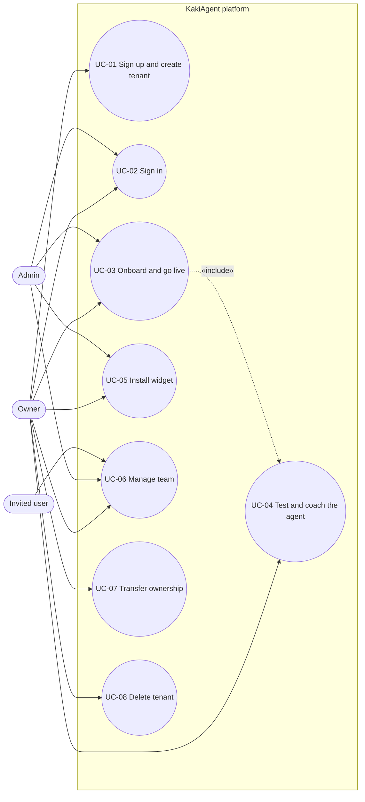
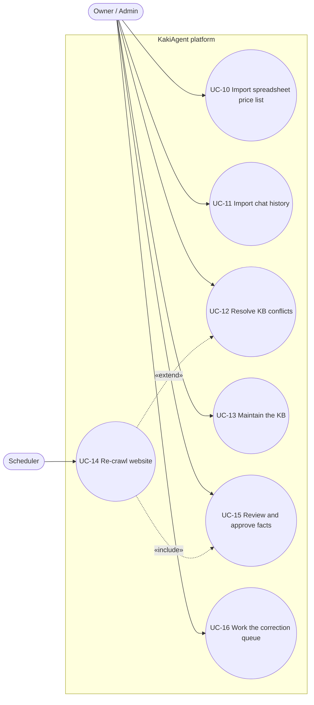
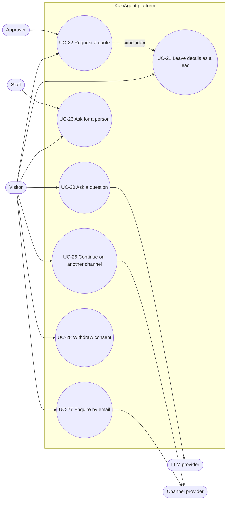
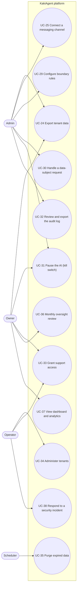

# Use-Case Specifications
## AI Customer Agent SaaS for Singapore SMEs — MVP

| Field | Value |
|---|---|
| Version | 0.4 (matches SRS v0.4, signed off 2026-10-19) |
| Date | 2026-10-19 |
| Source | [SRS.md](SRS.md) — requirement IDs below resolve there |
| Traceability | [rtm.md](rtm.md) |

Use cases describe goal-oriented journeys; the SRS holds the atomic requirements. Every use case lists the requirement IDs it realises under **Traces to**. Journeys J1–J11 in SRS §6 are built from these use cases (mapping in §9).

## Actors

| Actor | Kind | Notes |
|---|---|---|
| Owner | Primary, human | Tenant owner. Can do everything an Admin can, plus the Owner-only actions in SRS §2.1. |
| Admin | Primary, human | Tenant administrator. |
| Staff | Primary, human | Any tenant member working the inbox (Owner, Admin or Agent role). |
| Approver | Primary, human | Owner, Admin, or an Agent granted approval rights (D3). |
| Visitor | Primary, human | End customer of the SME, on any channel. |
| Operator | Primary, human | Platform operator (us). |
| AI Agent | System | The tenant's AI agent inside the platform boundary; shown as an actor where it drives a flow. |
| Scheduler | Secondary, system | Time-based jobs: re-crawl, purge, SLA timers, reminders. |
| Channel provider | Secondary, external | Telegram Bot API, Meta Graph API, email provider. |
| LLM provider | Secondary, external | Anthropic Claude (route per D5). |

---

## 1. Account and onboarding

### UC-01: Sign up and create a tenant
- **Actors:** Owner (primary)
- **Description:** A business owner creates an account and a tenant and lands in the onboarding wizard.
- **Preconditions:** The person is not signed in.
- **Postconditions (success):** A tenant exists on the trial plan, the person is its Owner, and acceptance of the current terms is recorded.
- **Traces to:** ONB-01, AUTH-01, AUTH-08, DSH-07, GOV-07

**Main success scenario**
1. Owner opens the sign-up page and chooses "Continue with email" or "Continue with Google".
2. For email, the system sends a single-use magic link valid for 15 minutes; the Owner opens it.
3. The system shows the Terms of Service, Acceptable Use Policy and DPA; the Owner accepts.
4. The system records the acceptance with document versions and a timestamp.
5. The system creates the tenant on the 14-day Growth trial (D10) and makes the person its Owner.
6. The system opens the onboarding wizard (UC-03).

**Alternate flows**
- 1a. The email already belongs to a user → the system signs them in and offers "Create another business" (AUTH-04 multi-tenant membership).
- 3a. The Owner declines the terms → no tenant is created; the account can be resumed later.

**Exception flows**
- 2a. Magic link expired or already used → the system rejects it and offers a new link.
- 2b. More than 5 link requests in 15 minutes → the request is refused with a "try again later" message.
- 2c. Email provider unavailable → the request is queued (NFR-17) and the user is told the link may be delayed.

### UC-02: Sign in and manage sessions
- **Actors:** Owner, Admin, Staff, Operator (primary)
- **Description:** A user signs in, optionally with MFA, and later signs out.
- **Preconditions:** The user has an active membership in at least one tenant (or is an Operator).
- **Postconditions (success):** An authenticated session exists for the chosen tenant.
- **Traces to:** AUTH-01, AUTH-02, AUTH-03, AUTH-04, AUTH-05

**Main success scenario**
1. User requests a magic link or uses Google.
2. The system verifies the link or Google identity.
3. If MFA is enrolled or required, the system asks for a TOTP code and verifies it.
4. If the user belongs to several tenants, the system shows the tenant switcher; the user picks one.
5. The system opens the dashboard.
6. Later, the user signs out, or signs out of all devices; the system ends the session(s).

**Alternate flows**
- 3a. The tenant requires MFA and the user has not enrolled → the system requires enrolment, shows recovery codes, then continues.
- 3b. User is an Operator → MFA is always required.
- 6a. Session idle for 12 hours or 30 days old → the system ends it and asks the user to sign in again.

**Exception flows**
- 2a. Link expired or reused → rejected; a new link can be requested.
- 3c. Wrong TOTP code 5 times → sign-in is blocked for 15 minutes; the user can use a recovery code.
- 4a. User's membership was deactivated → that tenant is not listed; if none remain, the user is told they have no active workspace.

### UC-03: Complete onboarding and go live
- **Actors:** Owner or Admin (primary); AI Agent, LLM provider (secondary)
- **Description:** The tenant builds a draft knowledge base from what it already has, sets boundaries and channels, and goes live.
- **Preconditions:** Tenant exists (UC-01). User is Owner or Admin.
- **Postconditions (success):** At least one channel is live and the bot answers real visitors.
- **Traces to:** ONB-02, ONB-03, ONB-04, ONB-06, ONB-08, ONB-09, ONB-10, KB-01, KB-05, KB-09, KB-12, KB-13, KB-16, APR-01, AGT-08, AGT-11, LED-02, GOV-14

**Main success scenario**
1. The system shows the wizard; the user fills in the business profile (name, UEN, industry, hours, contacts, languages, GST registration).
2. The system validates the UEN format and preloads SG public holidays.
3. The system applies the industry template (rules, lead fields, suggested FAQs).
4. The user pastes the website URL and confirms they own or are authorised to use the domain.
5. The system crawls the domain within the plan's page limit and extracts typed entities with provenance, showing progress per source.
6. Optionally the user adds files, spreadsheets (UC-10) and chat exports (UC-11).
7. The user reviews and approves the extracted facts (UC-15), resolves conflicts (UC-12) and checks the coverage report.
8. The user reviews boundary rules (safe defaults), persona, AI disclosure, PDPA purpose statement and privacy-notice link.
9. The user tests the bot (UC-04) and connects channels (UC-05, UC-25).
10. The user presses "Go live"; the system runs the readiness check, which passes.
11. The system switches the selected channels live and records the event in the audit log.

**Alternate flows**
- 1a. The user leaves the wizard → progress is saved; the wizard resumes at the same step next time.
- 4a. The tenant has no website → the user skips to files; KB-01 is not used.
- 7a. Conflicts remain unresolved → the readiness check shows warnings; the user may go live, and conflicting entities stay blocked.
- 10a. A required item is missing (profile, an approved fact, disclosure, purpose statement, privacy notice, current terms) → go-live is blocked and the missing item is linked.

**Exception flows**
- 4b. The user does not confirm authorisation → the crawl cannot start.
- 5a. Site blocks crawling (robots.txt) or pages fail → the pages are listed with reasons; the user may upload files instead.
- 5b. Pages exceed the plan limit → extra pages are listed as "skipped: plan limit" with an upgrade prompt.
- 5c. LLM provider unavailable → extraction is queued and retried (NFR-17); the source shows "queued".

### UC-04: Test and coach the agent
- **Actors:** Owner or Admin (primary)
- **Description:** From the dashboard, before or after go-live, the user chats with the agent, sees why it answered as it did, and teaches it corrections.
- **Preconditions:** At least one KB source is ready. The user is signed in to the dashboard as Owner or Admin.
- **Postconditions (success):** Confirmed corrections are approved facts; coaching conversations are excluded from analytics and fair use and never reach visitors.
- **Traces to:** ONB-05, AGT-17, AGT-01, AGT-02, AGT-04, KB-16, KB-18

**Main success scenario**
1. The user opens coaching mode and asks a question.
2. The AI Agent answers from approved facts (and, if the user chose, labelled unreviewed facts), checking prices and facts.
3. The system shows the answer with the facts used and why the agent answered that way.
4. The user replies with a correction, for example "price went up to $58 last month".
5. The agent turns it into a proposed fact change in the correction queue and asks the user to confirm.
6. The user confirms; the fact is approved and used in visitor answers within 60 seconds.
7. The system shows the old and new answers for affected past questions.

**Alternate flows**
- 2a. Question is out of scope → the agent says it will check with the team, exactly as it would live.
- 4a. The user edits a fact directly from its source link instead → the edit counts as approved.
- 4b. The user replays a real past conversation → the system re-answers it with the current KB and shows both versions.
- 5a. The user rejects the proposed change → nothing changes; the item is closed.

### UC-05: Install the widget
- **Actors:** Owner or Admin (primary)
- **Description:** The user adds the widget to their website and confirms it loads.
- **Preconditions:** Tenant has at least one allowed origin.
- **Postconditions (success):** The install check is green.
- **Traces to:** ONB-07, CHN-02, CHN-11, CHN-13, CHN-14

**Main success scenario**
1. The system previews the widget styled to match the site (colour, font, corner radius, light or dark mode).
2. The user keeps the match or overrides colour, logo and position.
3. The system shows the one-line snippet and platform-specific instructions.
4. The user adds the snippet to the site.
5. The system detects the widget loading on an allowed origin and turns the install check green; the widget follows the site's light or dark mode.

**Exception flows**
- 5a. The widget loads on an unlisted domain → it shows nothing; the install check explains that the domain must be added to allowed origins.

### UC-06: Manage the team
- **Actors:** Owner or Admin (primary); Invited user (secondary)
- **Description:** The user invites staff, sets roles and deactivates people.
- **Preconditions:** User is Owner or Admin.
- **Postconditions (success):** Membership and roles are updated and audited.
- **Traces to:** DSH-03, AUTH-04, AUTH-02, AUTH-03

**Main success scenario**
1. The user enters an email and a role and sends an invitation.
2. The system sends a single-use invite link valid for 7 days, bound to that email.
3. The invited user opens the link, signs in with that email and joins the tenant.
4. Later, the user changes a member's role or deactivates them; the system ends their sessions immediately.

**Alternate flows**
- 1a. The Owner grants approval rights to an Agent (D3).
- 1b. The Owner turns on "require MFA" for the tenant.

**Exception flows**
- 3a. Link opened by a different email, or expired → rejected; the inviter can resend.

### UC-07: Transfer ownership
- **Actors:** Owner (primary); Admin (secondary)
- **Preconditions:** The target is an active Admin.
- **Postconditions (success):** The target is the Owner; the old Owner is an Admin.
- **Traces to:** AUTH-06, AUTH-03

**Main success scenario**
1. The Owner chooses "Transfer ownership" and picks an Admin.
2. The system asks the Owner to re-authenticate.
3. The system notifies the Admin, who accepts.
4. The system swaps the roles and records the transfer in the audit log.

**Exception flows**
- 3a. The Admin declines or does not accept within 7 days → the transfer is cancelled.

### UC-08: Delete the tenant
- **Actors:** Owner (primary); Scheduler (secondary)
- **Preconditions:** The user is the Owner.
- **Postconditions (success):** After 30 days, all tenant data is removed from primary storage.
- **Traces to:** AUTH-07, AUTH-03, GOV-12

**Main success scenario**
1. The Owner chooses "Delete business"; the system offers a full data export (UC-24).
2. The Owner re-authenticates and confirms.
3. The system turns the AI off, disconnects channels and starts a 30-day grace period.
4. After 30 days the Scheduler hard-deletes all tenant data, including vector chunks and files, and keeps a PII-free deletion record.

**Alternate flows**
- 3a. The Owner restores the tenant within 30 days → everything returns, with channels to reconnect.

---

## 2. Knowledge base

### UC-10: Import a spreadsheet price list
- **Actors:** Owner or Admin (primary)
- **Preconditions:** Plan file limit not reached.
- **Postconditions (success):** Rows are imported as structured Product/Price records with provenance.
- **Traces to:** KB-02, KB-03, KB-05, KB-11, KB-12, KB-15, NFR-16

**Main success scenario**
1. The user uploads a CSV or XLSX file.
2. The system checks the content type and scans for malware.
3. The system suggests a mapping of columns to Product, Service, Price, Stock and SKU.
4. The user confirms or edits the mapping, including whether prices include GST.
5. The system imports valid rows and lists rejected rows with reasons.
6. The system runs conflict detection (UC-12) against existing entities.

**Alternate flows**
- 4a. Tenant is GST-registered and GST treatment is unknown → the prices are flagged for review and are not quoted until reviewed.

**Exception flows**
- 2a. File is unsafe, encrypted or not a spreadsheet → rejected with a reason.
- 5a. Every row fails validation → nothing is imported; the source shows "failed" with a retry option.

### UC-11: Import chat history and approve suggested FAQs
- **Actors:** Owner or Admin (primary)
- **Preconditions:** The user has a WhatsApp `.txt` or Telegram JSON export.
- **Postconditions (success):** Approved FAQs are live; visitor personal data from the export is not stored.
- **Traces to:** KB-04, KB-11, KB-12, GOV-04

**Main success scenario**
1. The user uploads the export.
2. The system checks and scans the file, redacts visitor personal data, mines question-and-answer pairs from the business's replies, and deletes the original file.
3. The system lists the pairs under "Suggested FAQs".
4. The user approves, edits or discards each one; approved FAQs go live.

**Exception flows**
- 2a. Format not recognised → the source fails with a reason and examples of supported formats.

### UC-12: Resolve KB conflicts
- **Actors:** Owner or Admin (primary)
- **Preconditions:** At least one conflict is flagged.
- **Postconditions (success):** The chosen value is active; the conflict is closed and audited.
- **Traces to:** KB-06, KB-07, GOV-01

**Main success scenario**
1. The system shows the "Resolve" list with both sources side by side.
2. The user picks one value, or enters a correct one.
3. The system activates the chosen value and records the decision in the audit log.

**Alternate flows**
- 2a. The user disables the entity instead → it is never used in answers.

### UC-13: Maintain the knowledge base
- **Actors:** Owner or Admin (primary)
- **Preconditions:** None.
- **Postconditions (success):** KB changes are live within 60 seconds and versioned.
- **Traces to:** KB-07, KB-09, KB-14, KB-12, KB-17

**Main success scenario**
1. The user browses or searches entities and documents.
2. The user edits, disables or deletes an entity, or adds an FAQ manually.
3. The system saves a new version and applies it to answers within 60 seconds.
4. The user reviews the coverage report and adds missing answers.

**Alternate flows**
- 2a. The user restores an earlier version of an entity → recorded in the audit log.
- 2b. A fact is overdue for confirmation → the user re-confirms it in one tap.

### UC-14: Re-crawl the website on schedule
- **Actors:** Scheduler (primary); Owner or Admin (secondary)
- **Preconditions:** Tenant has a crawled website source.
- **Postconditions (success):** Changed pages are re-extracted and changes are waiting for review.
- **Traces to:** KB-08, KB-01, KB-06, KB-12, KB-16

**Main success scenario**
1. Weekly, the Scheduler starts a re-crawl of the authorised domain.
2. The system re-extracts changed pages, shows a diff, and puts changed facts back to "needs review" (UC-15).
3. The system disables expired promotions automatically.
4. The user reviews the diff and accepts the changes.

**Exception flows**
- 2a. New values conflict with existing ones → they are flagged and blocked (UC-12).

### UC-15: Review and approve extracted facts
- **Actors:** Owner or Admin (primary)
- **Description:** The user checks facts extracted from websites, files and chat exports before the agent may use them.
- **Preconditions:** At least one fact is in "needs review".
- **Postconditions (success):** Reviewed facts are approved, edited and approved, or rejected; only approved facts reach visitors.
- **Traces to:** KB-16, KB-05, KB-06, KB-17, GOV-01, ONB-09

**Main success scenario**
1. The system lists facts waiting for review, prices, policies and promotions first, each next to its source passage, source date and extraction confidence.
2. The user approves a fact, edits and approves it, or rejects it.
3. The user approves the rest of one source, or of one entity type, in bulk.
4. The system records every decision with the approver and timestamp in the audit log, and approved facts are used in answers within 60 seconds.

**Alternate flows**
- 3a. The user trusts the extraction and chooses **Approve all** → the system shows how many facts of each type will be approved and asks for confirmation → the user confirms → all remaining facts are approved and the bulk action is audit-logged.
- 2a. Two sources disagree → the system shows both with their dates and suggests the newer one (UC-12).

**Exception flows**
- 3b. The user cancels the "Approve all" confirmation → nothing is approved.

### UC-16: Work the correction queue
- **Actors:** Owner or Admin (primary)
- **Description:** The user acts on signals that the KB may be wrong or incomplete.
- **Preconditions:** The queue has at least one open item.
- **Postconditions (success):** Each handled item has changed the KB or been closed with no change.
- **Traces to:** KB-18, KB-17, KB-09, AGT-15, AGT-17, INB-03, GOV-09, GOV-01

**Main success scenario**
1. The system shows open items with their source: visitor thumbs-down, staff reply to an escalation, staff edit of a suggested reply, owner coaching correction, oversight-review finding, stale fact or coverage gap.
2. The user opens an item and sees the conversation, the facts involved and the proposed fix.
3. The user accepts the fix, edits it, or closes the item with no change.
4. For an accepted fix, the system updates the fact (as approved), re-runs up to 20 past questions that used it, and shows the old and new answers side by side.
5. The change is recorded in the audit log.

**Alternate flows**
- 3a. The item is a stale fact → the user re-confirms it unchanged in one tap.
- 3b. The item is a coverage gap → the user adds a new FAQ.

---

## 3. Visitor conversations

### UC-20: Ask a question in the widget
- **Actors:** Visitor (primary); AI Agent, LLM provider (secondary)
- **Description:** A visitor asks a question in English, Singlish or Chinese and gets a grounded answer.
- **Preconditions:** The widget channel is live on an allowed origin; the AI is not paused.
- **Postconditions (success):** The answer is stored with the KB IDs it used, and the decision is in the audit log.
- **Traces to:** AGT-01, AGT-02, AGT-03, AGT-04, AGT-05, AGT-07, AGT-08, AGT-09, AGT-10, AGT-11, AGT-12, AGT-13, AGT-15, AGT-16, CHN-02, CHN-14, CHN-03, CHN-09, CHN-13, GOV-01, GOV-04, GOV-13, GOV-14, INB-08, KB-15, NFR-01

**Main success scenario**
1. The visitor opens the widget (or a proactive greeting appears after an intent signal).
2. The system shows the greeting with the AI disclosure, the privacy-notice link and a "talk to a person" option.
3. The visitor asks a question, for example "got eggless cake or not? how much ah".
4. The system masks NRIC, card and bank numbers in the message.
5. The AI Agent retrieves approved facts only, using page context where tracking allows, and drafts a reply in the visitor's language and register.
6. The system checks every price, stock, date and policy value against structured entities, then streams the reply.
7. The system stores the reply with its KB IDs and audit-logs the decision, tool calls and guardrail results.
8. The visitor rates the reply (optional) and the conversation auto-closes after 30 minutes of inactivity.

**Alternate flows**
- 1a. Tenant has consent mode on and the visitor has not accepted → only the current page is used as context.
- 5a. Out of scope or low confidence → the agent says it will check with the team and offers a person (UC-23) or lead capture (UC-21).
- 5b. After hours → the agent says when staff are back, still answers from the KB, and offers lead capture.
- 5c. Visitor attaches an image or PDF (if CHN-09 is enabled) → the file is checked and the agent may use it.
- 6a. A value does not match the KB → the reply is regenerated; if it still fails, the visitor is told the team will confirm, and the conversation is escalated.
- 6b. Tenant is GST-registered → prices are quoted GST-inclusive.

**Exception flows**
- 3a. Prompt-injection attempt → the agent refuses and keeps its rules; the attempt is audit-logged.
- 3d. The visitor claims to be the owner or staff, or asks for leads, other customers or internal settings → the agent gives only public business information and offers the normal contact options.
- 3b. Abusive or harmful content → safe reply; repeated abuse ends the AI conversation and flags it; self-harm mentions give SG crisis contacts and escalate.
- 3c. Visitor exceeds the message rate limit → polite refusal; no LLM call.
- 5d. LLM provider down → fallback "team will get back to you" plus lead capture (NFR-04).
- 5e. AI paused by the kill switch (UC-31) or a human has taken over → no AI reply.

### UC-21: Leave details as a lead
- **Actors:** Visitor (primary); AI Agent (secondary)
- **Preconditions:** A conversation is in progress.
- **Postconditions (success):** A lead with a consent record exists and is scored; hot leads alert the team.
- **Traces to:** LED-01, LED-02, LED-03, LED-04, LED-08, LED-09, AGT-06, CHN-08, DSH-09

**Main success scenario**
1. The agent decides to capture a lead (visitor interest, after hours, or out of scope).
2. The agent shows the tenant's purpose statement and asks for consent; the visitor agrees.
3. The system records consent with the wording and a timestamp.
4. The agent collects the configured fields and validates SG phone and email formats.
5. The system creates the lead, or updates the contact's open lead, and scores it with reasons.
6. For a hot lead, the system alerts users who subscribed, within 1 minute, respecting quiet hours.

**Alternate flows**
- 2a. Visitor declines consent → no personal data is stored; the agent continues answering questions.
- 2b. Visitor also opts in to marketing → the marketing-consent flag is recorded separately.
- 4a. Invalid phone or email → the agent asks again.
- 6a. It is within a user's quiet hours → the alert is held for the digest.

### UC-22: Request a quote or discount
- **Actors:** Visitor (primary); AI Agent, Approver (secondary)
- **Description:** The agent drafts a quote; a human decides before anything is sent.
- **Preconditions:** Boundary rules require approval for quotes or the discount exceeds the maximum.
- **Postconditions (success):** The approved, possibly edited, quote is delivered; each step is audited.
- **Traces to:** APR-01, APR-02, APR-03, APR-04, APR-06, AGT-06, LED-04, AUTH-03, GOV-01, INB-08

**Main success scenario**
1. The visitor asks for 200 corporate cupcakes with a discount.
2. The agent captures the lead (UC-21) and calls `draft_approval` with KB prices.
3. The system puts the draft in the approval queue and tells the visitor the team is checking, with an expected time.
4. The system alerts approvers by Telegram/email with a signed, single-use link.
5. An approver opens the link on their phone, signs in, edits the price and approves.
6. The system sends the approved quote to the visitor on the conversation's latest channel.
7. The system records the draft, the decision, the approver and the timestamps in the audit log.

**Alternate flows**
- 5a. Approver rejects with a reason → the visitor is told the team will follow up; staff can take over.
- 6a. The conversation has closed → the quote is sent on the latest channel; if the widget session is gone and no other channel is known, the approval is marked undeliverable and staff are alerted.
- 3a. Requested after hours → the visitor is told to expect a reply the next business day.

**Exception flows**
- 5b. Link expired or already used → rejected; the approver opens the queue in the app.
- 5c. Two approvers decide at the same time → the first decision wins; the second is told it was already decided.
- 5d. No decision within the SLA → the conversation is escalated (UC-23); after 7 days the approval expires and the visitor is told the team will contact them.

### UC-23: Ask for a person (escalation and takeover)
- **Actors:** Visitor (primary); Staff (secondary)
- **Preconditions:** A conversation is in progress.
- **Postconditions (success):** A staff member handled the conversation and handed it back or closed it.
- **Traces to:** INB-01, INB-02, INB-03, INB-04, INB-05, INB-06, INB-07, INB-08, INB-09, INB-10, INB-11, CHN-13, AGT-06, AGT-09, KB-18

**Main success scenario**
1. The visitor presses "talk to a person" or asks for one; the agent calls `escalate_to_human`.
2. The system routes the escalation (round-robin or named person) and notifies staff.
3. A staff member takes over; the AI pauses and the visitor sees "staff joined".
4. The staff member reads the sidebar, uses or edits AI-suggested replies, and adds internal notes.
5. The staff member hands back to the AI or closes the conversation.

**Alternate flows**
- 2a. After hours → the visitor is told when staff will respond and is offered lead capture.
- 2b. Nobody claims it within 10 minutes → reminders repeat until claimed.
- 4a. The staff answer fills a KB gap, or staff edit a suggested reply → the system adds a proposed fix to the correction queue (UC-16).

**Exception flows**
- 3a. Two staff take over at once → one succeeds; the other sees who owns it.

### UC-26: Continue on another channel
- **Actors:** Visitor (primary); Channel provider (secondary)
- **Preconditions:** The tenant has Telegram or email connected.
- **Postconditions (success):** The new thread is linked to the same contact and conversation.
- **Traces to:** CHN-05, CHN-07, CHN-08, AGT-06, AGT-12

**Main success scenario**
1. The visitor chooses "Continue on Telegram" in the widget.
2. The agent calls `handoff_channel`; the system shows a deep link carrying a one-time token.
3. The visitor opens Telegram and starts the bot.
4. The system verifies the token, links the Telegram ID to the contact and continues the conversation with its history.

**Alternate flows**
- 1a. Email instead → the visitor enters an email, verifies it, and the agent continues by email.

**Exception flows**
- 4a. Token expired → the bot starts a new conversation; staff can merge contacts manually.
- 3a. Visitor writes from a Telegram group → the bot replies that it works only in private chats.

### UC-27: Enquire by email
- **Actors:** Visitor (primary); Channel provider (secondary)
- **Preconditions:** Email channel is live.
- **Postconditions (success):** The visitor receives a threaded reply.
- **Traces to:** CHN-04, CHN-10, CHN-12, AGT-01, AGT-09, NFR-17, NFR-18

**Main success scenario**
1. The visitor emails the tenant's address.
2. The system checks for auto-replies, bulk mail and spam, stores and scans attachments.
3. The agent replies in the same thread from the KB.

**Alternate flows**
- 3a. After hours → reply from the KB plus "staff will follow up the next business day".

**Exception flows**
- 2a. Auto-reply, bounce or mailing-list mail → no AI response.
- 3b. Thread reaches 10 AI replies in 24 hours → AI stops and the conversation is escalated.
- 3c. Sending fails → queued and retried; after 24 hours staff see it as failed.

### UC-28: Withdraw consent
- **Actors:** Visitor (primary); AI Agent (secondary); Owner/Admin (secondary)
- **Preconditions:** The contact has given consent before.
- **Postconditions (success):** Withdrawal is recorded; the lead is excluded from exports and webhooks.
- **Traces to:** LED-07, LED-05, LED-06, GOV-05

**Main success scenario**
1. The visitor writes "pls don't keep my number" on any channel.
2. The agent recognises a withdrawal and asks the visitor to confirm.
3. The system records the withdrawal, marks the lead "consent withdrawn" and alerts the tenant.

**Alternate flows**
- 2a. The visitor asks for deletion, not just withdrawal → the system opens a data-subject request (UC-30).
- 1a. The visitor contacts the tenant directly → staff record the withdrawal on the contact.

---

## 4. Governance, privacy and administration

### UC-24: Export tenant data
- **Actors:** Owner or Admin (primary)
- **Traces to:** GOV-12, LED-05, AUTH-03, GOV-01
- **Main success scenario:** 1. The user requests a full export (or a leads CSV). 2. The system asks for re-authentication. 3. The system builds the export in the background and sends a link valid for 24 hours. 4. The export is recorded in the audit log.
- **Exception flows:** 3a. Export fails → the user is alerted and can retry.

### UC-25: Connect a messaging channel
- **Actors:** Owner or Admin (primary); Channel provider (secondary)
- **Preconditions:** The plan allows another channel.
- **Postconditions (success):** The channel is connected and can be set live.
- **Traces to:** CHN-01, CHN-04, CHN-05, CHN-06, CHN-12, DSH-04, LED-04

**Main success scenario**
1. The user chooses Telegram, Messenger/Instagram or a custom email domain.
2. Telegram: the user pastes a BotFather token. Meta: the user connects a Page/IG account. Email: the user adds DNS records.
3. The system verifies the credential (or SPF/DKIM/DMARC) and stores it as a secret.
4. The channel shows "connected"; the user can set it live (ONB-10) and route alerts to Telegram.

**Alternate flows**
- 1a. Plan limit reached → upgrade prompt.

**Exception flows**
- 3a. Invalid token or DNS not verified → error naming what to fix.
- 4a. Later revoked → detected within 15 minutes, shown as degraded, Owner/Admin alerted (CHN-12).

### UC-29: Configure boundary rules
- **Actors:** Owner or Admin (primary)
- **Traces to:** APR-01, AUTH-03, GOV-01, ONB-06
- **Main success scenario:** 1. The user opens boundary rules (pre-filled with safe defaults or the industry template). 2. The user edits allowed/blocked topics, maximum discount, quote approval and forbidden commitments. 3. The system asks for re-authentication, saves the rules, applies them to the next reply and records the change in the audit log.

### UC-30: Handle a data-subject request
- **Actors:** Owner or Admin (primary); Visitor (requester)
- **Description:** A contact asks for access to, correction of, or deletion of their personal data.
- **Preconditions:** A request has been received through any channel or directly.
- **Postconditions (success):** The request is fulfilled within 30 days and recorded; the audit chain still verifies.
- **Traces to:** GOV-05, GOV-01, GOV-04, LED-07, AUTH-03

**Main success scenario**
1. The Admin logs the request, its type and the date received; the system sets a due date 30 calendar days later.
2. The Admin verifies the requester's identity and records how.
3. The Admin searches by email, phone or Telegram ID; the system lists matching data across conversations, leads, KB items and attachments.
4. For deletion: the Admin re-authenticates and confirms; the system deletes the data, including vector chunks and attachments, from primary storage immediately, and deletes linked personal data in the audit store.
5. The system records the action in the audit log; the hash chain still verifies.
6. The Admin tells the requester the outcome.

**Alternate flows**
- 4a. Access request → the system builds an export of the contact's data.
- 4b. Correction → the Admin edits the data; the change is audited.

**Exception flows**
- 2a. Identity cannot be verified → the request is closed as "unverified" with the reason.
- 1a. 7 days before the due date and not closed → the Owner/Admin is alerted.

### UC-31: Pause the AI (kill switch)
- **Actors:** Owner or Admin (primary)
- **Traces to:** GOV-08, GOV-01, INB-02
- **Main success scenario:** 1. The user presses "Pause AI" on the dashboard or mobile inbox. 2. Within 5 seconds, every channel stops AI replies and shows the fallback message with lead capture. 3. Staff answer manually from the inbox. 4. The user presses "Resume AI". Both events are audit-logged.

### UC-32: Review and export the audit log
- **Actors:** Owner or Admin (primary)
- **Traces to:** GOV-01, GOV-02, AUTH-03
- **Main success scenario:** 1. The user filters the audit log by conversation, date range, actor or event type. 2. The user runs the chain verification; the system reports intact or the first broken entry. 3. The user exports CSV/JSON after re-authentication; 30 days of data completes within 1 minute.

### UC-33: Grant and use support access
- **Actors:** Owner (primary); Operator (secondary)
- **Traces to:** DSH-06, DSH-10, AUTH-03, GOV-01
- **Main success scenario:** 1. The Owner contacts support (DSH-10) and grants time-limited support access after re-authentication. 2. The Operator views tenant content only within the grant. 3. When the grant expires or is revoked, access ends. 4. Every operator action is in the tenant-visible audit log.

### UC-34: Administer tenants
- **Actors:** Operator (primary)
- **Traces to:** DSH-04, DSH-06, DSH-07, DSH-08, GOV-13, AUTH-03
- **Main success scenario:** 1. The Operator signs in with MFA. 2. The Operator lists tenants with health, usage and fair-use status. 3. The Operator changes a plan (after the trial, or on request), or suspends a tenant for an Acceptable Use Policy breach. 4. The system enforces new limits and audits the action.
- **Alternate flows:** 3a. Downgrade over limits → the Owner chooses which sources to pause and channels to disconnect; nothing is deleted.

### UC-35: Purge expired data
- **Actors:** Scheduler (primary)
- **Traces to:** GOV-06, GOV-01
- **Main success scenario:** 1. Daily, the Scheduler finds conversations, attachments and leads past the tenant's retention period. 2. The system deletes them from primary storage. 3. The system records the purge (counts, not content) in the audit log.

### UC-36: Monthly oversight review
- **Actors:** Owner (primary)
- **Traces to:** GOV-09, APR-05, AGT-15, KB-18
- **Main success scenario:** 1. Monthly, the system asks the Owner to review a sample of AI conversations. 2. The Owner marks each as fine or problematic, adding notes. 3. The system records completion; each problem becomes an item in the correction queue (UC-16).

### UC-37: View dashboard and analytics
- **Actors:** Owner, Admin; Agent (own stats only)
- **Traces to:** DSH-01, DSH-02, DSH-05, DSH-08, DSH-09, APR-05, KB-09
- **Main success scenario:** 1. The user opens the home dashboard (data at most 5 minutes old). 2. The user filters analytics by date and exports CSV. 3. The Owner downloads the EIS expense report. 4. The user checks usage against plan limits and adjusts notification preferences.

### UC-38: Respond to a security incident
- **Actors:** Operator (primary)
- **Traces to:** GOV-10, NFR-20, NFR-11
- **Main success scenario:** 1. An alert or report raises a suspected breach; the Operator records it. 2. The Operator assesses scope following the runbook. 3. If tenant data is affected, the Operator notifies each affected tenant within 24 hours of confirming it, with the facts needed for their PDPC notification. 4. Notifications and timings are recorded.

---

## 9. Journey to use-case mapping

| Journey (SRS §6) | Use cases |
|---|---|
| J1 Onboard | UC-01, UC-03, UC-10, UC-11, UC-12, UC-15, UC-04, UC-05 |
| J2 Visitor Q&A (Singlish) | UC-20 |
| J3 Quote approval | UC-21, UC-22 |
| J4 Takeover | UC-23 |
| J5 Channel handoff | UC-26 |
| J6 PDPA deletion | UC-30 |
| J7 Chinese enquiry | UC-20 |
| J8 Kill switch | UC-31 |
| J9 After-hours email | UC-27, UC-21 |
| J10 Consent withdrawal | UC-28 |
| J11 Owner coaching | UC-04, UC-16 |

Use-case numbers are grouped by area and have gaps (UC-09, UC-17–19) left free for later additions in the same area. Like requirement IDs, use-case IDs are never reused.
