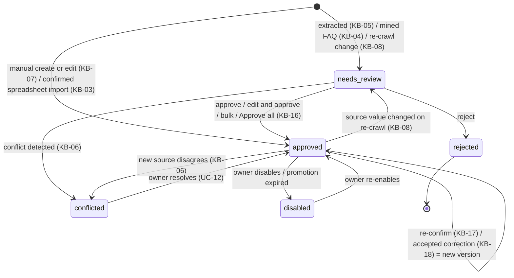

# ADR-010: Fact lifecycle, the review gate and the correction queue

**Status:** Proposed (awaiting product-owner sign-off)
**Date:** 2026-10-19
**Requirements addressed:** KB-16, KB-17, KB-18, KB-03, KB-04, KB-05, KB-06, KB-07, KB-08, KB-09, KB-14, KB-15, AGT-15, AGT-17, INB-03, GOV-09, GOV-01, ONB-09, D11, UC-12, UC-13, UC-14, UC-15, UC-16

**Context**
Four owner-facing mechanisms touch KB correctness and are easy to blur:
- **Fact review (KB-16, D11):** the gate between *extraction* and *use*. Every extracted fact starts as "needs review", with single, bulk and "Approve all" approval, all audit-logged.
- **Stale facts (KB-17):** approved facts not re-confirmed within an interval are flagged, but stay in use.
- **Correction queue (KB-18):** one queue of *signals* that the KB may be wrong or incomplete (thumbs-down, staff replies and edits, coaching corrections, oversight findings, stale facts, coverage gaps), each with a proposed fix that changes nothing until accepted, followed by a replay of up to 20 past questions.
- **Coaching mode (AGT-17):** a *source* of correction proposals and a test bench (ADR-009), not a separate way to edit the KB.

**Decision**
1. **One `facts` table with an explicit status machine and immutable versions** (`fact_versions`, KB-14):

   Flags that are **not** statuses: `stale` (KB-17, computed from `last_confirmed_at` and the per-type interval; the fact stays usable), `gst_unknown` (KB-15; blocks quoting the price until reviewed), and `confidence`.
2. **Only `approved`, enabled, not `gst_unknown`-blocked, unexpired facts are visible to the visitor agent**, through the `visitor_facts` view that the visitor database role is limited to (ADR-005, ADR-009). The chunk index stores the fact status with each chunk and is filtered by it, so approval or rejection takes effect in retrieval in the same transaction (within KB-07's 60 seconds).
3. **Bulk approval is a server-side command, not a client loop.** "Approve all" first returns a preview (counts by entity type, excluding conflicted and `gst_unknown` facts, which always need individual action), then executes with the preview's hash so it approves exactly what was shown. It writes one audit entry per fact plus one summary entry carrying the approver, the timestamp and the count (KB-16).
4. **The correction queue is a separate table, `corrections`**, of proposals: `{source_type, conversation_ref, fact_refs[], proposed_change (edit fact | add FAQ | no change), proposed_by (system | coaching | staff), status (open | accepted | edited_and_accepted | dismissed)}`. Producers append and never touch `facts`: the AGT-15 feedback handler, the inbox (staff reply to an escalated question, or staff edit of a suggested reply, INB-03), coaching `propose_correction` (AGT-17), the GOV-09 review screen, the KB-17 stale scanner (daily) and the KB-09 coverage-gap job (weekly). Similar open items are de-duplicated by fact and topic.
5. **Accepting a correction** creates a new `fact_versions` row with status `approved` (approver, timestamp), writes the audit entry, and enqueues a **replay job**. The job selects up to 20 past visitor questions whose stored answers cited the changed fact IDs (AGT-01 stores the IDs), re-answers them in coaching scope with tools stubbed, and stores old/new pairs for side-by-side display. Coaching corrections that the owner confirms in the coaching thread are accepted the same way, so J11 meets AGT-17's 60-second target.
6. **Re-crawl diffs (KB-08)** produce new `needs_review` versions for changed values, while the previously approved version stays live until the new one is approved. A changed value is not used until approved.
7. **Go-live readiness (ONB-09)** reads counts from this model: at least one approved fact is required; `needs_review` and `conflicted` counts are shown as warnings.

**Options considered**
- **Status machine on facts + separate proposal queue (chosen)** — a single place decides visitor visibility (the view), and every path into "approved" is explicit and audited. Con: the extra queue table and producers.
- **Treat corrections as facts in `needs_review`** — fewer tables. Lost: KB-18 items can be "no change" or "add FAQ", they link to conversations, and KB-17 requires stale facts to stay *in use*. Folding them into the fact status would remove a live fact from answers or conflate two queues.
- **Let coaching edit facts directly** — fastest for the owner. Lost: AGT-17 requires a confirmation step and KB-18 requires a single queue; direct edits would bypass replay.

**Consequences**
Owners see two inboxes with distinct meanings: **Review** ("new facts waiting to go live") and **Corrections** ("signals that something live may be wrong"). Both counts appear on the home dashboard (DSH-01). The visitor path depends on one view definition, which gets dedicated tests asserting that no `needs_review`, `rejected`, `conflicted` or `disabled` fact ever appears (KB-16 acceptance).
