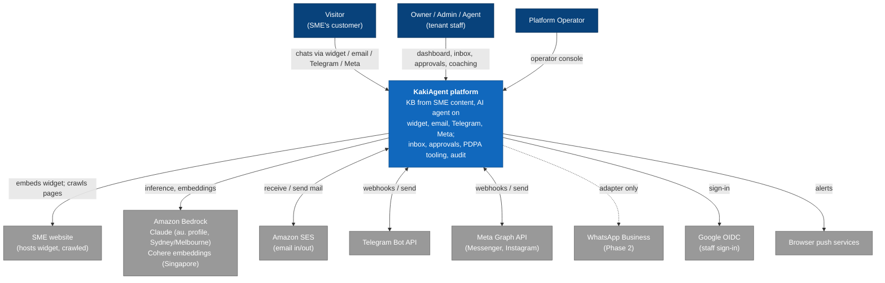
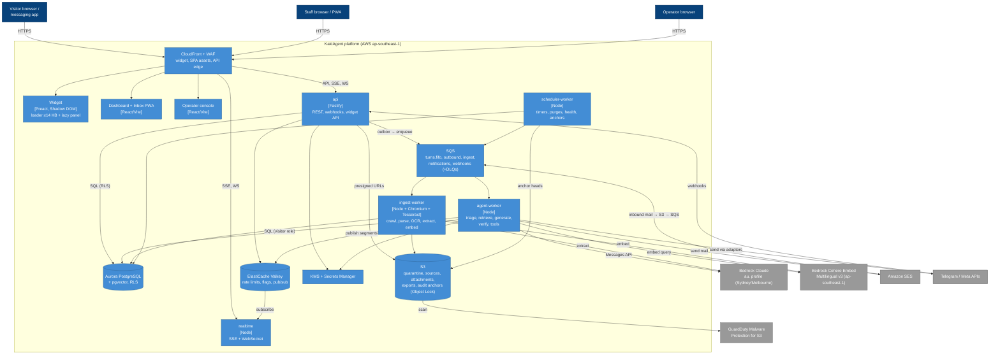
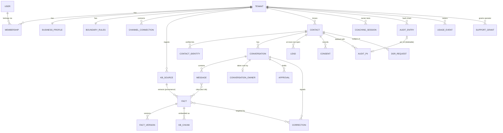
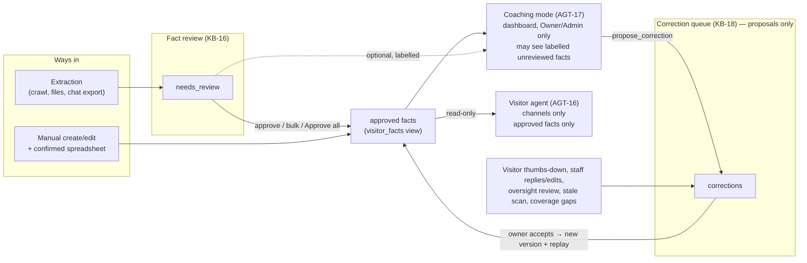
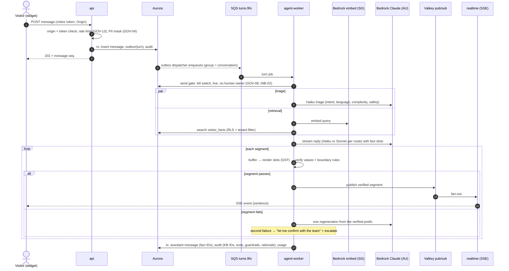
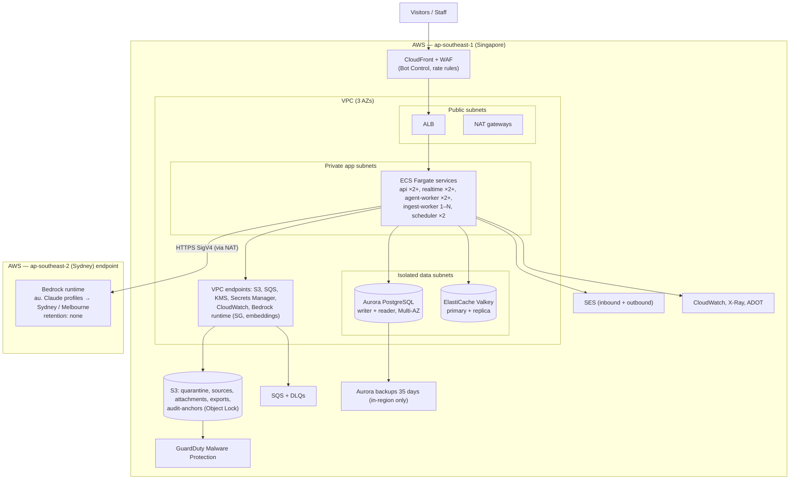

# Architecture: KakiAgent MVP

> Status: **Approved** — signed off by the product owner on 2026-10-19 · Last updated: 2026-10-19 · Author: Claude (for the product owner)
> Inputs (signed off, read-only): [SRS v0.4](../01-requirements/SRS.md), [use cases](../01-requirements/use-cases.md), [RTM](../01-requirements/rtm.md) · Decisions: [ADR-001 … ADR-022](adr/)

---

## Questions for product-owner sign-off

**Answered by the product owner on 2026-10-19.** The document below reflects these decisions.

| # | Decision |
|---|---|
| Q1 | **Bedrock Australia (`au.` profile)**, retention "none", no automatic failover to Global. Development may use an Anthropic API key with test data only; real visitor data goes only through the production route. |
| Q2 | **Haiku 5.5 by default, Sonnet 5.5 for complex turns**, with the cost governor. Added design consideration: **the model router is a separate component, so another provider can be added later without redesign** (ADR-007 decision 5, §5.2 `llm-gateway`). |
| Q3 | AWS-only sub-processor list with self-hosted Tesseract OCR. Chinese OCR is best-effort (most SME documents are English); KB-02 is unchanged. |
| Q4 | Shadow DOM in the host page. |
| Q5 | Keep the PII-free audit chain for 12 months after tenant deletion, then delete it. |
| Q6 | No stock counts unless the owner turns on "quote stock" (shown "as of <date>"). |
| Q7 | Sentence-at-a-time verified streaming; NFR-01 "first token" = first verified sentence. |

The original questions, with the alternatives that were weighed, follow for the record.

| # | Question | Recommendation | Alternatives and trade-off | ADR |
|---|---|---|---|---|
| **Q1** | **Where Claude processes visitor conversations (D5).** Live AWS and Anthropic docs (checked 2026-10-19) show **no route that processes Claude Sonnet 5.5 or Haiku 5.5 in Singapore**. From Singapore, Bedrock offers only a *Global* profile (any AWS commercial Region worldwide), and the Anthropic API offers only "global" or "US". The only APAC-only route is Bedrock's **Australia profile** (Sydney and Melbourne). | **Bedrock `au.` profile**, retention set to "none", no automatic failover to Global. The DPA says "stored in Singapore, processed transiently in Australia, not retained". | (a) **Bedrock Global**: about 10% cheaper, but processing may happen anywhere in the world. (b) **Anthropic API**: best feature parity, processing in the US or worldwide. (c) Australia by default **plus** an automatic Global failover during an Australian outage: higher availability, but the DPA must then also declare worldwide processing. | [ADR-006](adr/ADR-006-claude-inference-route-and-processing-location.md) |
| **Q2** | **LLM cost per conversation (D6, NFR-13).** At current list prices, the base case (4 turns, 25% of turns on the larger model) is about **S$0.022**. Haiku-only is about S$0.004 and Sonnet-only about S$0.058. Long catering conversations can reach S$0.04–0.08 each. | Accept routing: **Haiku 5.5 by default and Sonnet 5.5 for complex turns**, plus a **cost governor** that automatically sends fewer turns to Sonnet for a tenant whose 7-day average exceeds S$0.025. The S$0.03 target holds as a platform average. | Sonnet for everything (about twice the target), or hard per-tier caps (D6 rejected these). The estimate assumes the Bedrock Australia price is list price + 10% and US$1 = S$1.35; both are to be confirmed. | [ADR-007](adr/ADR-007-model-routing-prompt-caching-and-cost.md) |
| **Q3** | **Sub-processors and OCR (GOV-07).** Textract cannot read Chinese. | **AWS-only list:** Bedrock for LLM and embeddings, SES for email, GuardDuty for malware scanning, plus Google for tenant-user sign-in only. **OCR runs on our own servers (Tesseract)** in Singapore. | Claude vision for OCR: better on poor Chinese scans, but documents would be processed in Australia and cost more. | [ADR-019](adr/ADR-019-sub-processors-embeddings-ocr-email-malware.md) |
| **Q4** | **Widget isolation (CHN-14).** | **Shadow DOM in the host page.** It gives the best theme and font match and the smallest bundle. | Iframe: stronger isolation from the tenant's own page scripts, but host web fonts often cannot load, so the theme match is weaker. | [ADR-016](adr/ADR-016-widget-loader-shadow-dom-and-theme-detection.md) |
| **Q5** | **Audit log after tenant deletion.** D7 keeps audit entries for "life of the tenant plus 12 months", but AUTH-07 hard-deletes "all tenant data" 30 days after deletion. | Keep the **PII-free** audit chain for 12 months after deletion in a locked archive, then delete it. Everything else is deleted at day 30. | Delete the audit chain at day 30 with everything else (follows AUTH-07 literally, but loses the evidence trail D7 wanted). | [ADR-014](adr/ADR-014-hash-chained-pii-free-audit-log.md), OI-5 |
| **Q6** | **Stock levels in answers (AGT-02).** Stock in an uploaded spreadsheet goes stale within days. | In the MVP, the agent says "available" or "please check with us", **never a stock count**, unless the owner turns on "quote stock", which adds "as of <date>". | Quote imported stock counts as facts, which risks stale answers. | [ADR-008](adr/ADR-008-fact-slots-and-verified-segment-streaming.md), OI-2 |
| **Q7** | **How streaming looks (CHN-02 with AGT-02).** To guarantee no unchecked price is ever shown, replies appear **a sentence at a time** rather than word by word. NFR-01's "first token" would be measured as the first checked sentence. | Accept. The first sentence typically appears 1–2 seconds after the visitor sends a message. | Word-by-word streaming cannot meet AGT-02's "never displayed, even briefly". | [ADR-008](adr/ADR-008-fact-slots-and-verified-segment-streaming.md), OI-1 |

---

## 1. Introduction and goals

KakiAgent is a multi-tenant SaaS for Singapore SMEs. It builds a knowledge base from an SME's website, files and chat exports, puts approved facts behind an AI customer agent on a web widget, email, Telegram and Meta channels, and wraps the agent in human takeover, approvals, PDPA tooling and IMDA-aligned governance. Requirements are in the [SRS](../01-requirements/SRS.md); this document says **how** the MVP meets them.

**Top quality goals (ranked):**
1. **Trustworthy answers.** No invented or unapproved prices, facts or commitments (AGT-01, AGT-02, AGT-16, KB-16, APR-02). Research finding P2 rates this the biggest adoption risk.
2. **Privacy and isolation.** Data at rest in Singapore, PDPA deletion that actually deletes, tenant isolation in the database (NFR-07, GOV-03, GOV-04, GOV-05, GOV-11, D5, D7).
3. **Unit economics and responsiveness.** ≤ S$0.03 LLM cost per conversation on average (NFR-13, D6), first reply text p95 ≤ 3 s (NFR-01), 99.5% availability (NFR-04).

**Stakeholders:** the product owner (sign-off), tenant Owners/Admins/Agents (trust, speed, mobile use), visitors (fast and correct answers, privacy), Platform Operators (operability, no casual access to tenant data), and future auditors (IMDA pre-approval, Cyber Essentials).

## 2. Constraints

| Constraint | Source | Effect on the design |
|---|---|---|
| TypeScript full stack | C1 | Node.js services, React/Preact front ends; no Python services, so OCR uses the Tesseract binary rather than PaddleOCR (ADR-002, ADR-019) |
| AWS ap-southeast-1 for all data at rest, including backups | C1, NFR-07, GOV-11 | Single-region deployment; an SCP denies data stores elsewhere (ADR-003) |
| Claude under zero-retention terms; transient processing outside SG allowed if declared | C2, C4, D5 | Bedrock Australia profile with retention "none" (ADR-006) |
| Terraform, monorepo, CI with an AI eval gate, ≥ 70% coverage on core packages | NFR-12 | ADR-001, ADR-003, ADR-022, §8.7 |
| Meta app review before Instagram/Messenger go live | C3 | Meta adapters run in sandbox; go-live is a configuration flag (ADR-011) |
| Pilot scale: ≤ 20 staff per tenant, < 5,000 conversations a month each; 200 tenants; 1,000 concurrent conversations | A1, NFR-03 | Modular monolith with role-based scaling; one Postgres cluster (ADR-001, ADR-004) |
| Design phase only | Process | No code or scaffolding here; contracts are sketched only where a decision depends on them |

## 3. Context and scope



**System boundary.** Inside: everything in §5. Outside: the tenant's website (we only embed and crawl it), channel providers (chosen by the tenant), AWS managed AI services (sub-processors, §8.1), and Google sign-in.

**Key external interfaces.**

| Interface | Direction | Protocol | Notes |
|---|---|---|---|
| Widget ↔ API | both | HTTPS `POST` + SSE | Origin-checked, short-lived visitor token (ADR-016, ADR-017) |
| Telegram, Meta | both | HTTPS webhooks (signature/secret verified) + REST send | Via channel adapters (ADR-011) |
| Email | both | SES inbound receipt rules → S3 → SQS; SES outbound with DKIM/SPF/DMARC | CHN-04, CHN-10, NFR-18 |
| Bedrock | out | HTTPS SigV4 to `bedrock-runtime` (ap-southeast-2 for Claude, ap-southeast-1 for embeddings) | ADR-006, ADR-019 |
| Google | both | OIDC authorisation code + PKCE | AUTH-01 |
| Outbound webhooks (LED-06) | out | HTTPS POST, HMAC-signed, retried | Plan-gated |

## 4. Solution strategy

| # | Fundamental decision | ADR |
|---|---|---|
| 1 | One TypeScript monorepo, built as a modular monolith and deployed as five runtime roles (api, realtime, agent-worker, ingest-worker, scheduler-worker) | [ADR-001](adr/ADR-001-modular-monolith-monorepo.md), [ADR-002](adr/ADR-002-typescript-application-stack.md) |
| 2 | AWS ap-southeast-1, three AZs, ECS Fargate, Terraform, GitHub Actions with OIDC | [ADR-003](adr/ADR-003-aws-singapore-ecs-fargate-terraform.md) |
| 3 | Aurora PostgreSQL + pgvector as the only system of record; Valkey for ephemeral data only | [ADR-004](adr/ADR-004-aurora-postgres-pgvector-system-of-record.md) |
| 4 | Tenant isolation by forced RLS, per-trust-zone DB roles, tenant-filtered vector search | [ADR-005](adr/ADR-005-tenant-isolation-rls-and-filtered-vector-search.md) |
| 5 | Claude via Bedrock's Australia profile; nothing stored outside Singapore | [ADR-006](adr/ADR-006-claude-inference-route-and-processing-location.md) |
| 6 | Haiku triage → Haiku/Sonnet reply, cache-friendly prompts, per-tenant cost governor; the router is a separate, provider-neutral `llm-gateway` component | [ADR-007](adr/ADR-007-model-routing-prompt-caching-and-cost.md) |
| 7 | Protected values rendered from KB slots; deterministic verifier; release a sentence at a time | [ADR-008](adr/ADR-008-fact-slots-and-verified-segment-streaming.md) |
| 8 | Visitor scope vs coaching scope fixed by entry point and enforced by types and DB grants | [ADR-009](adr/ADR-009-agent-scopes-visitor-vs-coaching.md) |
| 9 | Fact status machine + separate correction queue; one view decides visitor visibility | [ADR-010](adr/ADR-010-fact-lifecycle-review-gate-and-correction-queue.md) |
| 10 | Capability-described `ChannelAdapter`s behind canonical events | [ADR-011](adr/ADR-011-channel-adapter-contract.md) |
| 11 | Transactional outbox + SQS (FIFO per conversation) + Postgres timers | [ADR-012](adr/ADR-012-async-processing-sqs-outbox-scheduler.md) |
| 12 | Database-enforced state machines for conversations, takeovers, approvals; one AI send gate | [ADR-013](adr/ADR-013-conversation-takeover-and-approval-state-machines.md) |
| 13 | Per-tenant hash-chained audit log with no PII + deletable `audit_pii` + S3 Object Lock anchors | [ADR-014](adr/ADR-014-hash-chained-pii-free-audit-log.md) |
| 14 | Mask identifiers at the edge; PII only in contact-keyed tables; DSR workflow | [ADR-015](adr/ADR-015-pii-masking-pii-store-and-data-subject-deletion.md) |
| 15 | Widget: 14 KB loader, closed Shadow DOM, runtime theme detection, lazy panel | [ADR-016](adr/ADR-016-widget-loader-shadow-dom-and-theme-detection.md) |
| 16 | SSE to widget, WebSocket to dashboard, Valkey pub/sub fan-out, Postgres for durability | [ADR-017](adr/ADR-017-realtime-sse-widget-websocket-inbox.md) |
| 17 | Ingestion: quarantine → parse/OCR → extract → stage → atomic promote | [ADR-018](adr/ADR-018-ingestion-pipeline.md) |
| 18 | Sub-processors: AWS only (plus Google sign-in); self-hosted OCR | [ADR-019](adr/ADR-019-sub-processors-embeddings-ocr-email-malware.md) |
| 19 | Self-hosted auth on Postgres; server-side sessions; re-auth windows | [ADR-020](adr/ADR-020-authentication-sessions-and-authorization.md) |
| 20 | OpenTelemetry → CloudWatch/X-Ray; per-tenant usage ledger | [ADR-021](adr/ADR-021-observability-and-usage-metering.md) |
| 21 | AI evaluation gate in CI on the real pipeline | [ADR-022](adr/ADR-022-ai-evaluation-gate-in-ci.md) |

## 5. Building block view

### 5.1 Container view (C4 level 2)



| Container | Responsibility | Scales on | Key ADRs |
|---|---|---|---|
| **Widget** | Loader, theme detection, tracking, launcher; lazy chat panel; SSE client | CDN | ADR-016, ADR-017 |
| **Dashboard PWA / Operator console** | All tenant and operator UI; coaching chat; review and correction queues | CDN | ADR-002, ADR-009, ADR-010 |
| **api** | Auth, REST, widget API (origin and token checks, rate limits), channel webhooks, presigned uploads; writes state + outbox | CPU, RPS | ADR-005, ADR-011, ADR-020 |
| **realtime** | Holds SSE and WebSocket connections; resumes from Postgres sequence numbers | connections | ADR-017 |
| **agent-worker** | Conversation turns: send gate → triage → retrieval → generation → slot render → verify → release; tools; suggested replies; coaching; replay | queue age | ADR-007, ADR-008, ADR-009, ADR-013 |
| **ingest-worker** | Crawls, file safety, parsing/OCR, extraction, conflict detection, embeddings, theme preview | queue age | ADR-018, ADR-019 |
| **scheduler-worker** | Timers (SLA, auto-close, reminders, expiry), recurring jobs (re-crawl, stale scan, purge, DSR alerts, health checks), audit anchoring | fixed (2) | ADR-012, ADR-014 |
| **Aurora** | System of record incl. vectors, audit chain, timers, outbox | Serverless v2 ACUs | ADR-004, ADR-005, ADR-014 |
| **Valkey** | Rate limits, kill-switch cache, session cache, pub/sub | node size | ADR-004, ADR-017 |

### 5.2 Domain modules (inside the monolith)

| Module | Owns | Public interface (examples) |
|---|---|---|
| `identity` | users, memberships, sessions, MFA, invites, terms acceptance, operators, support grants | `authenticate`, `requireReauth`, `can(role, capability)` |
| `tenancy` | tenants, business profile, plans/limits (stub), go-live readiness | `readiness(tenant)`, `limits(tenant)` |
| `kb` | sources, facts, versions, chunks, conflicts, corrections, replay | `visitorFacts.search`, `approve`, `approveAll(previewHash)`, `proposeCorrection` |
| `agent` | prompts, retrieval orchestration, slot renderer, verifier, tools, scopes (calls models only through `llm-gateway`) | `runVisitorTurn`, `runCoachingTurn`, `suggestReply` |
| `channels` | adapters, connections, credentials, health, contact identity | `ChannelAdapter`, `resolveContact` |
| `inbox` | conversations, messages, state machine, takeover, notes, tags, search | `transition`, `takeOver`, `search` |
| `leads` | leads, consents, scoring, exports, webhooks | `captureLead`, `withdrawConsent` |
| `approvals` | boundary rules, approvals, links, SLA | `draft`, `decide`, `expire` |
| `governance` | audit chain, PII store, DSR, retention, kill switch, incidents | `audit.append`, `dsr.*`, `killSwitch` |
| `analytics` | dashboards, usage ledger, EIS report | `usage.record`, `metrics.*` |
| `llm-gateway` | `ModelRouter` (logical model per request, tenant thresholds, cost governor), `ModelProvider` interface + Bedrock Claude provider, model registry, usage capture. A new provider = one provider module + registry entries; no other module changes (ADR-007 decision 5) | `route(purpose, ctx)`, `generate`, `stream` |
| `platform` (shared) | outbox, queues, timers, pii-mask, telemetry, config | — |

### 5.3 Logical domain model



Notes:
- **FACT.status** ∈ {needs_review, approved, rejected, conflicted, disabled}, with flags `stale`, `gst_unknown` (ADR-010). Only rows in the `visitor_facts` view reach visitors.
- **CORRECTION** is a proposal, never an edit. Accepting one creates a FACT_VERSION.
- **COACHING_SESSION** is a separate entity from CONVERSATION, so it is excluded from analytics and fair use by construction (ADR-009).
- **AUDIT_ENTRY** holds IDs, masked values and hashes; AUDIT_PII holds the personal data and is deleted with the CONTACT (ADR-014).
- Every entity except USER and the platform tables carries `tenant_id` under RLS (ADR-005). Entities with personal data carry `contact_id` (ADR-015).

### 5.4 Separation of fact review, correction queue, coaching and visitor scope

This is the KB-16 / KB-18 / AGT-16 / AGT-17 boundary, shown in one picture:



- **Fact review** gates *new* knowledge on its way in. **The correction queue** collects *signals* about live knowledge. **Coaching** is a test bench and one source of signals. **The visitor scope** is a read-only consumer of the approved view.
- Only two things change what visitors see: an approval in review, or an accepted correction. Both are Owner/Admin actions and both are audit-logged.

## 6. Runtime view

### 6.1 Visitor message → agent → guardrails → channel (UC-20, J2, J7)



Alternate and exception paths:
- *Out of scope or low confidence* → refusal, escalation or lead capture (AGT-04).
- *After hours* → system slots for the next opening time (AGT-09).
- *Injection or impersonation* → visitor scope has no owner tools; the attempt is audit-logged (AGT-07, AGT-16).
- *Rate limit* → polite refusal before any LLM call (GOV-13).
- *Bedrock unavailable* → fallback message + lead capture, and the turn is queued for retry (NFR-04, NFR-17).
- *Email, Telegram and Meta* follow the same flow, but the adapter sends one fully verified message.

### 6.2 Approval flow (UC-22, J3)

```mermaid
sequenceDiagram
    autonumber
    actor V as Visitor
    participant AW as agent-worker
    participant DB as Aurora
    participant SW as scheduler-worker
    participant N as notifications (Telegram/email/push)
    actor A as Approver (phone)
    participant API as api

    V->>AW: "200 corporate cupcakes, any discount?"
    AW->>AW: boundary rules: quotes need approval / discount > max
    AW->>DB: tx: lead + consent (LED-02), approval(pending, KB prices, computed totals), state=waiting_for_approval, timers(SLA in business hours, 7-day expiry), outbox(alert), audit
    AW-->>V: "Our team is checking; expect a reply by <slot: SLA time>" (APR-04)
    DB-->>N: alert with signed single-use link (24 h)
    A->>API: open link → sign in if needed → nonce consumed (APR-03)
    A->>API: edit price, approve
    API->>DB: UPDATE approvals SET status='edited_approved' WHERE status='pending' (first wins, APR-06)
    API->>DB: outbox(send to latest channel), audit(decision, approver, ts)
    DB-->>V: verified quote message on latest channel
    SW-->>DB: SLA timer fires → if still pending, escalate (INB-05)
    SW-->>DB: 7-day timer → expired + visitor notice
```

### 6.3 Ingestion → fact review → live (UC-03, UC-10, UC-15, J1)

```mermaid
sequenceDiagram
    autonumber
    actor O as Owner
    participant API as api
    participant S3 as S3 quarantine
    participant GD as GuardDuty
    participant IW as ingest-worker
    participant BA as Bedrock Claude (AU)
    participant BS as Bedrock embed (SG)
    participant DB as Aurora

    O->>API: attest domain (KB-13) / request upload URL
    API->>DB: kb_source(queued), audit(attestation)
    O->>S3: PUT file (presigned)
    S3->>GD: scan
    GD-->>IW: EventBridge result
    IW->>IW: content-type sniff, encryption check (KB-11)
    IW->>IW: parse / crawl (Playwright) / OCR (Tesseract eng+chi_sim)
    IW->>BA: Sonnet structured extraction per page (KB-05)
    IW->>DB: staging entities, conflict detection (KB-06), GST flags (KB-15)
    IW->>BS: embed facts
    IW->>DB: tx promote: facts(needs_review) + chunks + audit; source=ready
    DB-->>O: "N facts to review" (KB-12 status, alert)
    O->>API: approve prices one by one, then "Approve all" preview
    API-->>O: counts by type (excludes conflicted, gst_unknown)
    O->>API: confirm (preview hash)
    API->>DB: tx: status=approved for exactly the previewed set, audit per fact + summary
    Note over DB: visitor_facts view now includes them (≤ 60 s, KB-07)
```

### 6.4 Coaching correction (J11, UC-04, UC-16)

1. The owner asks in coaching mode. The agent answers in coaching scope with the same router, slots and verifier, and shows the facts used and the rationale.
2. The owner writes "price went up to $58 last month". The `propose_correction` tool creates a `corrections` row (edit fact F, price 58) and shows a confirm card.
3. The owner confirms. In one transaction this creates a new approved FACT_VERSION, re-embeds the fact and writes the audit entry. A replay job then re-answers up to 20 past questions that cited F, in coaching scope with tools stubbed, and shows old and new answers side by side.
4. The next visitor who asks is quoted $58, well within 60 seconds.

### 6.5 Kill switch (UC-31, J8)

The Owner presses pause → `tenants.ai_paused = true` + audit + Valkey publish → workers' flag cache (≤ 2 s) → the send gate refuses new turns and the streaming loop stops between segments → visitors get the fallback message with lead capture. Measured end to end ≤ 5 s (GOV-08).

## 7. Deployment view



- **Environments and promotion:** `dev` → `staging` → `prod`, each in its own AWS account under AWS Organizations with an SCP that restricts data stores to ap-southeast-1. Promotion is by the same image digest; prod needs the AI eval gate (ADR-022) and a manual approval.
- **Residency controls:** SCP region lock, no cross-region replication, in-region backups, the AWS AI services opt-out policy, and Bedrock retention "none" with invocation logging off in the Australian Regions.
- **Scaling (NFR-03):** api and realtime auto-scale on CPU and connections (minimum 2 each, across AZs); agent-worker on SQS age (minimum 2, target age < 1 s); ingest-worker on SQS age (scale to N, with one warm task); Aurora Serverless v2 0.5–16 ACUs per instance.
- **Maintenance windows:** Aurora and ElastiCache maintenance windows set within 02:00–06:00 SGT (NFR-04).
- **Launch profile (owner, 2026-10-19):** the diagram above is the target. Until the prod trigger (10 paying tenants), one environment runs a lean profile: 2 AZs, one task per role, RDS PostgreSQL single AZ, one Valkey node, one NAT instance, no interface endpoints, no Bot Control, a 15-minute canary. See [ADR-023](adr/ADR-023-launch-environment-before-prod.md), [ADR-024](adr/ADR-024-rds-postgres-for-launch.md) and [launch-cost-analysis.md](../03-planning/launch-cost-analysis.md).

## 8. Cross-cutting concepts

### 8.1 Security and privacy
- **Identity and access:** ADR-020 (magic link / Google, server-side sessions, TOTP, re-auth for sensitive actions); operator separation and support grants (DSH-06); least-privilege IAM per ECS role; GitHub OIDC for CI.
- **Isolation:** forced RLS, per-trust-zone DB roles, tenant-prefixed keys (ADR-005); agent scopes (ADR-009).
- **Encryption:** TLS 1.2+ at CloudFront and ALB, TLS to Aurora; KMS encryption for Aurora, S3, SQS, Valkey, backups; channel tokens envelope-encrypted with KMS (NFR-05).
- **AI-specific:** visitor text and KB content are passed as data in delimited blocks; the system prompt is never echoed; tools are scope-limited; protected values are rendered rather than generated (ADR-008); red-team suite in CI (AGT-07, ADR-022).
- **Abuse (GOV-13):**
  - per-visitor message rate (20/min) and per-tenant new-conversation rate in Valkey, checked before any LLM call;
  - AWS WAF Bot Control and managed rules on the widget API, with no CAPTCHAs for normal visitors; widget proof-of-work only when the WAF flags a session;
  - daily spend alerts (ADR-021).
- **Uploads:** quarantine bucket + GuardDuty + content-type sniffing (KB-11, CHN-09).
- **PII:** masking at the edge, PII only in contact-keyed tables, DSR workflow, retention purges (ADR-015); a PII-free audit log (ADR-014).
- **Supply chain (NFR-15):** Dependabot/Renovate, `pnpm audit`, Trivy image scans and ECR enhanced scanning in CI; SLA tracking (critical in 7 days, high in 30); a penetration test before the first paying tenant.
- **Cyber Essentials alignment (NFR-06):**
  - asset inventory from Terraform state and AWS Config;
  - patching through Fargate platform updates plus image rebuilds;
  - access control through IAM Identity Center with MFA;
  - backups through Aurora/S3;
  - malware protection through GuardDuty.
- **Sub-processors (GOV-07, GOV-11):** AWS (hosting, Bedrock inference in Australia, Bedrock embeddings in Singapore, SES, GuardDuty) and Google (staff sign-in only). See ADR-019.
- **Incidents (GOV-10):** a runbook linked from alarms; an incident register; tenant notification templates; a tabletop test before pilot.

### 8.2 Data
- **Single system of record:** Aurora with Drizzle migrations; RLS policies in migrations; vectors in pgvector (ADR-004).
- **Consistency:** strong consistency within a transaction; cross-process effects via the outbox (at-least-once delivery, idempotent consumers).
- **Search:** Postgres FTS + `pg_trgm` for conversation search over 12 months (INB-11); vector + trigram hybrid retrieval over facts.
- **Backups:** 35-day automated backups with PITR (RPO ≈ 5 min, below NFR-08's 15 min), restore drills before the pilot and quarterly, and a deletion-journal replay after any restore (ADR-015).

### 8.3 Resilience and error handling

| Dependency fails | Behaviour |
|---|---|
| Bedrock Claude (AU) | Fallback message + lead capture; turn retried with backoff ≤ 24 h, then surfaced (NFR-04, NFR-17); no automatic Global failover unless Q1 says otherwise |
| Bedrock embeddings | Retrieval falls back to trigram keyword search over `visitor_facts`; ingestion embedding jobs retry |
| Aurora writer failover | ~30 s Multi-AZ failover; API returns 503 with retry-after; queued work waits |
| Valkey | Rate limits fail closed for new conversations and open for existing ones; kill-switch flag read from Postgres directly; pub/sub loss → clients resume from Postgres |
| SES / Telegram / Meta send | Outbox retries ≤ 24 h, then the message is marked failed and staff are alerted (NFR-17); credential errors → channel degraded (CHN-12) |
| GuardDuty scan delayed | Source stays "queued"; never processed unscanned |

Timeouts on every outbound call, idempotency keys on every send, DLQs on every queue.

### 8.4 Observability
OpenTelemetry → CloudWatch/X-Ray; IDs-only logs; the usage ledger; SLO alarms; synthetic canary conversations (ADR-021).

### 8.5 Performance and scaling
- Stateless roles; Valkey caches for tenant config and sessions.
- Prompt-cache-friendly prompt layout (ADR-007).
- Parallel triage and retrieval; exact per-tenant vector search for small tenants (ADR-005).
- Sentence-level release (ADR-008).
- **Latency budget for the first verified sentence:** edge + queue 150 ms; triage ∥ retrieval 700 ms; Sydney round trip 100 ms; reply model to first sentence ≈ 900–1,400 ms; render + verify < 20 ms; fan-out 50 ms. That totals about 2.0–2.4 s at p50, with headroom to p95 ≤ 3 s; to be confirmed by load test.

### 8.6 Internationalisation
English UI (NFR-10). Agent language and register come from triage (AGT-03). Formatting for SGD, SGT and SG phone and address is done in the renderer, not by the model.

### 8.7 Testing strategy

| Layer | Framework | What | Driver |
|---|---|---|---|
| Unit | Vitest | domain modules, slot renderer, verifier, pii-mask, theme detection, business-hours maths | NFR-12, AGT-02, GOV-04, CHN-14 |
| Integration | Vitest + Testcontainers (Postgres + pgvector, Valkey, LocalStack for SQS/S3) | RLS cross-tenant suite, state-machine concurrency, outbox, audit chain verify/delete | GOV-03, INB-09, APR-06, GOV-01 |
| Contract | Vitest with recorded fixtures | each `ChannelAdapter` (normalise, ignore rules, idempotent send) | CHN-01, CHN-10 |
| E2E | Playwright | critical journeys J1 (UC-03, UC-10, UC-15), J2/J7 (UC-20), J3 (UC-22), J4 (UC-23), J5 (UC-26), J6 (UC-30), J8 (UC-31), J9 (UC-27), J10 (UC-28), J11 (UC-04, UC-16); widget on WordPress/Wix/Shopify/plain-HTML fixtures | §6 of SRS |
| Accessibility / performance | axe-core, Lighthouse CI, size-limit | widget and dashboard | NFR-02, NFR-09, CHN-02 |
| AI evaluation | in-repo TS runner (ADR-022) | ≥ 300 cases + ≥ 50 red-team | AGT-14 |
| Load | k6 | 1,000 concurrent conversations, 200 tenants, ingestion throughput | NFR-01, NFR-03, NFR-16 |

**Coverage stance:** an enforced threshold of **70% line coverage on core packages** (`agent`, `kb`, `channels`, `inbox`, `approvals`, `governance`, `platform/pii-mask`, `platform/outbox`), measured with Vitest's v8 provider in CI across the whole of each package. Report-only elsewhere. Driver: NFR-12.

## 9. Architecture decisions

| ADR | Title | Main requirements |
|---|---|---|
| [ADR-001](adr/ADR-001-modular-monolith-monorepo.md) | Modular monolith in a TypeScript monorepo | NFR-12, NFR-03, C1 |
| [ADR-002](adr/ADR-002-typescript-application-stack.md) | TypeScript application stack | C1, NFR-12, NFR-02, INB-06 |
| [ADR-003](adr/ADR-003-aws-singapore-ecs-fargate-terraform.md) | AWS ap-southeast-1 on ECS Fargate with Terraform | NFR-04, NFR-07, NFR-08, NFR-12 |
| [ADR-004](adr/ADR-004-aurora-postgres-pgvector-system-of-record.md) | Aurora PostgreSQL + pgvector as system of record | GOV-03, NFR-03, NFR-08, INB-11 |
| [ADR-005](adr/ADR-005-tenant-isolation-rls-and-filtered-vector-search.md) | Tenant isolation: RLS and tenant-filtered vector search | GOV-03, AGT-16, DSH-06 |
| [ADR-006](adr/ADR-006-claude-inference-route-and-processing-location.md) | Claude inference route and processing location | D5, NFR-07, GOV-11 |
| [ADR-007](adr/ADR-007-model-routing-prompt-caching-and-cost.md) | Model routing, prompt caching and cost budget | NFR-13, D6, NFR-01 |
| [ADR-008](adr/ADR-008-fact-slots-and-verified-segment-streaming.md) | Fact slots and verified-segment streaming | AGT-02, CHN-02, KB-15 |
| [ADR-009](adr/ADR-009-agent-scopes-visitor-vs-coaching.md) | Visitor scope vs coaching scope | AGT-16, AGT-17, AGT-07 |
| [ADR-010](adr/ADR-010-fact-lifecycle-review-gate-and-correction-queue.md) | Fact lifecycle, review gate, correction queue | KB-16, KB-17, KB-18 |
| [ADR-011](adr/ADR-011-channel-adapter-contract.md) | ChannelAdapter contract | CHN-01, CHN-12, NFR-17 |
| [ADR-012](adr/ADR-012-async-processing-sqs-outbox-scheduler.md) | SQS, transactional outbox, durable timers | NFR-17, APR-04, INB-08 |
| [ADR-013](adr/ADR-013-conversation-takeover-and-approval-state-machines.md) | Conversation, takeover and approval state machines | INB-09, APR-06, GOV-08 |
| [ADR-014](adr/ADR-014-hash-chained-pii-free-audit-log.md) | Hash-chained PII-free audit log | GOV-01, GOV-02, D7 |
| [ADR-015](adr/ADR-015-pii-masking-pii-store-and-data-subject-deletion.md) | PII masking, PII store, DSR deletion | GOV-04, GOV-05, GOV-06 |
| [ADR-016](adr/ADR-016-widget-loader-shadow-dom-and-theme-detection.md) | Widget loader, Shadow DOM, theme detection | CHN-14, NFR-02, CHN-11 |
| [ADR-017](adr/ADR-017-realtime-sse-widget-websocket-inbox.md) | Real-time delivery | INB-01, CHN-02 |
| [ADR-018](adr/ADR-018-ingestion-pipeline.md) | Ingestion pipeline | KB-01..05, KB-11, KB-12, NFR-16 |
| [ADR-019](adr/ADR-019-sub-processors-embeddings-ocr-email-malware.md) | Sub-processors: embeddings, OCR, email, malware | GOV-07, GOV-11, KB-02 |
| [ADR-020](adr/ADR-020-authentication-sessions-and-authorization.md) | Authentication, sessions, authorisation | AUTH-01..08 |
| [ADR-021](adr/ADR-021-observability-and-usage-metering.md) | Observability and usage metering | NFR-11, GOV-13, DSH-08 |
| [ADR-022](adr/ADR-022-ai-evaluation-gate-in-ci.md) | AI evaluation gate in CI | AGT-14, NFR-12 |
| [ADR-023](adr/ADR-023-launch-environment-before-prod.md) | One lean launch environment until the prod trigger (added 2026-10-19) | NFR-03, NFR-04, NFR-08, GOV-13 |
| [ADR-024](adr/ADR-024-rds-postgres-for-launch.md) | RDS PostgreSQL instead of Aurora until the prod trigger (added 2026-10-19) | NFR-03, NFR-04, NFR-08 |

## 10. Quality requirements — NFR to design mapping

Every NFR in the SRS is Must priority (RTM). Each maps to the design element that meets it and how it will be verified.

| NFR | Requirement (short) | Design element(s) | ADR(s) | Verified by |
|---|---|---|---|---|
| NFR-01 | First token p95 ≤ 3 s, full reply ≤ 8 s, dashboard ≤ 1.5 s | Parallel triage and retrieval; Haiku for simple turns; sentence-level release; warm minimum tasks; CDN-served SPA; latency budget §8.5 | ADR-007, ADR-008, ADR-017, ADR-003, ADR-002 | k6 load test at NFR-03 load; X-Ray p95 |
| NFR-02 | Widget ≤ 30 KB gz initial, lazy rest, non-blocking | 14 KB async loader, lazy panel, size-limit in CI | ADR-016 | CI bundle budget; Lighthouse |
| NFR-03 | 200 tenants, 1,000 concurrent conversations, 1M chunks, horizontal workers | Role-based ECS autoscaling on SQS age; FIFO per conversation; Aurora Serverless v2; exact/HNSW tenant-filtered search | ADR-001, ADR-003, ADR-004, ADR-005, ADR-012, ADR-017 | k6 load test; vector query p95 |
| NFR-04 | 99.5% availability; maintenance 02:00–06:00 SGT; LLM-down fallback | 3-AZ ECS + Multi-AZ Aurora/Valkey; maintenance windows; send-gate fallback with lead capture | ADR-003, ADR-006, ADR-013, ADR-021 | Synthetic canaries; monthly SLO report |
| NFR-05 | ASVS L1, TLS 1.2+, encryption at rest, secrets in KMS/Secrets Manager, MFA | TLS policies; KMS everywhere; envelope-encrypted channel tokens; ADR-020 MFA | ADR-003, ADR-004, ADR-020, ADR-011 | ASVS L1 checklist; penetration test |
| NFR-06 | Cyber Essentials-aligned controls | AWS Config inventory, Fargate patching, IAM Identity Center MFA, backups, GuardDuty | ADR-003, ADR-019, ADR-014 | Controls checklist before pilot |
| NFR-07 | Data and backups in ap-southeast-1; zero-retention LLM; processing per D5 | SCP region lock; in-region backups; Bedrock AU retention "none", logging off | ADR-003, ADR-006, ADR-019 | AWS Config rules; DPA data-flow review |
| NFR-08 | PITR 7 days, daily backups 35 days, RPO ≤ 15 min, RTO ≤ 4 h, restore tests | Aurora 35-day automated backups + PITR; S3 versioning; restore drill runbook | ADR-004, ADR-015 | Pre-pilot and quarterly restore drill |
| NFR-09 | WCAG 2.1 AA (widget and dashboard) | Radix-based primitives; contrast guard in theme detection; axe in CI | ADR-002, ADR-016 | axe-core in CI; manual audit |
| NFR-10 | English UI; EN/Singlish/ZH agent; SG formats | Triage language/register; renderer formats SGD/SGT/phones | ADR-007, ADR-008 | AGT-14 Singlish/Chinese subsets |
| NFR-11 | Logs, traces, metrics, per-tenant LLM cost, health checks, alerts | OpenTelemetry → CloudWatch/X-Ray; usage ledger; health endpoints; alarms | ADR-021 | Alarm tests in staging |
| NFR-12 | Monorepo, CI (lint, typecheck, unit, integration, AI eval), Terraform, ≥ 70% coverage | pnpm/Turborepo monorepo; GitHub Actions; Terraform modules; enforced coverage on core packages | ADR-001, ADR-002, ADR-003, ADR-022 | CI pipeline gates |
| NFR-13 | LLM cost per conversation tracked; target per D6 | Routing, cache layout, cost governor, usage ledger | ADR-007, ADR-021 | Usage ledger dashboards; eval cost per case |
| NFR-14 | Latest two browser versions, iOS 16+, Android 10+; silent failure on old browsers | Feature detection and try/catch loader; Browserslist targets | ADR-016, ADR-002 | Playwright browser matrix |
| NFR-15 | Dependency/container scanning; patch SLAs; pen test | Renovate, `pnpm audit`, Trivy, ECR scanning; SLA tracking | ADR-003 | CI gates; pen-test report |
| NFR-16 | Ingestion throughput (files 3 min, 200-page crawl 15 min, 500 rows 1 min) | Parallel stage queues; per-tenant crawl concurrency; deterministic spreadsheet path; autoscaled ingest workers | ADR-018, ADR-012 | Ingestion load tests with fixtures |
| NFR-17 | No message lost; retry ≥ 24 h then surface | Persist-before-ack inbound; transactional outbox; idempotent sends; 24 h retry budget; DLQs | ADR-012, ADR-011, ADR-017 | Fault-injection integration tests |
| NFR-18 | SPF/DKIM/DMARC alignment; bounce rate alert > 5% | SES DKIM + custom MAIL FROM; domain verification before sending; bounce metrics alarm | ADR-019, ADR-011, ADR-021 | Mail-tester checks; alarm test |
| NFR-19 | Empty, loading and error states with next actions | Shared UI state components; source and job status model (KB-12) | ADR-002, ADR-018 | UI review checklist; Playwright |
| NFR-20 | Operator alert acknowledgement times; support reply times | SNS → email/Telegram rota; support requests in operator console | ADR-021 | Pilot on-call records |

## 11. Risks and technical debt

| # | Risk / debt | Mitigation | Revisit when |
|---|---|---|---|
| R1 | **Bedrock prices for the `au.` profile not confirmed** (the pricing page did not render); the cost model assumes list + 10% | Confirm in the AWS Pricing Calculator during planning; the usage ledger reports real cost from day one | **Resolved 2026-10-19:** the AWS price list shows regional = list × 1.10 ([launch-cost-analysis.md](../03-planning/launch-cost-analysis.md) §5) |
| R2 | **Bedrock feature lag** vs the first-party API (some beta features are "unconfirmed" on Bedrock) | The design relies only on GA features (Messages API, streaming, tools, prompt caching, structured outputs); the Anthropic API stays a documented fallback, swappable as another `llm-gateway` provider | Any feature we need is missing |
| R3 | **Cost depends on conversation length and Sonnet share**; long catering conversations exceed the target | Cost governor, per-tenant routing thresholds, pilot measurement | First 4 weeks of pilot |
| R4 | **Slot discipline**: the model may still write literal prices | The verifier blocks them; ≥ 50 price eval cases; regeneration then escalation | Eval shows > 5% regeneration rate |
| R5 | **Chinese retrieval with Cohere Embed Multilingual v3** not proven for Singlish/ZH mixes | A dedicated retrieval eval subset; fallback to Cohere v4 via Global (declared) if needed | Eval before pilot |
| R6 | **Tesseract on poor Chinese scans** | Show OCR confidence in review; owners edit; Claude vision OCR as an owner-approved option (Q3) | Pilot feedback |
| R7 | **GuardDuty Malware Protection for S3 regional availability** not confirmed on the pages read | Verify during initial deployment; ClamAV fallback is designed in | Scaffolding |
| R8 | **Single region**: an ap-southeast-1 regional outage takes the service down | Accepted at 99.5%; RTO ≤ 4 h covers in-region restore | Enterprise SLA demand |
| R9 | **Self-hosted authentication** is security-critical code | Maintained library; ASVS L1; penetration test | Pen-test findings |
| R10 | **Shadow DOM exposes chat to host-page scripts** | Closed shadow root; DPA wording; iframe option (Q4) | Tenant or legal concern |
| R11 | **Bedrock training and retention terms** need legal confirmation for the DPA (training use not stated on the pages read) | Legal review (SRS §8 item 3) before publishing GOV-07 documents | Before pilot |
| R12 | **Aurora Serverless v2 cost** at steady load may exceed provisioned instances | Review after 1 month of pilot metrics. Deferred: the launch period uses RDS ([ADR-024](adr/ADR-024-rds-postgres-for-launch.md)) | At the prod trigger |

## 12. Open issues for requirements

These are places where a requirement looks ambiguous, conflicting or hard to meet literally. They are listed here for the requirements owner; the SRS and use cases are not edited.

| ID | Requirement(s) | Issue | Design assumption until resolved |
|---|---|---|---|
| OI-1 | NFR-01, CHN-02, AGT-02 | "First token" is ambiguous once replies are released only after verification. Token-level streaming cannot meet AGT-02's "never displayed, even briefly". | NFR-01's first token = the first **verified segment** delivered to the channel (see Q7). |
| OI-2 | AGT-02, KB-03 | AGT-02 requires stock values to match a KB entity exactly, but stock imported from a spreadsheet goes stale quickly, so an "exact match" can still be wrong. | Stock counts are not quoted unless the owner enables it, and then with "as of <date>" (Q6). |
| OI-3 | GOV-04, CHN-09 | GOV-04 forbids unmasked NRIC/card numbers in the database or LLM payload, but an image attachment (for example, a photo of an ID card or invoice) can contain them, and masking text cannot remove them from the image. | Attachments are OCR'd before use. If an identity or card number is detected in an image, it is not sent to the LLM, the visitor is asked not to send ID documents, and staff are told; the image is stored only under the attachment retention rules. A requirement decision is needed on whether such images may be stored at all. |
| OI-4 | KB-04, KB-11 | KB-04 says visitor PII in chat exports is redacted "before storage", but KB-11 requires the file to be malware-scanned before processing, which means storing the raw file first. | The raw export sits only in a quarantine bucket (no application read access, deleted after mining, 24-hour lifecycle backstop). Nothing derived from it is stored before redaction. Please confirm this reading. |
| OI-5 | AUTH-07, D7, GOV-01 | AUTH-07 hard-deletes "all tenant data" 30 days after tenant deletion; D7 keeps audit entries for "life of the tenant plus 12 months". | Keep only the PII-free audit chain for 12 months after deletion in the Object Lock archive (Q5). |
| OI-6 | D6 (§7.2), NFR-13 | The D6 decision says ≤ S$0.03, but its "why" column still discusses an S$0.02 target. Editorial only. | S$0.03 is the target. |
| OI-7 | D5, C4, GOV-11 | D5's preferred "Singapore or APAC" processing is available only as Australia for the chosen models. C4 and GOV-11 already allow this, but the DPA wording and sales material should say "Australia" explicitly. | ADR-006 declares Sydney/Melbourne. |
| OI-8 | GOV-01 | "Summary of reasoning" could be read as the model's internal reasoning, which is not returned by current Claude models and could contain personal data. | The audit stores a structured, PII-masked rationale produced with the reply (intent, fact IDs, rule applied). |

**Status after sign-off (2026-10-19):** OI-1, OI-2 and OI-5 are settled for the design by the product owner's answers to Q7, Q6 and Q5. The SRS wording is unchanged; aligning it is for the requirements phase if wanted. The other open issues remain open.

## 13. Glossary

| Term | Meaning |
|---|---|
| Fact slot | A token such as `[[f:9c1e.price]]` that the model writes in place of a protected value; the renderer substitutes the KB value (ADR-008). |
| Verified segment | A sentence-sized piece of a reply that has passed slot rendering and the verifier and may be shown to a visitor. |
| Send gate | The single check (kill switch, channel live, no human owner, state) before the AI may speak (ADR-013). |
| `visitor_facts` | The database view of approved, enabled, conflict-free facts; the only fact source the visitor agent can read (ADR-010). |
| `au.` profile | Amazon Bedrock geographic cross-Region inference profile that processes only in Sydney and Melbourne (ADR-006). |
| Outbox | A table written in the same transaction as a state change, from which work is dispatched to queues (ADR-012). |
| Anchor | A periodic copy of each audit chain head into an S3 Object Lock bucket (ADR-014). |
