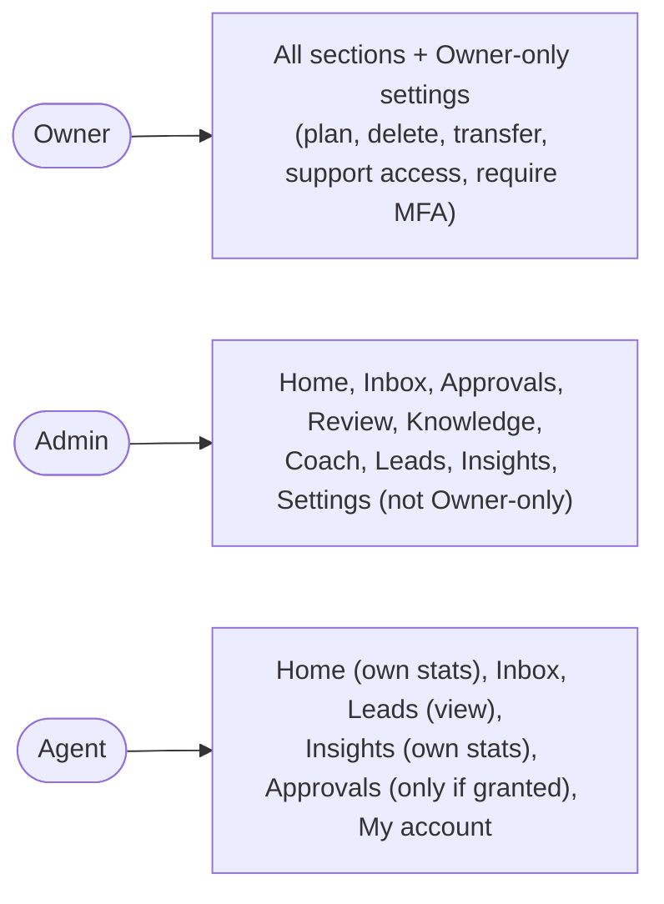
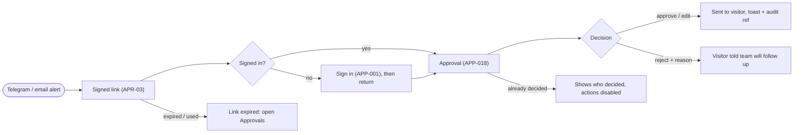
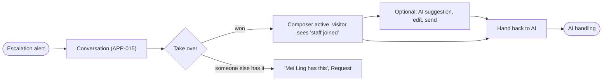
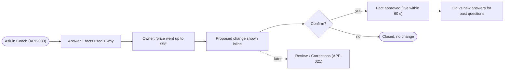
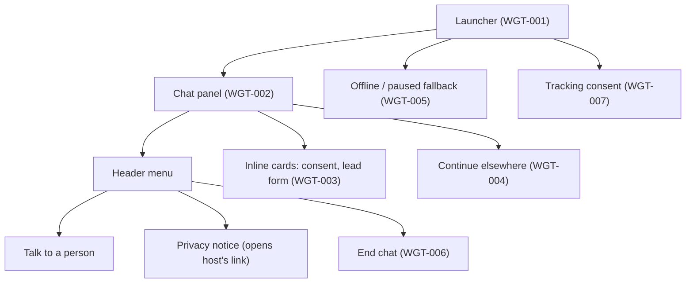
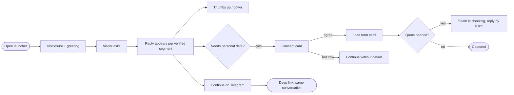
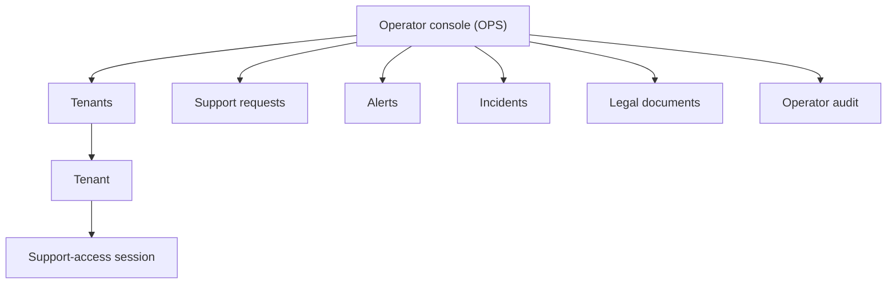
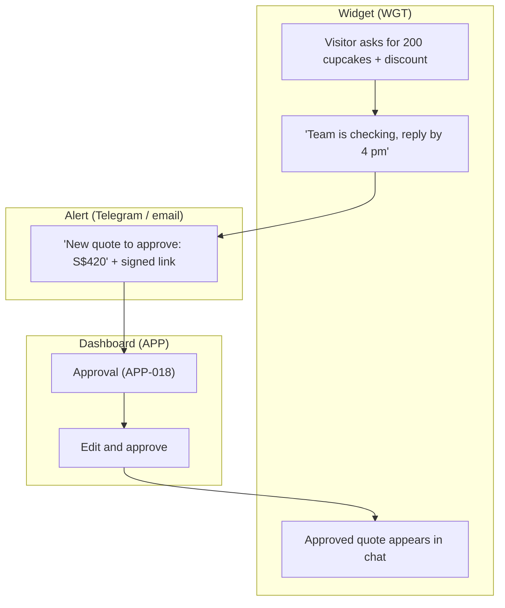

# UX Foundations: KakiAgent MVP

> Status: **Signed off by the product owner, 2026-10-19** · Last updated: 2026-10-19
> Sources: [SRS.md](../01-requirements/SRS.md) v0.4 · [use-cases.md](../01-requirements/use-cases.md) v0.4 · [architecture.md](architecture.md) and ADR-001..022
> Anchor screens: [anchor-screens.md](anchor-screens.md) · registry: [design-manifest.json](../design-manifest.json)
> Design system: **[design.md](design.md) + [tokens.json](tokens.json)** are the single source of truth for every design value. This document references them and never restates values.

## 1. Overview

KakiAgent lets a Singapore SME build a knowledge base from its own material, approve the facts, and run an AI customer agent on its website, email, Telegram and Meta. Staff take over, approve quotes and handle PDPA duties (SRS §1.1). This document defines the UX structure for the three UI surfaces in the architecture (§5.1 container view, ADR-002):

| Surface | Code | For | Container |
|---|---|---|---|
| Dashboard and Inbox PWA | `APP` | Owner, Admin, Agent (tenant staff) | React/Vite SPA, installable PWA |
| Web widget | `WGT` | Visitors on the SME's website | Preact, closed Shadow DOM (ADR-016) |
| Operator console | `OPS` | Platform operators (us) | React/Vite SPA |

Email, Telegram and Meta are visitor channels whose UI belongs to those apps; they aren't surfaces here. Our outbound alert emails and Telegram messages are covered by the cross-surface flows (Part C).

**Design-source mode:** research. The owner picked the "calm, trustworthy pro" personality and Direction A, *Harbour* (design.md §9).

Screen IDs `SCR-<CODE>-<NNN>` are permanent: they are never renumbered or reused, and removed screens are marked *Removed*. The next free IDs are **SCR-APP-061, SCR-WGT-008 and SCR-OPS-010**.

---

## Part A — Shared core (summary; authority lives in design.md)

### A1. Brand and visual direction
Calm, precise and trustworthy. Neutral slate surfaces carry the content, and a single sea-teal accent marks what the user can act on. Status colours are reserved for state. Provenance (fact next to source, answer next to facts) is a visual habit throughout, because the product's promise is "the bot only says what you approved" (D11, ADR-010). See design.md §1.

### A2. Voice and tone
Plain and warm, like a capable colleague. Short sentences, the active voice, no Singlish in the product UI, and no hype. Governance copy is calm and precise. The bot's own voice toward visitors is tenant-configured (AGT-08) and separate. See design.md §6 for microcopy rules and fixed terminology.

### A3. Design language summary
Cool slate neutrals, the sea-teal accent, and IBM Plex Sans with a CJK fallback stack and tabular numerals. Moderate density, a 4 px spacing scale, 6–12 px radii, borders rather than shadows, and short, restrained motion. Tokens are in design.md §2 and tokens.json; components and states are in design.md §4.

### A4. Accessibility standard
**WCAG 2.1 AA** for the dashboard and widget (NFR-09; CHN-02 for the axe criterion), applied to the operator console too. The **375 px** minimum width with no horizontal scroll comes from INB-06. Browser support follows NFR-14. Explicit empty, loading and error states with a next action follow NFR-19. The mechanical rules are in design.md §5.

### A5. Cross-surface principles
1. **Provenance before trust.** Every AI answer a staff member sees can show the facts behind it (AGT-01, INB-04, AGT-17). Every fact can show its source passage (KB-05, KB-16).
2. **Nothing unverified is ever shown.** Staff and visitors see AI text one verified segment at a time, never raw tokens (AGT-02, ADR-008).
3. **Decisions are deliberate, never optimistic.** Approvals, go-live, the kill switch, Approve all, PDPA actions and anything in AUTH-03's list follow the sensitive-action pattern (design.md §4.10). The UI shows the result only after the server confirms it.
4. **One place for "needs you".** Pending work is counted in one consistent way: Review (facts, conflicts, corrections), Approvals and escalated conversations. The counts are badges in the navigation and tiles on Home, and they match the alerts (LED-04).
5. **Role-aware, not role-confusing.** Navigation only shows sections a role can use (SRS §2.1). Inside a page, an action a role cannot take is shown disabled with the reason when hiding it would confuse; otherwise it's hidden.
6. **Scope is fixed by entry point.** Coaching lives only in the signed-in dashboard; nothing in the widget can reach it (AGT-16, ADR-009). The UI never offers an "admin" path from a visitor channel.
7. **Fixed terminology** across surfaces and alerts (design.md §6).
8. **Every job shows progress.** Long-running work (crawl, import, export, DSR deletion) shows a status chip and progress, and the user can leave and come back to it (KB-12, GOV-12).

---

## Part B — Surfaces

### B1. Dashboard and Inbox PWA — surface code `APP`

#### Users and primary jobs
| User class (SRS §2) | Context | Top jobs |
|---|---|---|
| **Owner** | SME founder, busy, **often on a phone** between other work | Set up and go live fast (J1); approve quotes on the go (J3); check what the bot said and fix it (J11); see leads; pause the AI if something is wrong (J8) |
| **Admin** | Office or marketing staff, mostly at a desk | Maintain the KB and review queues; configure channels, rules and the widget; manage the team; handle PDPA requests (J6) and exports |
| **Agent** | Sales or service staff, desk or phone | Work the inbox, take over and hand back (J4), reply with AI suggestions, handle escalations, view leads; approve if granted (D3) |

**Device target:** fully responsive and **mobile-first for the "needs you" loop**: Home, Inbox, Approvals, Review and the kill switch, which must all be complete at 375 px (INB-06). Desktop-first but still responsive for configuration-heavy screens: settings, column mapping, the audit log, analytics. The PWA is installable and supports web push (LED-04 S, INB-05).

#### Information architecture and navigation
**Navigation model:** a sidebar on desktop and a bottom tab bar on mobile (design.md §3). The tab bar holds the four most time-sensitive sections and "More". The onboarding wizard uses a **focused shell**: no sidebar, a step header with progress, and "Save and exit".

```mermaid
graph TD
    app["Dashboard (APP)"]
    app --> home["Home"]
    app --> inbox["Inbox"]
    app --> appr["Approvals"]
    app --> review["Review"]
    app --> kb["Knowledge"]
    app --> coach["Coach"]
    app --> leads["Leads"]
    app --> ins["Insights"]
    app --> set["Settings"]
    app --> me["My account"]

    inbox --> inbl["Conversation list"]
    inbox --> conv["Conversation"]
    inbox --> contact["Contact"]
    appr --> apl["Approval queue"]
    appr --> apd["Approval"]
    review --> rf["Facts to approve"]
    review --> rc["Conflicts"]
    review --> rq["Corrections"]
    kb --> src["Sources"]
    kb --> facts["Facts"]
    kb --> cov["Coverage"]
    coach --> chat["Coach chat"]
    coach --> replay["Replay a conversation"]
    leads --> ll["Leads list"]
    ins --> an["Analytics"]
    ins --> ov["Oversight review"]
    ins --> eis["EIS report"]
    set --> sch["Channels and widget"]
    set --> sag["Assistant and rules"]
    set --> sorg["Business and team"]
    set --> spriv["Privacy and data"]
    set --> splan["Plan and usage"]
```

**Mobile tab bar:** Home · Inbox · Approvals · Review · More (Knowledge, Coach, Leads, Insights, Settings, My account, Help). **Rule (owner decision, 2026-10-19): sections that need the owner's action come first.** The four tabs are the "needs you" loop (A5 principle 4), and Leads stays under More. A role without access to a tab gets the next eligible section in its place: an Agent without approval rights sees Home · Inbox · Leads · More. **Top bar on every page:** tenant switcher, search, **AI status pill / kill switch**, help, notifications, avatar.

**Navigation by role** (from SRS §2.1):

Coach, Review and Knowledge are Owner/Admin only (SRS §2.1). An Agent with approval rights (D3) sees Approvals; one without doesn't see it in navigation, and approval items in their conversations show "Waiting for approval" without actions.

#### Key user flows

**F1. Onboard and go live (J1) [UC-01, UC-03, UC-15, UC-12, UC-04, UC-05]**

```mermaid
flowchart LR
    s(["Sign up (APP-003)"]) --> p["Business profile (APP-006)"]
    p --> u["Paste URL + attest (APP-007)"]
    u --> att{"Attested?"}
    att -->|"no"| files["Upload files instead"]
    att -->|"yes"| crawl["Crawl + extract, live progress"]
    files --> rev
    crawl --> rev["Review facts (APP-008)"]
    rev --> conf{"Conflicts?"}
    conf -->|"yes"| res["Resolve side by side"]
    conf -->|"no"| bulk
    res --> bulk["Approve prices one by one,<br/>Approve all for the rest"]
    bulk --> rules["Rules, persona, privacy (APP-009)"]
    rules --> test["Test your bot (APP-010)"]
    test --> ch["Widget install + check (APP-011)"]
    ch --> ready{"Readiness (APP-012)"}
    ready -->|"blocked"| fix["Fix linked item"]
    fix --> ready
    ready -->|"pass or warnings accepted"| live(["Go live"])
```

Every wizard step after the profile can be skipped and is resumable (ONB-02). While the crawl runs, the user can continue to later steps; a progress chip in the step header follows them. The ≤ 15-minute target (ONB-08) depends on Approve all being one confirmation away from the first review screen.

**F2. Approve a quote from a phone (J3) [UC-22]**

**F3. Take over and hand back (J4) [UC-23]**

**F4. Pause the AI (J8) [UC-31]** — the top-bar pill → kill-switch dialog (APP-058) → "Pause AI now" → the pill shows a spinner until the server acknowledges (≤ 5 s, GOV-08) → a danger banner appears on every page → staff answer manually in the inbox → "Resume AI" from the banner or the pill.

**F5. Coach and correct (J11) [UC-04, UC-16]**

The **quick coach panel** (a slide-over on Review, Knowledge and Conversation screens) runs the same chat. It opens with context ("Ask about this fact"), and it never changes facts without the same confirmation step.

**F6. Data-subject deletion (J6) [UC-30]** — Data requests (APP-048) → New request → record how identity was verified → search the contact across stores (APP-049) → review what was found (conversations, lead, attachments, KB chunks) → Delete → type-to-confirm → re-auth (AUTH-03) → a progress job → completion with an audit reference and "Chain verified". A due-date chip counts down 30 days, with an alert 7 days before.

#### Screen inventory

States key: **L** loading · **E** empty · **X** error · **P** populated · plus screen-specific states. All screens implement design.md §4.8.

**Authentication and account entry (outside the shell)**

| ID | Screen | Purpose | Roles | Key states | Traces |
|---|---|---|---|---|---|
| SCR-APP-001 | Sign in | Magic link or Google sign-in; same response whether or not the email is registered | All | default, sending, rate-limited, X | AUTH-01, ONB-01 · UC-02 |
| SCR-APP-002 | Check your email / link problem | "Link sent" confirmation; expired or used link with "Send a new link" | All | sent, expired, used | AUTH-01 · UC-02 |
| SCR-APP-003 | Create your workspace | First sign-in: name the business and accept the ToS, AUP and DPA (version shown) | New Owner | default, X | ONB-01, AUTH-08 · UC-01 |
| SCR-APP-004 | Accept invitation | Join a tenant from an invite; wrong-email and expired cases | Invitee | valid, wrong email, expired | AUTH-04 · UC-06 |
| SCR-APP-005 | Two-step verification | Enrol TOTP (QR, recovery codes) or enter a code; forced enrolment when the Owner requires MFA | All | enrol, challenge, recovery, X | AUTH-03 · UC-02 |

**Onboarding wizard (focused shell)**

| ID | Screen | Purpose | Roles | Key states | Traces |
|---|---|---|---|---|---|
| SCR-APP-006 | Wizard · Business profile | Name, UEN, industry (applies the template), hours and holidays, contacts, languages, GST | Owner, Admin | default, X (field errors), saved | ONB-02, ONB-03, ONB-06 · UC-03 |
| SCR-APP-007 | Wizard · Add your sources | Paste URL + domain attestation; upload files, spreadsheets, chat exports; live per-source progress | Owner, Admin | E, processing, partial failure, plan-limit skipped | ONB-04, KB-01, KB-02, KB-11, KB-12, KB-13 · UC-03, UC-10, UC-11 |
| SCR-APP-008 | Wizard · Review your facts | The Review hub's facts and conflicts in the wizard frame; Approve all; coverage summary | Owner, Admin | L, E (still extracting), P, all approved | KB-16, KB-06, KB-09, ONB-08 · UC-15, UC-12 |
| SCR-APP-009 | Wizard · Rules and privacy | Safe-default boundary rules, persona, AI disclosure, PDPA purpose statement, privacy-notice link or template | Owner, Admin | default, X | APR-01, AGT-08, AGT-11, LED-02, GOV-14 · UC-03, UC-29 |
| SCR-APP-010 | Wizard · Test your assistant | The Coach chat (APP-030) embedded, with suggested test questions from the template | Owner, Admin | E (suggested prompts), P | ONB-05, AGT-17 · UC-04 |
| SCR-APP-011 | Wizard · Add to your website | Widget preview matched to the site, overrides, snippet + platform steps, install check; optional other channels | Owner, Admin | waiting, detected, wrong domain, pre-live form locked (purpose statement or privacy notice missing) | ONB-07, CHN-11, CHN-14 · UC-05, UC-25 |
| SCR-APP-012 | Go-live check | Readiness checklist with blocking items and warnings (including whether the pre-live contact form is allowed: it needs the purpose statement and privacy notice); choose channels; Go live | Owner, Admin | blocked, warnings, ready, live | ONB-09, ONB-10 · UC-03 |

**Home**

| ID | Screen | Purpose | Roles | Key states | Traces |
|---|---|---|---|---|---|
| SCR-APP-013 | Home | KPI tiles (conversations, AI resolution, escalations, leads with after-hours highlight, pending approvals), "Needs you" list, KB health (needs review, conflicts, overdue facts, open corrections), usage meter | All (Agent: own stats) | L, new-tenant (setup checklist), P | DSH-01, DSH-08, KB-17, KB-18 · UC-37 |

**Inbox**

| ID | Screen | Purpose | Roles | Key states | Traces |
|---|---|---|---|---|---|
| SCR-APP-014 | Inbox | Real-time conversation list with state chips; filters (open, escalated, approval, flagged, closed, channel, assignee); search | All | L, E, filtered-empty, P, reconnecting | INB-01, INB-08, INB-11, AGT-13 · UC-23 |
| SCR-APP-015 | Conversation | Thread with verified AI segments; takeover / hand back; AI-suggested reply; internal notes and tags; saved replies; context sidebar (contact, lead, intent, facts used); visitor feedback | All | AI-handling, escalated, human (mine / other's), waiting-for-approval, closed, flagged | INB-02, INB-03, INB-04, INB-07, INB-09, INB-10, AGT-15, CHN-03, CHN-09 · UC-23, UC-26, UC-27 |
| SCR-APP-016 | Contact | One contact across channels: identifiers (verified or not), conversations, lead, consent records; merge and undo merge | All (merge: all staff) | P, merge preview | CHN-08, LED-07 · UC-26, UC-28 |

**Approvals**

| ID | Screen | Purpose | Roles | Key states | Traces |
|---|---|---|---|---|---|
| SCR-APP-017 | Approvals | Queue of drafts (quote, discount, commitment) with SLA chips; urgent first | Owner, Admin, granted Agent | L, E, P | APR-02, APR-04, APR-06 · UC-22 |
| SCR-APP-018 | Approval | One draft with conversation context and KB prices used; approve, edit and approve, reject with reason. Also the landing page for signed alert links | Approvers | pending, deciding, decided by someone else, expired, link expired | APR-02, APR-03, APR-06 · UC-22 |

**Review hub** (Owner, Admin; one top-level section with three tabs and one badge)

| ID | Screen | Purpose | Roles | Key states | Traces |
|---|---|---|---|---|---|
| SCR-APP-019 | Review · Facts | Fact cards with source passages, prices, policies and promotions first; filter by source or type; bulk approve; **Approve all** | Owner, Admin | L, E (all clear), P, bulk selection | KB-16, KB-05, KB-15 · UC-15 |
| SCR-APP-020 | Review · Conflicts | Side-by-side sources with dates, suggests the newer one; resolve | Owner, Admin | E, P | KB-06, KB-17 · UC-12 |
| SCR-APP-021 | Review · Corrections | The correction queue: origin, involved facts, proposed fix; stale facts with one-tap re-confirm; coverage gaps | Owner, Admin | E, P | KB-18, KB-17, KB-09, AGT-15, INB-03, GOV-09 · UC-16 |
| SCR-APP-022 | Correction | One item: conversation excerpt, fix as a diff, accept or edit or close; afterwards, old and new answers for up to 20 past questions | Owner, Admin | open, applying, applied (comparison), closed | KB-18 · UC-16 |

**Knowledge** (Owner, Admin)

| ID | Screen | Purpose | Roles | Key states | Traces |
|---|---|---|---|---|---|
| SCR-APP-023 | Sources | All sources with state, counts and retry; add source; re-crawl schedule | Owner, Admin | L, E, P, failed | KB-01, KB-02, KB-08, KB-11, KB-12, KB-13 · UC-13, UC-14 |
| SCR-APP-024 | Source | A crawl's page list (included, excluded with reason, skipped: plan limit) or a file's extraction; changes since the last crawl as a diff | Owner, Admin | processing, ready, failed, changes to review | KB-01, KB-08, KB-12 · UC-14 |
| SCR-APP-025 | Spreadsheet import | Column mapping with suggestions, preview, invalid rows with reasons; confirming the import approves the rows | Owner, Admin | mapping, preview, importing, done with rejects | KB-03 · UC-10 |
| SCR-APP-026 | Chat-history import | Upload a WhatsApp or Telegram export; redaction notice; mined Q&A pairs as suggested FAQs to approve | Owner, Admin | uploading, mining, suggestions, E | KB-04 · UC-11 |
| SCR-APP-027 | Facts | Browse and search all facts by type and state; disable or delete; add an FAQ by hand | Owner, Admin | L, E, filtered-empty, P | KB-07, KB-17 · UC-13 |
| SCR-APP-028 | Fact | View and edit one fact with its sources, GST treatment, review interval and version history with restore | Owner, Admin | view, edit, X | KB-07, KB-14, KB-15, KB-17 · UC-13 |
| SCR-APP-029 | Coverage | Topics the KB cannot answer yet (template list before go-live, top gaps after) with "Add an FAQ" | Owner, Admin | pre-live, post-live, E | KB-09 · UC-03, UC-16 |

**Coach** (Owner, Admin)

| ID | Screen | Purpose | Roles | Key states | Traces |
|---|---|---|---|---|---|
| SCR-APP-030 | Coach | Chat with the agent; answer explainer (facts used, why); include-unreviewed toggle with labels; teach a correction and confirm it | Owner, Admin | E (suggested questions), answering, proposed change, confirmed | AGT-17, ONB-05 · UC-04 |
| SCR-APP-031 | Replay a conversation | Pick a past conversation; re-answer it against the current KB, side by side with the original | Owner, Admin | picking, replaying, comparison | AGT-17 · UC-04 |

**Leads**

| ID | Screen | Purpose | Roles | Key states | Traces |
|---|---|---|---|---|---|
| SCR-APP-032 | Leads | Pipeline (New → Contacted → Won / Lost) as a list or columns; score chips; marketing-consent flag; CSV export | All (Agent: view only, no export) | L, E, P, exporting | LED-03, LED-05, LED-08 · UC-21 |
| SCR-APP-033 | Lead | Captured fields, score and reasons, consent records with wording and time, "consent withdrawn" state, linked conversations | All (Agent: view) | P, consent withdrawn | LED-01, LED-02, LED-03, LED-07, LED-09 · UC-21, UC-28 |

**Insights**

| ID | Screen | Purpose | Roles | Key states | Traces |
|---|---|---|---|---|---|
| SCR-APP-034 | Analytics | Trends by channel, top questions, unanswered topics, conversion, response times, feedback, approval analytics; date range; CSV | Owner, Admin (Agent: own stats) | L, E (no data yet), P | DSH-02, APR-05, AGT-15 · UC-37 |
| SCR-APP-035 | Oversight review | Monthly sample of AI conversations to rate; findings go to Corrections; completion tracked | Owner, Admin | due, in progress, done | GOV-09 · UC-36 |

**Settings** (Owner, Admin unless marked Owner)

| ID | Screen | Purpose | Roles | Key states | Traces |
|---|---|---|---|---|---|
| SCR-APP-036 | Channels | All channels with live / offline / degraded state; go live and go offline per channel; connect new | Owner, Admin | P, degraded | ONB-10, CHN-12 · UC-25 |
| SCR-APP-037 | Website widget | Theme preview and overrides, position, logo; allowed origins; snippet and install check; pre-live mode (contact form, offered only once the purpose statement and privacy notice are set, or hidden); tracking and consent mode; proactive greetings | Owner, Admin | P, install pending | ONB-07, ONB-10, CHN-02, CHN-03, CHN-11, CHN-13, CHN-14, AGT-10 · UC-05 |
| SCR-APP-038 | Email channel | Forwarding address; custom domain with SPF, DKIM and DMARC records; reply cap | Owner, Admin | forwarding only, domain pending, verified, failing | CHN-04, CHN-10 · UC-25, UC-27 |
| SCR-APP-039 | Telegram | Connect a BotFather token; private-chats-only note; owner alerts via Telegram | Owner, Admin | disconnected, connected, revoked | CHN-05 · UC-25 |
| SCR-APP-040 | Messenger and Instagram | Connect a Page or IG business account; app-review status; messaging-window note | Owner, Admin | disconnected, sandbox, connected, revoked | CHN-06 · UC-25 |
| SCR-APP-041 | Assistant | Persona (name, tone, greeting, emoji), AI disclosure, after-hours message, fallback message | Owner, Admin | default, X | AGT-08, AGT-09, AGT-11, GOV-08 · UC-29 |
| SCR-APP-042 | Rules and approvals | Allowed and blocked topics, max discount, quotes need approval, forbidden commitments; approval SLA; Agent approval rights | Owner, Admin (rights: Owner) | default, X | APR-01, APR-04 · UC-29 |
| SCR-APP-043 | Leads and consent | Lead fields, qualification criteria, purpose statement and marketing-consent wording (versioned), outbound webhooks | Owner, Admin | default, plan-locked (webhooks) | LED-01, LED-02, LED-03, LED-06, LED-08 · UC-21 |
| SCR-APP-044 | Business profile | Edit the profile from ONB-03 after onboarding | Owner, Admin | default, X | ONB-03 · UC-03 |
| SCR-APP-045 | Team | Members, roles, invite, deactivate; require MFA (Owner) | Owner, Admin | P, invite pending | DSH-03, AUTH-03, AUTH-04 · UC-06 |
| SCR-APP-046 | Plan and usage | Current plan, trial banner, usage against limits and fair use; downgrade preview of what would pause | Owner | trial, active, over limit | DSH-04, DSH-07, DSH-08 · UC-37 |
| SCR-APP-047 | Privacy and data | Privacy-notice template or link; retention periods; DPA, sub-processor list and data-flow PDF; terms re-acceptance | Owner, Admin (terms: Owner) | default, re-acceptance needed | GOV-06, GOV-07, GOV-11, GOV-14, AUTH-08 · UC-35 |
| SCR-APP-048 | Data requests | PDPA requests with type, status and due date | Owner, Admin | E, P, due soon | GOV-05 · UC-30 |
| SCR-APP-049 | Data request | Identity-verification record; find the contact's data across stores; export, correct or delete; progress and audit reference | Owner, Admin | searching, results, deleting, done | GOV-05, LED-07 · UC-30, UC-28 |
| SCR-APP-050 | Audit log | Filter by conversation, actor, type and date; entry detail; verify chain; export CSV/JSON | Owner, Admin | L, E, P, verifying, verified, tamper detected | GOV-01, GOV-02 · UC-32 |
| SCR-APP-051 | Export all data | Request a full tenant export; job progress; 24-hour download link | Owner, Admin | idle, running, ready, expired | GOV-12 · UC-24 |
| SCR-APP-052 | Support access | Grant time-limited operator access; active and past grants; revoke | Owner | none, active, history | DSH-06 · UC-33 |
| SCR-APP-053 | Ownership and deletion | Transfer ownership to an Admin; delete the tenant (export first, 30-day grace, restore) | Owner | default, transfer pending, deletion scheduled | AUTH-06, AUTH-07 · UC-07, UC-08 |
| SCR-APP-054 | EIS expense report | Monthly and annual subscription statement; PDF/CSV; not-tax-advice disclaimer | Owner | P | DSH-05 · UC-37 |

**My account and global**

| ID | Screen | Purpose | Roles | Key states | Traces |
|---|---|---|---|---|---|
| SCR-APP-055 | My account | Name, email change with verification, sessions with "sign out everywhere", two-step verification | All | default, email pending | AUTH-02, AUTH-03, AUTH-05 · UC-02 |
| SCR-APP-056 | My notifications | Per-event channels (email, Telegram, web push), quiet hours | All | default | DSH-09, LED-04 · UC-37 |
| SCR-APP-057 | Help and support | Help articles for the current page; contact-support form | All | default, sent | DSH-10 |
| SCR-APP-058 | Pause AI dialog | Kill switch confirm and resume; shown from the AI status pill on any page | Owner, Admin | live, pausing, paused, resuming | GOV-08 · UC-31 |
| SCR-APP-059 | System pages | Not found, no permission, offline (PWA), tenant suspended, session expired | All | — | NFR-19, DSH-06, AUTH-02 |
| SCR-APP-060 | Accept ownership | The receiving Admin accepts or declines an ownership transfer | Admin | pending, accepted, declined | AUTH-06 · UC-07 |

#### Surface-specific components
The domain components in design.md §4.6: `fact-card`, `approve-all-dialog`, `conflict-compare`, `correction-item`, `answer-compare`, `answer-explainer`, `message-bubble`, `composer` with takeover bar, `context-sidebar`, `approval-card`, `ai-status-pill`, `readiness-checklist`, `source-row`, `column-mapper`, `widget-preview`, `snippet-box`, `dns-record-table`, `kpi-tile`, `quick-coach-panel`.

#### Token overrides
Touch devices only: control height and input type size go up (design.md §4.9, "APP on touch"). No palette overrides.

---

### B2. Web widget — surface code `WGT`

#### Users and primary jobs
| User class | Context | Top jobs |
|---|---|---|
| **Visitor** (SRS §2) | A prospective customer on the SME's site, **mostly on a phone**, in English, Singlish or Chinese, often in a hurry | Get a fast, accurate answer (J2, J7); leave details or ask for a quote (J3); reach a person (J4); continue on Telegram or email (J5); control their data (J10) |

**Device target:** mobile-first. On screens under 480 px the panel is full-screen; on larger screens it's a floating panel. It runs inside any host page (WordPress, Wix, Shopify, plain HTML), in light or dark, and must never break the page (NFR-14). Budgets: loader ≤ 14 KB gz and initial load ≤ 30 KB including theme detection (NFR-02, CHN-14, ADR-016).

**Language (owner decision, 2026-10-19):** the widget's own labels and notices follow the visitor's language, either English or 简体中文. The language is taken from the conversation's detected language, falling back to the browser language, then English. Texts the tenant writes (disclosure, purpose statement, fallback message) are shown as entered (design.md §4.9).

#### Information architecture and navigation
A single panel with no navigation tree. The header menu holds the visitor controls that are always available (CHN-13).

#### Key user flows

**F7. Ask, consent, leave details, continue on Telegram (J2, J3, J5) [UC-20, UC-21, UC-22, UC-26]**

**F8. Ask for a person (J4) [UC-23]** — Header menu or "Talk to a person" chip → the system notice "Asking the team…" → during business hours, "Mei Ling joined" (staff messages are labelled with the staff member's name) → when staff hand back, a notice says the assistant is back. After hours, the lead form appears with a callback promise and the return time (AGT-09).

**F9. Not live, or AI paused (ONB-10, GOV-08)** — the launcher opens WGT-005: the tenant's fallback text and a short contact form (with consent), or nothing at all if the tenant hides the widget before go-live.

#### Screen inventory

| ID | Screen | Purpose | Key states | Traces |
|---|---|---|---|---|
| SCR-WGT-001 | Launcher | Closed state; unread badge; proactive greeting bubble (≤ 1 per session) | closed, unread, greeting, hidden (not live) | CHN-02, CHN-14, AGT-10, ONB-10 · UC-20 |
| SCR-WGT-002 | Chat panel | Disclosure; messages with verified-segment release; feedback; header menu (talk to a person, privacy notice, end chat); attachments; system notices (staff joined, waiting for approval, after hours, rate limited) | E (greeting), typing, replying, human, waiting for approval, after hours, error/retry, rate limited | CHN-02, CHN-09, CHN-13, CHN-14, AGT-05, AGT-09, AGT-11, AGT-15, INB-02, APR-04, GOV-13 · UC-20, UC-22, UC-23 |
| SCR-WGT-003 | Consent and details | Inline consent card (purpose statement, separate unchecked marketing opt-in) and lead-form card; withdrawal confirmation | consent asked, agreed, declined, form, invalid field, withdrawn | LED-01, LED-02, LED-07, LED-08 · UC-21, UC-28 |
| SCR-WGT-004 | Continue elsewhere | Hand off to Telegram (deep link) or email (form), keeping the history | options, link opened, email sent | CHN-07 · UC-26 |
| SCR-WGT-005 | Fallback | Not live yet, or AI paused, or provider down: the tenant's message plus a contact form | not live, paused, outage | ONB-10, GOV-08, NFR-04 · UC-31 |
| SCR-WGT-006 | End of chat | Confirm end; optional rating; transcript notice | confirm, rate, done | AGT-15, CHN-13 · UC-20 |
| SCR-WGT-007 | Tracking consent | In consent mode only: a compact prompt before any tracking event is sent | asked, accepted, declined | CHN-03 · UC-20 |

#### Surface-specific components
`launcher`, `proactive-bubble`, `panel-header`, `disclosure-row`, `message` (segment release with a typing indicator), `feedback-buttons`, `consent-card`, `lead-form-card`, `handoff-card`, `system-notice`, `rating-card`, `attachment-chip` (design.md §4.9).

#### Token overrides
**Runtime theming instead of static overrides.** `--kaki-accent`, `--kaki-font` and `--kaki-radius` come from the host page and are clamped for contrast (CHN-14, ADR-016). The scheme follows the host's light or dark mode live. Everything else uses the core tokens. The tenant can override detection in APP-037.

---

### B3. Operator console — surface code `OPS`

#### Users and primary jobs
| User class | Context | Top jobs |
|---|---|---|
| **Platform Operator** (SRS §2) | Our own staff at a desk, MFA required, few users | Find a tenant and see its health and usage; change plan or suspend; answer support requests; handle spend and abuse alerts; record and notify incidents; use support access only when granted |

**Device target:** desktop only (≥ 1024 px). Dense tables. Visually distinct from tenant UI (dark sidebar, "Operator console" label — design.md §4.9) so an operator always knows which side they're on.

#### Information architecture and navigation
Fixed sidebar: Tenants · Support · Alerts · Incidents · Legal documents · Operator audit.

#### Key user flows
**F10. Support with access (UC-33)** — a support request arrives (OPS-005) → open the tenant (OPS-003) → if the Owner has granted access, "Start support session" opens a read-only tenant view (OPS-004) with a permanent banner and an expiry time → every page view is audit-logged and visible to the tenant → End session. Without a grant, tenant content isn't shown, only metadata and a "Ask the Owner to grant access" note.

#### Screen inventory

| ID | Screen | Purpose | Key states | Traces |
|---|---|---|---|---|
| SCR-OPS-001 | Operator sign-in | Sign-in with mandatory MFA | default, challenge, X | AUTH-03, DSH-06 · UC-34 |
| SCR-OPS-002 | Tenants | Search and filter tenants by plan, state, usage, spend and channel health | L, E, P | DSH-06, DSH-08 · UC-34 |
| SCR-OPS-003 | Tenant | Profile metadata, plan change (DSH-04 tiers, trial end), suspend or unsuspend, usage, LLM spend, channel health, support-access status | P, suspended, deleting | DSH-04, DSH-06, DSH-07, GOV-13 · UC-34 |
| SCR-OPS-004 | Support session | Read-only view of tenant screens under a grant, with banner and expiry | active, expired | DSH-06 · UC-33 |
| SCR-OPS-005 | Support requests | Requests from tenants' help forms, with response-time tracking | E, P | DSH-10, NFR-20 |
| SCR-OPS-006 | Alerts | Spend spikes (> 3× the 30-day average), abuse flags, crawl-abuse reports (D9) | E, P | GOV-13 · UC-34 |
| SCR-OPS-007 | Incidents | Record, assess and notify suspected breaches; per-tenant notification log with timings | E, P, notifying | GOV-10 · UC-38 |
| SCR-OPS-008 | Operator audit | Every operator action, filterable | L, P | DSH-06 · UC-34 |
| SCR-OPS-009 | Legal documents | Publish ToS, AUP, DPA and sub-processor versions; schedule the 30-day notice; track re-acceptance | P, scheduled | GOV-07, AUTH-08 |

#### Surface-specific components
`tenant-table`, `support-access-banner`, a usage meter (shared with APP-046), and an incident timeline.

#### Token overrides
Density: 40 px table rows and body-sm in tables. Dark sidebar chrome (design.md §4.9). No palette change.

---

## Part C — Cross-surface reconciliation

### Shared and surface-specific components
- **Shared core (all three):** buttons, form fields, dialogs/sheets, toasts, alerts, banners, chips and status badges, tables/lists, tabs, menus, empty/loading/error states, avatar.
- **Shared between APP and OPS:** usage meter, audit-entry row, tenant-switcher pattern (OPS reuses it as a tenant picker).
- **Shared between APP and WGT:** `message-bubble` rendering rules (verified-segment release, author labels, CJK `lang`) and `widget-preview`, which embeds the real widget build. **Promoted to core:** the segment-release behaviour is one module used by both, so staff and visitors see identical text timing.
- **WGT never imports APP code or fonts.** It shares design tokens only, through the `--kaki-*` mapping.

### Flows that span surfaces

| Cross-surface journey | Surfaces | Coherence rule |
|---|---|---|
| J3 quote approval | WGT → alert → APP → WGT (or the conversation's latest channel, APR-06) | The amount, item names and expected time are the same everywhere; the alert deep-links to the exact approval |
| J4 takeover | WGT ↔ APP | Visitor sees the staff member's display name as entered in My account; staff see a "Visitor sees: Mei Ling joined" preview |
| J5 channel handoff | WGT → Telegram/email, visible in APP | APP shows one conversation with a channel-switch system event |
| J8 kill switch | APP → all channels (WGT shows WGT-005) | The pill, banner and widget fallback change together; the APP pill confirms only after the server does |
| J11 coaching correction | APP → visitor answers | The comparison view uses the same message rendering as WGT |
| UC-33 support access | APP (Owner grants) → OPS (operator uses) → APP (tenant sees the grant in use) | Banners on both sides name the operator, the scope and the expiry time |
| Alerts (LED-04) | Email, Telegram, web push → APP | The wording matches the APP labels (design.md §6). Every alert links to one screen ID. Urgent items are labelled "Urgent" |

### Consistency rules
- **Must stay identical:** terminology, state names and colours for conversations and facts, the price format (S$, GST label), time and date format (SGT), and the AI disclosure wording.
- **May differ deliberately:** density (OPS denser), chrome (OPS dark sidebar), WGT accent, font and radius (taken from the host), and WGT tone (the tenant's persona).

---

## Part D — Open questions and risks

| # | Item | Default until decided |
|---|---|---|
| UX-Q1 | **Dashboard dark mode in the MVP?** Tokens are ready; shipping it adds QA cost across ~60 screens. The widget must support dark mode regardless (CHN-14). | **Decided 2026-10-19 (owner):** light only for APP and OPS at launch; dark mode is a fast-follow. The widget supports both from day one |
| UX-Q2 | **"Approve all" placement.** Placing it first speeds up ONB-08 but risks automation bias (IMDA). | Shown in the wizard and Review header, always behind a count-by-type confirmation; prices are listed first and conflicts are excluded (KB-16) |
| UX-Q3 | **Coach quick panel on mobile.** A slide-over is cramped at 375 px. | Below 768 px it opens the full Coach page with context passed in |
| UX-Q4 | **Language of system text in the widget.** The bot replies in the visitor's language (AGT-03), and NFR-10 keeps the dashboard UI in English, but no requirement says how widget chrome should handle language. | **Decided 2026-10-19 (owner):** widget chrome follows the visitor's language, EN or 简体中文, from a small string table (design.md §4.9) |
| UX-Q5 | **Mobile tab bar order.** | **Decided 2026-10-19 (owner):** Home · Inbox · Approvals · Review · More. Sections needing owner action come first; Leads stays under More (B1) |
| UX-R1 | **Theme detection may pick the wrong brand colour** on cluttered sites. | The tenant previews and overrides in APP-011 / APP-037; detection results are shown as editable swatches |
| UX-R2 | **The ≤ 15-minute go-live (ONB-08)** depends on extraction speed and on owners trusting Approve all. | To be measured in the pilot; the wizard lets users continue while the crawl runs |
| UX-R3 | **Assumptions not yet tested with users:** the Review-hub grouping and the wording of consent cards. | Validate with pilot SMEs (SRS §8 item 1) using the anchor prototypes |
| UX-R4 | **Pre-live widget mode** "coming soon + contact form" collects personal data before go-live, so it needs the purpose statement and privacy link from the readiness check, which may not be done yet. | **Decided 2026-10-19 (owner):** the pre-live form is available only once the purpose statement and privacy notice are set; otherwise the widget stays hidden (SCR-APP-011, -012, -037) |

No problems were found in the upstream documents that block this phase. UX-Q4 and UX-R4 are interpretations of SRS wording, recorded here rather than edited upstream.

---

## Appendix — Requirements with no dedicated screen

These Must/Should FRs are system behaviour. Their UI effects appear on the screens cited elsewhere, but no screen exists for them alone: AGT-01, AGT-02, AGT-03, AGT-04, AGT-06, AGT-07, AGT-12, AGT-14 (CI only), AGT-16, CHN-01, GOV-03, GOV-04, KB-11 (shown as source failure reasons), ONB-08 (product metric).
