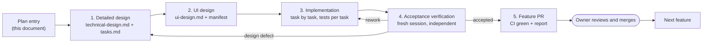
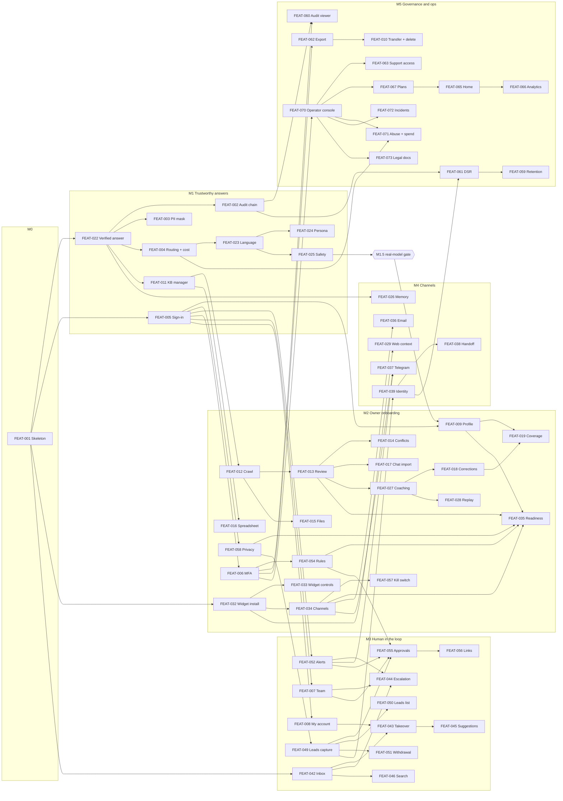

# Implementation Plan: KakiAgent MVP

> Status: **Signed off by the product owner, 2026-10-19** · Last updated: 2026-10-19 (revised after owner review: Team and My account moved to M3, alerts split by channel, NFR ownership added in §7)
> Inputs (all found, all signed off): [SRS v0.4](../01-requirements/SRS.md) · [use-cases.md](../01-requirements/use-cases.md) · [rtm.md](../01-requirements/rtm.md) · [architecture.md](../02-design/architecture.md) + [ADR-001..022](../02-design/adr/) · [ux-foundations.md](../02-design/ux-foundations.md) · [design.md](../02-design/design.md) · [design-manifest.json](../design-manifest.json)
> Fidelity: full. Every FR, UC and SCR ID below resolves in those documents.

## 1. Overview

This plan turns the signed-off requirements, architecture and UX foundations into a build order of **74 features** (`FEAT-001..074`) in **11 epics**, one per architecture domain module (architecture §5.2). Every feature is a vertical slice through UI, API, domain and data, and is built, verified and merged on its own (§3).

**What orders the work (owner decisions, 2026-10-19):**
- **De-risk the core first, in a demoable way.** The first feature after the skeleton proves the hardest invariants: verified fact slots (ADR-008), tenant isolation (ADR-005) and visitor scope (ADR-009), through a real J2 answer.
- **Every feature gets its own PR and an independent acceptance verification.** Each milestone ends with a live demo the owner signs off.
- **Local first.** AWS accounts aren't available yet (SRS §8 item 2), so the skeleton is complete when it runs end to end locally with Terraform written but not applied. Deployment is its own milestone (MD), runnable at any point after M1.
- **Accounts arrive after M1** (owner, 2026-10-19). The owner sets up AWS, Bedrock and the Anthropic developer account once M1 is done, so M1 is built and verified on the **fake (scripted) model provider**. An **M1.5 real-model gate** then re-checks M1 on a real model before M2 starts.
- **Cut line: all Musts, no fixed date.** The pilot starts when every Must FR is shipped and verified and the pilot-readiness checks (M6) pass. Shoulds, the Could, and the owner's fast-follows (dashboard dark mode) come after the pilot (M7).

This is a living order. Features beyond the next milestone are deliberately coarse: they're elaborated just in time by the detailed-design step, and the remaining sequence is re-checked at every milestone demo. Nothing past M1 is a fixed commitment.

---

## 2. Walking skeleton — FEAT-001

The thinnest end-to-end path through every runtime role, with the design system wired in.

**Path:** a visitor types in the widget → the `api` accepts the message (origin check, visitor token) and writes it plus an outbox row in one transaction → SQS `turns.fifo` (LocalStack) → `agent-worker` runs the turn through `llm-gateway` → the reply is persisted and published through Valkey → `realtime` pushes it over SSE → it appears in the widget. The same message appears in a bare dashboard conversation list over WebSocket.

| Real | Stubbed (and which feature replaces it) |
|---|---|
| pnpm + Turborepo monorepo with the five runtime roles (ADR-001, ADR-002) | Business logic: the agent echoes through `llm-gateway` using the **fake provider** (deterministic). An Anthropic-API dev provider exists behind a flag, for test data only (architecture Q1). FEAT-022 replaces both |
| Aurora-compatible Postgres 16 + pgvector in Docker; Drizzle migrations; **forced RLS** on `tenants`, `conversations`, `messages`; separate migration, app and visitor DB roles (ADR-005) | Authentication: a **dev-only sign-in** (seeded tenant and owner), compiled out of production builds and removed by FEAT-005 |
| Transactional outbox → SQS, idempotent consumer, DLQ (ADR-012) | Every other table and module |
| Valkey pub/sub → `realtime` SSE (widget) and WebSocket (dashboard) (ADR-017) | Theme detection: the widget uses its default tokens (FEAT-032 adds detection) |
| Widget: loader (≤ 14 KB gz) + lazy panel, closed Shadow DOM, `--kaki-*` variables (ADR-016) | Ingestion, channels other than the widget, notifications |
| Dashboard shell: React/Vite, Radix, tokens.json → CSS (via `docs/02-design/tools/gen_tokens_css.py` logic, moved into a `packages/design-tokens` build), sidebar/top bar/tab bar, light only (UX-Q1), the APP-059 system pages | — |
| Platform interfaces with real minimal implementations: `audit.append` (writes rows; the chain arrives in FEAT-002), `piiMask` (pass-through + tests; FEAT-003), `can(role, capability)` | — |
| Observability: OpenTelemetry SDK, IDs-only structured logs, `/health` on every role (ADR-021) | — |
| CI on GitHub Actions: lint, typecheck, unit, integration (Testcontainers), Playwright skeleton E2E, axe, size-limit, Trivy + `pnpm audit`, coverage report; AI-eval job wired with an empty set | Deployment (milestone MD) |
| Terraform modules for the dev account, **written and validated (`terraform validate`, `tflint`), not applied** (ADR-003) | — |

**Done when:**
1. `pnpm dev` starts every role locally. The Playwright test `skeleton.e2e.ts` sends a widget message and sees the reply in the widget (SSE) and in the dashboard (WebSocket).
2. The cross-tenant RLS test passes: tenant B's role can't read tenant A's message, even with a hand-written query.
3. CI is green on the PR, and the widget loader is within budget under size-limit.
4. Pending until MD: the same test passes against the deployed dev environment.

---

## 3. How every feature is built and verified

The owner asked for careful, feature-by-feature construction with proper verification. Every feature, FEAT-001 included, goes through the same loop. No feature starts until the previous one in the sequence is merged, unless the sequence below marks them as parallel.

| Step | Skill | Output (in `docs/features/FEAT-NNN-<slug>/`) | Gate to move on |
|---|---|---|---|
| 1. Detailed design | `detailed-design` | `technical-design.md` (API contracts, migrations, components, **numbered acceptance criteria AC-n**, each traced to an FR acceptance criterion or UC step) and an ordered `tasks.md` | Contracts don't contradict an ADR (if they do, an amendment ADR is needed first); every FR in scope, and every NFR §7 assigns to the feature, has at least one AC |
| 2. UI design | `ui-design` | `ui-design.md` and an entry per SCR ID in `design-manifest.json` | Every screen conforms to design.md or files an amendment; all inventory states covered, including empty, loading and error with a next action (NFR-19) |
| 3. Implementation | `feature-implementation` | Code plus tests, **one commit per task** | Each task's "done when" is shown by running it; at most 3 fix attempts, then an honest work-in-progress stop |
| 4. Acceptance verification | `acceptance-verification` in a **fresh session** | `acceptance-report.md`: per-AC evidence, a fresh full test run, binding NFRs measured, test-diff review (no weakened or skipped tests); verdict | Verdict "accepted"; RTM Test ref appended |
| 5. PR | — | Branch `feat/FEAT-NNN-<slug>`, PR body with the report summary | CI green on every gate below; owner merges |

**CI gates on every feature PR**
- Lint, typecheck, unit and integration tests.
- The **cross-tenant RLS suite** always runs (GOV-03).
- Contract tests for any `ChannelAdapter` touched (CHN-01).
- Playwright E2E for every journey the feature touches, on Chromium, Firefox and WebKit (NFR-14).
- Failure-path tests for any queue, channel or ingestion step touched: a dependency outage is retried and then surfaced as failed, never dropped (NFR-17).
- axe with no serious or critical issues on touched screens (NFR-09).
- size-limit on the widget (NFR-02).
- Coverage ≥ 70% on core packages (NFR-12).
- The **AI eval fast subset** if `agent`, `kb`, prompts or model config changed (ADR-022).
- Trivy and `pnpm audit` (NFR-15).

**Invariant review (every PR):** the acceptance verifier checks the diff against the architecture invariants in CLAUDE.md:
- RLS forced and tenant context only from a trusted source;
- facts reach visitors only through `visitor_facts`;
- scopes are fixed by entry point;
- the model never writes protected values;
- the core doesn't branch on channel kind;
- side effects go only through the outbox;
- the send gate is checked;
- no PII in the audit log;
- the widget uses only `--kaki-*` variables.

**Milestone close:**
- `pipeline-verify` checks the seams across documents (IDs, RTM, manifest, tokens).
- The owner gets a **live demo of the milestone's journeys**, running on the local stack (or dev, once MD is done).
- The owner signs off; the plan's remaining order is re-checked and this document updated.

**The evaluation set grows with the agent.** AGT-14's ≥ 300 cases are built feature by feature, not at the end. Each agent-touching feature adds its own cases (FEAT-022: prices and groundedness; FEAT-023: Singlish, Chinese and out-of-scope; FEAT-025: red-team and harmful content; FEAT-051: withdrawal), so the full set exists by M6.

**Before real-model access (M1).** For agent features built before M1.5, the acceptance verdict is **"accepted — real-model check pending"**:
- Deterministic behaviour (verifier, slot renderer, RLS, scopes, audit, send gate) is fully verified in M1, using the fake provider with recorded model fixtures and **adversarial fake outputs**: literal prices, wrong or missing slots, injected instructions echoed back.
- Model-dependent checks (groundedness, price accuracy, Singlish/Chinese intent, red-team) are re-run at M1.5.
- The RTM Test ref for those FRs carries `(partial)` until M1.5 upgrades the report.

---

## 4. Epic and feature breakdown

Feature IDs are in definition order and are permanent: they are never renumbered or reused, and a removed feature is marked *Removed*. **Next free ID: FEAT-075.** The build order is in §5. Priority is the highest MoSCoW of the FRs a feature implements. "(p)" means the feature implements part of that FR; the rest is listed elsewhere.

### E0 — Platform (`platform`, `llm-gateway`; ADR-001, -004, -007, -012, -014, -015, -021)

| ID | Feature | Pri | FRs | UCs | Screens | Blocks / endpoints | Data |
|---|---|---|---|---|---|---|---|
| FEAT-001 | Walking skeleton (§2) | M | GOV-03 (p) | UC-20 (p) | SCR-WGT-001, SCR-WGT-002 (p), SCR-APP-059 | all five roles; widget message API; SSE; WS | tenants, conversations, messages, outbox |
| FEAT-002 | Audit chain: per-tenant hash chain, `audit_pii`, verify tool, S3 Object Lock anchors (LocalStack until MD) | M | GOV-01 | UC-32 (p) | — (verify CLI; viewer is FEAT-060) | `governance.audit`; scheduler anchor job | audit_entries, audit_pii |
| FEAT-003 | PII masking at the edge: NRIC/FIN, card and bank numbers masked before storage and before any LLM payload | M | GOV-04 | UC-20 (p) | SCR-WGT-002 (p) | `platform/pii-mask` in api + channel ingress | messages |
| FEAT-004 | Model routing, cost governor and usage ledger: Haiku triage, Sonnet for complex turns, prompt-cache layout | M | — (NFR-13, NFR-11; D6) | UC-20 (p) | — | `llm-gateway` `ModelRouter`, registry, usage capture | usage_events |

### E1 — Identity and tenancy (`identity`, `tenancy`; ADR-020)

| ID | Feature | Pri | FRs | UCs | Screens | Blocks / endpoints | Data |
|---|---|---|---|---|---|---|---|
| FEAT-005 | Sign up, sign in and sessions (magic link, Google, terms acceptance, sign-out everywhere) | M | ONB-01, AUTH-01, AUTH-02 (p), AUTH-08 | UC-01, UC-02 | SCR-APP-001, -002, -003, -059 (session expired) | `/auth/*`; SES via Mailpit locally | users, sessions, memberships, tenants, terms_acceptances |
| FEAT-006 | Two-step verification and re-authentication for sensitive actions | M | AUTH-03 | UC-02 | SCR-APP-005 | `identity.requireReauth` | mfa_factors, recovery_codes |
| FEAT-007 | Team, invitations, roles, approval-rights grants, tenant switcher | M | DSH-03, AUTH-04 | UC-06 | SCR-APP-004, -045 | `/team/*` | invitations, memberships |
| FEAT-008 | My account: profile, email change, sessions list | M | AUTH-05, AUTH-02 (p) | UC-02 | SCR-APP-055 | `/me/*` | users, sessions |
| FEAT-009 | Business profile, hours, SG holidays, F&B industry template (D1): suggested FAQs only; FEAT-054 adds the template's boundary rules and FEAT-049 its lead fields | M | ONB-03, ONB-06 (p, F&B only) | UC-03 | SCR-APP-044, SCR-APP-006 (p) | `tenancy` | business_profiles, holidays |
| FEAT-010 | Ownership transfer and tenant deletion with 30-day grace and restore | M | AUTH-06, AUTH-07 | UC-07, UC-08 | SCR-APP-053, -060 | scheduler hard-delete job | tenants (all tables on delete) |

### E2 — Knowledge base (`kb`, ingest-worker; ADR-010, -018, -019)

| ID | Feature | Pri | FRs | UCs | Screens | Blocks / endpoints | Data |
|---|---|---|---|---|---|---|---|
| FEAT-011 | KB manager: browse, search, edit, disable, delete; manual FAQ; GST treatment | M | KB-07, KB-15 (p), KB-05 (p) | UC-13 | SCR-APP-027, -028 | `/kb/facts/*` | facts, fact_versions, kb_chunks |
| FEAT-012 | Website crawl with attestation; extraction to "needs review" with provenance; source status and retry | M | ONB-04, KB-01, KB-05, KB-12, KB-13 | UC-03 | SCR-APP-007 (p), -023, -024 | ingest-worker (Chromium); Bedrock extract and embed | kb_sources, facts, kb_chunks |
| FEAT-013 | Fact review, bulk approval and Approve all | M | KB-16 | UC-15 | SCR-APP-019, -008 | `kb.approve`, `approveAll(previewHash)` | facts |
| FEAT-014 | Conflict detection and side-by-side resolution | M | KB-06, KB-17 (p) | UC-12 | SCR-APP-020 | `kb.conflicts` | facts, conflicts |
| FEAT-015 | File upload with content-type and malware checks; parsing and Tesseract OCR | M | KB-02, KB-11 | UC-03 | SCR-APP-007 (p), -023 | presigned upload; quarantine bucket; GuardDuty (ClamAV locally) | kb_sources |
| FEAT-016 | Spreadsheet import with column mapping and preview | M | KB-03 | UC-10 | SCR-APP-025 | deterministic import path | kb_sources, facts |
| FEAT-017 | Chat-history import (WhatsApp, Telegram) to suggested FAQs, with redaction | M | KB-04 | UC-11 | SCR-APP-026 | quarantine → mine → redact → delete | facts (FAQ) |
| FEAT-018 | Correction queue, stale-fact scan and old-versus-new answer replay | M | KB-18, KB-17 | UC-16 | SCR-APP-021, -022 | `kb.proposeCorrection`; scheduler stale scan | corrections, fact_versions |
| FEAT-019 | Coverage report (template topics before go-live, gaps after) | M | KB-09 | UC-03, UC-16 | SCR-APP-029 | `kb.coverage` | facts, conversations |
| FEAT-020 | Scheduled re-crawl and change diff | S | KB-08 | UC-14 | SCR-APP-024 (p) | scheduler re-crawl | kb_sources, facts |
| FEAT-021 | Fact history and restore | S | KB-14 | UC-13 | SCR-APP-028 (p) | `kb.restore` | fact_versions |

### E3 — Agent (`agent`, `llm-gateway`; ADR-007, -008, -009, -022)

| ID | Feature | Pri | FRs | UCs | Screens | Blocks / endpoints | Data |
|---|---|---|---|---|---|---|---|
| FEAT-022 | **Grounded, verified answer from a hand-entered fact** (first slice, §6); introduces the AI send-gate check (conditions filled by FEAT-034, -043, -057) and the LLM-unavailable fallback reply (NFR-04) | M | AGT-01, AGT-02, AGT-11 (p), AGT-16 (p), AGT-06 (p: `lookup_kb`), CHN-02 (p), KB-07 (p), KB-15 (p) | UC-20, UC-13 (p) | SCR-WGT-002, SCR-APP-027 (p), SCR-APP-028 (p) | `agent.runVisitorTurn`: triage ∥ retrieval → generate → slot render → verify → release | facts, visitor_facts view, kb_chunks, messages |
| FEAT-023 | Language and register (EN, Singlish, 中文), out-of-scope handling, after-hours behaviour | M | AGT-03, AGT-04, AGT-09 | UC-20 | SCR-WGT-002 (p) | triage; business-hours maths | business_profiles |
| FEAT-024 | Assistant persona and disclosure settings | M | AGT-08, AGT-11 | UC-29 | SCR-APP-041 | `/settings/assistant` | assistant_settings |
| FEAT-025 | Prompt-injection resistance, harmful content, crisis replies, flagged conversations | M | AGT-07, AGT-13, AGT-16 | UC-20 | SCR-WGT-002 (p) | red-team eval suite ≥ 50 | conversations (flag; the inbox's flagged filter is built by FEAT-042) |
| FEAT-026 | Conversation memory and summarisation | M | AGT-12 | UC-20, UC-26 | — (visible in answers) | `agent` summariser | conversation_summaries |
| FEAT-027 | Coaching mode: explainer, unreviewed toggle, teach-to-correction, quick panel | M | AGT-17, ONB-05 | UC-04 | SCR-APP-030, -010 | `agent.runCoachingTurn` (coaching scope) | coaching_sessions, corrections |
| FEAT-028 | Replay a past conversation against the current KB | M | AGT-17 (p) | UC-04 | SCR-APP-031 | `agent.replay` | conversations |
| FEAT-029 | Web context and first-party intent tracking; consent mode | M | AGT-05, CHN-03 | UC-20 | SCR-WGT-007, SCR-APP-015 (p: intent) | widget tracker; `/v/events` | visitor_events |
| FEAT-030 | Proactive greetings | S | AGT-10 | UC-20 | SCR-WGT-001 (p), SCR-APP-037 (p) | widget trigger rules | widget_settings |
| FEAT-031 | Visitor feedback and end-of-chat rating | S | AGT-15 | UC-20 | SCR-WGT-006 (p), SCR-WGT-002 (p) | `/v/feedback` | message_feedback |

### E4 — Widget and channels (`channels`; ADR-011, -016, -017)

| ID | Feature | Pri | FRs | UCs | Screens | Blocks / endpoints | Data |
|---|---|---|---|---|---|---|---|
| FEAT-032 | Widget install, theme matching, allowed origins, install check | M | ONB-07, CHN-11, CHN-14, CHN-02 (p) | UC-05 | SCR-APP-011, -037, SCR-WGT-001 | theme detection + clamp; origin check | widget_settings, allowed_origins |
| FEAT-033 | Widget visitor controls (privacy link, end chat; "talk to a person" built but hidden until FEAT-044 enables it) and EN / 中文 chrome (UX-Q4) | M | CHN-13, CHN-02 (p) | UC-20 | SCR-WGT-002 (p), SCR-WGT-006 | widget string table | — |
| FEAT-034 | Channel framework: adapter contract, go-live and go-offline per channel, health and degraded alerts | M | CHN-01, ONB-10, CHN-12 | UC-25 | SCR-APP-036, SCR-WGT-005 (p: not live) | `ChannelAdapter`; scheduler health checks | channel_connections |
| FEAT-035 | Onboarding wizard frame and go-live readiness check | M | ONB-02, ONB-09, ONB-08 (p: instrumented) | UC-03 | SCR-APP-012, wizard frames of SCR-APP-006..011 | `tenancy.readiness` | onboarding_progress |
| FEAT-036 | Email channel: forwarding address, custom domain (SPF/DKIM/DMARC), threading, loop safety | M | CHN-04, CHN-10 | UC-27 | SCR-APP-038 | SES inbound → S3 → SQS; email adapter | channel_connections, messages |
| FEAT-037 | Telegram channel (1:1), owner alerts via Telegram (completes LED-04) | M | CHN-05, LED-04 (p: Telegram alerts) | UC-25 | SCR-APP-039 | Telegram adapter; webhook | channel_connections |
| FEAT-038 | Continue on another channel with the history | M | CHN-07, AGT-06 (p: `handoff_channel`) | UC-26 | SCR-WGT-004 | deep link + linking token | conversations, contacts |
| FEAT-039 | Contact identity, verified merge and undo | M | CHN-08 | UC-26 | SCR-APP-016 | `channels.resolveContact` | contacts, contact_identities |
| FEAT-040 | Messenger and Instagram (Meta sandbox) | S | CHN-06 | UC-25 | SCR-APP-040 | Meta adapter; messaging window | channel_connections |
| FEAT-041 | Visitor attachments with safety checks | S | CHN-09 | UC-20 | SCR-WGT-002 (p) | quarantine + scan; OI-3 handling | attachments |

### E5 — Inbox and handoff (`inbox`, realtime; ADR-013, -017)

| ID | Feature | Pri | FRs | UCs | Screens | Blocks / endpoints | Data |
|---|---|---|---|---|---|---|---|
| FEAT-042 | Real-time inbox, conversation view, context sidebar, lifecycle and auto-close; flagged filter for FEAT-025's flags | M | INB-01, INB-04, INB-08, AGT-13 (p: flagged filter) | UC-23 | SCR-APP-014, -015 | `inbox.transition`; WS; scheduler auto-close | conversations, messages |
| FEAT-043 | Take over and hand back, single owner | M | INB-02, INB-09 | UC-23 | SCR-APP-015 (p), SCR-WGT-002 (p) | `inbox.takeOver`; send gate | conversation_owners |
| FEAT-044 | Escalation routing to team members, enabling the widget's "talk to a person" control, reminders | M | INB-05, AGT-06 (p: `escalate_to_human`) | UC-23 | SCR-APP-014 (p), SCR-WGT-002 (p) | routing; scheduler reminders | escalations |
| FEAT-045 | AI-suggested replies for staff (verified) | M | INB-03 | UC-23 | SCR-APP-015 (p) | `agent.suggestReply` | suggestions, corrections (staff edits) |
| FEAT-046 | Conversation search | M | INB-11 | UC-23 | SCR-APP-014 (p) | Postgres FTS + `pg_trgm` | messages |
| FEAT-047 | Internal notes, tags and saved replies | S | INB-07, INB-10 | UC-23 | SCR-APP-015 (p) | `/inbox/notes`, `/saved-replies` | notes, tags, saved_replies |
| FEAT-048 | PWA install and web push | S | INB-06, LED-04 (p: web push) | UC-23 | SCR-APP-014 (p), -056 (p) | service worker; Web Push | push_subscriptions |

### E6 — Leads and notifications (`leads`; notifications in `platform`)

| ID | Feature | Pri | FRs | UCs | Screens | Blocks / endpoints | Data |
|---|---|---|---|---|---|---|---|
| FEAT-049 | Consent and lead capture in conversation; duplicate-lead update; marketing opt-in | M | LED-01, LED-02, LED-09, LED-08, AGT-06 (p: `capture_lead`) | UC-21 | SCR-WGT-003, SCR-APP-043 | `leads.captureLead` | contacts (created here; ADR-015), leads, consents |
| FEAT-050 | Leads list, pipeline, scoring and CSV export | M | LED-03, LED-05 | UC-21 | SCR-APP-032, -033 | `/leads/*`; export (re-auth) | leads |
| FEAT-051 | Consent withdrawal in any channel | M | LED-07 | UC-28 | SCR-WGT-003 (p), SCR-APP-033 (p) | `leads.withdrawConsent` | consents, leads |
| FEAT-052 | Owner alerts by email, quiet hours, digest, notification preferences (Telegram alerts arrive with FEAT-037) | M | LED-04 (p: email), DSH-09 | UC-22, UC-23 | SCR-APP-056 | notifications queue; email (SPF/DKIM/DMARC, NFR-18) | notification_prefs |
| FEAT-053 | Outbound lead webhooks | S | LED-06 | UC-21 | SCR-APP-043 (p) | signed webhooks; retries | webhooks |

### E7 — Approvals and boundaries (`approvals`; ADR-013)

| ID | Feature | Pri | FRs | UCs | Screens | Blocks / endpoints | Data |
|---|---|---|---|---|---|---|---|
| FEAT-054 | Boundary rules with safe defaults | M | APR-01 | UC-29 | SCR-APP-042, -009 | `/settings/rules` (re-auth) | boundary_rules |
| FEAT-055 | Approval drafts, queue, decisions, SLA, expiry | M | APR-02, APR-04, APR-06, AGT-06 (p: `draft_approval`) | UC-22 | SCR-APP-017, -018, SCR-WGT-002 (p) | `approvals.draft/decide/expire`; Postgres timers | approvals |
| FEAT-056 | Signed mobile approval links | M | APR-03 | UC-22 | SCR-APP-018 (p) | signed single-use links | approval_links |

### E8 — Governance and privacy (`governance`; ADR-013, -014, -015)

| ID | Feature | Pri | FRs | UCs | Screens | Blocks / endpoints | Data |
|---|---|---|---|---|---|---|---|
| FEAT-057 | Kill switch (pause and resume AI on all channels) | M | GOV-08 | UC-31 | SCR-APP-058, SCR-WGT-005 | send gate; Valkey flag + Postgres | tenants (ai_paused) |
| FEAT-058 | Privacy notice and template, consent wording, data-processing documents | M | GOV-14, GOV-07, GOV-11, LED-02 (p: wording) | UC-03, UC-35 | SCR-APP-047 (p), SCR-APP-009 (p) | `/settings/privacy` | privacy_settings, wording_versions |
| FEAT-059 | Retention settings and purge job | M | GOV-06 | UC-35 | SCR-APP-047 (p) | scheduler purge | all contact-keyed tables |
| FEAT-060 | Audit log viewer, chain verification and export | M | GOV-02 | UC-32 | SCR-APP-050 | `/audit/*` (re-auth on export) | audit_entries |
| FEAT-061 | Data-subject requests: find, export, correct, delete across stores | M | GOV-05 | UC-30 | SCR-APP-048, -049 | `governance.dsr.*` | dsr_requests; all PII stores |
| FEAT-062 | Tenant data export | M | GOV-12 | UC-24 | SCR-APP-051 | export job → S3 link (24 h) | exports |
| FEAT-063 | Support access grants (tenant side and operator session) | M | DSH-06 (p) | UC-33 | SCR-APP-052, SCR-OPS-004 | grant-scoped read-only role | support_grants |
| FEAT-064 | Monthly oversight review | S | GOV-09 | UC-36 | SCR-APP-035 | scheduler; findings → corrections | oversight_reviews |

### E9 — Insights and plans (`analytics`, `tenancy`)

| ID | Feature | Pri | FRs | UCs | Screens | Blocks / endpoints | Data |
|---|---|---|---|---|---|---|---|
| FEAT-065 | Home dashboard: KPIs, "Needs you", KB health | M | DSH-01 | UC-37 | SCR-APP-013 | `analytics.metrics` | metrics rollups |
| FEAT-066 | Analytics with date range and CSV; approval analytics | M | DSH-02, APR-05 | UC-37 | SCR-APP-034 | rollup jobs | metrics rollups |
| FEAT-067 | Plan stubs, limits, trial, downgrade preview, usage meter | M | DSH-04, DSH-07, DSH-08 | UC-37 | SCR-APP-046 | `tenancy.limits` | plans, usage_events |
| FEAT-068 | EIS expense report | S | DSH-05 | UC-37 | SCR-APP-054 | PDF/CSV export | plans |
| FEAT-069 | Help links and support requests | S | DSH-10 | UC-34 | SCR-APP-057, SCR-OPS-005 | `/support` | support_requests |

### E10 — Operator console (`identity` operators, `governance`)

| ID | Feature | Pri | FRs | UCs | Screens | Blocks / endpoints | Data |
|---|---|---|---|---|---|---|---|
| FEAT-070 | Operator console: MFA sign-in, tenants, plan change, suspension, operator audit | M | DSH-06, DSH-04 (p) | UC-34 | SCR-OPS-001, -002, -003, -008, SCR-APP-059 (p: suspended) | operator API (separate role) | operators, tenants |
| FEAT-071 | Abuse protection and spend alerts (rate limits, Bot Control rules, 3× spend alert) | M | GOV-13 | UC-34 | SCR-OPS-006, SCR-WGT-002 (p: rate-limited) | Valkey limits; WAF rules (Terraform); spend alarm | usage_events |
| FEAT-072 | Security incident register and tenant notifications | M | GOV-10 | UC-38 | SCR-OPS-007 | incident runbook | incidents |
| FEAT-073 | Legal documents, versions, re-acceptance and sub-processor notices | M | GOV-07 (p), AUTH-08 (p) | UC-34 | SCR-OPS-009 | document versions | legal_documents |

### Post-pilot fast-follow

| ID | Feature | Pri | FRs | UCs | Screens | Notes |
|---|---|---|---|---|---|---|
| FEAT-074 | Dashboard and operator console dark mode | — (owner fast-follow, UX-Q1) | — (keeps NFR-09) | — | all SCR-APP, SCR-OPS (p) | Tokens are ready (design.md §9); work is QA plus `color-scheme` switch and a setting |

**Placed in engineering foundations (§7), not in a single feature:** GOV-03 (RLS and the cross-tenant suite start in FEAT-001 and grow with every table), AGT-14 (the eval harness is set up in FEAT-001; cases are added per feature and completed in M6), AGT-06 (each tool lands with the feature that owns it: FEAT-022, -038, -044, -049, -055).

**Removed requirements:** KB-10 (removed in SRS v0.4) spawns no work.

---

## 5. Build sequence

### Reasoning
- **Risk first where it could force re-architecture:** verified slots and the release path (ADR-008), RLS and scopes (ADR-005, ADR-009), cost (ADR-007, R3) and safety (AGT-07) are all in M1. Ingestion (ADR-018, R5–R7) and the onboarding path to the ≤ 15-minute go-live target follow in M2.
- **Then dependency:**
  - Auth before anything owner-facing beyond the dev sign-in.
  - Privacy wording and channels before the readiness check.
  - Inbox before takeover, escalation and approvals.
  - Team, roles and approval-rights grants (FEAT-007) before escalation routing and approvals; My account (FEAT-008) before takeover, because J4 shows the staff member's display name. Both open M3.
  - Telegram owner alerts ride with the Telegram channel (FEAT-037), so M3 alerts are email-only.
  - Alerts before escalation reminders.
  - MFA/re-auth before the first sensitive action (boundary rules), and boundary rules before the readiness check that requires them (ONB-09), so both close M2.
  - The operator console before support access.
- **MoSCoW breaks ties within those constraints.** All 99 Must FRs are scheduled in M0–M5; all Shoulds and the one Could are in M7.

| Milestone | Features, in order | Demo at close (owner sign-off) |
|---|---|---|
| **M0 Skeleton** | FEAT-001 | A widget message round trip locally; dashboard sees it live; CI green |
| **M1 Trustworthy answers** | FEAT-022 → 002 → 003 → 005 → 004 → 011 → 023 → 024 → 025 | J2 and J7 on a seeded bakery: exact prices from approved facts, Singlish and Chinese, out-of-scope refusal, injection refused; audit chain verifies; real sign-in |
| **M1.5 Real-model gate** (after the owner sets up the accounts; blocks M2) | No new features. Add the Anthropic-dev provider key (Bedrock `au.` once AWS exists); replay every M1 eval case on the real model; measure the slot regeneration rate (> 5% → ADR-008 review, P2), Singlish/Chinese retrieval (P3) and red-team results; fix prompts if needed; upgrade the pending M1 acceptance reports and RTM `(partial)` entries | J2 and J7 on a real model |
| **MD Deploy** (alongside or right after M1.5, as the accounts arrive together) | `initial-deployment` skill: Terraform apply to dev, then staging; Bedrock `au.` provider; GuardDuty check (R7); price check (R1); Cohere embeddings and the Singlish/Chinese retrieval check (P3); residency and backup configuration (NFR-07, NFR-08); a basic WAF rate rule on dev until FEAT-071 | FEAT-001's deployed done-when passes; eval fast subset on Bedrock |
| **M2 Owner onboarding** | FEAT-009 → 012 → 013 → 014 → 015 → 016 → 017 → 027 → 028 → 018 → 019 → 032 → 033 → 058 → 034 → 057 → 006 → 054 → 035 | Interim demos after FEAT-013 (crawl → review) and FEAT-027 (coaching) (owner, 2026-10-19). Milestone demo: J1 in under 15 minutes, J8 kill switch, J11 coaching correction |
| **M3 Human in the loop** | FEAT-007 → 008 → 042 → 043 → 052 → 044 → 045 → 046 → 049 → 055 → 056 → 050 → 051 | J3 quote approved from a phone (email alert), J4 takeover, J10 withdrawal; a staff member invited and given approval rights |
| **M4 Channels and context** | FEAT-036 → 037 → 039 → 038 → 026 → 029 | J5 widget → Telegram, J9 after-hours email; owner alerts on Telegram |
| **M5 Governance and operations** | FEAT-060 → 061 → 059 → 062 → 070 → 063 → 010 → 067 → 065 → 066 → 071 → 072 → 073 | J6 PDPA deletion with chain still verifying; operator support session; downgrade preview |
| **M6 Pilot readiness** (no new features) | Full eval ≥ 300 + red-team ≥ 50; E2E J1–J11 on staging; k6 load test (NFR-01, -03, -16); dependency-outage drill (NFR-17, NFR-04 fallback); restore drill (NFR-08); incident tabletop (GOV-10); manual WCAG audit; real-device browser pass (NFR-14); ASVS L1 and Cyber Essentials checklists (NFR-05, NFR-06); residency check of every store and model call (NFR-07); operator on-call rota (NFR-20); legal review (SRS §8 item 3); pen test before the first paying tenant (NFR-15) | Pilot go/no-go with the readiness report |
| **M7 After pilot** (Shoulds, the Could, fast-follows) | FEAT-074, 040, 041, 031, 030, 020, 021, 047, 048, 053, 064, 068, 069, plus other industry templates (ONB-06 remainder, scheduled as a new feature when it's picked up) | Re-planned with pilot feedback |

### Dependency graph (main edges)

---

## 6. First vertical slice — FEAT-022: grounded, verified answer from a hand-entered fact

**User flow.** The owner (dev sign-in from the skeleton) opens Knowledge → Facts and adds "Chocolate fudge cake, 1 kg — S$55, GST incl." and an FAQ "Do you have eggless cakes? Yes, on request, 3 days ahead". A visitor on the widget asks "got eggless cake or not? how much ah" and receives, a sentence at a time, an answer whose price was rendered from the fact, never typed by the model. A second, unapproved fact and a second tenant's fact never appear.

**Why this slice:** it is J2's core and the product's central promise (P2: no invented prices). It exercises the four riskiest invariants together:
- slot rendering plus the deterministic verifier (ADR-008, R4);
- `visitor_facts` as the only fact source (ADR-010);
- visitor scope (ADR-009);
- tenant-filtered vector search under RLS (ADR-005).

It also produces the first real eval cases. If slot discipline doesn't hold with real models, we learn it in week two, not month four.

**Acceptance criteria** (to be refined into AC-n by detailed design):
1. A price in any reply equals a `visitor_facts` value exactly. On the seeded eval subset, price accuracy is 100% and there are zero invented prices (AGT-02). *In M1, measured with recorded fixtures and adversarial fake outputs; re-measured on the real model at M1.5.*
2. No reply text is shown before its sentence passes the verifier. A test with a fake model emitting a literal wrong price shows the sentence is blocked and regenerated, or the turn escalates, and nothing unverified reaches the SSE stream (AGT-02, CHN-02).
3. Every AI message stores the fact IDs it used. Groundedness on the seed subset is ≥ 95% and no answer cites a non-existent fact (AGT-01). *Measured as for AC 1.*
4. A fact in "needs review", "rejected" or "disabled", or one belonging to another tenant, is never retrieved for a visitor turn. This is tested at the DB grant level, with the visitor role querying the base table, and at the API level (AGT-16, GOV-03).
5. The first message of every conversation carries the AI disclosure (AGT-11).
6. For a GST-registered tenant, quoted prices are GST-inclusive (KB-15). The renderer formats S$ (NFR-10).
7. A manual fact edit is used in answers within 60 seconds (KB-07).
8. Latency is reported, not yet gated, until MD: time to first verified sentence and full reply, recorded in the PR (NFR-01, OI-1).
9. The eval fast-subset job runs with ≥ 20 price/groundedness cases (the start of AGT-14's ≥ 50 price cases). *It runs on the fake provider in M1 and on the real model from M1.5.* AC 2 and AC 4–7 are fully verifiable in M1.

**Hand-off to `ui-design`: screens**
- **SCR-WGT-002** (chat panel: greeting, replying with segment release, error states; the anchor already exists in the manifest).
- **SCR-APP-027** (Facts, a minimal list with add).
- **SCR-APP-028** (Fact, create and edit with price, currency, unit and GST fields).

**Hand-off to `detailed-design`: contracts and data needs**
- **Endpoints:**
  - `POST /kb/facts`, `PATCH /kb/facts/:id` and `GET /kb/facts` (owner scope).
  - Widget `POST /v/conversations/:id/messages` (from FEAT-001).
  - The SSE stream event `segment` (`seq`, `text`, `fact_ids`).
- **Domain:**
  - The `visitor_facts` view and the visitor DB role grant.
  - The fact slot syntax `[[f:<id>.<field>]]`.
  - The slot renderer.
  - The sentence segmenter.
  - The verifier rules: price, date and policy patterns must match a rendered slot.
  - Regenerate-then-escalate policy (max attempts).
  - The send-gate check before the turn and before release, with only the kill-switch flag real for now (ADR-013).
  - The LLM-unavailable fallback reply, "the team will get back to you" (NFR-04).
  - `llm-gateway` `generate`/`stream` with the fake and Anthropic-dev providers.
- **Data:**
  - `facts` (type, status, value JSON, GST treatment, source).
  - `fact_versions`.
  - `kb_chunks` (embedding; local embeddings via the fake provider or a dev model, with Bedrock Cohere at MD).
  - `messages.fact_ids`.
- **Eval:** `evals/` fixtures for the bakery tenant and a second tenant; the deterministic price scorer.

---

## 7. Engineering foundations

Stood up in FEAT-001 and extended by later features. Items marked (FR) are requirements placed here.

- **Repository:**
  - pnpm workspaces + Turborepo.
  - Packages per domain module (§5.2) with enforced import boundaries: lint rule, no cross-module internals, no provider SDK outside `llm-gateway`.
  - Apps: `api`, `realtime`, `agent-worker`, `ingest-worker`, `scheduler-worker`, `dashboard`, `operator`, `widget`.
  - Conventional commits; ADR-first rule for any change to an accepted decision.
- **Tenant isolation (FR GOV-03):**
  - Forced RLS policies created in the same migration as each table.
  - Per-trust-zone DB roles.
  - `SET LOCAL` tenant context helper.
  - The **cross-tenant suite** that every new table must join; CI fails if a tenant-scoped table has no policy or no suite entry.
- **AI evaluation (FR AGT-14):**
  - `evals/` runner, fixture tenants, deterministic scorers, `thresholds.json`.
  - The LLM judge and human-agreement sample arrive with FEAT-023.
  - Cases are added per agent feature (§3).
  - Fast subset on PRs; full suite at M6 and on every release candidate after MD.
- **Design system:**
  - `packages/design-tokens` builds CSS from `docs/02-design/tokens.json`, with the same contrast check as `gen_tokens_css.py`; a CI failure if a pair drops below AA.
  - A shared React component library on Radix that implements design.md §4.
  - Light theme only at launch (UX-Q1).
  - Widget token bundle with `--kaki-*` only.
- **Accessibility:** axe in Playwright for every screen a feature touches; keyboard-path tests for review, inbox and dialogs (NFR-09).
- **Test layers** (architecture §8.7): Vitest unit; Testcontainers integration (Postgres + pgvector, Valkey, LocalStack); adapter contract tests; Playwright E2E per journey; size-limit; k6 at M6; 70% coverage enforced on core packages (NFR-12).
- **Local environment:**
  - Docker Compose for Postgres, Valkey, LocalStack (S3, SQS) and Mailpit.
  - ClamAV standing in for GuardDuty.
  - Fake and Anthropic-dev LLM providers, for test data only (Q1).
  - Seed script for the bakery and second tenant.
- **CI/CD:** GitHub Actions; required checks on `main`; PR template with the acceptance-report section; Renovate; Trivy; `pnpm audit` (NFR-15). CD to dev and staging is added at MD; prod promotion by image digest with the eval gate and manual approval (ADR-003, ADR-022).
- **Observability:** OpenTelemetry traces across api → SQS → workers; IDs-only logs; usage ledger from FEAT-004; health endpoints; alarms are defined in Terraform and applied at MD (NFR-11).
- **Security:**
  - Secrets via env in dev and Secrets Manager from MD.
  - KMS envelope encryption helper for channel tokens (NFR-05).
  - The PII-mask module (FEAT-003).
  - Audit `append` interface (FEAT-002).
- **Infrastructure as code:** Terraform modules per architecture §7, validated in CI from FEAT-001 and applied at MD; the SCP region lock is part of the account bootstrap.
- **NFR ownership.** Each NFR has an owner that builds it and a gate that checks it. "Every PR" gates are in §3.

  | NFR | Built in | Checked by |
  |---|---|---|
  | NFR-01 latency | FEAT-022 (reported), FEAT-004 (routing) | Measured at MD; k6 gate at M6 |
  | NFR-02 widget size | FEAT-001 | size-limit on every PR |
  | NFR-03 scale | FEAT-001 (stateless roles, queues), FEAT-004 | k6 at M6 |
  | NFR-04 availability | FEAT-022 (LLM-unavailable fallback), FEAT-049 (lead capture in the fallback), MD (multi-AZ, alarms) | Outage drill at M6; monitored in pilot |
  | NFR-05 security baseline | FEAT-001 (TLS, KMS helper), FEAT-006 (MFA), FEAT-034 (encrypted channel tokens), FEAT-070 (operator MFA) | ASVS L1 checklist at M6 |
  | NFR-06 Cyber Essentials | FEAT-001 (scanning, Renovate), FEAT-015 (malware checks), MD (asset inventory via Terraform, backups) | Checklist at M6 |
  | NFR-07 residency | MD (SCP region lock, Bedrock `au.` with retention `none`, Cohere in-region) | Residency check at M6 |
  | NFR-08 backups | MD | Restore drill at M6 |
  | NFR-09 accessibility | Every UI feature | axe on every PR; manual audit at M6 |
  | NFR-10 localisation | FEAT-022 (S$), FEAT-009 (SG time zone, holidays, phone and UEN formats), FEAT-023 (languages) | Feature ACs; eval subsets |
  | NFR-11 observability | FEAT-001, FEAT-004, FEAT-034 (channel health) | Alarms applied at MD |
  | NFR-12 maintainability | FEAT-001 | CI on every PR |
  | NFR-13 cost | FEAT-004 | Cost per conversation in every eval run; M6 report |
  | NFR-14 browsers | FEAT-001 (Playwright matrix; widget fails silently on old browsers) | Three engines on every PR; real-device pass at M6 |
  | NFR-15 vulnerabilities | FEAT-001 | Trivy and `pnpm audit` on every PR; pen test at M6 |
  | NFR-16 ingestion throughput | FEAT-012 (crawl), FEAT-015 (files), FEAT-016 (spreadsheets) | Feature ACs locally; re-measured at MD and M6 |
  | NFR-17 no message lost | FEAT-001 (outbox, DLQ, retry), every channel and ingestion feature | Failure-path tests on every PR; outage drill at M6 |
  | NFR-18 email authentication | FEAT-052 (alert email), FEAT-036 (email channel) | Feature ACs; bounce alarm at MD |
  | NFR-19 UI states | Every UI feature | UI-design gate (§3); Playwright |
  | NFR-20 operability | FEAT-071 (operator alerts), FEAT-069 (support requests, post-pilot; email until then) | On-call rota at M6 |

- **Documentation:** per-feature folders under `docs/features/`; the RTM Plan ref (now) and Test ref (per feature); CLAUDE.md commands section updated by FEAT-001.

---

## 8. Risks and assumptions

| # | Risk or assumption | Effect on the plan | Mitigation |
|---|---|---|---|
| P1 | **No AWS, Bedrock or Anthropic accounts until after M1** (SRS §8 item 2; owner, 2026-10-19) | No real-model checks in M1. NFRs measured against real infrastructure (latency, residency, backups) can't be verified until MD. MD before M5 exposes a dev widget before FEAT-071's rate limits | Local-first skeleton; fake provider in M1; the M1.5 gate; MD alongside M1.5; acceptance reports mark these items "pending environment" or "real-model check pending"; MD adds a basic WAF rate rule on dev |
| P2 | **Slot discipline may fail with real models** (R4) | It could force a prompt or verifier redesign | FEAT-022 builds the verifier against adversarial fake outputs; the M1.5 gate measures the real regeneration rate, and > 5% triggers an ADR-008 review before M2 |
| P3 | **Singlish and Chinese retrieval quality** (R5) | Could change the embedding provider | FEAT-023 adds a retrieval subset. The real check needs a real model (M1.5) and Cohere Embed Multilingual v3, which arrives at MD, so the decision is due at MD, which runs alongside M1.5 |
| P4 | **Provider differences**: M1 uses a fake provider, dev uses the Anthropic API from M1.5, prod uses Bedrock `au.` | Behaviour or prompt-cache differences | `llm-gateway` provider parity tests; the eval reruns at M1.5 (Anthropic API) and at MD (Bedrock) |
| P5 | **Eval-set authoring effort**, especially 100 Singlish and 50 Chinese cases | Could delay M6 | Cases are written per feature, starting at M1; pilot SMEs supply real phrasing |
| P6 | **The M2 critical path is long** (19 features before the J1 demo) | Owner feedback on onboarding arrives late | Interim demos are offered after FEAT-013 (crawl → review) and FEAT-027 (coaching) without waiting for the milestone close |
| P7 | **Pilot SMEs and legal review** (SRS §8 items 1 and 3) | Blocks M6, not construction | Track as M6 entry criteria |
| P8 | **GuardDuty availability** (R7) | Could change upload safety at MD | ClamAV in the local build is the designed fallback |
| P9 | **Open requirement issues OI-3 and OI-4** (architecture §12) | Could reshape FEAT-041 and FEAT-017 | FEAT-017 follows OI-4's reading; FEAT-041 is post-pilot, so OI-3 must be decided before it starts |
| P10 | **Fake-provider tests can pass while real-model behaviour differs** | M1 can look green but fail on a real model | Adversarial fake outputs in every agent feature; "real-model check pending" verdicts; M1.5 blocks M2 until it passes |

**Coverage result:**
- All 99 Must FRs are implemented by a feature or placed in foundations (§4, §7).
- All 16 Should FRs and the 1 Could (INB-10) are scheduled in M7, except where they ride inside a Must feature: ONB-06 (F&B) in FEAT-009, ONB-08 instrumented in FEAT-035, LED-08 in FEAT-049, APR-05 in FEAT-066.
- All 76 inventory screens are touched by at least one feature.
- **No open coverage gaps.**

**The sequence is a living order.** M2–M7 will be re-checked at each milestone demo; features past the next milestone are intentionally coarse.
