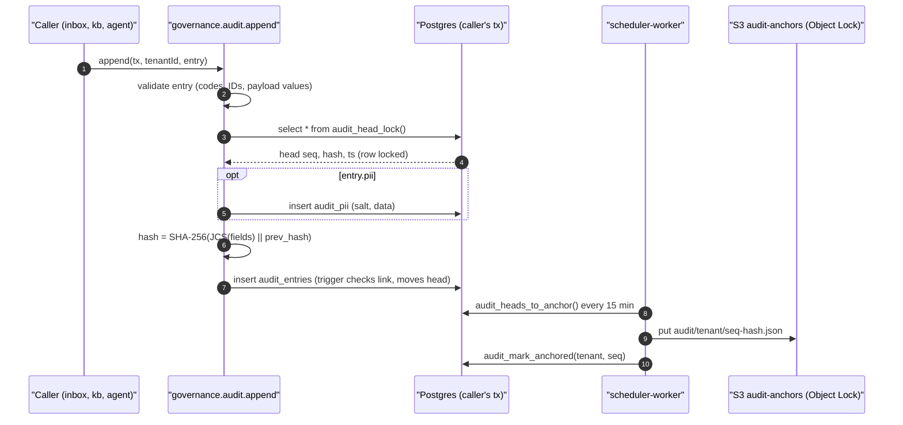

# Technical Design: FEAT-002 — Audit chain

> Feature from: [implementation-plan.md](../../03-planning/implementation-plan.md) §4 (E0) and §5 (M1, second after FEAT-022) · Epic: E0 Platform
> Implements: GOV-01 · Binding NFRs: NFR-06, NFR-07 (anchors in ap-southeast-1), NFR-12 (coverage)
> Realizes: UC-32 (p: step 2, the chain verification, as a CLI; the viewer and export are FEAT-060)
> Screens: none (plan §4: "verify CLI; viewer is FEAT-060"); see [ui-design.md](ui-design.md)
> Status: Verified (self-check §9) · Date: 2026-10-19

## 1. Intent

Turns the skeleton's plain `audit_events` rows into the tamper-evident log ADR-014 decided: one SHA-256 hash chain per tenant, entries that carry only IDs, codes, numbers and masked values, a separate `audit_pii` store that can be deleted without breaking the chain, external anchors of every chain head in an S3 Object Lock bucket, and a verification tool that reports the first broken entry. It comes second in M1 because every later feature writes audit entries (approvals, KB edits, takeovers, DSR deletions), and each one written before the chain exists is evidence that can't be verified (plan §5, "risk first").

## 2. Codebase context

Surveyed on `main` after the FEAT-022 merge (commit `51e0d06`).

- **Schema:** migrations `0000_init`, `0001_rls_roles_grants`, `0002_facts_kb`, `0003_facts_rls_views`. The skeleton's `audit_events (tenant_id, id, seq identity, action, actor_type, actor_id, subject_type, subject_id, created_at)` has forced RLS and `INSERT` grants for `app_dashboard` and `app_agent_visitor`; no role can read it. `seq` is a global identity, not gap-free per tenant.
- **Writers today** (all through `audit.append(tx, tenantId, entry)` from `@kaki/governance`, inside the caller's `withTenant` transaction): `inbox` (`conversation.started`, `message.received`, `message.ai_sent`), `kb` (`fact.created`, `fact.updated`, `fact.disabled`, `fact.enabled`), `agent` (`tool.lookup_kb`, `guardrail.segment_blocked`, `guardrail.escalated`, `agent.fallback_sent`). Writes come from two trust zones: `dashboard` and `visitor`.
- **Security-definer pattern:** 0001 and 0003 give cross-cutting reads to `NOLOGIN` roles that are neither superusers nor table owners (`kaki_widget_resolver`, `kaki_visitor_views`, `kaki_tenant_state`), so forced RLS still applies when the functions run. This design reuses that pattern three times.
- **Scheduler role:** `scheduler-worker` connects only as `app_outbox` and runs the outbox dispatcher; recurring jobs "join this role with the first feature that needs them" (its `main.ts`). This feature adds the first one.
- **AWS locally:** LocalStack (`sqs,s3`) with an init script that creates the queues; no bucket exists locally yet. Terraform already declares the `audit-anchors` bucket with Object Lock in compliance mode (`modules/storage`), but no task role can write to it and no role knows its name.
- **Tests:** integration tests use Testcontainers Postgres, or `KAKI_TEST_DATABASE_URL` without Docker. No test uses S3 yet.
- **`piiMask`** is still a pass-through (FEAT-003 is next); masked payload values call it, so they get real masking when FEAT-003 lands.
- **Divergences noted (reality wins):** the skeleton's actor type `visitor` is not in ADR-014's list (agent, user, operator, system); visitors do start conversations and send messages, so it stays (D4). The table is renamed from `audit_events` to ADR-014's `audit_entries` (D1).

## 3. API contracts

No HTTP endpoint: the Owner/Admin "Verify audit chain" action and the viewer are FEAT-060 (GOV-02). The contracts here are the module interface every feature calls and the CLI.

### 3.1 `@kaki/governance` — `audit`

```ts
type ActorType = 'agent' | 'user' | 'operator' | 'system' | 'visitor';

/** A value allowed in an audit payload: no free text (ADR-014 decision 2). */
type AuditValue =
  | number | boolean | null
  | AuditId          // auditId(uuid): a UUID
  | AuditCode        // auditCode('lookup_kb'): /^[a-z0-9][a-z0-9_.:-]{0,63}$/
  | AuditHash        // auditHash(hex): 64 lowercase hex chars (argument hashes)
  | Masked           // masked(text): { masked: piiMask(text) }, ≤ 500 chars
  | AuditValue[];
type AuditPayload = { [key: string]: AuditValue };   // keys: /^[a-zA-Z][a-zA-Z0-9_]{0,63}$/

interface AuditEntry {
  action: string;              // event type, an AuditCode (e.g. 'fact.updated')
  actorType: ActorType;
  actorId?: string;            // an ID (UUID or code), never a name or email
  subjectType: string;         // primary subject, an AuditCode
  subjectId: string;           // its ID
  related?: { type: string; id: string }[];   // more subject refs, e.g. the conversation of a message
  payload?: AuditPayload;
  pii?: { contactId: string | null; data: Record<string, unknown> };  // goes to audit_pii
}

audit.append(tx: Tx, tenantId: string, entry: AuditEntry): Promise<{ seq: number; hash: string }>;
audit.erasePii(tx: Tx, tenantId: string, input: { contactId: string; actor: { type: ActorType; id?: string } }):
  Promise<{ erased: number }>;
```

- `append` keeps the skeleton's call shape, so existing callers compile unchanged. It validates the entry (an invalid code, ID, key or payload value throws `AuditPayloadError` before anything is written), takes the tenant's chain head under a row lock, computes the hash and inserts, all inside the caller's transaction: the entry commits or rolls back with the action it records (ADR-014 decision 4).
- `AuditId`, `AuditCode`, `AuditHash` and `Masked` are branded types made only by their constructors, so a plain `string` can't be put in a payload without a type error; `append` re-checks the same rules at runtime (D6).
- `pii.data` is stored in `audit_pii` with a random 32-byte salt; the entry gets `pii_ref` and `pii_commitment` (ADR-014 decision 2). `pii.data` never enters the hash input except through the commitment.
- `erasePii` deletes every `audit_pii` row of the contact (salts included) and appends `audit.pii_erased` with payload `{ count }`, subject `contact:<id>`. The entries that pointed at those rows keep their `pii_ref` and commitment, so the chain still verifies (ADR-014 decision 3, GOV-01 acceptance). The DSR workflow that calls it is FEAT-061.

### 3.2 `@kaki/governance` — verification

```ts
interface VerifyResult {
  tenantId: string;
  ok: boolean;
  checked: number;             // entries recomputed
  headSeq: number;             // last seq seen
  anchorsChecked: number;
  piiChecked: number;          // commitments recomputed (rows still present)
  broken?: { seq: number; reason: 'hash_mismatch' | 'link_mismatch' | 'seq_gap' | 'anchor_mismatch'
             | 'truncated' | 'pii_commitment_mismatch' };
}
verifyChain(zdb: ZoneDb, tenantId: string, opts?: { anchors?: AnchorStore; fromSeq?: number; toSeq?: number }): Promise<VerifyResult>;
```

It reads entries in `seq` order in pages of 1,000 (dashboard zone, tenant context), recomputes each hash, checks `seq` continuity and the `prev_hash` link, recomputes the commitment of every `audit_pii` row that still exists, and compares every anchor in range with the recomputed hash at its `seq`. An anchor whose `seq` is beyond the last entry means the chain's tail was removed (`truncated`). The result names the **first** broken `seq` (ADR-014 decision 6). With `fromSeq > 1` the first entry's `prev_hash` is taken as given (a range check).

### 3.3 Anchors

```ts
interface AnchorStore {
  put(anchor: { tenantId: string; seq: number; hash: string; anchoredAt: string }): Promise<void>;
  list(tenantId: string): Promise<{ seq: number; hash: string }[]>;
}
createS3AnchorStore(cfg: { bucket: string; region: string; endpoint?: string }): AnchorStore;
anchorHeads(zdb: ZoneDb /* outbox zone */, store: AnchorStore): Promise<{ anchored: number }>;
```

- Object key `audit/<tenantId>/<seq, zero-padded to 20 digits>-<hash>.json`, so a listing alone yields every anchor without a read per object; body `{ tenantId, seq, hash, anchoredAt }`, `Content-Type: application/json`. Retention comes from the bucket's default compliance-mode retention (Terraform `audit_anchor_retention_days`), so even the root account can't shorten it (ADR-014 decision 5, OI-5).
- `anchorHeads` reads the heads whose `seq` moved since their last anchor (`audit_heads_to_anchor()`), puts one object each, then records `anchored_seq` (`audit_mark_anchored()`). A crash between the two only causes the same head to be anchored again: the same key and body, harmless.

### 3.4 CLI

`pnpm audit:verify --tenant <uuid> [--from <seq>] [--to <seq>] [--no-anchors]` (root script → `packages/governance/scripts/verify-audit.ts`). Reads `packages/governance/.env` (`DASHBOARD_DATABASE_URL`, `AWS_REGION`, `AWS_ENDPOINT_URL`, `AUDIT_ANCHOR_BUCKET`), prints the `VerifyResult` as JSON, and exits 0 when intact, 1 when broken, 2 on a usage or connection error.

## 4. Schema changes

Migration `0004_audit_chain` (drizzle-kit DDL from `schema.ts`) and `0005_audit_chain_rls` (hand-written RLS, roles, grants, functions, triggers), against the current schema (0000–0003).

| Change | Conceptual entity | Columns / definition |
|---|---|---|
| **Drop `audit_events`** | — | Replaced by `audit_entries` (D1). Never deployed; local rows are dropped. |
| **`audit_entries`** (new table) | AUDIT_ENTRY (architecture §5.3, ADR-014 decision 1) | `tenant_id uuid`, `seq bigint` (gap-free per tenant, from 1), `ts timestamptz` (DB clock, millisecond precision), `actor_type text check in (agent, user, operator, system, visitor)`, `actor_ref text null`, `event_type text`, `subject_refs text[] not null` (`'type:id'`, primary first), `payload jsonb not null default '{}'`, `pii_ref uuid null`, `pii_commitment text null`, `prev_hash text not null`, `hash text not null`. PK `(tenant_id, seq)`; index `(tenant_id, ts)`; GIN index on `subject_refs` (ADR-014 decision 8); check `(pii_ref is null) = (pii_commitment is null)`; checks that both hashes are 64 lowercase hex chars. |
| **`audit_heads`** (new table) | AUDIT_ENTRY (the chain head; ADR-014 decision 4) | `tenant_id uuid PK`, `seq bigint not null`, `hash text not null`, `anchored_seq bigint not null default 0`, `updated_at timestamptz`. Genesis: `seq 0`, hash of 64 zeros. |
| **`audit_pii`** (new table) | AUDIT_PII (ADR-014 decision 2) | `tenant_id uuid`, `id uuid default random`, `contact_id uuid null` (no FK: `contacts` arrives with FEAT-049), `salt bytea not null`, `data jsonb not null`, `created_at`. PK `(tenant_id, id)`; index `(tenant_id, contact_id)`. |

All three are tenant-scoped: forced RLS with the `tenant_isolation` policy, listed in `TENANT_SCOPED_TABLES` (replacing `audit_events`), with cases in `rls.int.test.ts`.

**Functions and triggers (0005).** Two new `NOLOGIN` roles, neither superuser nor table owner, so forced RLS applies when their functions run:

- `kaki_audit_chain` owns:
  - `audit_head_lock() returns (seq bigint, hash text, ts timestamptz)`, `SECURITY DEFINER`: inserts the tenant's genesis head if missing (`on conflict do nothing`), then `select … for update` of the head of `app_current_tenant()`, returning it with `date_trunc('milliseconds', clock_timestamp())` as the entry time. No tenant context → no row → `append` throws (fail closed).
  - trigger function `audit_entries_link()` (`BEFORE INSERT`, `SECURITY DEFINER`): rejects the row unless `NEW.tenant_id` has a head, `NEW.seq = head.seq + 1` and `NEW.prev_hash = head.hash`; then moves the head to `(NEW.seq, NEW.hash)`. So even a writer that skips `append` cannot leave a gap or a broken link; only the hash value itself is the application's to compute (D2).
  - Grants to it: `SELECT, INSERT, UPDATE` on `audit_heads`.
- `kaki_audit_anchor` owns `audit_heads_to_anchor()` (returns `tenant_id, seq, hash` for every head with `seq > anchored_seq`, all tenants) and `audit_mark_anchored(p_tenant uuid, p_seq bigint)` (sets `anchored_seq = greatest(anchored_seq, p_seq)`), both `SECURITY DEFINER`. Policy `audit_anchor ON audit_heads TO kaki_audit_anchor USING (true)`, with `SELECT (tenant_id, seq, hash, anchored_seq)` and `UPDATE (anchored_seq)` grants: the scheduler can see heads (hashes and counts, no content) but nothing else.
- **Append-only** (ADR-014 decision 4): trigger `audit_entries_immutable` (`BEFORE UPDATE OR DELETE`, row level) and `audit_entries_no_truncate` (`BEFORE TRUNCATE`, statement level) raise for every role, the owner included. The retention purge (FEAT-059) will need a narrow, audited exception (§8).

**Grants (0005):**
- `app_dashboard`: `SELECT, INSERT` on `audit_entries` (the viewer and verification read it); `SELECT, INSERT, DELETE` on `audit_pii` (erasure, and verification of commitments); `EXECUTE` on `audit_head_lock()`.
- `app_agent_visitor`: `INSERT` on `audit_entries` and `audit_pii`; `EXECUTE` on `audit_head_lock()`. No read of either table (AGT-16).
- `app_outbox`: `EXECUTE` on `audit_heads_to_anchor()` and `audit_mark_anchored()`. Nothing else new.
- No role gets any privilege on `audit_heads` directly.

Rollback: drizzle's migrator is forward-only here; a rollback is a new migration that drops the triggers, functions, roles and the three tables and recreates `audit_events`.

## 5. Component design



**`packages/governance/src`:**
- `canonical.ts` — RFC 8785 (JCS) serialisation: object keys sorted by UTF-16 code units, ECMAScript number and string serialisation (what `JSON.stringify` produces for finite numbers and strings), no whitespace; rejects non-finite numbers, `undefined` and non-plain objects.
- `payload.ts` — the branded constructors (`auditId`, `auditCode`, `auditHash`, `masked`), the `AuditValue`/`AuditPayload` types, and `assertAuditEntry(entry)`, the runtime check: every string in the entry or payload must be a UUID, a code or a hash; masked values must be `{ masked: string }` objects of ≤ 500 chars; keys must match the key pattern; arrays ≤ 200 items; nesting ≤ 4 levels; payload ≤ 8 KB serialised.
- `chain.ts` — `GENESIS_HASH` (64 zeros), `hashInput(entry)` (the canonical object: `tenantId, seq, ts (ISO 8601, ms, Z), actorType, actorRef, eventType, subjectRefs, payload, piiRef, piiCommitment, prevHash`), `entryHash(e) = sha256hex(JCS(hashInput(e)) + prevHash)` (ADR-014 decision 1, taken literally), `piiCommitment(salt, data) = sha256hex(salt ‖ JCS(data))`. Pure; shared by `append` and `verify`.
- `audit.ts` — `audit.append` and `audit.erasePii` (§3.1). Replaces the skeleton body of `index.ts`.
- `verify.ts` — `verifyChain` (§3.2), with a pure core `verifyEntries(entries, anchors, piiRows)` that the unit tests drive with tampered fixtures.
- `anchors.ts` — `AnchorStore`, `createS3AnchorStore` (`@aws-sdk/client-s3`, `forcePathStyle` when an endpoint is set, for LocalStack), `anchorHeads`.
- `scripts/verify-audit.ts` — the CLI (§3.4).

**Callers enriched** (GOV-01 asks agent decisions to carry the KB IDs retrieved, tool calls, guardrail results and a summary of reasoning; OI-8 defines that summary as a structured rationale):
- `agent/turn.ts`: `tool.lookup_kb` gets payload `{ tool: 'lookup_kb', factIds: [retrieved IDs] }` and the related visitor message; each `guardrail.segment_blocked` (one per violation, as before) gets `{ kind }` (the blocked text is never logged); a new `agent.decision` entry per stored reply carries the rationale `{ outcome, factIds, attempts, violations: <count> }` with subject `message:<id>` and related `conversation:<id>`.
- `inbox`: `message.received` and `message.ai_sent` gain the related `conversation:<id>`.
- `kb/facts.ts`: `fact.updated` gains `{ version }`.
- Model and prompt version are not in the payload yet: the turn has no model ID to hand until FEAT-004's router (§8).

**`apps/scheduler-worker`:** a recurring `audit-anchor` loop next to the dispatcher: runs once at start-up, then every `AUDIT_ANCHOR_INTERVAL_MS` (default 900,000, the 15 minutes of ADR-014), logging `{ anchored }`; an error is logged and retried on the next tick. New config `AUDIT_ANCHOR_BUCKET` (required) and `AUDIT_ANCHOR_INTERVAL_MS`; `.env.example` and `gen-local-env.mjs` updated. With two scheduler tasks (full profile) both may anchor the same head; the key and body are identical, so it is harmless and needs no leader election.

**Local and cloud wiring:**
- `infra/local/localstack/02-buckets.sh`: creates `kaki-local-audit-anchors` with Object Lock enabled and a 1-day compliance default retention. The LocalStack health check waits for the bucket too.
- Terraform `envs/prod`: scheduler-worker gets `AUDIT_ANCHOR_BUCKET = module.storage.bucket_names["audit-anchors"]` and a task policy with `s3:PutObject` on that bucket's objects and `kms:GenerateDataKey` on the data key (the bucket is SSE-KMS). Validated with `terraform validate` and the existing `terraform test`.

**Stub replaced:** scaffold-notes §4 row "`audit.append` writes plain IDs-only rows, with no hash chain" (and the comment in `governance/src/index.ts`).

## 6. Acceptance criteria

- **AC-1 (GOV-01: hash-chained, append-only).** After entries are appended for tenants A and B in interleaved transactions, each tenant's entries have `seq` 1..n with no gaps, entry 1's `prev_hash` is the genesis hash, every `prev_hash` equals the previous entry's `hash`, and every `hash` equals `SHA-256(JCS(fields) ‖ prev_hash)` recomputed independently.
- **AC-2 (GOV-01: concurrency).** 20 concurrent transactions appending to one tenant produce `seq` 1..20 with no gap and a chain that verifies; a transaction that rolls back after `append` leaves no entry and no gap.
- **AC-3 (GOV-01: append-only).** As the owner role and as `app_dashboard`, `UPDATE`, `DELETE` and `TRUNCATE` on `audit_entries` fail. An `INSERT` with a wrong `seq` or a wrong `prev_hash`, written by hand without `append`, fails. `app_agent_visitor` cannot select from `audit_entries` or `audit_pii`, and no app role can read or write `audit_heads` directly.
- **AC-4 (GOV-01: "any tampering breaks the hash-chain check"; UC-32 2).** On a chain of ≥ 10 entries, each of these tampers, done as the owner with the immutability trigger disabled, makes `verifyChain` return `ok: false` with `broken.seq` equal to the first tampered entry: a changed payload value, a changed actor, a changed `ts`, a deleted middle entry, a swapped pair, and a deleted tail entry detected through its anchor (`truncated`). An entry altered and re-hashed is reported at the next entry (`link_mismatch`), the earliest point the chain itself can show it. An untampered chain returns `ok: true` with `checked` equal to the entry count.
- **AC-5 (GOV-01: anchors; ADR-014 decision 5).** `anchorHeads` writes one object per tenant whose head moved, with the head's `seq` and `hash`; a second run with no new entries writes nothing; after a new entry it writes one more. Rewriting the whole chain consistently (every hash recomputed) after an anchor makes verification fail with `anchor_mismatch` at the anchored `seq`. Against LocalStack, the bucket has Object Lock enabled and the anchor objects carry a compliance-mode retention.
- **AC-6 (GOV-01, D7: "deleting a contact leaves the chain verifiable").** An entry appended with `pii` stores the data only in `audit_pii`; the entry's row and hash input contain neither the data nor the salt. Verification checks the commitment while the row exists (and reports `pii_commitment_mismatch` if `audit_pii.data` is altered). After `erasePii` for that contact, the `audit_pii` rows are gone, an `audit.pii_erased` entry with the count exists, and the whole chain still verifies.
- **AC-7 (GOV-01, D7: no personal data in entries; ADR-014 consequence).** `append` rejects, before writing anything: a payload string that isn't a UUID, code or hash (for example `'Tan Ah Kow'`, `'tan@example.com'`, `'S1234567D'`), an actor ID with a space or `@`, a nested raw string, and a masked value over 500 chars. The type checker rejects a plain `string` in a payload (a `@ts-expect-error` test). Every existing caller's entries pass.
- **AC-8 (GOV-01: agent decisions).** A grounded visitor turn writes `tool.lookup_kb` with the retrieved fact IDs, and `agent.decision` with `outcome: 'answered'` and the cited fact IDs; a turn whose segment is blocked writes `guardrail.segment_blocked` with the violation kind and no visitor or model text. Human actions (`fact.created`, `fact.updated`) and visitor events keep their entries, now chained.
- **AC-9 (GOV-01: tenant isolation; GOV-03).** With tenant A's context, `append(tx, B, …)` fails; A cannot read B's entries, PII rows or head; verification of A never reads B's rows; the RLS suite covers `audit_entries`, `audit_pii` and `audit_heads`.
- **AC-10 (GOV-01: "a verification tool is provided").** `pnpm audit:verify --tenant <bakery>` on the local stack prints `ok: true` with the entry and anchor counts and exits 0; after a tamper it prints the broken `seq` and exits 1; an invalid tenant ID exits 2.
- **AC-11 (NFR-07).** Anchors are written only to the bucket in ap-southeast-1 named by config; nothing else leaves the database.

## 7. Decisions

- **D1 — Replace `audit_events` with `audit_entries`.** Driver: ADR-014 decision 1 names the table and its columns, and the skeleton's global `seq` can't be made gap-free per tenant in place. The skeleton was never deployed, so the migration drops the old table instead of migrating rows into a chain they never had. Rejected: keeping `audit_events` and adding chain columns (a misleading name and a mixed chained/unchained history). Consequence: the four tests that query `audit_events` move to `audit_entries` (`event_type` for `action`).
- **D2 — The application computes the hash; the database enforces the link.** Driver: ADR-014 decision 1 requires RFC 8785 canonical JSON, which Postgres's `jsonb` text form is not (it orders keys by length). So `append` and `verify` share one TypeScript implementation, and the database's trigger enforces what it can check cheaply: `seq` continuity and `prev_hash` linkage. A writer that computes a wrong hash produces a chain that verification flags at once. Rejected: hashing in PL/pgSQL (a second canonicaliser to keep identical).
- **D3 — The head is locked through a security-definer function.** Driver: least privilege (ADR-005). The visitor zone needs to append but must not read or update `audit_heads`; `audit_head_lock()` and the trigger run as `kaki_audit_chain` under the tenant's RLS policy. The entry time comes from the same call (`clock_timestamp()`, truncated to milliseconds so it round-trips through JavaScript's `Date` exactly).
- **D4 — Actor type `visitor` stays.** Driver: code reality; visitors start conversations and send messages, and calling them `system` would misstate who acted. `actor_ref` is the pseudonymous visitor ID, never a name. ADR-014's four types plus this one.
- **D5 — `subject_refs` is `text[]` of `type:id`.** Driver: ADR-014 decision 8 (GIN index on subject refs) and GOV-02's per-conversation filter: `subject_refs @> '{conversation:<id>}'` uses the index. The primary subject is first. The existing `subjectType`/`subjectId` arguments map to it, plus the new optional `related`.
- **D6 — Payload safety by types plus a runtime check, not a schema scan.** Driver: ADR-014's consequence asks for "typed builders and a CI test that scans payload schemas for string fields without a masked or id type". With branded value types, a plain string in any payload is a compile error everywhere, which `pnpm typecheck` already enforces in CI; the runtime check catches what types can't (casts, JSON from elsewhere). A separate scanner would test the same property twice. Masked values are stored as `{ "masked": "…" }` objects, so they are recognisable in the log and in the check.
- **D7 — The scheduler reads heads through functions, not a new login role.** Driver: least privilege and the existing resolver pattern. The anchor job needs every tenant's head and nothing else; two definer functions give exactly that to `app_outbox`, the scheduler's existing role. Rejected: a new `app_scheduler` login role (one more secret, before any other job needs it).
- **D8 — Verification is a CLI and a module function now; no endpoint.** Driver: plan §4 (FEAT-002 has no screen; FEAT-060 builds the viewer and the Owner/Admin verify action on top of `verifyChain`). The CLI connects as `app_dashboard` with a tenant ID, like any dashboard request. Running it against the launch environment (an ECS task with the dashboard credential) is set up at MD (§8).
- **D9 — Anchors are idempotent puts, no leader election.** Driver: ADR-014 decision 5 and simplicity. The key is determined by `(tenant, seq)` and the body by the head, so duplicate runs from two scheduler tasks write the same thing. The bucket is versioned, so a duplicate becomes a second identical version under the same retention.
- **D10 — S3 integration tests use LocalStack, or an endpoint from `KAKI_TEST_S3_ENDPOINT`.** Driver: the existing `KAKI_TEST_DATABASE_URL` convention for running without Docker. `@kaki/governance` gets a `startTestS3()` helper that starts `localstack/localstack:4` with Testcontainers (as CI does) or uses the given endpoint, and creates an Object Lock bucket per suite.
- **D11 — Branch name.** AGENTS.md asks for `feat/FEAT-002-audit-chain`; this session's tooling pins `claude/project-thread-fty1bc`. The PR is titled with the feature ID instead (as FEAT-022 did).

## 8. Escalations and open items

- No architecture amendment is needed: AUDIT_ENTRY and AUDIT_PII are entities in architecture §5.3, and `audit_heads` is ADR-014 decision 4's head row.
- **Platform chain** (ADR-014 decision 1, "plus one platform chain for operator and cross-tenant events") is not built: nothing writes operator events until the operator console (FEAT-070) and support access (FEAT-072/073). It will be a chain keyed on a reserved platform tenant ID, on the same tables and functions.
- **Retention checkpoint** (ADR-014 decision 7) belongs to the purge job (FEAT-059, GOV-06). It needs a narrow exception to the immutability trigger (for example a definer function that deletes entries below a checkpoint it has just appended); `verifyChain` will then start from the latest checkpoint. Recorded here so FEAT-059 designs it.
- **Model and prompt version in agent decisions** (ADR-014 decision 1's payload list) need the model ID, which `composeReply` doesn't expose until FEAT-004's router and usage ledger. FEAT-004 adds `{ model, promptVersion }` to `agent.decision`.
- **Verify in the launch environment** (D8): needs a one-off ECS task definition or the FEAT-060 action; set up at MD alongside the first deploy.
- **`contact_id` has no foreign key** until `contacts` exists (FEAT-049). FEAT-061's DSR deletion calls `audit.erasePii`.
- **S3 retention locally** is 1 day; production uses `audit_anchor_retention_days` (D7 policy, OI-5), set when the environment is applied at MD.

## 9. Self-check

Requirement coverage: GOV-01 → AC-1 to AC-11 (append-only and hash-chained: AC-1–AC-3; agent decisions, human actions and admin events with references and masked values only: AC-7, AC-8; separate deletable store: AC-6; tampering breaks the check and a tool is provided: AC-4, AC-5, AC-10; deletion leaves the chain verifiable: AC-6). UC-32 step 2 → AC-4, AC-10 (CLI; the UI is FEAT-060). Binding NFRs: NFR-07 → AC-11; NFR-06 (Cyber Essentials logging) is served by the chain itself; NFR-12 → governance keeps its 70% line threshold. E2E obligation: UC-32 is not one of architecture §8.7's critical journeys and has no UI in this feature, so no E2E task; the existing E2E keeps exercising `append` on every message. Every table maps to an architecture entity; no escalation filed. No HTTP contract changes; the one breaking change (D1, table rename) is recorded with its test updates.
