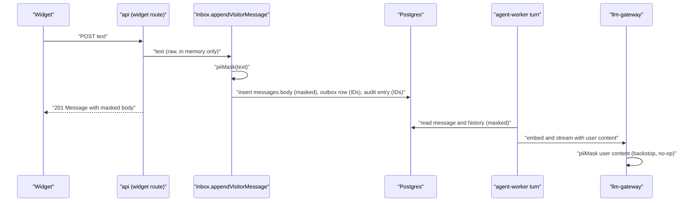

# Technical Design: FEAT-003 — PII masking at the edge

> Feature from: [implementation-plan.md](../../03-planning/implementation-plan.md) §4 (E0) and §5 (M1, third after FEAT-022 and FEAT-002) · Epic: E0 Platform
> Implements: GOV-04 · Binding NFRs: NFR-01 (masking sits on the turn's critical path), NFR-05 (ASVS L1 input handling), NFR-12 (coverage on `platform/pii-mask`)
> Realizes: UC-20 (p: step 4, "the system masks NRIC, card and bank numbers in the message")
> Screens: SCR-WGT-002 (p: the visitor's own bubble shows the stored, masked text); see [ui-design.md](ui-design.md)
> Status: Verified (self-check §9) · Date: 2026-10-20

## 1. Intent

Replaces the skeleton's pass-through `piiMask` with the masker ADR-015 decision 1 specifies: NRIC/FIN numbers (checksum-validated), payment card numbers (Luhn-validated) and Singapore bank account numbers (next to an account or bank keyword) in visitor text become typed tokens such as `[NRIC ••••567D]`, before the message is stored and so before anything reaches a model. The original value is kept nowhere. The same feature adds the log-side half of GOV-04 (other PII masked in logs) and a gateway backstop so a future caller that forgets to mask still can't send an identifier to a provider. It comes third in M1 because every message stored before it lands is unmasked (plan §5, "risk first").

## 2. Codebase context

Surveyed on `main` after the FEAT-002 merge (commit `f304dc3`).

- **The stub** is `packages/platform/src/pii-mask.ts` (`piiMask(text) => text`), exported from `@kaki/platform`. `platform.test.ts` asserts the pass-through; FEAT-003 replaces that test. `vitest.config.ts` already holds `src/pii-mask.ts` to 70% lines (architecture §8.7).
- **Callers today:**
  - `inbox.appendVisitorMessage` stores `body: piiMask(input.text)`. It is the only writer of visitor messages; the widget route (`POST /widget/v1/conversations/:id/messages` in `apps/api/src/app.ts`) calls it, and its response and the SSE `message` event carry the stored body.
  - `governance.masked(text)` wraps audit payload text in `{ masked: piiMask(text) }` (FEAT-002 §3.1).
- **What reaches the model:** `agent.runVisitorTurn` reads the visitor message and history back from Postgres (`message.body`, `prep.history[].body`) and sends them to `llm.embed` (`purpose: 'query'`) and `llm.stream`/`generate` as `user` messages. So storing masked text already makes the LLM payload masked; nothing in the turn holds the raw request text.
- **Queues carry IDs only:** the `conversation-turns` outbox payload is `{ tenantId, conversationId, messageId }`; audit entries for messages carry IDs (FEAT-002 AC-8).
- **Channels:** `@kaki/channels` defines `ChannelAdapter.normalise() → InboundMessage[]`; no adapter exists yet (FEAT-034+). ADR-011: the core never branches on channel kind, so every adapter's messages will be stored through `appendVisitorMessage`.
- **Logs:** `platform/logger.ts` (pino) redacts `text`, `body`, `email`, `phone` (and one level of nesting) and auth headers. Message strings and error messages are not scrubbed.
- **`llm-gateway`** depends only on the Anthropic SDK; `createGateway` passes requests to providers unchanged.
- **Open item inherited:** FEAT-002 acceptance M1, "the runtime check accepts any lowercase code as an ID, so a lowercased NRIC could pass in `actorId`, `subjectId` or a payload code; tighten with FEAT-003's masking patterns".
- **Divergence noted (reality wins):** architecture §6 draws the mask as an API step before the domain call; in the code the mask runs inside `appendVisitorMessage`, the one storage path all channels share, before the insert and before the outbox row (D2). Nothing between the HTTP handler and that call persists, queues or logs the text.

## 3. Contracts

No HTTP endpoint changes shape. `Message.body` of a visitor message is now the masked text, which the widget already renders (it shows the stored message returned by the POST).

### 3.1 `@kaki/platform/pii-mask` (new subpath export; `@kaki/platform` keeps re-exporting it)

```ts
export type PiiKind = 'nric' | 'card' | 'bank';
export interface PiiFinding { kind: PiiKind; start: number; end: number }  // UTF-16 offsets in the input

/** Every NRIC/FIN, card and bank account number in the text, in order, non-overlapping. */
export function findPii(text: string): PiiFinding[];

/** GOV-04: the text with every finding replaced by its token. Idempotent. */
export function piiMask(text: string): string;

/** GOV-04 "mask other PII in logs": piiMask, then emails → [EMAIL] and SG phone numbers → [PHONE]. */
export function maskLogText(text: string): string;
```

**Matching** runs on a folded copy of the text: full-width forms U+FF01–U+FF5E map to ASCII U+0021–U+007E (one UTF-16 unit each, so offsets are unchanged) and the match is case-insensitive. Replacements are applied to the original text, so the visitor's own punctuation and script are kept. A candidate never starts or ends inside a longer run of ASCII letters or digits (lookarounds on `[A-Za-z0-9]`, so Chinese text directly around a number still matches).

| Kind | Shape | Validation | Token |
|---|---|---|---|
| NRIC/FIN | `[STFGM]`, 7 digits, a letter; one optional space or hyphen between any two characters | Weights 2 7 6 5 4 3 2; offset 4 for T and G, 3 for M; remainder mod 11 indexes `JZIHGFEDCBA` (S, T), `XWUTRQPNMLK` (F, G), `XWUTRQPNJLK` (M) | `[NRIC ••••567D]`: last three digits and the letter, upper-case |
| Card | A digit run: digit groups joined by single spaces or hyphens | The longest window of consecutive groups (earliest first) with 13–19 digits that passes Luhn; the rest of the run is searched again | `[CARD ••••4242]`: last four digits |
| Bank account | A digit run (as above) of 9–12 digits in total, not preceded by `+` | A keyword within 40 characters before or after the run (§5.1) | `[BANK ••••7890]`: last four digits |

Passes run in that order (NRIC, then card, then bank), so a 16-digit card next to the word "account" is a card. Tokens contain at most four consecutive digits and no NRIC shape, so masking twice changes nothing.

### 3.2 `@kaki/llm-gateway` — backstop

`createGateway` applies `piiMask` to the `content` of every `user`-role message in `generate` and `stream` requests and to `texts` of `embed` requests with `purpose: 'query'`, before the provider sees them. `assistant` content, the system prompt (business facts, which may legitimately hold the business's own bank account for PayNow) and `purpose: 'document'` embeddings are not touched. On already-masked text it is a no-op (idempotence, AC-4).

### 3.3 `@kaki/governance` — payload check

`assertAuditEntry` additionally rejects (`AuditPayloadError`, before anything is written) an `actorId`, a subject or related ID, or a payload ID/code string in which `findPii` finds anything. `masked()` is unchanged and now really masks.

### 3.4 `@kaki/platform` — logger

`createLogger` gains:
- `hooks.logMethod`: every string argument goes through `maskLogText` (the message and any format arguments).
- `serializers.err`: pino's standard error serializer, then `maskLogText` on `message` and `stack`.
- More redaction paths: `prompt`, `content`, `messages`, `texts` (top level and one level down), alongside the existing `text`, `body`, `email`, `phone`.

## 4. Schema changes

None. `messages.body` stays `text`. The skeleton was never deployed, so there is no stored production text to backfill; local stacks can be reset with `pnpm stack:reset` (§8).

## 5. Component design

### 5.1 `packages/platform/src/pii-mask.ts`

Pure functions, no dependencies, replacing the stub:

- `fold(text)`: the full-width fold.
- `nricFindings(folded)`: regex `(?<![A-Za-z0-9])([STFGM])[ -]?((?:\d[ -]?){6}\d)[ -]?([A-Z])(?![A-Za-z0-9])` with flags `gi`, then `nricChecksumOk(prefix, digits, letter)`.
- `digitRuns(folded)`: regex `(?<![A-Za-z0-9])\d+(?:[ -]\d+)*(?![A-Za-z0-9])`, split into groups with their offsets.
- `cardFindings(runs)`: per run, windows of consecutive groups with 13–19 digits, longest first then earliest; `luhnOk(digits)`; on a hit, record it and search the groups before and after it the same way. A run has at most a few dozen groups (4000-character messages), and each window holds at most 19 digits, so the search is bounded (AC-10).
- `bankFindings(runs, folded)`: runs not overlapping an earlier finding, with 9–12 digits, not preceded by `+`, and with `BANK_KEYWORD` within 40 characters on either side: `account`, `acct`, `acc`, `a/c`, `bank`, `savings`, `current`, `paynow`, `dbs`, `posb`, `ocbc`, `uob`, `maybank`, `hsbc`, `citi`, `citibank`, `standard chartered`, `scb`, `户口`, `账号`, `帐号`, `账户`, `帐户`, `银行`, `转账`, `转帐`, `存折`. English keywords are whole words.
- `findPii(text)` merges the three passes; `piiMask` replaces findings right to left; `maskLogText` applies `piiMask`, then `EMAIL_RE` (`[A-Za-z0-9._%+-]+@[A-Za-z0-9.-]+\.[A-Za-z]{2,}` → `[EMAIL]`) and `SG_PHONE_RE` (optional `+65`, then 8 digits starting 3, 6, 8 or 9, with an optional separator after the fourth → `[PHONE]`).

Every regex is linear: no nested quantifiers over overlapping classes, which AC-10's adversarial input checks.

### 5.2 The message path (unchanged shape, now real)



### 5.3 Test corpus

`packages/platform/src/pii-mask.test.ts` reads `packages/platform/src/pii-corpus.json`: cases `{ id, text, masked, kinds }` in English, Singlish and Chinese, with spacing, hyphen, full-width and case variants, plus a negative set of ordinary bakery messages (prices such as `S$55.00`, an 8-digit phone, dates, quantities, 6-digit postal codes, short order numbers) that must come back unchanged. This is the security-critical corpus ADR-015's consequences ask for; it runs in every CI job with the unit tests (D6).

## 6. Acceptance criteria

- **AC-1 (GOV-04: NRIC/FIN).** Checksum-valid numbers with each prefix S, T, F, G and M are replaced by `[NRIC ••••<last 3 digits><letter>]`, also when written in lower case, with a space or hyphen between groups, in full-width characters, and directly next to Chinese text (`我的IC是S1234567D谢谢`). A number with a wrong check letter, with 6 or 8 digits, or inside a longer letter or digit run (`XS1234567D`, `S1234567D9`) is unchanged.
- **AC-2 (GOV-04: card numbers).** Luhn-valid numbers of 13 to 19 digits, plain, in groups of four, with hyphens, and Amex's 4-6-5 grouping, are replaced by `[CARD ••••<last 4>]`, including when a quantity or another number follows in the same run (`4242 4242 4242 4242 2 pcs`). A 16-digit number that fails Luhn is unchanged.
- **AC-3 (GOV-04: bank accounts).** A 9-to-12-digit number with a keyword within 40 characters (before or after; English or Chinese: `my DBS acct 123-456789-0`, `转账到户口 1234567890`, `0123456789 is my OCBC account`) becomes `[BANK ••••<last 4>]`. The same number without a keyword, and a `+65` phone number next to the word "account", are unchanged.
- **AC-4 (GOV-04: no damage to ordinary text; idempotence).** Every negative corpus case comes back byte-for-byte unchanged, and `piiMask(piiMask(x)) === piiMask(x)` for every corpus case.
- **AC-5 (GOV-04 acceptance: "never appear unmasked in the database").** A visitor message sent through the widget route with an NRIC, a card and a bank number returns and stores the masked body; afterwards none of the three raw values (digits only, separators removed) appears in any column of `messages`, `conversations`, `outbox`, `audit_entries` or `audit_pii`, checked by a text scan of those tables. A retried POST with the same `clientMessageId` returns the same masked message.
- **AC-6 (GOV-04 acceptance: "… or the LLM payload").** In a visitor turn on that message, every request the provider receives (embed, generate or stream) contains none of the raw values, and contains the masked tokens. A gateway called directly with a raw NRIC in a `user` message or a `query` embedding passes the provider the masked text; a raw value in the system prompt or an `assistant` message is passed unchanged.
- **AC-7 (GOV-04: "mask other PII in logs").** A logger line whose message or error message holds an NRIC, a card number, an email or an SG phone number is written with `[NRIC …]`, `[CARD …]`, `[EMAIL]`, `[PHONE]` instead; `prompt`, `content`, `messages` and `texts` fields are `[redacted]`.
- **AC-8 (GOV-04 with GOV-01; FEAT-002 M1).** `audit.append` rejects an entry whose `actorId`, subject ID, related ID or payload code is a lower-case NRIC (`s1234567d`) or contains a card number, before anything is written; every existing caller's entries still pass.
- **AC-9 (UC-20 step 4, SCR-WGT-002).** In the widget on the host page, a visitor who sends `My IC is S1234567D` sees their bubble read `My IC is [NRIC ••••567D]` and still gets the agent's reply; the raw number is not shown in the log.
- **AC-10 (NFR-01, NFR-05).** `piiMask` on a 4000-character message (the `SendMessageBody` maximum) of adversarial input (long digit runs with separators, repeated near-NRIC shapes, keywords) returns in under 20 ms on the CI runner, so the masker adds nothing measurable to the turn and has no catastrophic-backtracking path.

## 7. Decisions

- **D1 — Checksum and Luhn failures are not masked.** Driver: ADR-015 decision 1 specifies checksum and Luhn validation, which keeps product codes, order numbers and reference numbers intact (AC-4). A mistyped NRIC or card number is not a valid identifier. Rejected: masking every NRIC-shaped string (it would hide `S1234567A`-style SKUs and confuse the agent). Consequence: the negative corpus pins the boundary.
- **D2 — The mask runs inside `appendVisitorMessage`, not in the HTTP handler.** Driver: code reality and ADR-011. It is the single storage path every channel's messages reach, it runs before the insert and before the outbox row, and the handler neither persists, queues nor logs the text. Masking in the handler too would add a second place to keep in sync for no gain. The ADR-015 phrase "first step after normalise" holds: nothing happens to the text between normalise and this call. Consequence: FEAT-034+ adapters must not queue raw provider payloads before they reach it (§8).
- **D3 — A gateway backstop on visitor content only.** Driver: GOV-04's acceptance names the LLM payload, and ADR-007 makes the gateway the only route to models, so it is the one place a future caller's slip (an attachment's OCR text, an email body) can still be caught. Only `user` content and query embeddings are masked: the system prompt carries the business's approved facts, which may include its own bank account for payments, and masking those would break grounded answers. Rejected: masking every string sent to a provider. Consequence: `llm-gateway` imports `@kaki/platform/pii-mask` (a subpath with no dependencies, so the gateway doesn't load the database or queue clients).
- **D4 — Bank numbers need a keyword; cards and NRICs don't.** Driver: ADR-015 decision 1 ("SG bank formats next to account/acct/户口/账号 keywords"). A 9-to-12-digit number alone is as likely a phone with a country code, an order number or a tracking number. The keyword list adds bank names and transfer words visitors use (`DBS`, `PayNow`, `转账`), within 40 characters on either side. A 1800 hotline next to the word "bank" is masked; that over-masking is accepted.
- **D5 — Token format.** Driver: ADR-015 decision 1's examples (`[NRIC ••••567A]`, `[CARD ••••4242]`); the bank token follows the same pattern (`[BANK ••••7890]`). Keeping the last characters lets staff and the visitor tell which number was meant without the number being stored; the last three digits and letter of an NRIC are what PDPC's guidance treats as acceptable partial display.
- **D6 — The corpus is a unit-test fixture, not an eval subset.** Driver: ADR-015's consequence puts the masker "in the AGT-14 CI gate". The masker is deterministic and doesn't involve the agent, so the eval runner (which scores `composeReply` outputs) is the wrong harness; the unit tests run in the same CI pipeline and fail it on a single miss, which is stricter than a pass-rate threshold. `evals/thresholds.json` is unchanged.
- **D7 — Logs are scrubbed by pattern as well as by field.** Driver: GOV-04 "mask other PII in logs" and ADR-015 decision 3. Field redaction can't catch a value interpolated into a message or an error (a driver error that echoes a parameter), so string arguments and error messages go through `maskLogText`. Names in free text can't be detected by pattern; they are kept out of logs by the existing IDs-only rule.
- **D8 — Branch name.** AGENTS.md asks for `feat/FEAT-003-pii-masking`; this session's tooling pins `claude/feat-003-pii-masking-ymm32o`. The PR is titled with the feature ID, as FEAT-022 and FEAT-002 were.

## 8. Escalations and open items

- No architecture amendment is needed: no entity or boundary changes, and the masker is the `platform/pii-mask` component architecture §5.2 already names.
- **Later inbound paths reuse the masker**, each in its own feature: email bodies and webhook payloads (FEAT-034+; they must not queue raw payloads before `appendVisitorMessage`, D2), text OCR'd from attachments (CHN-09; architecture OI-3 still needs its requirement decision), and chat-export imports (KB-04, with ADR-015's name/phone/email redactor for non-business participants).
- **Staff replies** (INB-03, FEAT-040+) are not visitor messages and GOV-04 doesn't cover them; if a staff member pastes a card number into a reply it is stored. Raised here for FEAT-040's design.
- **Local data from before this feature** is unmasked; `pnpm stack:reset` clears it. Nothing was ever deployed.
- **Screen-reader reading of tokens:** `••••` is read as "bullet" four times. Acceptable for now (ui-design.md); FEAT-033's widget accessibility pass can render tokens with an `aria-label` if testing shows it confuses visitors.

## 9. Self-check

Requirement coverage: GOV-04 → AC-1 to AC-9 (NRIC/FIN: AC-1; cards: AC-2; bank accounts: AC-3; before storage: AC-5; before the LLM: AC-6; logs: AC-7; audit payloads: AC-8; visible behaviour: AC-9; no damage to ordinary messages: AC-4). UC-20 step 4 → AC-5, AC-9. Binding NFRs: NFR-01 and NFR-05 → AC-10; NFR-12 → the existing 70% threshold on `src/pii-mask.ts`. E2E obligation: UC-20 is in architecture §8.7's critical journeys (J2/J7), so tasks.md extends the widget E2E (T6). Every cited ID resolves (GOV-04, UC-20, SCR-WGT-002, NFR-01, NFR-05, NFR-12, ADR-007, ADR-011, ADR-015, OI-3). No schema change; no new endpoint; the one behaviour change to a prior contract (`Message.body` of visitor messages is masked, and `assertAuditEntry` is stricter) is intended by GOV-04 and FEAT-002 §8, and existing tests' inputs carry no PII. Mermaid labels are quoted. RTM Design ref appended for GOV-04.
