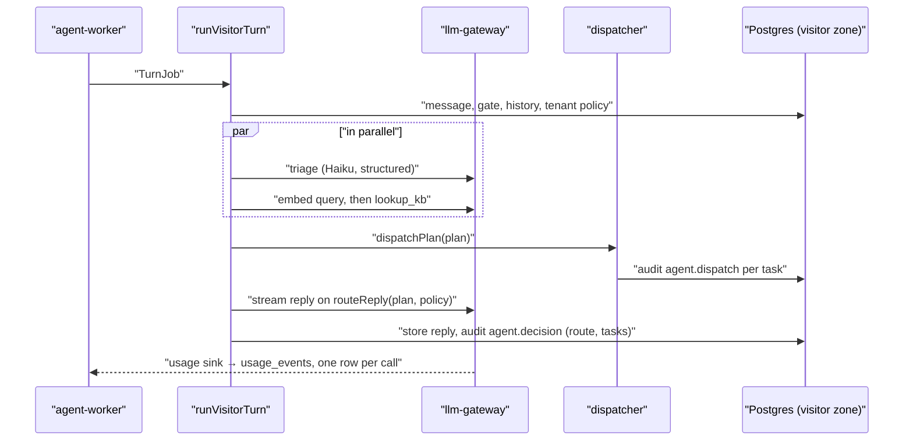

# Technical Design: FEAT-004 — Model routing, cost governor and usage ledger

> Feature from: [implementation-plan.md](../../03-planning/implementation-plan.md) §4 (E4 Agent core) and §5 (M1, fifth after FEAT-022, FEAT-002, FEAT-003 and FEAT-005), plus the ADR-025 note in §4 · Epic: E4
> Implements: NFR-13, NFR-11 (p: per-tenant LLM cost and token tracking), D6 (the cost target is measured and governed); ADR-007 decisions 1–3 and 5, ADR-021 (usage ledger), ADR-025 decisions 1–4, 6 and 8 (the turn plan, the dispatcher with an empty registry)
> Binding NFRs: NFR-01 (triage sits on the turn's critical path), NFR-04 (a failing model never strands a visitor), NFR-07 (the ledger lives in ap-southeast-1 Postgres)
> Realizes: UC-20 (p: step 5, "the AI Agent … drafts a reply", now triaged and routed; step 7, "audit-logs the decision, tool calls")
> Screens: none; see [ui-design.md](ui-design.md)
> Status: Verified (self-check §9) · Date: 2026-10-20

## 1. Intent

Every visitor turn becomes ADR-007's two-stage turn: a Haiku **triage** call returns a typed **turn plan** (ADR-025) in parallel with fact retrieval, the **ModelRouter** sends simple turns to Haiku and complex ones to Sonnet using per-tenant thresholds, and the reply prompt is laid out so its stable prefix can be cached. Every model and embedding call writes a row to the **usage ledger** (`usage_events`) with its tokens and cost, and a **cost governor** raises a tenant's Sonnet threshold when its 7-day cost per conversation passes S$0.025. A **dispatcher** in `@kaki/agent` becomes the one place where a task becomes a side effect; it ships with an empty handler registry, so each later tool feature only registers a handler. It comes fifth in M1 because the M1.5 real-model gate measures cost per conversation and cache hit rate, and every agent feature after it (FEAT-023, -025, -044, -049, -055) plugs into the turn plan and dispatcher it creates (plan §5, "risk first: cost (ADR-007, R3)").

## 2. Codebase context

Surveyed on `main` after the FEAT-005 merge (commit `8fe8196`).

- **`@kaki/llm-gateway`** (FEAT-001, FEAT-022): `createGateway(registry, providers)` → `{ generate, stream, embed }`, with the GOV-04 backstop masking `user` content (FEAT-003 §3.2). `GenerateRequest` is `{ model, system, messages, maxTokens, meta: { tenantId, conversationId? } }`; `GenerateResult.usage` already has the four token counts; `EmbedResult` has none. `route(purpose)` returns `reply.simple` for every reply ("FEAT-004 adds triage-driven routing"). `defaultRegistry('fake' | 'anthropic-dev')` maps logical models to `{ provider, modelId }` with no prices. Providers: `fake` (scripted, chars/4 token estimate) and `anthropic-dev` (Anthropic SDK 0.135, `output_config.effort: 'low'`, no caching, no tools, no structured output).
- **`@kaki/agent`** (FEAT-022): `runVisitorTurn` is gate → embed + `lookup_kb` → `composeReply` (stream → segment → render → verify → gate → release, one regeneration, then escalate) → store + audit (`agent.decision`, `tool.lookup_kb`, guardrail entries). `buildVisitorPrompt` puts the rules, the business name **and the turn's facts** in `system`, so no prefix is stable across turns. `fakeVisitorResponder` reads fact lines from `req.system`. There is no triage, no plan and no dispatcher (agent-task-routing analysis, project file `reviews/agent-task-routing-analysis.md`).
- **`@kaki/analytics`** is an empty placeholder "until FEAT-004 (usage ledger)".
- **Database:** migrations 0000–0007. The visitor zone (`app_agent_visitor`) reads tenant state only through `visitor_tenant_state()` (SECURITY DEFINER, owned by NOLOGIN `kaki_tenant_state`, returns `ai_paused, business_name, gst_registered`). Cross-tenant work in scheduler-worker runs on the outbox zone through narrow SECURITY DEFINER functions owned by NOLOGIN roles (`audit_heads_to_anchor`, FEAT-002), the pattern this feature reuses for the governor. `rls.int.test.ts` fails on a tenant-scoped table without forced RLS, a policy and a `TENANT_SCOPED_TABLES` entry.
- **Roles:** agent-worker builds the gateway with `fakeScript: fakeVisitorResponder` and logs `turn complete` with timings; scheduler-worker runs the outbox dispatcher, audit anchoring and magic-link retries on intervals.
- **Evals** (`evals/src/run.ts`): each case runs `composeReply` with `scriptedOutputs(recorded)` or the fake responder; subsets and thresholds in `thresholds.json`; no cost reporting.
- **Terraform** defines no CloudWatch alarms or SNS topics yet (they arrive at MD, ADR-021).
- **Divergences noted (reality wins):**
  - ADR-007's price table lists Sonnet 5.5 cache reads at US$0.10/MTok; the current Anthropic price list gives US$0.20 (0.1× of input). The registry uses the current price (D5); recorded in §8 for ADR-007.
  - ADR-007 has triage rewrite the retrieval query, but retrieval already runs on the raw (masked) message in parallel with triage (ADR-025 consequences; FEAT-022 D1). The plan carries no rewrite (D3).
  - ADR-007's minimum-cacheable concern: the current models cache prefixes from 512 tokens, so the ~1.2k-token triage prefix and the reply prefix both qualify.

## 3. Contracts

No HTTP endpoint or realtime event changes. The contracts are module interfaces.

### 3.1 `@kaki/llm-gateway`

```ts
type LogicalModel = 'triage' | 'reply.simple' | 'reply.complex' | 'extract' | 'summarise' | 'judge' | 'embed';  // unchanged

interface ToolDefinition { name: string; description: string; inputSchema: Record<string, unknown> }
interface ToolCall { id: string; name: string; input: unknown }

interface GenerateRequest {
  model: LogicalModel;
  /** The cached prefix: platform rules and the tenant block. Byte-stable; no timestamps or IDs (ADR-007 decision 2). */
  system: string;
  /** The full scope tool list, never varied per turn (ADR-025 decision 4). Rendered before `system`. */
  tools?: ToolDefinition[];
  /** History, oldest first, ending with the current visitor message. */
  messages: { role: 'user' | 'assistant'; content: string }[];
  /**
   * This turn's context, never cached and never stored in history: retrieved facts,
   * the current SGT time, regeneration notes. Placed after the history breakpoint,
   * before the current visitor message. Not masked: it is the business's own data.
   */
  tail?: string;
  /** Structured output: the reply is JSON matching this schema (triage). */
  outputSchema?: Record<string, unknown>;
  maxTokens: number;
  /** IDs only (ADR-021): the ledger row and traces are built from these. */
  meta: { tenantId: string; conversationId?: string; turnId?: string };
}

interface GenerateResult {
  text: string;
  toolCalls: ToolCall[];                // empty until a feature defines tools
  stopReason: 'end' | 'max_tokens' | 'refusal' | 'tool_use' | 'other';
  provider: ProviderId; providerModelId: string;
  usage: Usage;                         // unchanged shape
  costUsd: number;                      // from the registry price table (§5.1)
}

interface EmbedResult { vectors: number[][]; provider; providerModelId; usage: { inputTokens: number }; costUsd: number }

/** Per million tokens, USD. `multiplier` covers a route premium (Bedrock `au.` = 1.10, ADR-007). */
interface PriceTable { input: number; cacheWrite: number; cacheRead: number; output: number; multiplier?: number }
interface RegistryEntry { provider: ProviderId; modelId: string; price: PriceTable }

/** One ledger row's worth, emitted after every call that returned usage (ADR-021). */
interface UsageEvent {
  tenantId: string; conversationId: string | null; turnId: string | null;
  purpose: 'triage' | 'reply' | 'extract' | 'summarise' | 'judge' | 'embed';
  model: LogicalModel; provider: ProviderId; providerModelId: string;
  inputTokens: number; outputTokens: number; cacheReadInputTokens: number; cacheWriteInputTokens: number;
  costUsd: number;
}
type UsageSink = (event: UsageEvent) => Promise<void>;

function createGateway(registry: ModelRegistry, providers: ModelProvider[], opts?: { onUsage?: UsageSink }): LlmGateway;
function gatewayFromConfig(cfg: { provider; anthropicApiKey?; fakeScript?; onUsage?: UsageSink }): LlmGateway;
function costOf(usage: Usage, price: PriceTable): number;
```

`stream` emits `onUsage` once, after the provider's `done`; a stream that throws midway records nothing (the provider reports no usage for it, §8). `generate` and `embed` emit after the provider returns. The gateway awaits the sink; a sink must not throw (the roles' sinks catch and log, §5.6).

**ModelRouter** (ADR-007 decisions 1, 3 and 5), replacing `route()`:

```ts
interface RoutePolicy { complexityThreshold: number; minConfidence: number; governorStep: number }
interface RouteSignals {
  complexity: number;     // 0..1 from triage
  confidence: number;     // 0..1 from triage
  complexTask: boolean;   // the plan holds a task that always needs the larger model
  complaint: boolean;
  regeneration: boolean;  // a reply that failed verification once
}
const GOVERNOR_STEP = 0.1, MAX_GOVERNOR_STEP = 3, DEFAULT_ROUTE_POLICY = { complexityThreshold: 0.6, minConfidence: 0.5, governorStep: 0 };
function effectiveThreshold(p: RoutePolicy): number;   // min(0.95, threshold + step × 0.1)
function routeReply(s: RouteSignals, p: RoutePolicy): 'reply.simple' | 'reply.complex';
```

`routeReply` returns `reply.complex` when `regeneration`, `complexTask` or `complaint` is set, when `confidence < minConfidence`, or when `complexity ≥ effectiveThreshold(p)`; otherwise `reply.simple`. The governor moves only the complexity threshold: commitments, complaints, low confidence and regenerations stay on Sonnet whatever the step (D8).

### 3.2 `@kaki/agent` — the turn plan (ADR-025 decision 1)

```ts
const TaskKind = z.enum(['answer', 'capture_lead', 'request_commitment', 'escalate', 'handoff_channel',
  'withdraw_consent', 'data_request', 'crisis', 'abuse', 'out_of_scope']);
const Task = z.object({ kind: TaskKind, args: z.record(z.string(), z.union([z.string().max(200), z.number(), z.boolean()])).default({}) });
const TurnPlan = z.object({
  language: z.enum(['en', 'zh', 'ms', 'ta', 'other']),
  register: z.enum(['standard', 'singlish', 'formal']),
  complexity: z.number().min(0).max(1),
  confidence: z.number().min(0).max(1),
  flags: z.object({ complaint: z.boolean(), injection: z.boolean() }),
  tasks: z.array(Task).min(1).max(6),
});
type TurnPlan = z.infer<typeof TurnPlan> & { fallback: boolean };

/** ADR-025: unparseable, empty or failed triage → answer only, confidence 0 (routes to Sonnet, AGT-04). */
const FALLBACK_PLAN: TurnPlan;
function parsePlan(text: string): TurnPlan;
function triage(llm: LlmGateway, input: { history: HistoryMessage[]; meta: GenerateRequest['meta'] }): Promise<TurnPlan>;
function routeSignals(plan: TurnPlan, regeneration: boolean): RouteSignals;   // complexTask = plan has request_commitment
```

`triage` sends `model: 'triage'`, the fixed triage system prompt (no tenant data, so the prefix is shared by every tenant), the last 4 history messages and `outputSchema` (the JSON Schema of `TurnPlan`, built with `z.toJSONSchema`, `additionalProperties: false`). A provider error, a refusal, invalid JSON or a schema failure all return `FALLBACK_PLAN`; the turn goes on (NFR-04: if the provider is really down, the reply call fails too and the existing fallback closes the turn).

### 3.3 `@kaki/agent` — the dispatcher (ADR-025 decisions 2, 3 and 6)

```ts
type Scope = 'visitor' | 'coaching';
type Phase = 'safety' | 'state';           // `answer` is the turn's own reply, never dispatched
const PHASE: Record<Exclude<TaskKind, 'answer'>, Phase>;   // crisis, abuse → safety; the rest → state
type Outcome = 'done' | 'refused' | 'failed' | 'unhandled';
type RefusalReason = 'scope' | 'gate_closed' | 'consent' | 'boundary' | 'invalid_args' | 'not_in_plan';

interface DispatchContext {
  scope: Scope; tenantId: string; conversationId: string; turnId: string;
  gateOpen(): Promise<boolean>;                    // ADR-013
  consentGiven(): Promise<boolean>;                // LED-02; false until FEAT-049/058
  boundaryRules(): Promise<BoundaryRules | null>;  // APR-01; null until FEAT-054
  audit(entry: { task: TaskKind; tool?: string; outcome: Outcome; reason?: RefusalReason }): Promise<void>;
}
interface TaskResult { endTurn?: { text: string } }   // a safety handler may end the turn with a fixed text
interface TaskHandler<A = unknown> {
  kind: Exclude<TaskKind, 'answer'>;
  scopes: Scope[];
  args: z.ZodType<A>;
  needsConsent?: boolean;
  checkBoundary?: (rules: BoundaryRules | null, args: A) => boolean;   // false → refused; null rules → handler decides (fail closed)
  tool?: string;                                                       // the model-assisted tool name, if any
  run(ctx: DispatchContext, args: A, idempotencyKey: string): Promise<TaskResult>;
}
interface DispatchReport { task: TaskKind; index: number; outcome: Outcome; reason?: RefusalReason }

function createRegistry(handlers: TaskHandler[]): Registry;    // throws on a duplicate kind or tool
const visitorRegistry: Registry;   // empty in FEAT-004
function dispatchPlan(reg: Registry, plan: TurnPlan, ctx: DispatchContext): Promise<{ reports: DispatchReport[]; endTurn?: { text: string } }>;
function dispatchToolCall(reg: Registry, call: ToolCall, plan: TurnPlan, ctx: DispatchContext): Promise<DispatchReport & { result?: TaskResult }>;
```

`dispatchPlan` runs the plan's non-`answer` tasks: safety phase first, then state, each in plan order. Per task: no handler → `unhandled`; the handler's `scopes` exclude `ctx.scope` → refused `scope`; `gateOpen()` false → refused `gate_closed`; args fail Zod → refused `invalid_args`; `needsConsent` without consent → refused `consent`; `checkBoundary` false → refused `boundary`; else `run(ctx, args, "<turnId>:<index>")` → `done`, or `failed` if it throws (the next task still runs). Every task is audited through `ctx.audit` with its kind and outcome, never arguments or text. A safety task whose result has `endTurn` stops the dispatch; later tasks are not run and are not audited.

`dispatchToolCall` resolves the tool name to a handler (none → refused `scope`, since the scope list defines the tools), refuses a tool whose kind is not in this turn's plan (`not_in_plan`, ADR-025 decision 3), then applies the same checks. No tool exists yet, so no turn calls it in FEAT-004; it is unit-tested for the features that add tools.

## 4. Schema changes

Migration `0008_usage_ledger.sql` (drizzle-kit, table DDL) and `0009_usage_ledger_rls.sql` (hand-written: RLS, grants, functions).

**`usage_events`** (ADR-021; the analytics module's ledger, architecture §5.2 `usage.record`):

| Column | Type | Notes |
|---|---|---|
| `tenant_id` | uuid not null → tenants | RLS key |
| `id` | uuid default random | PK `(tenant_id, id)` |
| `conversation_id` | uuid null | null for calls outside a conversation (extraction, FEAT-012) |
| `turn_id` | uuid null | the visitor message the turn answers |
| `purpose` | text, check in `triage, reply, extract, summarise, judge, embed` | |
| `model` | text | logical model |
| `provider`, `provider_model_id` | text | |
| `input_tokens`, `output_tokens`, `cache_read_input_tokens`, `cache_write_input_tokens` | integer not null default 0, check ≥ 0 | |
| `cost_usd` | numeric(14,10) not null, check ≥ 0 | at the registry price when written |
| `created_at` | timestamptz not null default now() | |

Index `(tenant_id, created_at)`. Forced RLS with `tenant_isolation`; added to `TENANT_SCOPED_TABLES` and the RLS suite. Grants: `app_agent_visitor` INSERT only. No dashboard grant yet (DSH-08 is FEAT-067); no role gets UPDATE or DELETE.

**`tenants`** (the Tenant entity; routing policy is tenant configuration, ADR-007 decision 1):

| Column | Type |
|---|---|
| `route_complexity_threshold` | real not null default 0.6, check 0..1 |
| `route_min_confidence` | real not null default 0.5, check 0..1 |
| `cost_governor_step` | smallint not null default 0, check 0..3 |
| `cost_governor_changed_at` | timestamptz null |

**`visitor_tenant_state()`** is dropped and recreated with four more columns (`route_complexity_threshold, route_min_confidence, cost_governor_step` and nothing else new), and `kaki_tenant_state` gets SELECT on the three columns. Its owner, grant and fail-closed behaviour are unchanged.

**Governor function** (D9): NOLOGIN role `kaki_cost_governor` with SELECT on `usage_events`, SELECT `(id, cost_governor_step, cost_governor_changed_at)` and UPDATE `(cost_governor_step, cost_governor_changed_at)` on `tenants`, and policies `cost_governor` on both tables `FOR ALL TO kaki_cost_governor USING (true)`. Function:

```sql
cost_governor_evaluate(p_raise_above_usd numeric, p_relax_below_usd numeric, p_min_conversations int)
  RETURNS TABLE (tenant_id uuid, old_step smallint, new_step smallint, avg_usd numeric, conversations bigint)
```

For every tenant with at least `p_min_conversations` distinct `conversation_id`s in `usage_events` over the last 7 days, `avg = sum(cost_usd) / count(distinct conversation_id)` over rows with a conversation. Raise one step when `avg > p_raise_above_usd`, the step is below 3 and the last change is more than 24 hours old (or never); lower one step when `avg < p_relax_below_usd`, the step is above 0 and the last change is more than 7 days old. It updates those tenants and returns one row per change. SECURITY DEFINER, owned by `kaki_cost_governor`, EXECUTE granted to `app_outbox` only.

Rollback: the project has no down migrations (drizzle-kit forward-only); the skeleton has never been deployed, and `pnpm stack:reset` rebuilds local stacks.

## 5. Component design

### 5.1 Gateway: prices, usage and the provider mapping

- **Registry prices** (USD per MTok, from the Anthropic price list on 2026-10-20 and ADR-007): Haiku 5.5 0.10 / 0.125 / 0.01 / 0.50; Sonnet 5.5 2.00 / 2.50 / 0.20 / 10.00; Opus 5.5 4.00 / 5.00 / 0.20 / 20.00 (input / 5-minute cache write / cache read / output). The `fake` registry prices its models as their Claude counterparts (`fake-haiku` as Haiku, `fake-sonnet` as Sonnet, `fake-opus` as Opus), so a local or eval run reports a realistic cost. Embeddings: Cohere Embed Multilingual v3 at US$0.10/MTok input (ADR-019), used for `fake-embed` too. The Bedrock entries (multiplier 1.10) are added with the Bedrock provider at MD.
- **`costOf(usage, price)`** = `(input × p.input + cacheWrite × p.cacheWrite + cacheRead × p.cacheRead + output × p.output) / 1e6 × (multiplier ?? 1)`, where `input` is the uncached input count (Anthropic's `input_tokens` excludes cached tokens).
- **`createGateway`** resolves the entry, calls the provider, sets `costUsd` and emits a `UsageEvent` with `purpose` derived from the logical model (`reply.simple`/`reply.complex` → `reply`).
- **`anthropic-dev`** maps the request to the Messages API:
  - `tools` → `tools` with `input_schema`; none sent when empty.
  - `system` → one text block with `cache_control: { type: 'ephemeral' }`.
  - History (all messages but the last) → messages; the last history message's last block gets `cache_control` when there is history.
  - The last message (the visitor's) → a user message whose content is `[tail block (if any), visitor text]`; consecutive user messages are merged by the API.
  - `outputSchema` → `output_config: { effort: 'low', format: { type: 'json_schema', schema } }`; otherwise `output_config: { effort: 'low' }` as today.
  - `tool_use` blocks → `toolCalls`; `stop_reason: 'tool_use'` → `'tool_use'`.
- **`fake`** keeps its script contract; usage gains `toolCalls: []`; it reports no cache tokens (it has no cache), and the tail counts as input.
- **Masking:** the GOV-04 backstop still masks `user` message content; `tail` and `system` are trusted business data and are not masked (FEAT-003 §3.2 rule).

### 5.2 Prompt layout (ADR-007 decision 2)

`buildVisitorPrompt` is split:

| Part | Content | Changes when |
|---|---|---|
| `tools` | the visitor scope's tool definitions from the registry (empty now) | a feature adds a tool (deploy) |
| `system` | platform rules (today's slot rule, protected-field list, injection rule) and the tenant block (`businessName`, GST registration) | the owner edits the business profile |
| breakpoint | | |
| `messages[0..n-2]` | history, append-only within the 10-message window | every turn (appended) |
| breakpoint | | |
| `tail` | `<facts>` lines (unchanged format), `Current time in Singapore: <ISO, minutes>`, and, on a regeneration, the blocked-continuation note | every turn |
| `messages[n-1]` | the current visitor message | every turn |

The fake responder reads fact lines from `req.tail` instead of `req.system`. The triage prompt follows the same rule: a fixed system prompt (no tenant data) and the recent history, so its prefix is shared across tenants.

### 5.3 The turn



1. Read the message, the gate and the tenant state (now with its route policy) as today.
2. Gate closed → today's paused/silent behaviour; no triage call is made.
3. `Promise.all([triage(...), embed + lookup_kb])`. The embed failure path is unchanged (fallback, D6 of FEAT-022). Triage failure yields `FALLBACK_PLAN`.
4. `dispatchPlan(visitorRegistry, plan, ctx)` with `ctx.audit` appending `agent.dispatch` (`{ task, outcome, reason? }`, all codes) in the tenant's transaction. With the empty registry every non-`answer` task is `unhandled`. An `endTurn` result stores its text as an `agent` message with outcome `ended` and skips the reply (no handler returns one yet; FEAT-025's crisis handler will).
5. `composeReply` gets `model: routeReply(routeSignals(plan, false), policy)` for the first attempt and `reply.complex` for the regeneration (ADR-007: "any turn that failed verification once").
6. `agent.decision` gains `route` (`reply_simple` / `reply_complex`), `tasks` (the plan's kinds) and `planFallback`; the result gains `route`, `plan` and `triageMs` for the worker's log line.

`TurnDeps` gains nothing: usage reaches the ledger through the gateway's sink, configured by the role (§5.6), and `meta.turnId` is the visitor message ID.

### 5.4 `@kaki/analytics`

- `usage.record(tx: Tx, event: UsageEvent)`: one insert into `usage_events` (the tenant's transaction; RLS checks the tenant).
- `usageSink(zdb, log)`: a `UsageSink` that runs `withTenant(zdb, e.tenantId, tx => usage.record(tx, e))` and logs a warning on failure instead of throwing, so a ledger outage never fails a visitor turn (NFR-04 over NFR-13; D7).
- `runCostGovernor(zdb, { targetSgd, relaxSgd, usdToSgd, minConversations })`: calls `cost_governor_evaluate` with the SGD limits converted to USD and returns the changes. Defaults: target S$0.025 (ADR-007 decision 3), relax S$0.020 (D9), rate 1.35 (ADR-007), 20 conversations.

`@kaki/analytics` depends on `@kaki/db` and `@kaki/llm-gateway` (types only).

### 5.5 Fake triage

`fakeTriage(req)` (in `@kaki/agent`, next to `fakeVisitorResponder`) returns a deterministic plan for local development and E2E: English/Chinese by script, Singlish by particles (`lah`, `leh`, `can or not`); `request_commitment` for quote/discount/"can deliver"/打折, `capture_lead` for "my number/email is", `escalate` for "talk to a person"/真人, `withdraw_consent` for "stop contacting"/"delete my details"; complexity 0.8 for a commitment or 3+ products mentioned, else 0.2; confidence 0.9. `fakeAgentScript(req)` returns `fakeTriage` output for `model: 'triage'` and `fakeVisitorResponder` otherwise; agent-worker passes it as the fake script.

### 5.6 Roles and configuration

- **agent-worker:** `gatewayFromConfig({ …, fakeScript: fakeAgentScript, onUsage: usageSink(visitorDb, logger) })`. The `turn complete` line adds `route`, `tasks` (kinds), `planFallback`, `triageMs` and the turn's `costUsd` and cache-read tokens (summed by a per-turn counter on the sink), IDs and codes only (NFR-11).
- **scheduler-worker:** an hourly `runCostGovernor(outboxDb, …)` (`COST_GOVERNOR_INTERVAL_MS`, default 3,600,000; the limits from `COST_GOVERNOR_TARGET_SGD`, `COST_GOVERNOR_RELAX_SGD`, `USD_SGD_RATE`, `COST_GOVERNOR_MIN_CONVERSATIONS`, all with the defaults above). Each change logs at `warn`: `{ event: 'cost_governor.step_changed', tenantId, oldStep, newStep, avgSgd, conversations }`. This line is the operator alert until MD's CloudWatch metric filter and FEAT-070's console (§8). All new variables go in each role's `.env.example`.

### 5.7 Evaluation (ADR-025 decision 8, NFR-13)

- `Case` gains `plan` (the recorded triage output, as a `TurnPlan` object; the fake plays it back), `expectTasks` (the task kinds, order-free) and `expectRoute` (`reply.simple` / `reply.complex`). A case with `expectTasks` or `expectRoute` belongs to the new **`multi-task`** subset, threshold 0.9 in `thresholds.json`.
- The runner runs the agent's own `triage` and `routeReply` before `composeReply` for every case (with `plan` recorded, the fake provider returns it for the triage call; without it, `fakeTriage`). It scores `expectTasks` against the plan and `expectRoute` against the route, and runs `dispatchPlan` on the empty registry to check every non-answer task is reported (the dispatch check).
- A usage sink in the runner sums cost per case; the report ends with `cost: <n> conversations, US$<total>, S$<avg> per conversation (target ≤ S$0.03)`. Each case is one conversation.
- New case file `feat-004-multi-task.json`: at least 12 cases in English, Singlish and Chinese covering a single question (simple), a multi-item quote (commitment + answer, complex), price + lead details, a request for a person, consent withdrawal, a complaint, and a fallback plan (invalid triage JSON → answer, complex). Six are `fast`.

## 6. Acceptance criteria

- **AC-1 (ADR-025 decision 1; UC-20 step 5).** Triage is called with `model: 'triage'`, a JSON-schema output and the recent history, and its output is parsed into a `TurnPlan`. A message with a price question and a quote request yields a plan with both an `answer` and a `request_commitment` task. Invalid JSON, a schema violation, an empty task list, a refusal or a provider error each yield the fallback plan (`[answer]`, confidence 0, `fallback: true`), and the turn still answers.
- **AC-2 (ADR-007 decision 1; NFR-13).** `routeReply` sends a plan with complexity below the tenant's threshold, confidence at or above its minimum, no commitment and no complaint to `reply.simple` (Haiku); complexity at or above the threshold, low confidence, a `request_commitment` task, a complaint flag, or a regeneration each go to `reply.complex` (Sonnet). A tenant's own thresholds are used, and each governor step raises the complexity threshold by 0.1 (capped at 0.95) without moving the other rules.
- **AC-3 (ADR-007 decision 2).** For two turns of the same tenant with different facts, different visitor messages and different times, the reply requests' `system` strings are byte-identical, the second request's messages extend the first's (append-only within the window), and facts and the current SGT time appear only in `tail`. The triage `system` is identical across tenants. The `anthropic-dev` request places `cache_control` on the system block and on the last history message, puts the tail before the visitor text in the final user message, and sends `output_config.format` for triage.
- **AC-4 (ADR-021; NFR-11, NFR-13).** One visitor turn writes one `usage_events` row per model or embedding call (triage, embed, reply, plus any regeneration), each with the tenant, conversation, turn (the visitor message ID), purpose, logical model, provider model, the four token counts and `cost_usd`; the rows hold no message text. A tenant cannot read or insert another tenant's rows (RLS suite). A failing ledger insert is logged and the visitor still gets the reply.
- **AC-5 (NFR-13).** `costOf` matches a hand calculation for each price table, including cache writes, cache reads and a multiplier; `GenerateResult.costUsd` and the ledger row carry it.
- **AC-6 (ADR-007 decision 3; D6).** With seeded ledger rows: a tenant averaging above S$0.025 per conversation over 7 days with at least 20 conversations moves up one step and a `cost_governor.step_changed` warning is logged; a second run within 24 hours does not move it again; it never passes step 3; a tenant below S$0.020 whose last change is more than 7 days old moves down one step; a tenant with fewer than 20 conversations and a tenant within the band are unchanged. The next turn of a raised tenant routes with the raised threshold.
- **AC-7 (ADR-025 decisions 2, 3 and 6; AGT-06 acceptance "tool calls are audited").** With test handlers registered: safety tasks run before state tasks, in plan order within each phase; a handler outside the turn's scope, a closed gate, invalid arguments, missing consent and a failed boundary check each give `refused` with that reason and do not run the handler; a throwing handler gives `failed` and the next task still runs; a safety `endTurn` stops the dispatch; each run receives the key `<turnId>:<index>`; a tool call with an unknown name, or whose kind is not in the plan, is refused; every dispatched task is audited with its kind and outcome and no argument values. A duplicate kind or tool name in a registry throws.
- **AC-8 (ADR-025 consequences; UC-20).** With the production (empty) registry, a visitor turn whose plan holds `answer`, `capture_lead` and `request_commitment` stores the verified answer as before, writes one `agent.dispatch` entry per non-answer task with outcome `unhandled`, and records `route` and the task kinds in `agent.decision`. The FEAT-022 integration tests, eval cases and E2E specs pass unchanged in what they assert.
- **AC-9 (NFR-01).** Triage and retrieval run concurrently: with a provider that delays triage and the embedder by 200 ms each, both calls start before either finishes, and the turn's time to the reply request is under 350 ms. `triageMs` is reported.
- **AC-10 (ADR-025 decision 8; NFR-13).** `pnpm eval` runs triage and routing for every case, reports the `multi-task` subset against its 0.9 threshold, fails a case whose plan or route differs from `expectTasks` / `expectRoute`, and prints the cost per conversation. All subsets pass on the fake provider.

## 7. Decisions

- **D1 — The turn plan lives in `@kaki/agent`, the router's inputs stay provider-neutral.** Driver: ADR-007 decision 5 keeps `llm-gateway` free of agent concepts; ADR-025 puts the dispatcher in `agent`. `routeReply` takes `RouteSignals`, which `agent` derives from the plan. Rejected: the plan schema in `@kaki/contracts` (no API carries it). Consequence: the eval runner imports the plan from `@kaki/agent`, as it already imports `composeReply`.
- **D2 — `tail` is a separate request field, not a user message.** Driver: the GOV-04 backstop masks every `user` message; facts may hold the business's own bank account (PayNow), which FEAT-003 deliberately leaves unmasked in `system`. A field the gateway knows is trusted keeps that rule. Rejected: facts as a second user message (they would be masked, and the gateway could not tell them from visitor text).
- **D3 — No query rewrite in the plan.** Driver: retrieval runs in parallel with triage on the raw message (ADR-025 consequences), so a rewrite would add a second retrieval on the critical path (NFR-01). Rejected: the field without a reader. FEAT-023 can add it if the M1.5 Singlish/Chinese retrieval check (P3) needs it.
- **D4 — The reply always runs unless a safety task ends the turn.** Driver: ADR-025 decision 6 ("then the visitor-facing answer, which reflects what actually happened") and UC-20's postcondition. A plan without `answer` (only `capture_lead`, say) still gets a verified reply. Rejected: skipping the reply when no `answer` task is planned, which would leave the visitor with no message on a triage miss.
- **D5 — Prices are registry configuration in USD, with a route multiplier, at the current list price.** Driver: ADR-007 decision 5 ("registry … price table"); the current list gives Sonnet 5.5 cache reads at US$0.20, not ADR-007's US$0.10. The ledger stores the cost computed at write time, so a later price change does not rewrite history.
- **D6 — Tool definitions and tool calls are plumbed but empty.** Driver: ADR-025 decisions 3–4 fix where tools sit in the cached prefix and that calls go through the dispatcher; FEAT-004 owns the dispatcher. `GenerateRequest.tools` and `GenerateResult.toolCalls` exist, the provider maps them, and `dispatchToolCall` is unit-tested; the streaming reply does not yet consume tool calls, because no tool exists. The first model-assisted tool feature (FEAT-049) wires tool calls from the stream into `dispatchToolCall`.
- **D7 — The ledger is written outside the turn's transactions, best effort.** Driver: the gateway is called while no transaction is open (FEAT-022 D8), and embeds and triage happen before the reply is stored. A failed insert is logged (warn) rather than failing the turn (NFR-04). Rejected: collecting usage and writing it with the reply, which loses the rows of turns that end early (fallback, gate closed) and of non-turn calls.
- **D8 — The governor moves only the complexity threshold.** Driver: ADR-007 decision 3 ("raises that tenant's Sonnet threshold one step"). Commitments (`draft_approval`), complaints, low confidence and regenerations go to Sonnet by ADR-007 decision 1 for accuracy (AGT-02), whatever the cost. Step size 0.1, at most 3 steps, cap 0.95, so a fully raised tenant still sends its clearly complex turns to Sonnet.
- **D9 — Governor cadence and hysteresis.** Driver: ADR-007 decision 3 names only the raise. Without a way back, a one-week spike would lower a tenant's quality for good. Raise at most once per 24 hours; lower one step after 7 days below S$0.020 (so the window reflects the new policy); ignore tenants with fewer than 20 conversations in the window (too few to average). Runs hourly in scheduler-worker through a narrow SECURITY DEFINER function, the FEAT-002 anchoring pattern, so no zone gains cross-tenant read of the ledger.
- **D10 — Per-tenant routing columns on `tenants`.** Driver: ADR-007 decision 1 ("routing thresholds are per-tenant configuration"); the Tenant entity owns its settings, and the send gate already reads `tenants` through `visitor_tenant_state()`. No owner screen: thresholds are operator settings (FEAT-070) and are tuned against the eval set. Rejected: a new settings entity (an architecture amendment for two numbers).
- **D11 — The usage sink is a gateway option, not a dependency.** Driver: `llm-gateway` may not import `db` or `analytics` (module boundaries); every call, from any module, must be recorded. The role wires `analytics.usageSink` into the gateway it builds; the eval runner wires an in-memory sum.

## 8. Escalations and open items

- **ADR-007 price table (open issue, not an escalation):** Sonnet 5.5 cache reads are US$0.20/MTok on the current list, not US$0.10. At the base scenario's cache mix this moves the per-conversation estimate by well under S$0.001; the verdict stands. Suggested: note it at the next ADR-007 revision. The registry uses the current price (D5).
- **Operator alert channel:** the governor's alert is a structured `warn` log line until MD adds the CloudWatch metric filter, alarm and SNS route (ADR-021) and FEAT-070 shows it on the operator console. Recorded in scaffold-notes §5 for MD.
- **Cache hit rate alarm** (ADR-007 consequences, < 60% on warm tenants): the ledger carries the counts; the alarm is defined at MD with the other ADR-021 alarms.
- **Stream failures record no usage:** a provider error midway through a stream returns no usage, so its partial output is not in the ledger. Small (a failed stream is rare and short) and corrected by the provider's bill; revisit if M1.5 shows otherwise.
- **History window and cache:** once a conversation exceeds `HISTORY_LIMIT` (10 messages) the window slides and the history prefix no longer matches, so only `tools` + `system` hit the cache from then on. FEAT-026 (AGT-12 summaries) replaces the sliding window.
- **Trace attributes:** NFR-11 traces with model and route as span attributes are not added; the `turn complete` log line carries them. The OpenTelemetry span work joins MD's observability setup.
- **M1.5 measurements:** triage accuracy on the multi-task subset, the real Sonnet share and cost per conversation, and the cache hit rate are measured on the real model at M1.5; the fake-provider numbers are structural only.
- No architecture amendment is needed: `usage_events` is ADR-021's ledger in the analytics module; the routing columns belong to Tenant.

## 9. Self-check

- **Coverage:** NFR-13 → AC-2, AC-4, AC-5, AC-6, AC-10 (T1–T4, T8–T10). NFR-11 (p) → AC-4 and the log fields (T4, T9). ADR-025 decisions 1–4, 6, 8 → AC-1, AC-3, AC-7, AC-8, AC-10 (T5–T8, T10). NFR-01 → AC-9 (T8). NFR-04 → AC-1 fallback, AC-4 ledger failure (T5, T8). UC-20 step 5 and 7 → AC-8 (T8, T11).
- **IDs:** every cited FR/NFR/UC/ADR/D exists in SRS v0.4, use-cases v0.4 and ADR-001..025.
- **Schema:** `usage_events` is ADR-021's entity owned by `analytics` (architecture §5.2); the routing columns extend Tenant. Migrations follow 0007.
- **Conventions:** module interfaces only; `withTenant` on the visitor zone; cross-tenant work through a SECURITY DEFINER function owned by a NOLOGIN role; config via Zod in each role with `.env.example` entries.
- **Breaking changes to earlier features:** `route()` is replaced by `routeReply` (one caller, `composeReply`); `buildVisitorPrompt` moves facts from `system` to `tail` and `fakeVisitorResponder` follows (FEAT-022 tests that read `req.system` for facts are updated to `req.tail`; what they assert about replies does not change); `visitor_tenant_state()` returns more columns (one caller, `@kaki/tenancy`).
