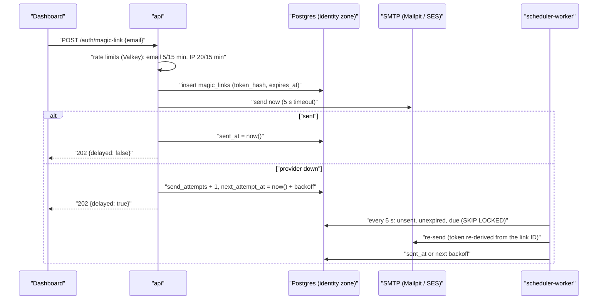

# Technical Design: FEAT-005 — Sign up, sign in and sessions

> Feature from: [implementation-plan.md](../../03-planning/implementation-plan.md) §4 (E1 Identity) and §5 (M1, fourth after FEAT-022, FEAT-002 and FEAT-003) · Epic: E1 Identity and access
> Implements: ONB-01, AUTH-01, AUTH-02 (p: expiry, sign-out, sign-out everywhere, immediate revocation; the sessions list is FEAT-008), AUTH-08
> Binding NFRs: NFR-05 (ASVS L1: session management, CSRF, token storage), NFR-07 (all identity data in ap-southeast-1), NFR-17 (the magic-link email is retried, not lost)
> Realizes: UC-01 (main flow, 2a, 2b, 2c, 3a; 1a in part), UC-02 (steps 1, 2, 5, 6, 6a, 2a; MFA steps 3, 3a–3c are FEAT-006, the switcher in step 4 is FEAT-007)
> Screens: SCR-APP-001, SCR-APP-002, SCR-APP-003, SCR-APP-059 (session expired); see [ui-design.md](ui-design.md)
> Status: Verified (self-check §9) · Date: 2026-10-20

## 1. Intent

Replaces the walking skeleton's dev-only sign-in with real accounts: a person signs up or signs in with an emailed magic link or with Google, a first-time user names their business and accepts the Terms of Service, Acceptable Use Policy and DPA, and a tenant is created with them as its Owner. Sessions live in Postgres and stop working the moment they are signed out, expire, or lose their membership. It comes fourth in M1 because the M1 demo needs a real sign-in, and every owner-facing feature after it builds on the session it creates (plan §5, "auth before anything owner-facing beyond the dev sign-in").

## 2. Codebase context

Surveyed on `main` after the FEAT-003 merge (commit `93a2520`).

- **The stub being replaced** (scaffold-notes §4): `apps/api/src/dev-auth.ts` (`POST /api/dev/sign-in`, `/api/dev/sign-out`), `packages/identity/src/dev-session.ts` (an HMAC-signed `kaki_dev_session` cookie with `{ tenantId, userId: 'dev-owner', role, exp }`), `apps/dashboard/src/pages/dev-sign-in.tsx`, the `KAKI_DEV_AUTH` flag (api config, `turbo.json` globalEnv, `gen-local-env.mjs`, Terraform's api env), and the CI step that greps the production bundles for `dev/sign-in`.
- **Session readers today:** `sessionFrom(req)` in `apps/api/src/app.ts` (used by `/api/v1/me`, `/api/v1/conversations` and the fact routes through `registerFactRoutes(app, deps, sessionFrom)`), and the realtime `/ws` handler. Both return `{ tenantId, userId, role }`, and every tenant query is `withTenant(dashboardDb, s.tenantId, …)`. Keeping that shape keeps every call site unchanged (§5.2).
- **Contract conventions:** Zod schemas in `@kaki/contracts`, parsed by hand in handlers; errors are `{ error: code, message }` from one `setErrorHandler` (400 `bad_request`, 401 `unauthorized`, 403 `forbidden`, 404 `not_found`, 409 codes, 503 `unavailable`). Dashboard routes live under `/api/v1/`; the dashboard reaches them same-origin (Vite proxy locally, CloudFront path routing in AWS).
- **Database:** migrations 0000–0005. Trust zones (`TrustZone`): `dashboard`, `visitor`, `outbox`, each a login role created by `pnpm db:setup` (`LOGIN_ROLES`). Tenant-scoped tables carry `tenant_id` with forced RLS; `packages/db/test/rls.int.test.ts` fails if any table with a `tenant_id` column lacks forced RLS, a policy, or an entry in `TENANT_SCOPED_TABLES`. `app_dashboard` can SELECT `tenants` and INSERT audit rows; nobody can INSERT `tenants` except the migration owner (the seed).
- **Audit:** `audit.append(tx, tenantId, entry)` in the tenant's transaction; it needs `audit_head_lock()` EXECUTE and INSERT on `audit_entries` (FEAT-002).
- **Valkey** is configured for the api (`VALKEY_URL`, pub/sub only so far). **Mailpit** runs in compose (SMTP :1025, UI/API :8025); nothing sends mail yet.
- **The schema has no** `users`, `sessions`, `memberships` or terms tables; `Role` is `'owner' | 'admin' | 'agent'` in `@kaki/identity` (`agent` is SRS "Staff").
- **E2E** signs in through the dev sign-in in all three specs.
- **Divergences noted (reality wins):**
  - ADR-020 names Better Auth as the candidate library "to be confirmed in detailed design". It is not adopted (D1).
  - ADR-005 lists `app_dashboard`, `app_agent_visitor`, `app_ingest`, `app_operator`; the skeleton already added `app_outbox`. This feature adds `app_identity` (D2), recorded in §8 for the next ADR-005 revision.
  - ADR-020 caches session lookups in Valkey for ≤ 30 s; this feature reads Postgres on every request (D5).

## 3. API contracts

All bodies are JSON and validated with the Zod schemas below (new in `@kaki/contracts`). The session cookie is `kaki_session`: an opaque 256-bit random token, `HttpOnly; SameSite=Lax; Path=/`, plus `Secure` unless `COOKIE_SECURE=false` (local HTTP only). Errors use the existing envelope.

**Cross-origin guard (NFR-05, CSRF):** every `POST`, `PATCH`, `PUT` or `DELETE` under `/api/` that carries an `Origin` header other than `PUBLIC_APP_URL`'s origin is refused with 403 `forbidden` before any handler runs. With `SameSite=Lax` this is the second of two layers (D7).

### 3.1 Sign-in options and terms

`GET /api/v1/auth/options` (no auth) → 200 `AuthOptions`
```ts
{ google: boolean,                                   // false when GOOGLE_CLIENT_ID is unset
  terms: { document: 'tos' | 'aup' | 'dpa', title: string, version: string }[] }
```
The current versions come from `CURRENT_TERMS` in `@kaki/identity` (§5.1, D9).

### 3.2 Magic link (AUTH-01, UC-01 steps 1–2, UC-02 steps 1–2)

`POST /api/v1/auth/magic-link` (no auth) — body `{ email: string }`: trimmed, lower-cased, a valid address of at most 254 characters.
- **202** `{ delayed: boolean }` for every well-formed address, registered or not, so the response reveals nothing (AUTH-01). A link row is written and the email is sent (§5.3). `delayed: true` means the email provider failed and the link is queued (UC-01 2c, NFR-17).
- **400** `bad_request` for a malformed address.
- **429** `rate_limited` "Too many sign-in links. Try again in a few minutes." when the address has had 5 links in the last 15 minutes, or the client IP 20 (AUTH-01, UC-01 2b). The limit counts requests, so it is the same for registered and unregistered addresses.

The emailed link is `{PUBLIC_APP_URL}/auth/verify#token={token}`. The token sits in the fragment, so it never reaches a server log or a `Referer` header, and the page posts it (D4).

`POST /api/v1/auth/magic-link/verify` (no auth) — body `{ token: string }` (43 base64url characters).
- **200** `{ next: 'app' | 'create-workspace' }` with `Set-Cookie: kaki_session=…`. The link is consumed atomically; a new user is created for an unknown address (§5.4). `next` is `app` when the user has an active membership, else `create-workspace`.
- **400** `link_expired` "This link has expired." / `link_used` "This link has already been used." / `link_invalid` "This link isn't valid." No session is created (AUTH-01 "rejected with an option to request a new one", UC-01 2a, UC-02 2a).

### 3.3 Google (AUTH-01, ONB-01)

`GET /api/v1/auth/google/start` (no auth) → **302** to Google's authorization endpoint with `response_type=code`, `scope=openid email`, PKCE (`S256`), `state` and `nonce`. The verifier, state and nonce travel in a `kaki_oauth` cookie signed with `SESSION_SECRET` (`signToken`, 10 minutes, `Path=/api/v1/auth/google`, `HttpOnly`, `SameSite=Lax`). **404** `not_found` when Google isn't configured.

`GET /api/v1/auth/google/callback?code&state` (no auth) → **302** to `/` (has an active membership) or `/welcome` (doesn't), with `Set-Cookie: kaki_session=…` and the `kaki_oauth` cookie cleared. The ID token must verify against Google's keys with the expected issuer, audience and nonce, and carry `email_verified: true`. Any failure (missing or bad cookie, state mismatch, error from Google, unverified email, a `sub` that doesn't match the one bound to the user) → **302** `/sign-in?error=google`, no session.

### 3.4 Session and account

`GET /api/v1/me` (session) → 200 `Me` — **changed shape** (D10):
```ts
{ user: { id: uuid, email: string },
  role: 'owner' | 'admin' | 'agent' | null,           // null without a workspace
  tenant: { id: uuid, name: string, status: 'active' | 'suspended' } | null }
```
**401** `unauthorized` with no cookie; **401** `session_expired` "Your session has ended. Sign in again." when a cookie is present but its session is unknown, revoked, idle for 12 hours or 30 days old (the cookie is cleared) (AUTH-02, UC-02 6a).

`POST /api/v1/auth/sign-out` (session) → **204**, revokes this session, clears the cookie (UC-02 step 6). Without a valid session it still clears the cookie and returns 204.

`POST /api/v1/auth/sign-out-everywhere` (session) → **204**, revokes every session of the user, this one included (AUTH-02). 401 without a session.

### 3.5 Create a workspace (ONB-01, AUTH-08, UC-01 steps 3–5)

`POST /api/v1/workspaces` (session; any signed-in user) — body:
```ts
{ businessName: string,                                  // trimmed, 1–120 characters
  accepted: { tos: string, aup: string, dpa: string } }   // the versions the user saw
```
- **201** `{ tenant: { id, name, status } }`: in one transaction, a tenant (status `active`), its `business_profiles` row, an `owner` membership, three `terms_acceptances` rows (document, version, `accepted_at`), two audit entries on the new tenant's chain (`tenant.created`, `terms.accepted`), and the session's active tenant set to it.
- **409** `terms_outdated` "The terms have been updated. Please review them again." when any version differs from `CURRENT_TERMS`; nothing is created (AUTH-08).
- **400** `bad_request` for a missing name or acceptance. Declining is not a request: the user stays signed in with no workspace and can come back to SCR-APP-003 later (UC-01 3a).
- **401** without a session.

### 3.6 Dashboard routes needing a workspace

Every existing tenant route (`/api/v1/conversations`, `/api/v1/kb/*`) and the `/ws` socket require a session **with** an active, still-valid membership. A session without one gets **403** `no_workspace` "Create your workspace first." (the socket closes with 4403). Role checks (`can(role, …)`) are unchanged and read the membership's current role on every request, so a role change applies at once.

## 4. Schema changes

Migration `0006_identity.sql` (drizzle-kit generates the DDL from `schema.ts`; the RLS, roles and grants are hand-written in `0007_identity_rls.sql`, as 0001/0003/0005 do).

| Table | Columns | Keys and indexes | Conceptual entity |
|---|---|---|---|
| `users` | `id uuid` default random; `email text` not null (lower-cased); `google_sub text` null; `status text` (`active`, `disabled`) default `active`; `created_at`; `last_sign_in_at` null | PK `id`; unique `email`; unique `google_sub` | USER (architecture §5.3) |
| `memberships` | `tenant_id uuid` → tenants; `user_id uuid` → users; `role text` (`owner`, `admin`, `agent`); `status text` (`active`, `deactivated`) default `active`; `created_at` | PK `(tenant_id, user_id)`; index `(user_id)`; check on role and status | MEMBERSHIP |
| `terms_acceptances` | `tenant_id uuid` → tenants; `id uuid`; `user_id uuid` → users; `document text` (`tos`, `aup`, `dpa`); `version text`; `accepted_at timestamptz` default now | PK `(tenant_id, id)`; index `(tenant_id, document, accepted_at desc)` | terms acceptance (ADR-020; identity module, architecture §5.2) |
| `sessions` | `id uuid`; `user_id uuid` → users; `token_hash bytea` not null; `active_tenant_id uuid` null → tenants; `auth_method text` (`magic_link`, `google`); `created_at`; `last_seen_at`; `expires_at` (created + 30 days); `reauth_at` (= sign-in time, for AUTH-03 later); `revoked_at` null | PK `id`; unique `token_hash`; index `(user_id) where revoked_at is null` | session (ADR-020; identity module) |
| `magic_links` | `id uuid`; `email text`; `token_hash bytea` not null; `created_at`; `expires_at` (created + 15 minutes); `consumed_at` null; `sent_at` null; `send_attempts int` default 0; `next_attempt_at timestamptz` default now | PK `id`; unique `token_hash`; index `(next_attempt_at) where sent_at is null` | magic link (ADR-020 decision "magic links") |

- `memberships` and `terms_acceptances` are tenant-scoped: forced RLS with the `tenant_isolation` policy, added to `TENANT_SCOPED_TABLES` and the cross-tenant suite.
- `users`, `sessions` and `magic_links` are not tenant data (architecture §5.3: "every entity except USER and the platform tables carries `tenant_id`"). They have no `tenant_id` column, RLS enabled with no policy for any application role except `app_identity` (so a grant added by mistake still reads nothing), and grants to `app_identity` only. The session's tenant column is named `active_tenant_id` because it is the user's current choice, not ownership (D3).
- `terms_acceptances` is insert-only: no role has UPDATE or DELETE.

**New trust zone `identity`** (login role `app_identity`, D2). Grants:
- `users`: SELECT, INSERT, UPDATE (`google_sub`, `last_sign_in_at`); `sessions`: SELECT, INSERT, UPDATE (`last_seen_at`, `active_tenant_id`, `revoked_at`); `magic_links`: SELECT, INSERT, UPDATE (`consumed_at`, `sent_at`, `send_attempts`, `next_attempt_at`), DELETE (the 24-hour purge).
- `memberships`: SELECT through an extra policy `identity_read FOR SELECT TO app_identity USING (true)` (it must find a user's memberships across tenants before any tenant context exists), INSERT under `tenant_isolation`.
- `tenants`: INSERT under `tenant_isolation` (the caller sets `app.tenant_id` to the ID it just minted), and SELECT `(id, name, status)` under `tenant_isolation`; `business_profiles`, `terms_acceptances`: INSERT; `audit_entries`: INSERT; `audit_head_lock()`: EXECUTE.
- Nothing else: the identity zone cannot read conversations, messages, facts or audit entries.
- `app_dashboard` gains SELECT on `memberships` and `terms_acceptances` (its own tenant only, through `tenant_isolation`) for the go-live check (ONB-09) and the team page later; nothing on `users`, `sessions` or `magic_links`.

**Rollback:** drizzle migrations are forward-only here, as before. Dropping the five tables and the role reverses it; no existing table changes shape.

**Seed** (`pnpm db:setup` with `SEED_DEV_TENANTS=true`, and the test database): a user `owner@kaki-bakery.test` (owner of Kaki Bakery) and `owner@second-tenant.test` (owner of the second tenant), with acceptances of the current terms.

## 5. Component design

### 5.1 `@kaki/identity` (the module ADR-020 places it in)

| File | Responsibility |
|---|---|
| `tokens.ts` | `newSessionToken()` (32 random bytes, base64url), `hashToken(token)` (SHA-256), `magicLinkToken(secret, linkId)` = base64url(HMAC-SHA256(`MAGIC_LINK_SECRET`, linkId)) (D6) |
| `email.ts` | `normaliseEmail()` (trim, lower-case); the magic-link email's subject, text and HTML (en) |
| `magic-link.ts` | `requestMagicLink(idDb, email)` → `{ id, email, token }` · `consumeMagicLink(idDb, token)` → `{ userId, isNew }` or a typed `LinkError` (`expired`, `used`, `invalid`) · `sendMagicLink(idDb, mailer, opts, id)` and `sendPendingMagicLinks(idDb, mailer, opts)` (§5.3) |
| `users.ts` | `findOrCreateUser(tx, email)`; `signInWithGoogle(idDb, { sub, email })` binding `google_sub` on first use |
| `sessions.ts` | `createSession(idDb, { userId, method })` → token; `authenticate(idDb, token)` → `AuthContext \| null` with a reason; `revokeSession`, `revokeAllSessions(userId)` |
| `workspaces.ts` | `createWorkspace(idDb, ctx, { businessName, accepted })` (§5.5) |
| `terms.ts` | `CURRENT_TERMS`: `tos`, `aup`, `dpa`, each `{ title, version: '2026-10-20' }` |
| `google.ts` | `createGoogleSignIn({ issuer, clientId, clientSecret, redirectUri })` on `openid-client` (D1): `start()` → `{ url, cookie }`, `finish(callbackUrl, cookie)` → `{ sub, email }` |
| `capabilities.ts` | unchanged; `dev-session.ts` is deleted |

```ts
interface AuthContext {
  sessionId: string; userId: string; email: string;
  tenantId: string | null; role: Role | null;   // the active membership, re-read every request
}
```

### 5.2 Request authentication

`authenticate` is one query in the identity zone: the session by `token_hash`, joined to its user and, when `active_tenant_id` is set, the membership. It returns `null` with a reason (`missing`, `unknown`, `revoked`, `idle`, `expired`, `user_disabled`) unless:
- `revoked_at is null`, `expires_at > now()` (30 days absolute) and `last_seen_at > now() - 12 hours` (idle) (AUTH-02);
- the user is `active`.

A membership that is missing or `deactivated` leaves `tenantId` and `role` null (so the request gets 403 `no_workspace`, not a silent tenant). `last_seen_at` is moved forward when it is more than 60 seconds old, so a busy session doesn't write on every request.

In the api, `sessionFrom(req)` keeps its name and return shape (`{ tenantId, userId, role }`) for tenant routes, throwing `UnauthenticatedError` (401, with `session_expired` when a cookie was sent) or `NoWorkspaceError` (403). `/api/v1/me`, sign-out and workspace creation use `authFrom(req)`, which allows a null tenant. Realtime's `/ws` calls the same `authenticate` and closes with 4401 or 4403.

### 5.3 Magic-link delivery (NFR-17, UC-01 2c)



- The row holds the token's SHA-256 only. The plaintext is never stored: the sender re-derives it as HMAC(`MAGIC_LINK_SECRET`, link ID) (D6), so a retry needs no stored secret and a database read alone can't produce a valid link.
- Backoff: 10 s, 20 s, 40 s … capped at 2 minutes, while the link has at least 1 minute of validity left. A link that expires unsent is never sent; the user requests a new one. That is the whole meaningful retry window for a 15-minute link (D8).
- The sweep also deletes `magic_links` rows created more than 24 hours ago (their email address is personal data with no further use).
- The rate limiter is `createRateLimiter(valkeyUrl)` in `@kaki/platform`: a fixed window per key (`INCR`, then `PEXPIRE … NX`). Keys are `rl:ml:e:{sha256(email)}` and `rl:ml:ip:{ip}`, so no raw address sits in Valkey. If Valkey is unreachable the request is refused with 503 `unavailable` (fail closed). An in-memory limiter with the same interface serves unit and api integration tests.
- The mailer is `createSmtpMailer(SMTP_URL, EMAIL_FROM)` in `@kaki/platform` on nodemailer: Mailpit locally, the SES SMTP endpoint at MD.

### 5.4 Verifying a link

One identity-zone transaction:
1. `update magic_links set consumed_at = now() where token_hash = $1 and consumed_at is null and expires_at > now() returning email`. A row means success.
2. Otherwise read the row by hash to tell `used` from `expired`; no row is `invalid`.
3. `findOrCreateUser(email)` (insert … on conflict (email) do nothing, then select), `last_sign_in_at = now()`.
4. The session's active tenant is the user's earliest active membership, or null (D11).
5. Insert the session with a fresh token (no fixation: every sign-in mints a new token).

Google sign-in finishes with steps 3–5 from the verified email, and binds `google_sub` the first time; a later Google sign-in whose `sub` differs from the bound one is refused.

### 5.5 Creating a workspace

In the identity zone, `withTenant(idDb, newTenantId, …)` with a tenant ID the server just minted (a trusted source under ADR-005: it never comes from the request):
1. Compare `accepted` with `CURRENT_TERMS`; any difference → `TermsOutdatedError` (409).
2. Insert the tenant: the name; a slug from the name (lower-case ASCII letters and digits joined by hyphens, at most 40 characters, `workspace` if empty) plus a 6-character random suffix; a random widget key `wk_` + 24 base64url characters; no allowed origins yet (FEAT-032).
3. Insert `business_profiles` (GST unknown → `false` until FEAT-009 asks), the `owner` membership and three `terms_acceptances`.
4. `audit.append` `tenant.created` (actor `user:{userId}`, subject `tenant:{id}`) and `terms.accepted` (payload `{ tos, aup, dpa }` as version codes).
5. Set the session's `active_tenant_id`.

### 5.6 Wiring and configuration

| Unit | Change |
|---|---|
| `packages/db` | `TrustZone` gains `identity`; `LOGIN_ROLES` gains `app_identity`; testing's `ZONE_ROLE`; seed users (§4) |
| `apps/api` | `IDENTITY_DATABASE_URL`, `PUBLIC_APP_URL`, `MAGIC_LINK_SECRET`, `SMTP_URL`, `EMAIL_FROM`, `COOKIE_SECURE`, `GOOGLE_CLIENT_ID`, `GOOGLE_CLIENT_SECRET`, `GOOGLE_ISSUER` (default `https://accounts.google.com`); `KAKI_DEV_AUTH` removed. `Deps` gains `identityDb`, `mailer`, `rateLimiter`, `google` (null when unconfigured). New `src/auth.ts` registers §3's routes; `dev-auth.ts` deleted |
| `apps/realtime` | `IDENTITY_DATABASE_URL`; `/ws` authenticates through `@kaki/identity` |
| `apps/scheduler-worker` | `IDENTITY_DATABASE_URL`, `MAGIC_LINK_SECRET`, `SMTP_URL`, `EMAIL_FROM`, `PUBLIC_APP_URL`; a 5-second magic-link sweep loop beside the outbox dispatcher |
| `scripts/gen-local-env.mjs` | `APP_IDENTITY_PASSWORD`, `MAGIC_LINK_SECRET`, the new variables; `COOKIE_SECURE=false`; no `KAKI_DEV_AUTH` |
| `infra/terraform/envs/prod` | secrets `identity-database-url` and `magic-link-secret` wired to api, realtime and scheduler-worker; `KAKI_DEV_AUTH` removed. Never applied until MD |
| `turbo.json` | `KAKI_DEV_AUTH` removed from `globalEnv` |
| `.github/workflows/ci.yml` | the bundle check now greps for `dev/sign-in` and `kaki_dev_session`, so the removed sign-in can't come back |
| `apps/dashboard` | §5.7 |

### 5.7 Dashboard

- Routes outside the shell: `/sign-in` (SCR-APP-001, with its "check your email" state), `/auth/verify` (SCR-APP-002's expired and used states), `/welcome` (SCR-APP-003), `/session-expired` (SCR-APP-059), `/legal/:document` (the terms pages, D9). `dev-sign-in.tsx` is deleted.
- `/setup` inside the shell: the wizard's entry route, a placeholder naming FEAT-009, where a new workspace lands (ONB-01 "land in the wizard"; the wizard itself is FEAT-009).
- `AppShell` reads `/api/v1/me`: 401 `unauthorized` → `/sign-in`; 401 `session_expired` → `/session-expired`; `tenant: null` → `/welcome`. The top bar's avatar becomes an account menu with the email, "Sign out" and "Sign out of all devices".
- `UnauthorizedError` carries the code so any query that hits 401 later (an idle session) routes to `/session-expired`.

## 6. Acceptance criteria

| AC | Criterion | Traces |
|---|---|---|
| AC-1 | Given any well-formed address, registered or not, `POST /auth/magic-link` returns 202 with the same body and an email with a link arrives; the database holds only the token's SHA-256 and no plaintext token. | AUTH-01, UC-01 1–2, UC-02 1 |
| AC-2 | A link signs in once: the first verify returns 200 with a session cookie; a second verify returns 400 `link_used`; a link older than 15 minutes returns 400 `link_expired`; a made-up token returns 400 `link_invalid`; none of the failures create a session. | AUTH-01, UC-01 2a, UC-02 2a |
| AC-3 | The 6th link request for one address within 15 minutes returns 429 `rate_limited`, whether or not the address is registered; the 21st from one IP returns 429; other addresses are unaffected. | AUTH-01, UC-01 2b |
| AC-4 | With the email provider failing, the request still returns 202 `{ delayed: true }`; once the provider recovers, the sweep sends the link before it expires and marks it sent; an expired unsent link is never sent; rows older than 24 hours are deleted. | UC-01 2c, NFR-17 |
| AC-5 | A Google callback with a valid code, state, PKCE verifier, nonce and `email_verified: true` creates a session (new users go to `/welcome`); a wrong state, a missing or tampered `kaki_oauth` cookie, an unverified email, a wrong nonce or a mismatched `sub` creates none and redirects to `/sign-in?error=google`. | AUTH-01, ONB-01 |
| AC-6 | A first-time user who verifies a link gets `next: 'create-workspace'`; `POST /workspaces` with the current versions creates the tenant, the `owner` membership, one acceptance per document with its version and timestamp, and `tenant.created` and `terms.accepted` audit entries on a chain that verifies; `/me` then returns the tenant and role `owner`. | ONB-01, AUTH-08, UC-01 3–5 |
| AC-7 | `POST /workspaces` with an outdated version returns 409 `terms_outdated` and creates nothing; a user who leaves without accepting stays signed in with no workspace (`/me` has `tenant: null`) and can create it later. | AUTH-08, UC-01 3a |
| AC-8 | An existing member's verify returns `next: 'app'` and the session works on their tenant's routes; a session with no workspace gets 403 `no_workspace` on tenant routes. | UC-02 2, 5; UC-01 1a (p) |
| AC-9 | The session cookie is `HttpOnly`, `SameSite=Lax` and `Secure` (unless `COOKIE_SECURE=false`); the database stores only the token's hash; a session idle for 12 hours, or 30 days old, gets 401 `session_expired`. | AUTH-02, UC-02 6a, NFR-05 |
| AC-10 | After sign-out, the old cookie gets 401 on every API route and the `/ws` socket is refused; after "sign out of all devices", every session of that user is refused and other users' sessions still work. | AUTH-02, UC-02 6 |
| AC-11 | Deactivating a membership makes that session's tenant routes return 403 at once; disabling the user makes every request 401; changing the role changes `can()` results on the next request. | AUTH-02 ("role change or deactivation") |
| AC-12 | A state-changing `/api/` request with a foreign `Origin` returns 403 and changes nothing. | NFR-05 |
| AC-13 | The dev sign-in is gone: `/api/dev/sign-in` is 404 in every build, `KAKI_DEV_AUTH` appears nowhere, and the production bundles contain neither `dev/sign-in` nor `kaki_dev_session`. | plan §2 (stub removal) |
| AC-14 | Isolation: `memberships` and `terms_acceptances` are in the cross-tenant suite; the identity zone cannot read conversations, messages, facts or audit entries; the dashboard and visitor zones cannot read `users`, `sessions` or `magic_links`. | GOV-03, ADR-005 |
| AC-15 | E2E: a new address signs up through the emailed link (read from Mailpit), creates a workspace and reaches `/setup` in under one minute; it signs out and the inbox then redirects to sign-in; the seeded bakery owner signs in by magic link and reaches the inbox; a used link shows the "already used" page with "Send a new link". | ONB-01, UC-01, UC-02 |
| AC-16 | SCR-APP-001, -002, -003 and -059 (session expired) render the states in ui-design.md, and axe reports no serious or critical violations on them. | ONB-01, AUTH-01, AUTH-08, NFR-09 |

## 7. Decisions

**D1 — No authentication framework; `openid-client` for Google, Node crypto for the rest.** *Driver:* ADR-020 asks for exact control of tokens (hashed magic links and sessions, atomic consumption, immediate revocation) inside the identity module's trust zone and RLS, and left the library to detailed design. Better Auth brings its own tables, plaintext session tokens by default, its own router and adapter conventions, which would sit beside, not inside, ADR-005's zones; magic links and server-side sessions are each a few dozen lines with the hard parts (randomness, hashing, constant-time compare) in `node:crypto`. The part where a library matters is OpenID Connect (discovery, PKCE, nonce, ID-token signature and claims), so that uses `openid-client` 6 (certified OpenID relying-party library, maintained). *Rejected:* Better Auth (above); Lucia (deprecated by its author). *Consequence:* the session and magic-link code is ours and in the penetration-test scope (ADR-020 already says so); recorded in §8 so ADR-020's "library to be confirmed" is closed.

**D2 — A new `identity` trust zone (`app_identity`).** *Driver:* sign-in reads users, sessions and a user's memberships before any tenant context exists, which no current zone may do; ADR-005's pattern is a login role per trust zone. *Rejected:* SECURITY DEFINER functions callable from `app_dashboard` (a dozen functions for routine CRUD, and the dashboard zone would gain the power to mint sessions); granting `app_dashboard` the user tables (any dashboard request could read every user). *Consequence:* api, realtime and scheduler-worker get one more pool; §8 asks ADR-005's list to be updated.

**D3 — `users`, `sessions`, `magic_links` carry no `tenant_id`.** *Driver:* they belong to a person, who may have several tenants (AUTH-04); architecture §5.3 exempts USER. The session's current tenant is `active_tenant_id`, the user's choice, re-validated against `memberships` on every request. RLS is enabled with no policies but `app_identity`'s, so these tables fail closed for every other role.

**D4 — The token travels in the URL fragment and the page posts it.** *Driver:* a GET that consumes the token would be spent by email link scanners and leaks into server logs and `Referer`. *Rejected:* a GET verify endpoint. *Consequence:* `/auth/verify` is a dashboard page that posts on load; a scanner that only fetches the page spends nothing.

**D5 — No Valkey session cache.** *Driver:* the lookup is one indexed query on a primary-key-sized table, and a cache adds an invalidation path that AUTH-02's "at once" depends on. NFR-01's dashboard p95 is measured at M6; if it needs the cache, ADR-020's 30-second cache with invalidation on sign-out, role change and deactivation is added then. *Rejected:* building the cache now.

**D6 — The magic-link token is HMAC(secret, link ID).** *Driver:* NFR-17 needs the email retried after the request returns, and ADR-020 needs the token stored hashed. Deriving the token from the link ID lets the sweep re-send it with no plaintext token stored anywhere; the stored SHA-256 still makes the database alone useless for forging a link. *Rejected:* storing the plaintext until sent (a database read could sign in as anyone with a pending link); no retry (UC-01 2c). *Consequence:* rotating `MAGIC_LINK_SECRET` invalidates links in flight, which last 15 minutes.

**D7 — CSRF: `SameSite=Lax` plus an `Origin` check.** *Driver:* NFR-05 (ASVS V3/V4). Lax keeps the cookie off cross-site POSTs in current browsers; the Origin check covers older ones and same-site subdomains. Requests without `Origin` (non-browser clients, `app.inject` in tests) aren't blocked, since a browser always sends it on a cross-origin POST. *Rejected:* synchronizer tokens (no forms posted outside the SPA, so they add state for no gain).

**D8 — The retry window is the link's life.** *Driver:* NFR-17's 24-hour retry applies to messages; a magic link is useless after 15 minutes, so retrying past that would deliver a dead link. The user is told the link may be delayed (`delayed: true`) and can request another. *Consequence:* recorded in §8 as an interpretation of NFR-17 for sign-in links.

**D9 — Terms versions are constants until the legal-documents screen exists.** *Driver:* AUTH-08 needs a version per document now; publishing versions is SCR-OPS-009 (FEAT-073) and the legal text needs the review in SRS §8 item 3. `CURRENT_TERMS` holds `2026-10-20` for all three, and `/legal/:document` shows a placeholder naming the review. Acceptances already record the version, so FEAT-073's re-acceptance works on existing rows.

**D10 — `/api/v1/me` changes shape.** *Driver:* a signed-in user may have no workspace (UC-01 3a), and the dashboard needs the email for the account menu. `{ userId, role, tenant }` becomes `{ user, role, tenant }` with nullable role and tenant. *Compatibility:* the only consumer is the dashboard (`AppShell`, `api.me`), changed in the same feature; `Me` in `@kaki/contracts` is the single definition.

**D11 — Without a switcher, the session opens the earliest active membership.** *Driver:* the tenant switcher is FEAT-007 (AUTH-04). Today a user has at most one membership unless they create a second workspace, and creating one switches the session to it. FEAT-007 replaces this rule with the user's choice.

## 8. Escalations and open items

1. **ADR-020, library confirmation (closed here, for the record):** D1 chooses no framework plus `openid-client`. The ADR asked detailed design to confirm; nothing in its decision changes. Suggested: a note on ADR-020 at its next revision.
2. **ADR-005, trust-zone list:** add `app_identity` (D2) beside the skeleton's `app_outbox`. Not blocking; recorded rather than edited (signed-off document).
3. **ADR-020, session cache:** deferred (D5); revisit with the M6 load test (NFR-01).
4. **NFR-17 for sign-in links:** retried for the link's 15 minutes, not 24 hours (D8). Suggested wording for the next SRS amendment: "…except sign-in links, which are retried until they expire".
5. **Real Google credentials** are not available (as with the model accounts, M1.5/MD). Google sign-in is built and tested against a local OpenID provider in the integration suite; the live check against Google is pending, like FEAT-022's real-model check. The local stack hides the Google button until `GOOGLE_CLIENT_ID` is set.
6. **Client IP behind CloudFront and the ALB (MD):** Fastify's `trustProxy: true` takes the left-most `X-Forwarded-For` entry, which a client can set. Before the per-IP limit is relied on in AWS, set `trustProxy` to the number of trusted hops (CloudFront + ALB = 2). Locally there is no proxy in front of the api.
7. **Trial plan (DSH-07, D10):** UC-01 step 5 creates the tenant "on the 14-day Growth trial". Plans don't exist yet; the trial starts when the plan module does (FEAT-066/FEAT-010 territory, plan §4). Not built here.
8. **Legal text** for ToS, AUP and DPA: placeholders until the legal review (SRS §8 item 3) and FEAT-073.
9. **Not in this feature:** MFA (FEAT-006), the tenant switcher and invitations (FEAT-007), the sessions list in My account (FEAT-008), the wizard behind `/setup` (FEAT-009), operator sign-in (FEAT-070).

## 9. Self-check

- Coverage: ONB-01 → AC-6, AC-15; AUTH-01 → AC-1–AC-5; AUTH-02 (p) → AC-9–AC-11; AUTH-08 → AC-6, AC-7. Each has tasks T1–T10. UC-01 2a, 2b, 2c, 3a and UC-02 2a, 6, 6a each map to an AC.
- E2E obligation: architecture §8.7's E2E row names J1 (UC-03, UC-10, UC-15), which every owner reaches through UC-01, and all current specs start with a sign-in. UC-01 and UC-02 are not named there, so the obligation is computed as "extend": T8 moves the existing specs onto real sign-in and adds the sign-up and sign-in path J1 starts from.
- Schema: USER and MEMBERSHIP are in architecture §5.3; sessions, magic links and terms acceptances are named in ADR-020's decision and the identity module's ownership list (§5.2). No new conceptual entity.
- IDs cited resolve in SRS v0.4, use-cases.md, ux-foundations.md and the ADRs.
- Mermaid labels are quoted; no bare `end`.
