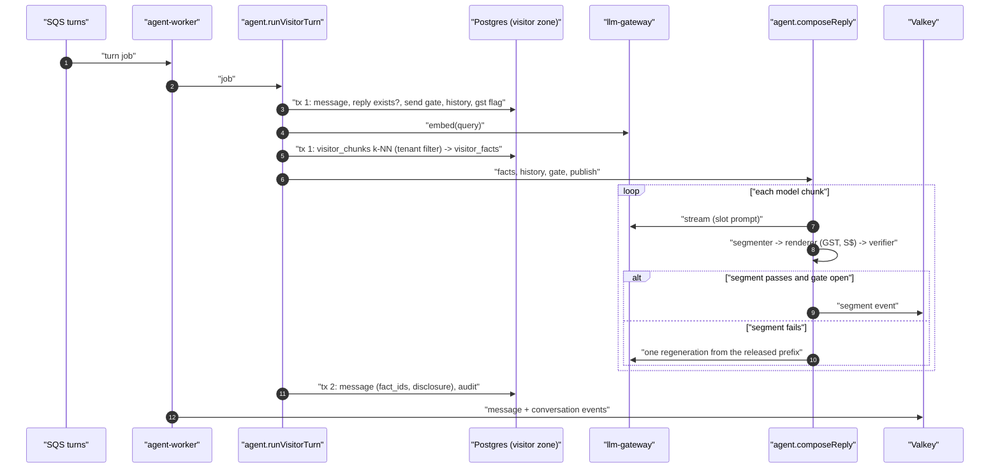

# Technical Design: FEAT-022 — Grounded, verified answer from a hand-entered fact

> Feature from: [implementation-plan.md](../../03-planning/implementation-plan.md) §4 (E3) and §6 · Epic: E3 Agent
> Implements: AGT-01, AGT-02, AGT-11 (p), AGT-16 (p), AGT-06 (p: `lookup_kb`), CHN-02 (p), KB-07 (p), KB-15 (p) · Binding NFRs: NFR-01 (reported, not gated), NFR-04, NFR-10
> Realizes: UC-20 (main flow, 5d, 5e, 6, 6a, 6b), UC-13 (p: steps 1–3)
> Screens: SCR-WGT-002, SCR-APP-027 (p), SCR-APP-028 (p), designed in [ui-design.md](ui-design.md)
> Status: Verified (self-check §9) · Date: 2026-10-19

## 1. Intent

The first real agent turn. An owner types a fact into the dashboard; a visitor asks about it in the widget and receives, one verified sentence at a time, an answer whose price was rendered from that fact and never typed by the model. It replaces the skeleton's echo with the ADR-008 pipeline (slots, renderer, deterministic verifier, held-back segment release), makes `visitor_facts` the only fact source for the visitor scope (ADR-009, ADR-010), and adds the tenant-filtered vector search under RLS (ADR-005). It is first in the build order because it exercises the product's central promise (P2, no invented prices) and the four riskiest invariants together (plan §6).

## 2. Codebase context

Surveyed on `main` after the FEAT-001 merge (commit `c8be4cc`).

- **Schema:** migrations `0000_init` (drizzle-kit DDL) and `0001_rls_roles_grants` (hand-written RLS, roles, grants, `resolve_widget_key`). Tables: `tenants`, `conversations`, `messages`, `outbox`, `audit_events`. pgvector is already installed by 0001. The migration owner is a superuser locally and in Testcontainers, so **anything that must stay under RLS cannot run as the owner**. 0001 already solves this for `resolve_widget_key` with a dedicated `NOLOGIN` role; this design reuses that pattern for the views.
- **Contracts:** Zod in `packages/contracts`, parsed by hand in route handlers; errors are `{ error, message }` with codes `bad_request`, `unauthorized`, `not_found`, `internal`. Dashboard routes live under `/api/v1/…` (the plan's `/kb/facts` becomes `/api/v1/kb/facts`: reality wins).
- **Turn path:** api → `appendVisitorMessage` (+ outbox) → dispatcher → SQS `conversation-turns.fifo` → agent-worker → `runVisitorTurn` → `appendAgentReply` (idempotent on `in_reply_to`) → Valkey `t:{tenant}:conv:{id}` → realtime SSE (`event: message`, `id: <seq>`) and the inbox WebSocket.
- **Stubs this feature replaces** (scaffold-notes §4): the echoing fake provider (it gains scripted streaming), `runVisitorTurn`'s echo body, the eval runner's direct `llm.generate` call, and the empty `kb` module.
- **Conventions reused:** `withTenant(zoneDb, tenantId, fn)`, `audit.append` (IDs only), `enqueue` (not needed here: no new side effect leaves the process, see D7), `can(role, capability)`, `TENANT_SCOPED_TABLES` plus a case in `rls.int.test.ts` per new table.
- **Divergences noted (reality wins):** endpoint paths gain the `/api/v1` prefix; the conversation state machine of ADR-013 (`ai_handling`, `escalated`, …) is not built yet, so the send gate reads the skeleton's `conversations.status` (`ai | human | closed`).

## 3. API contracts

All shapes are added to `packages/contracts`. Errors keep the `{ error, message }` envelope.

### 3.1 Fact shape (shared)

```ts
FactType   = 'product' | 'faq'
FactStatus = 'needs_review' | 'approved' | 'rejected' | 'conflicted' | 'disabled'   // ADR-010
GstTreatment = 'inclusive' | 'exclusive' | 'unknown'                               // KB-15
Money      = string matching /^\d{1,7}(\.\d{1,2})?$/      // SGD, as typed; stored as integer cents
ProductValue = { name: string(1..200), price: Money, unit?: string(1..60) }
FaqValue     = { question: string(1..300), answer: string(1..2000) }
Fact = {
  id: uuid, type, status, version: int,
  value: ProductValue | FaqValue,      // discriminated by `type`
  gstTreatment: GstTreatment | null,   // required for products, null for FAQs
  source: 'manual',                    // other sources arrive with FEAT-012+
  updatedAt: iso datetime
}
```

### 3.2 Dashboard: facts (owner scope; dashboard trust zone)

Auth: the dev session cookie (FEAT-005 replaces it). Capability `kb.manage` (owner, admin); `agent` role gets 403. Tenant ID comes from the session only.

| Method, path | Request | Success | Errors |
|---|---|---|---|
| `GET /api/v1/kb/facts` | query `status?` (one FactStatus), `q?` (≤ 100 chars, case-insensitive match on name, question or answer) | 200 `{ facts: Fact[] }`, newest first, max 200 | 400 `bad_request`, 401, 403 `forbidden` |
| `GET /api/v1/kb/facts/:id` | — | 200 `{ fact: Fact }` | 401, 403, 404 `not_found` (also for another tenant's ID) |
| `POST /api/v1/kb/facts` | `{ type, value, gstTreatment }` (product: `gstTreatment` ∈ inclusive/exclusive; faq: omitted or null) | 201 `{ fact }`, status `approved`, version 1 (KB-07: manual entries count as approved) | 400 `bad_request` (validation), 401, 403, 503 `unavailable` (the embedding call failed; nothing was saved, retry) |
| `PATCH /api/v1/kb/facts/:id` | `{ version: int, value?, gstTreatment?, status?: 'approved' \| 'disabled' }` — at least one of value, gstTreatment, status | 200 `{ fact }`, version + 1 | 400, 401, 403, 404, 409 `version_conflict` (stale `version`: someone else saved first; reload), 409 `invalid_state` (fact is `rejected` or `conflicted`, which FEAT-013/014 own), 503 `unavailable` |

PATCH rules (ADR-010 state machine): a content edit (value or GST) on `needs_review` makes it `approved` (KB-07); on `approved` it stays `approved`; on `disabled` it stays `disabled`. `status` may move `approved ↔ disabled` only. Every successful write is one transaction: the `facts` row, a new `fact_versions` row, the fact's `kb_chunks` row (re-embedded when the content changed), and an audit entry (`fact.created`, `fact.updated`, `fact.disabled`, `fact.enabled`; actor = user ID). Because the chunk and the status are written in the same transaction and `visitor_facts` is a view, the change is visible to the next visitor turn at commit (KB-07's 60 s, AC-9).

`kb.manage` is added to the capability table for owner and admin (identity/capabilities.ts).

### 3.3 Widget: messages (visitor trust zone, unchanged endpoint)

`POST /widget/v1/conversations/:id/messages` is unchanged. The shared `Message` shape gains two nullable fields, used by the widget and the inbox:

```ts
Message += {
  inReplyTo: uuid | null,     // the visitor message an agent/system reply answers
  disclosure: string | null,  // AI disclosure carried by the first AI-side message (AGT-11)
}
```

`factIds` is stored on the message (AC-4) but **not** sent to the widget: it is internal provenance (AGT-16 forbids revealing internal data). The dashboard reads it from the database in later features.

### 3.4 Realtime: the `segment` event (SSE only)

```ts
SegmentEvent = { type: 'segment', turnId: uuid /* visitor message ID */, seq: int ≥ 0, text: string }
RealtimeEvent = MessageEvent | ConversationEvent | SegmentEvent
```

- Published by the agent worker on `t:{tenant}:conv:{conversation}` after each segment is rendered and verified. Realtime forwards it as `event: segment` **without an `id:` line**, so `Last-Event-ID` keeps pointing at durable messages (ADR-017). Segments are ephemeral: a client that reconnects mid-reply gets the stored message once the turn completes.
- The plan named the fields `seq`, `text`, `fact_ids`. Fact IDs are left out for the AGT-16 reason above (D9); `turnId` is added so a client can group segments.
- When the turn completes, the worker publishes the normal `message` event; the widget replaces that turn's segments with the stored message.
- Nothing reaches this event before the verifier passes it (AGT-02, CHN-02; AC-2).

### 3.5 Internal: `llm-gateway`

```ts
interface LlmGateway {
  generate(req: GenerateRequest): Promise<GenerateResult>;          // unchanged
  stream(req: GenerateRequest): AsyncIterable<StreamChunk>;          // new
  embed(req: EmbedRequest): Promise<EmbedResult>;                    // new
}
StreamChunk = { type: 'text', text: string } | { type: 'done', result: GenerateResult }
EmbedRequest = { texts: string[], purpose: 'document' | 'query', meta: { tenantId } }
EmbedResult  = { vectors: number[][], provider, providerModelId }    // 1024 dimensions
LogicalModel += 'embed'
```

Providers: `fake` streams its scripted text in small chunks and embeds with a deterministic hashed bag of words and character trigrams (so similar wording ranks close, which is enough for tests and local demos); `anthropic-dev` streams with `messages.stream`. Anthropic has no embedding API, so with `anthropic-dev` the registry keeps `embed` on the fake embedder (D5). Bedrock (Claude `au.` and Cohere Embed Multilingual v3, 1024 dimensions) arrives at MD behind the same interface.

## 4. Schema changes

Migration `0002_facts_kb` (drizzle-kit DDL from `schema.ts`) and `0003_facts_rls_views` (hand-written RLS, roles, grants, views, function), against the current schema (0000, 0001). Every new table leads its primary key and indexes with `tenant_id`, has forced RLS with the `tenant_isolation` policy, and is added to `TENANT_SCOPED_TABLES`.

| Change | Conceptual entity | Columns / definition |
|---|---|---|
| `tenants.ai_paused boolean not null default false` | TENANT (kill switch, architecture §6.5) | Written by the kill switch (UC-31, later); read by the send gate |
| **`business_profiles`** (new table) | BUSINESS_PROFILE | `tenant_id uuid PK → tenants`, `gst_registered boolean not null default false`, `created_at`, `updated_at`. FEAT-009 adds the rest of the profile. Seed: bakery registered, second tenant not |
| **`facts`** (new table) | FACT | `tenant_id`, `id uuid default random`, `type text check in (product, faq)`, `status text check in (needs_review, approved, rejected, conflicted, disabled) default needs_review`, `value jsonb not null`, `gst_treatment text null check in (inclusive, exclusive, unknown)`, `source text not null default 'manual'`, `version int not null default 1`, `valid_until timestamptz null`, `last_confirmed_at timestamptz`, `created_by text null`, `updated_by text null`, `created_at`, `updated_at`. PK `(tenant_id, id)`; index `(tenant_id, status, updated_at desc)`; check `(type = 'product') = (gst_treatment is not null)`. Product `value` = `{ name, priceCents, currency: 'SGD', unit? }`; FAQ `value` = `{ question, answer }` |
| **`fact_versions`** (new table) | FACT_VERSION (KB-14) | `tenant_id`, `fact_id`, `version int`, `status`, `value jsonb`, `gst_treatment`, `changed_by text null`, `created_at`. PK `(tenant_id, fact_id, version)`; FK `(tenant_id, fact_id) → facts`. Immutable: no role may UPDATE it |
| **`kb_chunks`** (new table) | KB_CHUNK | `tenant_id`, `id uuid default random`, `fact_id uuid not null`, `fact_version int not null`, `content text not null`, `embedding vector(1024) not null`, `created_at`. PK `(tenant_id, id)`; unique `(tenant_id, fact_id)` (one chunk per fact for now; document chunks arrive with FEAT-012); FK to facts |
| `messages.fact_ids uuid[] not null default '{}'` | MESSAGE cites FACT | The facts the reply's slots rendered (AGT-01) |
| `messages.disclosure text null` | MESSAGE | The AI disclosure on the first AI-side message (AGT-11) |
| **View `visitor_facts`** | — (ADR-010 decision 2) | `facts` where `status = 'approved'` and `(valid_until is null or valid_until > now())` and not (type product and `gst_treatment = 'unknown'` and the tenant is GST-registered) and `tenant_id = app_current_tenant()`. Columns: `tenant_id, id, type, version, value, gst_treatment`. `security_barrier` |
| **View `visitor_chunks`** | — | `kb_chunks` joined to `visitor_facts` on `(tenant_id, fact_id)` and `fact_version = version`: a chunk is searchable only while its fact is visitor-visible and current. `security_barrier` |
| **Function `visitor_tenant_state()`** | — (ADR-013 decision 3; ADR-009 public profile) | `SECURITY DEFINER`, `STABLE`, returns one row `(ai_paused boolean, business_name text, gst_registered boolean)` for `app_current_tenant()`: the kill-switch flag for the send gate and the two public profile values the renderer needs. The caller treats **no row as paused** (fail closed) |

**Roles and grants (0003):**
- New `NOLOGIN` role `kaki_visitor_views` owns both views. It has `SELECT` on `facts`, `kb_chunks` and `business_profiles`, is not a superuser and does not own the tables, so the forced `tenant_isolation` policies apply when the views run. The views also filter on `app_current_tenant()` themselves. (A view owned by the superuser migration owner would bypass RLS; this is the reason for the role.)
- New `NOLOGIN` role `kaki_tenant_state` owns `visitor_tenant_state()`, with `SELECT (id, name, ai_paused)` on `tenants` and `SELECT` on `business_profiles`; the existing `tenant_isolation` policies limit it to the current tenant.
- `app_agent_visitor`: `SELECT` on `visitor_facts`, `visitor_chunks`; `EXECUTE` on `visitor_tenant_state()`. **No grant on `facts`, `fact_versions`, `kb_chunks` or `business_profiles`** (AGT-16, AC-6).
- `app_dashboard`: `SELECT, INSERT, UPDATE` on `facts` and `kb_chunks`; `SELECT, INSERT` on `fact_versions`; `SELECT` on `business_profiles`. No `DELETE` (deletion is FEAT-011).
- Rollback: drizzle's migrator is forward-only in this repo; a rollback is a new migration that drops the views, function, roles and tables in reverse order. Nothing reads the new columns on `messages` and `tenants` except this feature.

## 5. Component design



**`packages/kb`** (owns facts, versions, chunks):
- `facts.ts` (dashboard scope): `listFacts`, `getFact`, `createFact`, `updateFact`. Each takes a `DashboardKbContext { scope: 'dashboard', tx, tenantId, userId }`. Writes facts + version + chunk + audit in the caller's transaction. Optimistic concurrency: `UPDATE … WHERE version = $expected` (0 rows → `VersionConflictError`).
- `chunk.ts`: `chunkContent(fact)`: the text that is embedded: `"{name}{, unit}. Price."` for products, `"{question}\n{answer}"` for FAQs.
- `visitor.ts` (visitor scope): `searchVisitorFacts(ctx: VisitorKbContext, embedding, k = 6)`: one SQL statement over `visitor_chunks` joined to `visitor_facts`, `WHERE tenant_id = $tenant` (explicit, in addition to RLS; ADR-005), ordered by cosine distance `<=>`, returning facts with a score; drops results with distance above 0.8 (configurable). Exact k-NN on the tenant's rows (ADR-005: below 20,000 chunks per tenant); the HNSW index is deferred until a tenant approaches that size.
- **Scope types (ADR-009):** `VisitorKbContext` and `DashboardKbContext` are distinct branded types; visitor functions don't accept a dashboard context and vice versa. The database grants above back this up.

**`packages/agent`:**
- `slots.ts`: slot syntax `[[f:<ref>.<field>]]`, where `<ref>` is the fact ID's first 8 hex characters (lengthened for any facts in the turn that share a prefix). Fields: product `name`, `price`, `unit`; FAQ `question`, `answer`. Parser that finds complete slots and reports an open `[[` at the end of a buffer.
- `render.ts`: replaces each slot with its value and returns the text plus **protected spans** (character ranges produced by slot rendering) and the fact IDs used. `price` formatting (NFR-10, KB-15): `S$` with thousands separators and two decimals (`S$1,234.50`). For a GST-registered tenant, an `exclusive` price renders the inclusive amount, `S$59.95 incl. GST` (9% GST, rounded half-up to the cent; the rate is a named constant); an `inclusive` price renders as is. For a tenant that isn't registered, the stored price renders as is. A slot whose ref or field isn't in this turn's fact set is a render failure.
- `segment.ts`: incremental segmenter. Emits a segment at a sentence end (`.`, `!`, `?`, `。`, `！`, `？` followed by whitespace or end), a line break, or after 160 characters at the last word boundary; never while a `[[` is open, and never at a `.` between digits. `flush()` emits the remainder at stream end.
- `verify.ts`: deterministic verifier over the rendered segment. Masks protected spans, then scans for protected-value patterns (ADR-008 decision 2): currency (`S$`, `$`, `SGD`, `元`, `块`, `dollars`, `bucks`, number words before `dollars`/`bucks`), bare numbers after price words (price, cost, costs, priced, only, just, at, for), percentages, dates (`12/10`, `12 Oct`, `Oct 12`, `10月12日`), times (`3pm`, `15:00`, `3点`), durations (digits or number words followed by day, week, hour, minute, month, year, and `天`, `小时`, `周`, `个月`), stock (`5 left`, `in stock`, `available` after a number) and policy trigger phrases (refund, deliver by, guarantee, warranty, 退款, 保证). Every hit outside a protected span fails, with one exception: a **plain quantity** (a bare number that is not currency, a percentage, a date, a time or a duration) is allowed when it appears verbatim in the visitor's own messages (D3). Any leftover `[[` or `]]` fails. Returns `{ ok: true } | { ok: false, violations: { kind, text }[] }`. Pure, no I/O, 100% unit-testable.
- `prompt.ts`: the visitor-scope system prompt: role, the slot rule ("write every price, stock level, date, time, duration, percentage and policy term only as a slot; never type them"), the fact list (`ref`, type, field values, which fields to slot), "answer only from these facts; if they don't answer the question, say you will check with the team", and the conversation's last 10 messages as `messages`. The prompt layout keeps the static part first, for prompt caching later (ADR-007, FEAT-004).
- `compose.ts`: `composeReply(input, deps)`: the pure pipeline used by the worker and the eval runner. Input: facts, history, visitor text, GST flag, `gateOpen(): Promise<boolean>`, `publish(segment)`. Streams from the gateway into the segmenter; renders and verifies each segment; checks the gate before releasing each one; on a failure discards the segment and makes **one regeneration** (D2) with a system note naming the violation and the already-released prefix; on a second failure releases the escalation text ("Let me confirm that with the team and get back to you.") and returns `outcome: 'escalated'`. Returns `{ text, segments, factIds, outcome: 'answered' | 'escalated' | 'gate_closed' | 'unavailable', guardrail: violations[], timings: { firstSegmentMs, totalMs } }`. If the provider throws before anything is released, the outcome is `unavailable` and the text is the fallback (NFR-04).
- `turn.ts`: `runVisitorTurn(deps, job)`: replaces the echo. Transaction 1 (visitor zone): load the visitor message; stop if a reply already exists (idempotent); send gate and tenant state (business name, GST flag); history; embedding (outside the transaction, before it opens) and `searchVisitorFacts`; audit `tool.lookup_kb` (AGT-06 p). No transaction is held while the model streams. Then `composeReply`, with `gateOpen` re-checking the send gate in a short transaction per segment. Transaction 2: insert the reply (`author` `agent`, or `system` for the fallback and gate texts) with `fact_ids`, `in_reply_to` and, if no earlier agent or system message exists in the conversation, `disclosure`; audit `message.ai_sent` plus one entry per guardrail result (`guardrail.segment_blocked`, `guardrail.escalated`) and `agent.fallback_sent` when used. Returns null when the insert finds an existing reply.
- `gate.ts`: `aiAllowed(tx, tenantId, conversationId)`: `visitor_tenant_state()` returns a row with `ai_paused = false`, and the conversation status is `ai` (ADR-013 decision 3). Channel-live (FEAT-034) and human-owner (FEAT-043) conditions plug in here later. Gate closed before the turn: if paused, store the fallback system message "Thanks for your message. Our team will get back to you soon." (architecture §6.5); if a human owns it or it's closed, store nothing and return null (UC-20 5e). Gate closed mid-reply: stop releasing, store what was released, and append the fallback when paused.
- System texts (disclosure "You're chatting with an AI assistant for {business name}." from design.md §6, without its "a person can take over" clause until FEAT-044 enables that; fallback; escalation) are constants in `agent/texts.ts`, English only; FEAT-024 makes the disclosure tenant-editable and FEAT-033 adds 中文 chrome.

**`apps/agent-worker`:** passes a `publish` that sends `segment` events; after the turn publishes the stored `message` and `conversation` events as today; logs `firstSegmentMs`, `totalMs` and the outcome (AC-12).

**`apps/realtime`:** the SSE handler forwards `segment` events (`event: segment`, no `id:`) and keeps `message` handling as is.

**`apps/api`:** the four fact routes (§3.2) on the dashboard zone with `can(role, 'kb.manage')`; error mapping for `ForbiddenError` (403), `VersionConflictError` and `InvalidStateError` (409), `EmbeddingUnavailableError` (503). Needs an `llm-gateway` instance for embeddings (config `LLM_PROVIDER`, same values as the worker).

**`apps/widget`:** handles `segment` events (a pending agent bubble per `turnId` that grows a sentence at a time), the typing indicator while waiting, the disclosure row, and replaces segments with the stored message. Details in ui-design.md.

**`apps/dashboard`:** Knowledge → Facts list (SCR-APP-027, minimal) and the Fact create/edit page (SCR-APP-028, minimal). Details in ui-design.md.

**`evals`:** fixture tenants (`evals/fixtures/bakery.json`, `second.json`: facts with fixed IDs, GST flag); cases carry an optional `recorded: string[]` (the fake model's output per attempt, slots included; adversarial cases record literal or wrong prices). The runner calls `composeReply` with in-memory retrieval (the fake embedder and cosine over the fixture facts) and scores with two new deterministic expectations: `prices-from-facts` (every `S$` amount in the final text is a rendered price of that tenant's facts) and `cites` (the fact IDs used include the listed ones and none outside the tenant's set), plus the existing `contains`/`not-contains`/`matches`. With `LLM_PROVIDER=anthropic-dev` the recorded outputs are ignored and the real model answers the same cases (M1.5).

**Dev data (`pnpm db:setup`):** the bakery's GST flag, plus two demonstration facts that must never reach a visitor: a `needs_review` bakery fact ("Eggless chocolate cake, 1 kg — S$70") and an approved second-tenant fact ("Chocolate fudge cake, 1 kg — S$99"). The seeding script lives in `packages/kb` (it needs the embedder) and runs after the db setup.

## 6. Acceptance criteria

Fake provider = the deterministic scripted provider. "Recorded fixtures" = scripted outputs in eval cases and tests.

- **AC-1 (AGT-02; plan §6 AC 1).** Given the bakery's approved product fact "Chocolate fudge cake, 1 kg, S$55, GST inclusive", when the model writes `[[f:<ref>.price]]`, then the released text contains `S$55.00` and no other amount. On the eval `prices` subset (fast, fake provider) price accuracy is 100% and zero invented prices pass (`prices-from-facts`).
- **AC-2 (AGT-02, CHN-02; UC-20 6a; plan §6 AC 2).** Given a fake model whose first output contains a literal price (`S$50`) in its second sentence, then the first sentence is released, the second is never published as a `segment`, and the regenerated continuation (slot-correct) is released. Given a fake model that fails twice, then the turn releases the escalation text, the stored message has outcome `escalated`, and an audit entry `guardrail.escalated` exists. In both cases a subscriber on the conversation channel receives no segment containing the literal value.
- **AC-3 (AGT-02).** The verifier blocks, outside slot renderings: `S$50`, `$50`, `50 dollars`, `fifty bucks`, `SGD 50`, `50元`, `10%`, `3 days`, `three days`, `12 Oct`, `3pm`, `5 left`, "full refund"; and passes the same values when they come from a slot. A plain quantity the visitor typed ("200 cupcakes") passes; a currency amount the visitor typed ("is it $20?") does not.
- **AC-4 (AGT-01; plan §6 AC 3).** Every stored agent message has `fact_ids` equal to the facts its slots rendered; every ID exists in `visitor_facts` for that tenant at the time of the turn. On the eval `groundedness` subset (fast) the pass rate is ≥ 95% and no case cites an ID outside the tenant's fixture set.
- **AC-5 (AGT-01, UC-20 5a).** When retrieval returns no fact above the threshold, the prompt carries no facts and the fake model's "check with the team" reply is released with empty `fact_ids`.
- **AC-6 (AGT-16, GOV-03; plan §6 AC 4).** As `app_agent_visitor` with tenant A's context, `select * from facts`, `fact_versions`, `kb_chunks` and `business_profiles` fail with permission denied. `visitor_facts` and `visitor_chunks` return tenant A's approved, enabled, unexpired facts only: never `needs_review`, `rejected`, `conflicted`, `disabled`, expired, GST-unknown (registered tenant), or tenant B rows, including with a hand-written `where tenant_id = '<B>'`. With no tenant context they return nothing.
- **AC-7 (AGT-16; plan §6 AC 4, API level).** A widget turn for tenant A, whose question matches a `needs_review` bakery fact and tenant B's approved fact best, uses neither: the released text contains neither `S$70` nor `S$99`, and `fact_ids` contains neither ID.
- **AC-8 (AGT-11; plan §6 AC 5).** The first agent or system message of every conversation has a non-empty `disclosure`; later messages have `disclosure = null`. The widget shows it as the disclosure row.
- **AC-9 (KB-07; UC-13 3; plan §6 AC 7).** After `PATCH /api/v1/kb/facts/:id` changes the price (S$55 → S$58) and returns 200, the next visitor turn (no waiting) renders `S$58.00`. After a PATCH to `disabled`, the next turn cannot retrieve the fact. (Effect at commit, well inside 60 s.)
- **AC-10 (KB-15, NFR-10; UC-20 6b; plan §6 AC 6).** For the GST-registered bakery, an `exclusive` S$55 price renders `S$59.95 incl. GST`; an `inclusive` S$55 price renders `S$55.00`. For the unregistered second tenant, S$55 renders `S$55.00` whatever the treatment. `S$1234.5` renders `S$1,234.50`. A product with `gst_treatment = unknown` at a registered tenant is not in `visitor_facts`.
- **AC-11 (KB-07; UC-13 1–3).** The fact endpoints: create returns 201 with status `approved`, version 1 and writes a `fact_versions` row, a `kb_chunks` row and a `fact.created` audit entry; invalid bodies (missing price, product without GST treatment, price `55.123`, FAQ with GST) return 400; a stale `version` returns 409 `version_conflict`; editing a `rejected` fact returns 409 `invalid_state`; an `agent`-role session gets 403; tenant B's session gets 404 for tenant A's fact ID; `GET` filters by `status` and `q`.
- **AC-12 (NFR-01, OI-1; plan §6 AC 8).** The worker logs `firstSegmentMs` and `totalMs` per turn; the PR records the values from the local E2E run (fake provider). Not gated until MD.
- **AC-13 (NFR-04; UC-20 5d).** When the provider throws before any segment is released, the visitor receives the fallback system text as the turn's reply (stored with `in_reply_to`, so a redelivered job does nothing), plus the audit entry `agent.fallback_sent`.
- **AC-14 (ADR-013 decision 3; UC-20 5e; GOV-08 p).** With `tenants.ai_paused = true` before the turn, no model call is made and the fallback system text is stored. With conversation status `human`, nothing is stored and no model call is made. If the gate closes between two segments, the second is not released.
- **AC-15 (plan §6 AC 9, AGT-14).** `pnpm eval --fast` runs ≥ 20 `prices` and `groundedness` cases on the fake provider, including adversarial recorded outputs (literal prices, wrong slot refs, another tenant's slot ref, an echoed injection carrying a price), and passes the thresholds in `evals/thresholds.json`.
- **AC-16 (UC-20 main flow, J2; E2E).** In the browser: the owner adds the product fact and the FAQ on SCR-APP-028, sees them on SCR-APP-027, then a visitor asks "got eggless cake or not? how much ah" on the widget host page and sees the disclosure row and an answer containing `S$55.00` and neither `S$70` nor `S$99`.

Verifiable fully in M1: AC-2, AC-3, AC-5 to AC-11, AC-13, AC-14, AC-16. AC-1, AC-4 and AC-15 are verified on recorded fixtures now and re-run on the real model at M1.5 ("accepted — real-model check pending", plan §3).

## 7. Decisions

- **D1 — Retrieval up front, not a model tool call.** Driver: AGT-06 (p: `lookup_kb`) and NFR-01. The orchestrator always runs `lookup_kb` (embed + `visitor_chunks` search) before generation and audits it as a tool call. A model-invoked tool would add a round trip before the first sentence and a tool loop inside the stream. Rejected: model-called `lookup_kb`. Consequence: one retrieval per turn; if evals at M1.5 show missed follow-up lookups, a model-callable `lookup_kb` can be added behind the same function.
- **D2 — One regeneration, then escalate.** Driver: ADR-008 decision 5. `MAX_REGENERATIONS = 1`. The regeneration prompt carries the released prefix in a system note ("you have already said: …; continue without repeating it; your previous continuation was rejected because: …") instead of an assistant prefill, which recent Claude models don't accept. The escalation itself (routing to a person) is FEAT-044; here it is the escalation text, an audit entry and the `escalated` outcome.
- **D3 — Visitor literals: quantities only.** Driver: AGT-02's "zero invented prices". ADR-008 allows literal numbers that appear in the visitor's own messages. Taken literally, "is it $20?" → "Yes, $20" would pass. Only plain quantities are allowed from visitor text; a currency, percentage, date, time or duration is never allowed unless rendered from a slot. Rejected: any visitor literal. This is a tightening within the ADR's intent, not a change to it.
- **D4 — Synchronous embedding on save.** Driver: KB-07 (60 s) and ADR-010 decision 2 (chunk and status change in one transaction). The API embeds the fact before opening the transaction and writes fact, version and chunk together; if the embedder fails, nothing is saved and the API returns 503. Rejected: an outbox job to the ingest worker (a new queue and a window where the edit is saved but not searchable). Revisit when document ingestion (FEAT-012) needs batch embedding.
- **D5 — The fake embedder stays on with `anthropic-dev`.** Driver: Anthropic has no embedding endpoint, and the dev provider is for test data only. Retrieval quality on real models is judged at MD with Cohere on Bedrock.
- **D6 — Fallback replies are stored system messages that close the turn.** Driver: NFR-04 and idempotency. On a provider failure the fallback is stored with `in_reply_to`, so the turn is complete and a redelivery does nothing. This changes FEAT-001's behaviour ("store nothing so the turn can be retried"), and its test is updated to the new requirement-driven behaviour. The retry-with-backoff of NFR-17 is not built here (§8).
- **D7 — Segments go straight to Valkey, not through the outbox.** Driver: ADR-017 (pub/sub only notifies; Postgres is the record) and NFR-01. The durable record is the message written at the end; a lost segment is recovered by the `message` event or a reconnect. No new outbox topic.
- **D8 — No transaction is held while the model streams.** Driver: connection-pool sizing at NFR-03 load. Two short transactions plus one tiny gate check per segment. A duplicate delivery that races the first run is resolved by the unique `in_reply_to` index; its segments could be published twice, which the widget de-duplicates by `(turnId, seq)` and then replaces with the single stored message.
- **D9 — No fact IDs on the wire to the widget.** Driver: AGT-16 (no internal data to visitors). The plan listed `fact_ids` on the `segment` event; they stay in the database.
- **D10 — `business_profiles` starts with only the GST flag**, and the visitor scope reads the public values it needs (business name, GST flag, kill switch) through one fail-closed function, `visitor_tenant_state()`, instead of a `business_profile_public` view. FEAT-009 adds the profile fields and that view (ADR-009) when there is more public profile data to read.
- **D11 — Triage is not called yet.** Driver: FEAT-004 (routing) and FEAT-023 (language, register, out-of-scope) own triage's outputs; nothing in this slice consumes them. `route('reply')` stays `reply.simple`. The plan's "triage ∥ retrieval" block gains its triage half with those features.
- **D12 — Branch name.** AGENTS.md asks for `feat/FEAT-022-<slug>`; this session's tooling pins the branch `claude/project-thread-91q4ac`. The PR is titled with the feature ID instead.

## 8. Escalations and open items

- No architecture amendment is needed: every table is an entity of architecture §5.3 (BUSINESS_PROFILE, FACT, FACT_VERSION, KB_CHUNK, MESSAGE→FACT), and `tenants.ai_paused` is named in architecture §6.5.
- **NFR-17 retry ≤ 24 h after a provider outage** is not built (D6); the visitor gets the fallback immediately. Suggested owner: FEAT-034 or the first feature that adds outbox retries for sends.
- **Embedding fallback** (architecture §8.3: keyword search over `visitor_facts` when embeddings fail) is not built. Facts can't be saved while the embedder is down (D4), and visitor turns without an embedding go to the fallback reply. Suggested owner: FEAT-012, which adds the Bedrock embedder.
- **Kill-switch cache** (ADR-013: Valkey-published flag, ≤ 2 s worker cache) is not built; the gate reads Postgres on every check, which is correct and cheap at this volume. The toggle UI is UC-31's feature.
- **HNSW index** on `kb_chunks.embedding` deferred (ADR-005 threshold, §5).
- **Plan §6 `fact_ids` on `segment`** is replaced by D9; the plan can drop the field at its next revision.
- **Fake-embedder noise.** The fake embedder's signed feature hashing can put an unrelated fact within the 0.85 distance limit (measured: "Can I bring my dog along?" lands at 0.80 from "Pandan chiffon cake, whole", while relevant pairs range 0.13–0.78). Local and eval retrieval can therefore pass an irrelevant fact to the model; the verifier still keeps every price correct. The limit is to be tuned on Cohere at MD (D5); the eval's no-fact case uses a query clear of such collisions.
- **Real-model checks** (AC-1, AC-4, AC-15 on the real model, and real latency for AC-12) are pending M1.5 / MD.

## 9. Self-check

Requirement coverage: AGT-01 → AC-4, AC-5; AGT-02 → AC-1, AC-2, AC-3; AGT-11 (p) → AC-8; AGT-16 (p) → AC-6, AC-7; AGT-06 (p) → D1 and the `tool.lookup_kb` audit (AC-11's audit check pattern, tested in T7); CHN-02 (p) → AC-2, AC-16; KB-07 (p) → AC-9, AC-11; KB-15 (p) → AC-10; NFR-01 → AC-12; NFR-04 → AC-13; NFR-10 → AC-10. UC-20 flows 5a, 5d, 5e, 6, 6a, 6b → AC-5, AC-13, AC-14, AC-1, AC-2, AC-10; UC-13 1–3 → AC-11, AC-9. E2E obligation: UC-20 and UC-13 are critical flows (architecture §8.7, J2) → T14. Every new table maps to an architecture entity; no escalation filed. Contracts follow the `/api/v1` and `{ error, message }` conventions; the one breaking behaviour change (D6) is recorded.
