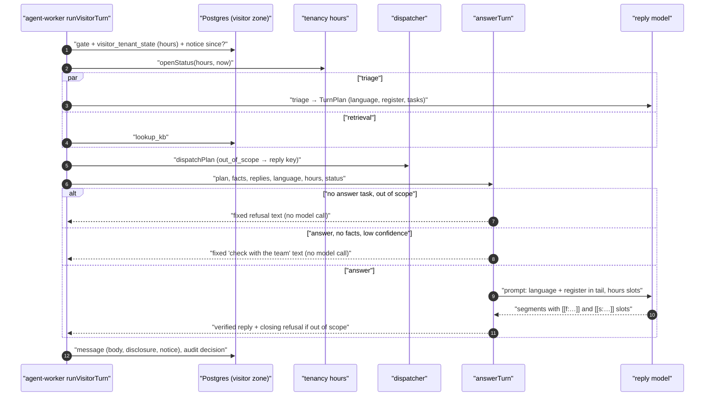

# Technical Design: FEAT-023 — Language and register, out-of-scope handling, after-hours behaviour

> Feature from: [implementation-plan.md](../../03-planning/implementation-plan.md) §4 (E3 Agent) and §5 (M1, after FEAT-011), plus the ADR-025 note in §4 and the §7 eval note · Epic: E3
> Implements: AGT-03, AGT-04 (p: offers of a person and lead capture arrive with FEAT-044 and FEAT-049), AGT-09 (p: lead capture arrives with FEAT-049) · Binding NFRs: NFR-10 (EN/Singlish/中文 agent, SGT times), NFR-11 (IDs and codes only in logs and audit), NFR-13 (cost reported per eval run), NFR-02 (widget budget)
> Also builds: ADR-022's LLM judge and human-agreement check (plan §7: "arrive with FEAT-023"), the `out_of_scope` handler (ADR-025 decision 1 table), ADR-025 decision 5's first system slots (the next opening time)
> Realizes: UC-20 main flow step 5 (language and register), alternates 5a (out of scope or low confidence) and 5b (after hours)
> Screens: SCR-WGT-002 (p: the after-hours system notice, language of parts), designed in [ui-design.md](ui-design.md)
> Status: Verified (self-check §9) · Date: 2026-10-21

## 1. Intent

FEAT-022 and FEAT-004 built one grounded, verified English answer per turn and a triage plan whose `language`, `register` and `out_of_scope` task nothing yet used. FEAT-023 makes the agent answer in the visitor's language and register (English, Singlish, Simplified Chinese), answer opening-hours questions from the business profile through verified slots (J7: "请问周末营业时间？"), decline questions that have nothing to do with the business and say it will check with the team when it is unsure instead of guessing, and tell a visitor who writes after hours when the team will be back while still answering from the KB. It also gives the eval set its Singlish, Chinese, out-of-scope and retrieval cases and the LLM judge that scores what deterministic checks can't. It is next in M1 (plan §5) because the M1 demo shows Singlish, Chinese and an out-of-scope refusal, and FEAT-024 (persona and tone) builds on the register handling made here.

## 2. Codebase context

Surveyed on `main` at `f5d991f` (after FEAT-011, PR #13).

- **Schema:** migrations 0000–0011. `business_profiles` (0002) has only `tenant_id`, `gst_registered` and timestamps, with forced RLS (0003); the dashboard role can `SELECT` it, and visitors see it only through `visitor_tenant_state()` (0003, recreated in 0009, owned by `kaki_tenant_state`). `messages` carries `disclosure` (AGT-11) next to `body`; `app_agent_visitor` has table-level `SELECT, INSERT` on `messages`.
- **Agent:** `runVisitorTurn` (`turn.ts`): gate → triage ∥ retrieval → `dispatchPlan` → `routeReply` → `composeReply` → `appendAgentReply` with audit. `TurnPlan.language ∈ {en, zh, ms, ta, other}` and `register ∈ {standard, singlish, formal}` are produced by triage but unused. `visitorRegistry` is empty, so `out_of_scope` is reported `unhandled`. `TaskResult` has only `endTurn` (safety phase). System texts (`texts.ts`) are English only. Slots are `[[f:<ref>.<field>]]` only; the verifier blocks every typed digit, number word and Chinese numeral, which also blocks the weekday names 星期六 and 周日. The prompt's `system` is byte-stable per tenant and the tail carries facts and the SGT time (FEAT-004 AC-3).
- **Tenancy:** `visitorTenantState(tx)` returns the kill switch, business name, GST flag and route policy. There is no hours model and no public-holiday calendar.
- **Evals:** `evals/src/run.ts` drives triage, routing, the dispatch check (which assumes the empty registry) and `composeReply` on fixture tenants with the fake embedder. The `singlish`, `chinese` and `out-of-scope` subsets exist in `thresholds.json` (0.9, 0.9, 0.95) with no cases. `cases.ts` says "The LLM judge arrives with FEAT-023". The `judge` logical model already maps to `claude-opus-5-5` (anthropic-dev) and `fake-opus`.
- **Widget:** `panel.tsx` renders `Message.disclosure` as a caption row; `.notice` (pill, `--kaki-muted` on `--kaki-subtle`) exists for the slow-reply notice. Chrome strings are `en` and `zh-Hans` (`strings.ts`).
- **Conventions reused:** `withTenant`, `audit.append` with `auditCode`/`auditId`, the dispatcher's checks and audit, system-owned texts rendered never generated (ADR-008 decision 6), forward-only migrations as drizzle DDL plus a hand-written `_rls` migration.
- **Divergences (reality wins):** FEAT-011 D2 put business hours in BUSINESS_PROFILE (FEAT-009), not in facts; this feature adds the hours columns FEAT-009's screen will edit (D2). The plan lists FEAT-009's data as `business_profiles, holidays`; the SG public-holiday calendar ships here as code data, and FEAT-009 keeps the tenant-specific `holidays` table (D3).

## 3. API contracts

No new endpoint. One contract change, in `packages/contracts`:

```ts
Message = {
  id, conversationId, seq, author, body, inReplyTo, disclosure, createdAt,   // unchanged
  notice: string | null,   // NEW: a system notice shown with this message (after hours, AGT-09)
}
```

- Returned wherever `Message` is: `POST /widget/v1/conversations/:id/messages` (the visitor's own message: always `null`), the SSE `event: message`, and the dashboard's `GET /api/v1/conversations/:id/messages`. Additive; existing clients ignore it.
- The notice is server-rendered in the reply's language and carried on the first reply of a closed period (§5.5). The widget shows it as a `system-notice` above that reply (ui-design.md).
- Errors: unchanged. Nothing new is accepted from a client.

## 4. Schema changes

Migration `0012_hours_notice` (drizzle DDL from `schema.ts`) and `0013_hours_notice_rls` (hand-written function), against 0000–0011.

| Change | Conceptual entity | Definition |
|---|---|---|
| `business_profiles.hours jsonb null` | BUSINESS_PROFILE (ONB-03 operating hours) | Weekly opening hours in SGT: `{ "mon": [{ "open": "08:00", "close": "19:00" }], …, "sun": [] }`. Keys `mon`..`sun`, each 0–4 intervals, `HH:MM` 24-hour, `close` may be `24:00`, `open < close`, sorted, not overlapping. Null = not set (no after-hours behaviour, no hours slots). Validated by `@kaki/tenancy`'s `WeeklyHours` on read; FEAT-009 validates on write. Check: `hours is null or jsonb_typeof(hours) = 'object'` |
| `business_profiles.open_on_public_holidays boolean not null default false` | BUSINESS_PROFILE (ONB-03 "public holidays", SRS §1.4 "Business hours") | False: closed on SG public holidays; true: usual hours on them |
| `messages.notice text null`, `messages.notice_kind text null` | MESSAGE | The system notice shown with the message and its kind. Check `messages_notice_ck`: `(notice is null) = (notice_kind is null) and (notice_kind is null or notice_kind in ('after_hours'))`. Later kinds (waiting for approval, APR-04; rate limited, GOV-13) extend the list |
| `visitor_tenant_state()` recreated | ADR-013 d3; FEAT-022 D10 | Adds `hours jsonb` and `open_on_public_holidays boolean` (coalesced to false) to its result. Same owner (`kaki_tenant_state`), `SECURITY DEFINER`, `EXECUTE` for `app_agent_visitor` only |

No new table, so no new RLS policy: both tables already have forced RLS and their `TENANT_SCOPED_TABLES` entries. The RLS suite gains cases for the new columns (§6 AC-10). Rollback is forward-only, as before: a later migration would drop the columns and restore the 0009 function text.

## 5. Component design



### 5.1 `@kaki/tenancy`: hours and the SG calendar

- `hours.ts` (new):
  - `WeeklyHours` (Zod) for the §4 shape, `Weekday = 'mon' | … | 'sun'`.
  - `sgDay(instant) → 'YYYY-MM-DD'`, `sgWeekday(instant)`, `sgInstant(day, 'HH:MM')`. SGT is a fixed UTC+8 (no daylight saving since 1982), so the maths is plain offset arithmetic, unit-tested across midnight and the year end.
  - `openStatus(hours, openOnPublicHolidays, now) → { open: boolean; since: Date | null; nextOpen: Date | null; today: Interval[] }`. It lays the weekly intervals over SG days from 14 days before to 14 days after `now`, drops public-holiday days unless `openOnPublicHolidays`, and merges intervals that touch (Mon `18:00–24:00` + Tue `00:00–02:00` is one opening). `open` = `now` is inside one. Open: `since` is when it opened. Closed: `since` is when the last opening ended (null if none in 14 days, meaning "closed for at least 14 days") and `nextOpen` the next start (null if none within 14 days). `today` is today's intervals after the holiday rule.
- `sg-holidays.ts` (new): `SG_PUBLIC_HOLIDAYS`, the MOM-gazetted days for 2026 and 2027 **including the Monday off in lieu** when a holiday falls on a Sunday (2026: 1 Jan, 17–18 Feb, 21 Mar, 3 Apr, 1 May, 27 May, 31 May, 1 Jun, 9 Aug, 10 Aug, 8 Nov, 9 Nov, 25 Dec; 2027: 1 Jan, 6–8 Feb, 10 Mar, 26 Mar, 1 May, 17 May, 20 May, 9 Aug, 28 Oct, 25 Dec), `SG_HOLIDAYS_COVER_THROUGH = 2027`, and `isSgPublicHoliday(day)`. A day after the covered years is not treated as a holiday (§8). Source: MOM's 2026 list and its 18 Jun 2026 release for 2027.
- `visitorTenantState` gains `hours: WeeklyHours | null` (invalid JSON in the column → null, counted as not set) and `openOnPublicHolidays`.

### 5.2 `@kaki/agent`: language, register and system texts

- `language.ts` (new): `replyLanguage(plan, visitorText) → 'en' | 'zh'`. `plan.language` `zh` → `zh`, `en` → `en`; for `ms`, `ta`, `other` and the fallback plan, `zh` if the visitor's text contains Han characters, otherwise `en` (D4).
- `texts.ts` gains `textsFor(lang)`: `{ disclosure(business), fallback, escalation, outOfScope(business), unsure, afterHours(when | null) }` in `en` and `zh` (D5); `texts` stays the English set:

  | Key | en | zh |
  |---|---|---|
  | `disclosure` | You're chatting with an AI assistant for {business}. (unchanged) | 您正在与 {business} 的 AI 助手聊天。 |
  | `fallback` | Thanks for your message. Our team will get back to you soon. (unchanged) | 感谢您的留言，我们的团队会尽快回复您。 |
  | `escalation` | Let me confirm that with the team and get back to you. (unchanged) | 我先跟团队确认一下，稍后回复您。 |
  | `outOfScope` | Sorry, I can only help with questions about {business}. | 抱歉，我只能回答与 {business} 有关的问题。 |
  | `unsure` | I'm not sure about that, so I'll check with the team and get back to you. | 这个问题我不太确定，我先跟团队确认，稍后回复您。 |
  | `afterHours(when)` | We're closed right now. The team will be back {when}. I can still answer your questions in the meantime. — with no known reopening: "We're closed right now, and the team will get back to you as soon as they can. I can still answer your questions in the meantime." | 我们现在休息中，团队将于{when}回来。在此期间，我仍可以为您解答问题。 — 无已知时间：我们现在休息中，团队会尽快回复您。在此期间，我仍可以为您解答问题。 |

- `prompt.ts`: the static rules gain three lines: write in the reply language named in the tail; for register `singlish`, reply in friendly, natural Singapore English (short sentences; a particle such as "lah" or "ah" is fine where it reads naturally; never mock or overdo it); for `formal`, be polite and complete. The tenant block gains the hours lines when hours are set: `Hours mon: 8:00 am – 7:00 pm → [[s:hours.mon]]` … `sun`, `Hours on public holidays: closed → [[s:hours.ph]]`. These depend only on the profile, so `system` stays byte-stable per tenant (FEAT-004 AC-3). The tail gains `Reply language: English|Chinese (Simplified)`, `Visitor register: standard|singlish|formal`, `Today: <today's hours> → [[s:hours.today]]`, and either `Open now.` or `Closed now; the team is back <when> → [[s:next_open]]. The visitor has been told this; don't repeat it unless asked.` When the plan also has `out_of_scope`, the tail adds: `Part of the latest message is not about this business: answer only the part that is; the system adds a short note about the rest.`
- `slots.ts` / `render.ts`: a second slot family, **system slots** `[[s:<name>]]` (ADR-025 decision 5). `SLOT_RE` matches both. `renderSegment(raw, facts, gstRegistered, system)` fills `[[s:…]]` from a `SystemSlots` map built per turn; an unknown name is an `unknown_field` violation, as for facts. Rendered system values are protected spans like fact values. This turn's names: `hours.mon`..`hours.sun`, `hours.today`, `hours.ph` (only when hours are set) and `next_open` (only when closed with a known reopening). Values in the reply language (NFR-10, design.md §6 "2:30 pm"):
  - an interval: en `8:00 am – 7:00 pm`, `midnight` for `24:00`; zh `上午8:00至晚上7:00` (上午 before 12:00, 中午 12:00–12:59, 下午 13:00–17:59, 晚上 from 18:00; `24:00` → `午夜12:00`); several intervals joined by `, ` / `、`; none → `closed` / `休息`. `hours.today` on a holiday when closed → `closed (public holiday)` / `公共假期休息`. `hours.ph` → `closed` / `休息` or `usual hours` / `照常营业`.
  - `next_open`: en `today at 9:00 am`, `tomorrow at 9:00 am`, or `on Sat 24 Oct at 9:00 am`; zh `今天上午9:00`, `明天上午9:00`, `10月24日（周六）上午9:00`.
- `verify.ts`: the D15 number rule leaves alone Chinese weekday names (`星期一`..`星期日`, `周一`..`周日`, `礼拜一`..`礼拜天`), `三明治`, and Singlish emphatic "one" before a particle ("this one nice one lah"). Every other typed number, time and date is still blocked, in both languages (D7).
- `fake-responder.ts`: reads `Reply language:` from the tail and answers facts in Chinese templates for `zh` (`[[f:r.name]]（[[f:r.unit]]）的价格是[[f:r.price]]。`); answers an hours question (hours, open, close, 营业, 几点, 周末, weekend) with the hours slots (weekend → Saturday and Sunday; otherwise today, plus `next_open` when closed); its "not sure" line follows the language. `fake-triage.ts` gains an `out_of_scope` keyword rule (homework, weather, election, stock prices, write a poem or code, 天气, 作业, 股票) so the local stack and E2E exercise the path.

### 5.3 `@kaki/agent`: the `out_of_scope` handler and AGT-04

- `dispatch.ts`: `TaskResult` gains `reply?: { key: 'out_of_scope' }`, a system text the turn renders in the reply language (handlers never see the visitor's text or language). `dispatchPlan` returns `replies` (the state-phase reply keys in plan order) besides `reports` and `endTurn`. `visitorRegistry` registers the first handler, `outOfScopeHandler`: kind `out_of_scope`, scopes `['visitor']`, args any (ignored), no consent, no boundary rule, `run` → `{ reply: { key: 'out_of_scope' } }`. It is audited `agent.dispatch` `done` like any task.
- `answer.ts` (new) holds the turn's reply decision, shared by the worker and the eval runner so both run the same code:
  - `replyPlan({ plan, factCount, minConfidence, replies }) → { compose: boolean; lead: 'out_of_scope' | 'unsure' | null; closing: ReplyKey[] }`:
    1. no `answer` task and at least one reply key → no model call; the reply is the fixed texts; outcome `out_of_scope`;
    2. an `answer` task, no retrieved facts, and low confidence (`plan.fallback` or `plan.confidence < minConfidence`, the tenant's routing knob, default 0.5) → no model call; the reply is `unsure` (then any closing texts); outcome `unsure`;
    3. otherwise compose; the reply keys are released as a closing segment after the verified reply (`answered` or `escalated` only).
  - `answerTurn(input, deps)` runs `replyPlan`, then either releases the fixed text as one segment (through the same gate check and `publish`) or calls `composeReply` and releases the closing segment. It returns a `ComposeResult` plus `outcome ∈ ComposeOutcome ∪ {out_of_scope, unsure}`.
- A plan with no `answer` and no reply key (for example `[escalate]` while `escalate` is unhandled) composes as before (FEAT-004 behaviour, unchanged).

### 5.4 `@kaki/agent`: the turn

`runVisitorTurn` changes:
- The prep transaction also reads whether an after-hours notice was already sent in this closed period: `noticeSince(tx, tenantId, conversationId, 'after_hours', since)` (new in `@kaki/inbox`: an agent or system message with that `notice_kind` created at or after `since`; with `since` null, any in the conversation).
- After triage: `lang = replyLanguage(plan, message.body)`. With the gate closed or triage unavailable (no plan), `lang` comes from the message text alone.
- `status = openStatus(…)` from the gate's tenant state when hours are set, using `deps.clock()` (new, wall time, default `new Date()`; the existing `now` stays the latency timer).
- `answerTurn` replaces the direct `composeReply` call. System slots: the hours values and, when closed with a known reopening, `next_open`.
- **Notice:** when hours are set, the business is closed and no notice was sent since `status.since`, the stored reply carries `notice = texts(lang).afterHours(next_open value or null)` and `notice_kind = 'after_hours'`. This holds for any stored reply (answer, fixed text, fallback, paused), never when the AI stays silent (human owner, closed conversation). The model is never asked to write it.
- Disclosure and the fallback and escalation texts use `texts(lang)`.
- The `agent.decision` audit payload gains `language` and `register` (codes), `slots` (the system slot names rendered, codes such as `hours.sat`), `afterHours` (boolean) and the new outcome codes `out_of_scope` and `unsure`. Still no visitor text (ADR-014, NFR-11). The worker's `turn complete` log line adds `language` and `outcome`.

### 5.5 `@kaki/inbox` and contracts

- `appendAgentReply` input gains `notice?: { kind: 'after_hours'; text: string } | null`. `toMessage` maps `notice`. `noticeSince` as above.
- Contracts `Message.notice` (§3). The realtime role's SSE `message` event uses the same mapper.

### 5.6 Widget (SCR-WGT-002, p)

`panel.tsx` renders `m.notice` as a `system-notice` row above the message (after the disclosure row when both exist), and sets `lang="zh-Hans"` on any message bubble whose text contains Han characters (WCAG 3.1.2, language of parts), so a screen reader on an English page reads a Chinese reply in Chinese. The growing bubble uses the same rule. Details and states in ui-design.md. Budget: a few hundred bytes in the lazy panel (NFR-02, ADR-016).

### 5.7 Evals: cases, judge and agreement

- **Fixture and case fields:** `Fixture` gains `hours` and `openOnPublicHolidays` (the bakery: Mon–Fri 8:00 am–7:00 pm, Sat 9:00 am–5:00 pm, Sun 9:00 am–1:00 pm, closed on public holidays; the second tenant: none). A case gains `at` (an ISO instant, default Wed 21 Oct 2026 11:00 SGT, so results don't depend on when CI runs) and `needs: 'semantic-embedder'` (skipped and reported on the fake embedder; counted with Cohere at MD, P3).
- **Runner:** runs the same `replyPlan`/`answerTurn`, `openStatus`, `replyLanguage` and notice rule as the worker (the notice is due on every case: each case is one conversation). The dispatch check expects `done` for kinds in `visitorRegistry` and `unhandled` for the rest.
- **Deterministic expectations (new):** `language` (`zh`: Han characters make up at least 30% of the letters; `en`: none), `outcome` (`answered`, `out_of_scope`, `unsure`, `escalated`), `notice` (`present` with optional `contains`, or `absent`), `retrieves` (fact IDs in the retrieved set). A new subset `retrieval` (threshold 0.9) holds Singlish and mixed EN/中文 retrieval cases, and pure-Chinese ones marked `needs: semantic-embedder`.
- **Cases (new files):** `feat-023-singlish.json` (≥ 20: particles, "can or not", "got … or not", "tapau", "chope", HDB, MRT, code-switching; prices verified, triage register, the D7 Singlish verifier cases), `feat-023-chinese.json` (≥ 15: J7 weekend hours, prices in a Chinese reply, mixed script, Chinese fallback and unsure texts, the D7 weekday cases, typed Chinese times blocked), `feat-023-out-of-scope.json` (≥ 15: unrelated questions alone and mixed with a business question, low confidence with no facts, unknown business questions, in both languages), `feat-023-after-hours.json` (in `groundedness`: closed with a known reopening, closed over a public holiday, open, no hours), and `feat-023-retrieval.json`. About half are `fast`.
- **LLM judge** (`evals/src/judge.ts`, ADR-022): `judge(llm, { criterion, messages, reply, facts }) → { pass, reason }` on the `judge` logical model (Opus 5.5, a different model from the generators), structured output `{ verdict: 'pass' | 'fail', reason }`, one call per case and criterion, rubric per criterion: `language` (the reply is in the visitor's language), `register` (it matches the visitor's register, within a friendly tone, without mocking), `out-of-scope` (it declines or defers the unrelated part and answers nothing it can't ground), `grounded` (every claim about the business is supported by the facts or hours given). A case lists them as `{ kind: 'judge', criterion }`. On the fake provider the judge doesn't run: judge expectations are reported as "pending real judge" and the case is scored on its deterministic expectations (D8).
- **Agreement check:** `evals/labels/agreement-sample.json` holds fixed (conversation, reply, criterion, human verdict) items for the eval-set version in `evals/version.json` (`0.5.0`, bumped from the implied 0.4 of FEAT-011). Every run checks, statically, that the sample's version matches and that it has at least 10% as many items as there are judge expectations. With a real judge the runner judges each item and fails the run if agreement is below 90%, and refuses to run the check while the sample is marked `labelledBy: "draft"`: the drafted labels must be confirmed by a person before M1.5 (§8).

### 5.8 Dev data

`devTenants` gains `hours` and `openOnPublicHolidays`: the bakery gets the fixture's hours; the second tenant gets none. The seed writes them idempotently.

## 6. Acceptance criteria

- **AC-1 (AGT-03; UC-20 5).** For each plan language, the reply language is: `zh` → Chinese, `en` → English, `ms`/`ta`/`other`/fallback → Chinese if the visitor wrote Han characters, else English. The reply prompt's tail names the reply language and the visitor register; the `system` string stays byte-identical across turns of a tenant with different languages, registers and times, and changes when the tenant's hours change (FEAT-004 AC-3 kept).
- **AC-2 (AGT-03; NFR-10).** A Chinese turn renders prices as `S$…` and hours in Chinese (`上午9:00至下午5:00`), stores the disclosure in Chinese on the first reply, and uses the Chinese fallback and escalation texts. Typed Chinese times (`九点`, `9点半`) and dates (`10月24日`) are still blocked; `星期六`, `周日` and `礼拜天` pass; `三明治` passes.
- **AC-3 (AGT-03).** Singlish recorded replies that use particles and "this one nice one lah" pass the verifier when their values are slots; typed values in a Singlish reply ("$55 only lah", "can collect 3pm") are blocked. The eval `singlish` and `chinese` subsets pass their thresholds (0.9) on the fake provider with ≥ 20 and ≥ 15 cases.
- **AC-4 (AGT-04; ADR-025 d1, d3).** A plan of only `out_of_scope` gets the fixed refusal in the reply language with no reply-model call (the usage ledger has a triage row and no reply row), outcome `out_of_scope`, and the dispatcher reports and audits `out_of_scope: done`. A plan of `answer` + `out_of_scope` gets the verified answer followed by the refusal as its last segment; the tail tells the model to answer only the business part.
- **AC-5 (AGT-04, "never guesses").** An `answer` plan with no retrieved facts and confidence below the tenant's `minConfidence` (or the fallback plan) gets the `unsure` text with no reply-model call, outcome `unsure`. With confidence at or above it, or with facts, the turn composes as before. The `out-of-scope` subset passes its threshold (0.95) with ≥ 15 cases.
- **AC-6 (AGT-09; SRS §1.4 business hours).** `openStatus` is correct for: open; closed overnight (reopens tomorrow); closed on Sunday afternoon (reopens Monday); a split day; an interval to `24:00` merged with one from `00:00`; a public holiday with `openOnPublicHolidays` false (closed, reopens the next working day; the Monday in lieu counts) and true (usual hours); SGT midnight and the 31 Dec → 1 Jan boundary; no opening in 14 days (`nextOpen` null). Hours null → no after-hours behaviour.
- **AC-7 (AGT-09; UC-20 5b).** On a turn while closed, the stored reply carries `notice_kind = 'after_hours'` and the notice text with the rendered next opening ("The team will be back tomorrow at 8:00 am."), the reply still answers from the KB (a price question cites its fact), and the same conversation's next turn in the same closed period has no notice. After the business has opened and closed again, the next turn carries it again. A paused tenant's fallback carries it too; a turn the AI doesn't answer (human owner) stores nothing.
- **AC-8 (AGT-09, AGT-01; J7).** "请问周末营业时间？" at the bakery gets a Chinese reply whose hours come only from `[[s:hours.sat]]` and `[[s:hours.sun]]`; a model that types the hours instead (`周六9点到5点`) is blocked and regenerated. Unknown system slots (`[[s:hours.xyz]]`, `[[s:next_open]]` while open) fail as `unknown_field`.
- **AC-9 (GOV-01; ADR-014; NFR-11).** The `agent.decision` entry carries `language`, `register`, `slots`, `afterHours` and the outcome code; the `agent.dispatch` entry carries `out_of_scope`/`done`; neither carries visitor text, reply text or the notice text.
- **AC-10 (GOV-03).** `visitor_tenant_state()` returns `hours` and `open_on_public_holidays` for the current tenant only; the visitor role still can't read `business_profiles` directly; a message with `notice` but no `notice_kind` (or an unknown kind) is rejected by the check; tenant B can't see tenant A's notices.
- **AC-11 (ADR-022; plan §7).** The judge returns pass/fail per criterion from structured output and fails closed (counted as a fail) on an unparseable verdict; with a real judge, agreement below 90% on the sample fails the run; a draft-labelled sample stops the real-judge run with a clear message; a sample smaller than 10% of the judge expectations or for another eval-set version fails every run. On the fake provider, judge expectations are reported as pending.
- **AC-12 (UC-20 5, 5a, 5b; E2E; NFR-09).** In the browser: a Chinese weekend-hours question gets a Chinese reply with the bakery's hours and `lang="zh-Hans"` on the bubble; an unrelated request ("help me with my maths homework") gets the refusal; with the bakery's hours set so it is closed until tomorrow, a question gets the after-hours notice row with "tomorrow at 9:00 am" above the answer, and a second question gets no new notice. No serious axe violations on the panel with the notice.

AC-1 to AC-11 are verified in M1 on the fake provider with recorded and adversarial outputs. The model-dependent part (does the real model write Chinese and Singlish well, does it decline mixed out-of-scope parts, judge agreement) is re-run at M1.5, so AGT-03 and AGT-04's Test refs carry `(partial)` until then (plan §3).

## 7. Decisions

- **D1 — Out-of-scope and low confidence are handled in code with fixed texts; the reply model is skipped when there is nothing to answer.** Driver: ADR-025 decision 3 (code-handled, outcome never depends on the model) and AGT-04's ≥ 95% target; a fixed text is 100% on the fake and real model alike and saves the reply call (NFR-13). Rejected: telling the model to refuse, which makes the rate model-dependent. Consequence: a mixed message gets the model's answer plus a fixed closing line, which reads slightly stiff.
- **D2 — Hours live on BUSINESS_PROFILE as a weekly JSON schedule; FEAT-009 builds the editor.** Driver: ONB-03 lists hours in the profile, FEAT-011 D2 kept them out of facts, and the plan puts `business_profiles` in this feature's data. JSON (not a child table) because the schedule is read and written whole, is tiny, and FEAT-009's form saves it in one go. Rejected: hours as a fact type, which would put them through KB review and the `visitor_facts` view for data the owner types once.
- **D3 — The SG public-holiday calendar is code data in `@kaki/tenancy`, not a table.** Driver: it is the same for every tenant, changes once a year with MOM's announcement, and a code change gets review and tests. FEAT-009 keeps the `holidays` table for tenant-specific closures and openings (its plan entry) and reads this calendar as the preloaded SG list. Rejected: a platform table, which needs a new trust-zone grant and a yearly data migration anyway.
- **D4 — Reply languages are English and Simplified Chinese; Malay, Tamil and anything else get English.** Driver: AGT-03 and NFR-10 scope EN/Singlish/中文; triage reports `ms` and `ta` so they can be counted (a future amendment), not answered. Han script decides when triage gives no usable language, so a failed triage on a Chinese message still gets Chinese texts.
- **D5 — System-owned texts are localised in the agent, including the disclosure.** Driver: AGT-03 ("replies in the visitor's language") and ADR-008 decision 6 (rendered, not generated). In English every text stays the FEAT-022 sentence; FEAT-024 makes it tenant-editable and FEAT-033 localises the widget chrome. Rejected: leaving system texts English, which would answer a Chinese visitor's first message with an English disclosure and fallback.
- **D6 — The after-hours notice is a system notice on the message, once per closed period, not model text.** Driver: AGT-09 "tells the visitor when staff will be back" is a promise about time (a protected value, ADR-008), SCR-WGT-002 lists "after hours" as a `system-notice`, and design.md §4.9 gives it "the return time". Once per closed period, because repeating it on every reply at 11 pm is noise. Rejected: a per-conversation flag (a conversation can span two closed periods) and a separate system message (it would break the one-reply-per-visitor-message idempotency of `in_reply_to`).
- **D7 — The number rule allows weekday names, 三明治 and Singlish emphatic "one"; nothing else is relaxed.** Driver: without it every Chinese reply naming a weekday is blocked (星期六 contains 六) and J7 can't pass; the exceptions are words, not values. Each exception is anchored so `周六9点` still fails on `9点`, and "one" passes only directly before a Singlish particle. Rejected: allowing all Chinese numerals in words, which would let 三天 (three days) through.
- **D8 — The judge runs only with a real model; the fake provider never pretends to judge.** Driver: a heuristic fake judge would repeat the deterministic checks and report agreement that means nothing. CI keeps the deterministic gate; M1.5 adds the judge and the agreement check. Consequence: AGT-03 register quality is not measured until M1.5 (plan §3 already says so).
- **D9 — Low confidence reuses the tenant's `minConfidence` routing knob.** Driver: one threshold for "triage is unsure" (FEAT-004 D10 already routes such turns to Sonnet). The fixed `unsure` text applies only when retrieval also found nothing, so an unsure triage with facts still gets a grounded answer. Rejected: a second threshold per tenant, with no requirement behind it.

## 8. Escalations and open items

- No architecture amendment: the columns are on BUSINESS_PROFILE and MESSAGE (architecture §5.3), the handler is ADR-025's planned `out_of_scope` row, and system slots are ADR-025 decision 5.
- **Agreement labels need a person (owner action before M1.5).** ADR-022 requires a human-labelled 10% sample. This feature ships the sample drafted and marked `labelledBy: "draft"`; the real-judge run refuses to use it until someone reviews the verdicts and changes the marker. Recorded in the acceptance report and the PR.
- **Holiday calendar upkeep.** The calendar covers 2026 and 2027. MOM announces each next year around June; the update is a one-file change with its test. Hari Raya dates are gazetted subject to moon sighting; a late change is the same one-file update. Suggested for FEAT-009: show the covered years in the profile screen.
- **AGT-04 offers and AGT-09 lead capture are partial.** The texts say the team will check or get back; offering a person needs FEAT-044 and lead capture needs FEAT-049, which add their offers to these texts and to the notice. RTM Design ref is appended now; the Test ref carries `(partial)`.
- **Tone.** Register matching stays inside the default friendly tone; FEAT-024 adds the tenant's tone (AGT-08) and the editable after-hours message (SCR-APP-041).
- **Retrieval for Chinese (P3, R5).** Pure-Chinese questions against English facts can't be retrieved by the fake embedder; those cases are marked `needs: semantic-embedder` and run with Cohere at MD.
- **Malay and Tamil** are reported by triage and answered in English (D4); supporting them would be an SRS amendment.

## 9. Self-check

Requirement coverage: AGT-03 → AC-1, AC-2, AC-3, AC-12 (tasks T3, T4, T6, T8, T10); AGT-04 → AC-4, AC-5, AC-12 (T5, T6, T8, T10), offers partial (§8); AGT-09 → AC-6, AC-7, AC-8, AC-12 (T1, T2, T4, T6, T9, T10), lead capture partial (§8). UC-20 5, 5a, 5b → AC-1/3, AC-4/5, AC-7. NFR-10 → AC-2, AC-6 (SGT, formats); NFR-11 → AC-9; NFR-13 → AC-4 (no reply call), the eval cost line; NFR-02 → T9 size check. Plan §7 judge and agreement → AC-11 (T8). E2E obligation: UC-20 is a critical flow (J2, J7; architecture §8.7) → T10 adds `language.e2e.ts`. IDs checked: AGT-01/03/04/08/09/11, ONB-03, APR-04, GOV-01/03/13, NFR-02/09/10/11/13, UC-20, SCR-WGT-002, SCR-APP-041, ADR-007/008/013/014/016/022/025, FEAT-009/024/033/044/049 all resolve. Schema changes are on BUSINESS_PROFILE and MESSAGE only. The contract change is additive (`Message.notice`). Change inside the codebase: `dispatchPlan`'s result gains `replies`; callers are in this repo and change in the same PR. (Implementation note: `texts` was kept as the English set beside the new `textsFor(lang)`, so existing callers and tests needed no change.)
