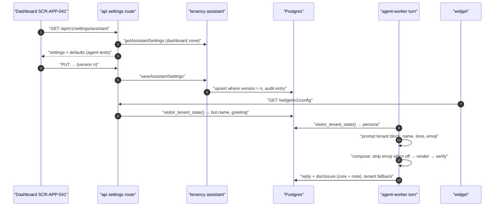

# Technical Design: FEAT-024 — Assistant persona and disclosure settings

> Feature from: [implementation-plan.md](../../03-planning/implementation-plan.md) §4 (E3 Agent) and §5 (M1, after FEAT-023) · Epic: E3
> Implements: AGT-08, AGT-11 · Also serves: AGT-09 (p: the editable after-hours message on SCR-APP-041; FEAT-023 §8 "Tone"), NFR-04 (p: the editable fallback message) · Binding NFRs: NFR-10 (EN/中文 texts), NFR-11 (codes only in audit and logs), NFR-02 (widget budget), NFR-09 (WCAG 2.1 AA), NFR-19 (validation and data-view states)
> Realizes: UC-20 main flow (persona and disclosure in replies); UC-29 as the plan maps it (the owner configures the assistant from Settings; re-authentication is for boundary rules only, D8)
> Screens: SCR-APP-041 (Assistant), SCR-WGT-002 (p: header name, greeting, disclosure), designed in [ui-design.md](ui-design.md)
> Status: Verified (self-check §9) · Date: 2026-10-21

## 1. Intent

Until now every tenant's assistant is called "Assistant", greets visitors with the same chrome line, discloses itself with a fixed sentence and answers in one default friendly tone. FEAT-024 gives the owner (or an Admin) one settings screen, SCR-APP-041, to set the bot's name, tone (friendly or professional), greeting and emoji use, to add to the AI disclosure without being able to remove it, and to word the after-hours and fallback messages, in English and optionally Chinese. The agent reflects the settings in every reply: the name and tone go into the cached tenant block of the prompt (ADR-007 decision 2), emoji are removed from model text when they are off, and the system texts come from the tenant's wording. It is next in M1 (plan §5) because FEAT-023 built register matching inside a default tone, which this feature replaces with the tenant's tone, and FEAT-025 (safety) closes M1 after it.

## 2. Codebase context

Surveyed on `main` at `a4fc7d2` (after FEAT-023, PR #14).

- **Schema:** migrations 0000–0013. `business_profiles` holds GST and hours; `tenants` holds name, kill switch and routing knobs. Nothing holds persona settings. `visitor_tenant_state()` (0013, owner `kaki_tenant_state`, `SECURITY DEFINER`, `EXECUTE` for `app_agent_visitor`) is how the visitor zone reads tenant settings; the api's visitor pool connects as the same role.
- **Agent:** `texts.ts` has `textsFor(lang)` with fixed en/zh `disclosure(business)`, `fallback`, `escalation`, `outOfScope`, `unsure`, `afterHours(when)`; its comment names FEAT-024 for the editable disclosure and after-hours message. `prompt.ts` builds `system` (static rules + `<business>` block) byte-stable per tenant, and a tail with language and register. The register rule allows Singlish particles. `compose.ts` renders and verifies each raw segment; nothing touches emoji. `turn.ts` stores the disclosure on the first reply and uses `textsFor(language).fallback` for the paused and unavailable fallbacks. The fake responder reads the tail only.
- **api:** `GET /widget/v1/config` returns `botName: 'Assistant'` (hard-coded) after `resolveWidgetKey`. Dashboard routes follow `registerFactRoutes`: session from cookie, `can(role, capability)` (the `settings.manage` capability already exists for owner and admin), `withTenant(dashboardDb, …)`, Zod parse of body and response, errors mapped in `app.ts`'s handler (`bad_request` 400, `forbidden` 403, `version_conflict` 409).
- **Widget:** the panel header shows `config.botName`; the empty log shows the chrome string `empty`; the disclosure renders from `Message.disclosure`. Locale comes from `navigator.language` (`pickLocale`).
- **Dashboard:** `/settings` is a placeholder naming FEAT-009. Forms follow `fact.tsx` (field, validation on blur and submit, error summary alert, sticky Save, version conflict alert).
- **Conventions reused:** forced RLS + policy + `TENANT_SCOPED_TABLES` + an RLS suite case per table; forward-only drizzle DDL plus a hand-written `_rls` migration; `audit.append` with `auditCode`; optimistic concurrency by `version` (FEAT-022, FEAT-011).
- **Divergences (reality wins):** the plan's data column names `assistant_settings`, which the architecture's logical model (§5.3) does not draw; it is tenant configuration in the `tenancy` module, like BUSINESS_PROFILE (D1, §8). design.md §6's default disclosure includes "A person can take over at any time."; FEAT-022 left that clause for FEAT-044 (takeover), and this feature keeps it out of the fixed core for the same reason (D2).

## 3. API contracts

All in `packages/contracts`. Dashboard routes need a session and `settings.manage` (Owner, Admin).

### 3.1 Shapes

```ts
/** A text the tenant may word per language; null = the default (FEAT-024 D3). '' is read as null. */
LocalText(max) = { en: string(trim, 1..max) | null, zh: string(trim, 1..max) | null }

Tone = 'friendly' | 'professional'

AssistantSettingsBody = {
  version: int ≥ 0,                 // the version read; 0 = never saved
  botName: string(trim, 1..30, no digits, letters/marks/space/'’.-) | null,   // D6
  tone: Tone,
  emoji: boolean,
  greeting: LocalText(200),         // widget empty state (SCR-WGT-002 E)
  disclosureNote: LocalText(200),   // added after the fixed disclosure core (AGT-11, D2)
  afterHoursMessage: LocalText(300),// after the system-owned return-time sentence (AGT-09, D7)
  fallbackMessage: LocalText(300),  // paused and LLM-unavailable fallback (NFR-04)
}

AssistantSettings = AssistantSettingsBody & { updatedAt: string | null }

AssistantDefaults = {
  botName: 'Assistant',
  greeting: { en, zh },
  afterHoursMessage: { en, zh },
  fallbackMessage: { en, zh },
  /** The fixed core with this tenant's business name; `{name}` is replaced by the bot name. */
  disclosureCore: { en: { named, unnamed }, zh: { named, unnamed } },
  /** The return-time sentence, with `{when}` for the rendered next opening (FEAT-023 D6). */
  afterHoursLead: { en, zh },
}

AssistantSettingsResponse = { settings: AssistantSettings, defaults: AssistantDefaults }
```

### 3.2 `GET /api/v1/settings/assistant`

- 200 `AssistantSettingsResponse`. With no saved row: the defaults as settings (`version: 0`, `botName: null`, `tone: 'friendly'`, `emoji: false`, every text null, `updatedAt: null`).
- 401 `unauthorized`/`session_expired`, 403 `no_workspace`, 403 `forbidden` (an Agent).

### 3.3 `PUT /api/v1/settings/assistant`

- Body `AssistantSettingsBody`, the whole document (D9). Response 200 `AssistantSettingsResponse` with `version + 1`.
- 400 `bad_request` on any schema failure (the dashboard validates with the same schema first and names the field, NFR-19).
- 409 `version_conflict`, "These settings were changed by someone else" (the stored version is not `body.version`, including a second first save racing the first).
- 401/403 as above.
- Side effects in the same transaction: the row and one audit entry `settings.assistant_updated` (§5.1). No outbox event: the next visitor turn reads the settings (UC-20), so a change applies to the next reply.

### 3.4 `GET /widget/v1/config` (changed, additive)

`WidgetConfigResponse` gains `greeting: { en: string, zh: string }` (the tenant's or the default, resolved) and `botName` becomes the tenant's name or `'Assistant'`. Both are read after the key resolves, in the visitor zone through `visitor_tenant_state()`. The not-here 404 is unchanged.

`Message` is unchanged: the disclosure is still `Message.disclosure`, now the core plus the tenant's note.

## 4. Schema changes

Migration `0014_assistant_settings` (drizzle DDL from `schema.ts`) and `0015_assistant_settings_rls` (hand-written), against 0000–0013.

| Change | Conceptual entity | Definition |
|---|---|---|
| table `assistant_settings` | TENANT configuration, `tenancy` module (D1) | `tenant_id uuid pk → tenants.id`; `version integer not null default 1`; `bot_name text null`; `tone text not null default 'friendly'`; `emoji boolean not null default false`; `greeting_en, greeting_zh, disclosure_note_en, disclosure_note_zh, after_hours_en, after_hours_zh, fallback_en, fallback_zh text null`; `created_at, updated_at timestamptz not null default now()` |
| checks | | `assistant_settings_tone_ck`: `tone in ('friendly','professional')`; `assistant_settings_bot_name_ck`: `bot_name is null or (char_length(bot_name) between 1 and 30 and bot_name !~ '[0-9]' and btrim(bot_name) = bot_name)`; `assistant_settings_texts_ck`: each text null or `btrim(x) <> ''` with length ≤ 200 (greeting, note) or ≤ 300 (after hours, fallback) |
| RLS (0015) | ADR-005 | `ENABLE` + `FORCE ROW LEVEL SECURITY`; policy `tenant_isolation` `USING/WITH CHECK (tenant_id = app_current_tenant())`; `GRANT SELECT, INSERT, UPDATE ON assistant_settings TO app_dashboard`; `GRANT SELECT ON assistant_settings TO kaki_tenant_state`; no grant to `app_agent_visitor` |
| `visitor_tenant_state()` recreated (0015) | ADR-013 d3; FEAT-022 D10 | Adds the persona columns from a `LEFT JOIN assistant_settings` (`tone` coalesced to `'friendly'`, `emoji` to false, the rest null). Same owner, definer, `search_path` and grant |
| `TENANT_SCOPED_TABLES` | | gains `assistant_settings`; the RLS suite gets its case (AC-10) |

Rollback is forward-only, as before: a later migration would drop the table and restore the 0013 function text.

## 5. Component design



### 5.1 `@kaki/tenancy`: assistant settings

- `assistant.ts` (new):
  - `AssistantPersona` type (the stored values, defaults applied): `{ version, botName, tone, emoji, greeting, disclosureNote, afterHoursMessage, fallbackMessage, updatedAt }`, texts as `{ en: string | null; zh: string | null }`.
  - `DEFAULT_PERSONA` (version 0, everything default).
  - `getAssistantSettings(tx, tenantId) → AssistantPersona` (dashboard zone; no row → `DEFAULT_PERSONA`).
  - `saveAssistantSettings(tx, { tenantId, userId, input, version }) → AssistantPersona`: `version === 0` → `insert … on conflict (tenant_id) do nothing returning`; otherwise `update … set …, version = version + 1, updated_at = now() where tenant_id = $1 and version = $2 returning`. No row → `SettingsConflictError`. Then `audit.append` `settings.assistant_updated`, actor user, subject `assistant_settings`/tenantId, payload `{ version, fields: [codes of the changed fields] }` (`bot_name`, `tone`, `emoji`, `greeting`, `disclosure_note`, `after_hours_message`, `fallback_message`), never the texts (ADR-014, NFR-11). `tenancy` gains a dependency on `@kaki/governance`.
- `VisitorTenantState` gains `persona: Omit<AssistantPersona, 'version' | 'updatedAt'>`, read from the function's new columns; a malformed row (impossible under the checks) falls back to defaults field by field.

### 5.2 `@kaki/agent`: texts

`texts.ts`:

- `Persona` (agent's input type) = `VisitorTenantState['persona']`; optional everywhere, so existing callers and tests keep FEAT-023's texts.
- `textsFor(lang, persona?)`:
  - `disclosure(business)` = core + (` ` + note[lang] if set). Core en: named `You're chatting with {name}, an AI assistant for {business}.`, unnamed `You're chatting with an AI assistant for {business}.` (FEAT-022's sentence, unchanged); zh: named `您正在与 {name} 对话，这是 {business} 的 AI 助手。` (design.md §6), unnamed `您正在与 {business} 的 AI 助手聊天。` (unchanged).
  - `fallback` = `fallbackMessage[lang] ?? default`.
  - `afterHours(when)` = the system lead sentence (FEAT-023's first sentence: `We're closed right now. The team will be back {when}.` or the no-reopening sentence; zh likewise) + ` ` + `afterHoursMessage[lang] ?? default` (`I can still answer your questions in the meantime.` / `在此期间，我仍可以为您解答问题。`). So with no customisation every text is byte-identical to FEAT-023's.
  - `escalation`, `outOfScope`, `unsure` stay fixed (not on SCR-APP-041).
- `DEFAULT_GREETING` en `Ask us anything. We usually reply right away.`, zh `有什么问题都可以问我们，我们通常会马上回复。` (moved from the widget's chrome strings, which no longer hold it).
- `assistantDefaults(businessName) → AssistantDefaults` (§3.1) for the api, from the same templates, so the dashboard preview and the stored disclosure can't drift.

### 5.3 `@kaki/agent`: prompt and compose

- `prompt.ts`: `buildVisitorPrompt` gains `persona?`. The tenant block gains an `<assistant>` section after `<business>`:
  - `Name: {botName}` (only when set) with the rule "Call yourself {name} if you introduce yourself; never claim to be a person.",
  - `Tone: friendly` → "warm and casual, like a helpful shop assistant", `professional` → "courteous and businesslike; complete sentences; no slang and no Singlish particles, even when the visitor uses them" (AGT-08: register matching stays within the chosen tone),
  - `Emoji: at most one, only where it fits a friendly reply` / `Emoji: never`.
  The static register rule line gains "within the tone set in <assistant>". All of it depends only on settings, so `system` stays byte-stable per tenant and changes only when the owner saves (ADR-007 decision 2; FEAT-004 AC-3 extended).
- `emoji.ts` (new): `stripEmoji(text)` removes emoji sequences (`\p{Extended_Pictographic}` and regional-indicator pairs, with their ZWJ joins, `U+FE0F` and skin-tone modifiers, and keycap sequences), then tidies the spaces it left (no doubled spaces, no space before `.,!?，。！？`). `©`, `®` and `™` are kept.
- `compose.ts`: `ComposeInput.emoji?: boolean` (default true, the pre-FEAT-024 behaviour). With `emoji === false`, each raw segment is passed through `stripEmoji` before rendering, so fact values (rendered after) are never touched and the verifier sees the stripped text (D4).
- `fake-responder.ts`: reads `Tone:` and `Emoji:` from `system`: a friendly tone with emoji allowed ends its answer with ` 🙂`; with a name set, a "who are you / what's your name / 你是谁 / 你叫什么" question gets `I'm {name}, the AI assistant here. How can I help?` (zh `我是{name}，这里的 AI 助手。有什么可以帮您？`). Professional or emoji never: unchanged. So the local stack and E2E show the settings on the fake model.

### 5.4 `@kaki/agent`: the turn

`runVisitorTurn` takes `persona = gate.tenant?.persona` and passes it to every `textsFor(language, persona)` (disclosure, fallback for paused and unavailable, after-hours notice), to `answerTurn`/`composeReply` (`persona`, `emoji: persona.emoji`), and so to the prompt. The `agent.decision` audit payload gains `tone` (code) and `emojiRemoved` (boolean: a segment changed when stripped). Still no text.

### 5.5 api

- `apps/api/src/settings.ts` (new): `registerSettingsRoutes(app, deps, sessionFrom)` with §3.2 and §3.3, requiring `settings.manage`; maps `SettingsConflictError` → 409 `version_conflict` with the message in §3.3 (added to `app.ts`'s handler). `defaults` come from `assistantDefaults(businessName)`; the business name is read in the same transaction (`tenants.name`, dashboard zone). The api gains a dependency on `@kaki/agent` (the texts' single source).
- `GET /widget/v1/config`: after the key resolves, `withTenant(visitorDb, install.tenantId, visitorTenantState)` gives `persona.botName ?? 'Assistant'` and the greeting resolved per language with `DEFAULT_GREETING`.

### 5.6 Widget (SCR-WGT-002, p)

`WidgetConfig` gains `greeting`. The empty log shows `config.greeting[locale === 'zh-Hans' ? 'zh' : 'en']` (with `lang` from `langOf`), replacing the `empty` chrome string; the header and launcher label already use `botName`. Budget: tens of bytes (NFR-02).

### 5.7 Dashboard (SCR-APP-041)

`/settings` becomes the Settings index (ui-design.md) and `/settings/assistant` the Assistant screen: `GET` on load, a form bound to `AssistantSettingsBody` validated with the contract schema on blur and submit, a live preview of the widget's header, greeting and first reply disclosure, `PUT` on Save, the 409 alert with Reload, and the 403 no-permission state for an Agent. `apps/dashboard/src/lib/settings.ts` holds the fetchers.

### 5.8 Evals

- `Fixture` and `Case` gain `persona?: Partial<Persona>` (the case's wins); the runner passes it into `answerTurn` and the texts exactly as the worker does.
- New expectation `{ kind: 'emoji', present: boolean }`; new judge criterion `tone` (the reply matches the tenant's tone, within the visitor's register; professional replies use no particles), pending on the fake provider as before (FEAT-023 D8).
- `feat-024-persona.json` (≥ 12 cases, about half `fast`): emoji off with a recorded emoji answer (stripped, price still cited), emoji on with the fake (present), professional tone + Singlish question (no particle in a recorded professional answer; `tone` judge pending), friendly + Singlish, a custom fallback (`unavailable` triage), the custom after-hours message with the system return time, a named disclosure in en and zh, the name question. Subsets: `groundedness`, `singlish`, `chinese`.
- `evals/version.json` → `0.6.0`; the agreement sample gains draft-labelled `tone` items so it stays ≥ 10% of the judge expectations.

### 5.9 Dev data

The seed leaves both dev tenants without a saved row (defaults), so earlier E2E tests see FEAT-023's texts; the E2E for this feature saves and then restores the settings through the API.

## 6. Acceptance criteria

- **AC-1 (AGT-08; UC-29 as mapped).** An Owner or Admin can read and save bot name, tone, greeting and emoji; an Agent gets 403 on both routes. A saved setting reads back unchanged with `version + 1`; a save with a stale version (including two first saves) gets 409 `version_conflict` and changes nothing.
- **AC-2 (AGT-08; NFR-19).** Validation: a bot name over 30 characters, with a digit, or blank is rejected (400, and named inline in the dashboard); texts over their limits are rejected; blank texts are stored as null (default). The database checks reject the same values written directly.
- **AC-3 (AGT-08; ADR-007 d2).** The prompt's `system` carries the name, tone and emoji lines; it is byte-identical across turns with different languages, registers and times for the same settings, and differs after any persona change. A professional tone's lines forbid particles; a friendly tone keeps FEAT-023's register rule.
- **AC-4 (AGT-08, "settings are reflected in replies").** With emoji off, a model segment containing emoji is released without them (spaces tidied, slot values untouched) and the stored reply has none; with emoji on, the fake model's friendly answer ends with an emoji. With a name set, the widget header and launcher label show it and the fake answers the name question with it.
- **AC-5 (AGT-11).** The first reply of every conversation stores the disclosure core naming the AI (with the bot name when set) followed by the tenant's note in the reply language; with no note the core alone; with no settings at all, FEAT-022's sentence byte for byte. No setting can produce a first reply without the core (the API has no field for the core).
- **AC-6 (AGT-09 p; NFR-04 p).** A paused tenant's or an LLM-unavailable turn's fallback is the tenant's fallback text in the reply language (default when unset); the after-hours notice is the system return-time sentence followed by the tenant's message, so the return time is always shown.
- **AC-7 (NFR-10).** Each text is chosen per reply language: a Chinese turn uses the `zh` text, or the Chinese default when only `en` is customised; it never falls back to the tenant's English text.
- **AC-8 (SCR-WGT-002; NFR-02).** `GET /widget/v1/config` returns the tenant's bot name and greeting (resolved per language); the widget's empty state shows the greeting in the panel locale; the widget stays within budget.
- **AC-9 (GOV-01; ADR-014; NFR-11).** Each save writes one `settings.assistant_updated` entry with the actor, the new version and the changed field codes, and no text; the `agent.decision` entry gains `tone` and `emojiRemoved`.
- **AC-10 (GOV-03; ADR-005).** `assistant_settings` has forced RLS; tenant B can't read or write tenant A's row; the visitor role can't select it directly and gets only its own tenant's persona from `visitor_tenant_state()`.
- **AC-11 (SCR-APP-041; NFR-09, NFR-19).** The Assistant screen loads, validates on blur and submit with a linked error summary, previews the header, greeting and disclosure as typed, saves with a success toast, shows the conflict alert on 409 and the no-permission state for an Agent; no serious axe violations at 375 px and desktop.
- **AC-12 (E2E; UC-20, UC-29).** In the browser an owner sets a name, emoji on, a greeting and a disclosure note, saves, and on the widget host page sees the name in the header, the greeting, the disclosure with name and note on the first reply, and an emoji in the answer; the test restores the defaults afterwards.
- **AC-13 (AGT-14).** `pnpm eval` and `--fast` pass every threshold with the new persona cases and the existing cases unchanged.

AC-1 to AC-13 are verified in M1 on the fake provider. Whether the real model holds the professional tone with Singlish visitors (the `tone` judge) is checked at M1.5, so AGT-08's Test ref carries `(partial)` until then (plan §3).

## 7. Decisions

- **D1 — A separate `assistant_settings` table, one row per tenant, in `tenancy`.** Driver: the plan names it as this feature's data; SCR-APP-041 is its own screen with its own optimistic-concurrency version, separate from the business profile FEAT-009 edits. A missing row means defaults, so tenant creation (FEAT-005) needn't change. Rejected: columns on `business_profiles`, which would make two screens race on one version.
- **D2 — The disclosure is a fixed core plus an editable note.** Driver: AGT-11 "can be edited but not removed" and design.md §6 "editable by the tenant except the disclosure core". The core always says "AI assistant" and names the business (and the bot when named), so no setting can hide that the visitor talks to an AI (IMDA transparency). The note defaults to empty; FEAT-044 adds "A person can take over at any time." as its default when takeover exists. Rejected: a free text that must contain "AI", which a regex can't guarantee discloses anything.
- **D3 — Each editable text has an optional English and Chinese wording; null means the localised default.** Driver: AGT-03/NFR-10 and FEAT-023 D5 (Chinese visitors get Chinese system texts). A Chinese turn never shows the tenant's English text; it shows the Chinese default instead. Rejected: one text for all languages, which would answer a Chinese visitor's first message with an English note.
- **D4 — Emoji off is enforced in code by stripping model-typed emoji before render and verify.** Driver: "settings are reflected in replies" must hold on any model; stripping is deterministic and costs nothing, while blocking would spend a regeneration on a cosmetic slip. Fact values and owner texts are never stripped. Emoji on is a prompt allowance only ("at most one").
- **D5 — Tone lives in the cached tenant block and bounds the register rule.** Driver: ADR-007 decision 2 lists persona settings in the tenant block; AGT-08 says register matching stays within the chosen tone. Professional suppresses Singlish particles but still answers a Singlish visitor in plain, natural English.
- **D6 — Bot names are 1–30 characters with no digits.** Driver: the verifier blocks every model-typed digit (FEAT-022 D13, D15), so a name like "Kaki 2" would block the model's own introduction. Letters in any script, spaces, apostrophes, hyphens and full stops are allowed.
- **D7 — The after-hours return time stays system-owned; the owner words only the sentence after it.** Driver: AGT-09 "tells the visitor when staff will be back" is a protected time value (ADR-008, FEAT-023 D6), so an owner text can't drop or mistype it.
- **D8 — Saving persona settings needs no re-authentication.** Driver: AUTH-03 and design.md §4.10 list boundary rules, not persona, as sensitive; UC-29's re-auth step is the boundary-rules flow (FEAT-054 with FEAT-006). The change is audited (GOV-01).
- **D9 — The screen saves the whole document with `PUT` and a version.** Driver: one form, one Save (design.md §3 sticky action bar), and FEAT-022's version-conflict convention. Rejected: `PATCH` per field, which would need per-field conflict handling for no user benefit.

## 8. Escalations and open items

- **Logical model note (no amendment requested).** ASSISTANT_SETTINGS is not drawn in architecture §5.3, but it introduces no new domain noun beyond ADR-007's "persona settings" in the tenant block and is owned by `tenancy` with TENANT's consistency boundary (1:1, same RLS). Recorded here as an open issue for the next architecture revision to draw it, like FEAT-023's hours on BUSINESS_PROFILE.
- **SCR-APP-041's kill switch (GOV-08)** belongs to FEAT-057; the screen leaves room for it (ui-design.md).
- **SCR-APP-009 (wizard · rules and privacy)** reuses these contracts when FEAT-009/FEAT-035 build the wizard; nothing here blocks it.
- **"A person can take over"** joins the disclosure default with FEAT-044 (D2); the fallback's lead-capture clause with FEAT-049.
- **Real-model tone check** at M1.5 (§6); the `tone` agreement labels are drafts that the owner confirms before M1.5, like FEAT-023's.

## 9. Self-check

Requirement coverage: AGT-08 → AC-1, AC-2, AC-3, AC-4, AC-11, AC-12, AC-13 (tasks T1–T9); AGT-11 → AC-5, AC-12 (T3, T5, T8, T9). AGT-09 (p) and NFR-04 (p) → AC-6 (T3, T5). NFR-10 → AC-7; NFR-11 → AC-9; NFR-02 → AC-8 (T7 size check); NFR-09/NFR-19 → AC-11; GOV-03/ADR-005 → AC-10 (T1). E2E obligation: UC-20 is a critical flow (architecture §8.7) and this feature changes what its first reply shows → T9 adds `assistant.e2e.ts`. IDs checked: AGT-03/08/09/11/14, AUTH-03, GOV-01/03/08, NFR-02/04/09/10/11/19, UC-20, UC-29, SCR-APP-009, SCR-APP-041, SCR-WGT-002, ADR-005/007/008/013/014/022, FEAT-004/005/009/022/023/025/035/044/049/054/057 all resolve. Schema: one table inside TENANT's boundary (§8 note), forced RLS in the same migration pair. Contract changes are additive (`WidgetConfigResponse.greeting`); `textsFor` keeps its signature with an optional persona.
