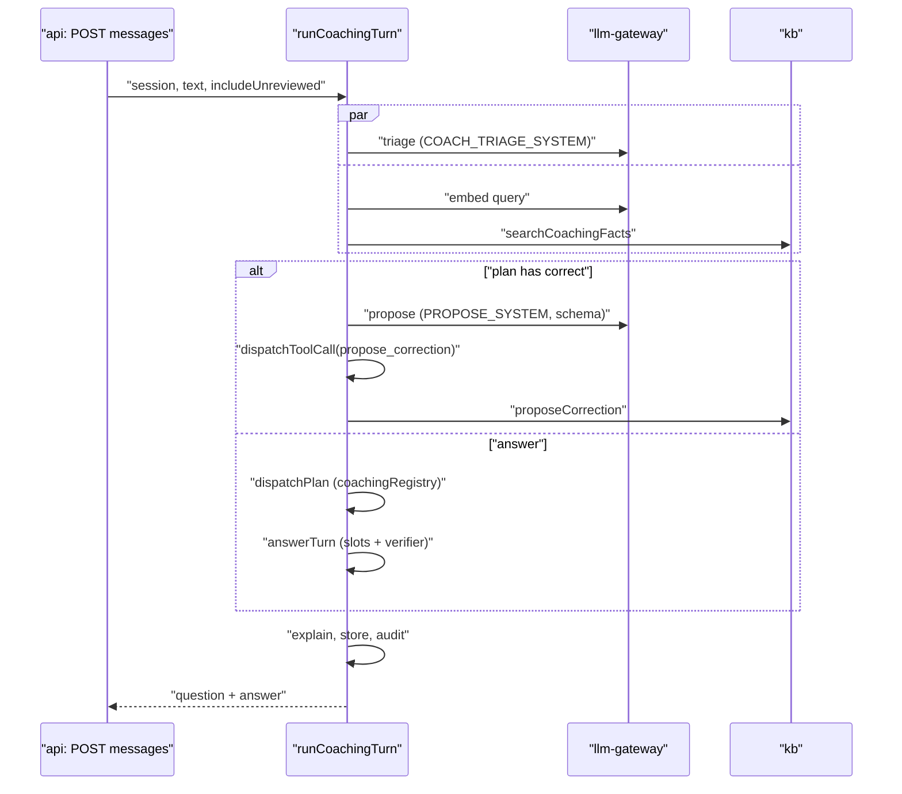

# Technical Design: FEAT-027 — Coaching mode

> Feature from: [implementation-plan.md](../../03-planning/implementation-plan.md) §4 (E3) · Milestone: M2
> Implements: AGT-17, ONB-05 · Realizes: UC-04 (main flow; 2a, 4, 5a; 4a and 4b belong to FEAT-013/028) · Screens: SCR-APP-030, SCR-APP-010, quick coach panel (see [ui-design.md](ui-design.md))
> Status: Verified (ADR-026 accepted and D10 decided, 2026-10-24) · Date: 2026-10-24

## 1. Intent

The Owner and Admins can chat with their assistant in the dashboard, before and after go-live. Each answer goes through the same verified pipeline visitors get and shows which facts it used and why. The owner can include unreviewed facts (labelled), and can teach a correction in plain language, which becomes a proposed change they confirm in the chat and which visitors get straight away. It's next because the setup flow (J1) needs its "test your assistant" step, and M2 has an interim demo after this feature.

## 2. Codebase context

- **Agent:** `runVisitorTurn` (`packages/agent/src/turn.ts`) runs gate → triage ∥ retrieval → `dispatchPlan` → `answerTurn` (compose, slots, verifier) → store. `answerTurn` and `composeReply` take plain inputs (facts, history, persona, slots) and are reused unchanged. `Scope = 'visitor' | 'coaching'` already exists in `dispatch.ts`; `dispatchToolCall` exists but is unused (its comment expects the first model-assisted tool).
- **Task kinds** are a closed enum (`plan.ts`, ADR-025 decision 1: "new kinds only by amending this table"). Coaching needs one, so this feature files **ADR-026** (§8).
- **KB:** scope-typed contexts in `kb/src/context.ts`. `searchVisitorFacts` reads `visitor_chunks`/`visitor_facts`. Every staged fact has a chunk (promote embeds them), so `needs_review` facts are searchable from `kb_chunks` with the dashboard role. `updateFact` (KB-07) already does "edit → new approved version, re-embedded chunk, audit" in one transaction; `createFact` does a manual approved fact.
- **Tenancy:** hours are `business_profiles.hours` (`WeeklyHours`), saved with `saveBusinessProfile(tx, {version, profile})`; not facts.
- **Schema:** last migration `0026`. No `corrections` or `coaching_*` tables yet. `usage_events` keys usage by `conversation_id`/`turn_id`.
- **API:** routes in `apps/api/src/<area>.ts` with `register<Area>Routes(app, deps, sessionFrom)`, capability checks with `can(role, …)` (`identity/capabilities.ts`), `ErrorBody {error, message}`, `/api/v1/…`. The api role already has `llm` (with the usage sink) and depends on `@kaki/agent`.
- **Dashboard:** `/coach` is a placeholder naming FEAT-027; setup steps are `/setup`, `/setup/sources`, `/setup/review` (FEAT-035 adds the wizard frame).
- **Divergence:** architecture §5.1 places coaching in the agent-worker. This design runs it in the api role (D1, ADR-026).

## 3. API contracts

New contracts section `// ---- Dashboard API: coaching (AGT-17, ONB-05; FEAT-027 §3)`. All routes need a signed-in session with the new capability **`coach.use`** (Owner, Admin); others get 403 `forbidden`. IDs from another tenant, or malformed, give 404 `not_found` (RLS hides them). Owner text is masked at the edge (ADR-015, `piiMask`) before it's stored or sent to a model.

| Method, path | Body / query | 200/201 response | Errors |
|---|---|---|---|
| `POST /api/v1/coach/sessions` | `{ origin: 'coach' \| 'setup' \| 'panel' }` | 201 `{ session: CoachSession }` | 403 |
| `GET /api/v1/coach/sessions` | `?cursor` | `{ sessions: CoachSession[] (20, newest first, own and others'), nextCursor }` | 403 |
| `GET /api/v1/coach/sessions/:id` | | `{ session, messages: CoachMessage[] }` | 403, 404 |
| `POST /api/v1/coach/sessions/:id/messages` | `{ text: string 1..1000 trimmed, includeUnreviewed: boolean }` | 201 `{ question: CoachMessage, answer: CoachMessage }` | 403, 404, 422 `invalid_body`, 429 `rate_limited` (20 turns a minute per user) |
| `POST /api/v1/coach/corrections/:id/confirm` | `{}` | `{ correction: Correction, before: CoachMessage \| null, after: CoachMessage \| null }` | 403, 404, 409 `correction_closed` (already decided), 409 `correction_stale` (the fact or the hours changed since the proposal), 422 `invalid_correction` (the change no longer passes `checkFact`) |
| `POST /api/v1/coach/corrections/:id/dismiss` | `{}` | `{ correction }` | 403, 404, 409 `correction_closed` |
| `GET /api/v1/coach/suggestions` | | `{ questions: string[] (≤ 6) }` | 403 |

Shapes:

- `CoachSession { id, origin, title: string | null (the first question, ≤ 80 chars), createdAt, updatedAt }`.
- `CoachMessage { id, seq, author: 'owner' | 'agent', kind: 'question' | 'answer' | 'proposal' | 'after', text, includeUnreviewed, createdAt, explainer: Explainer | null, correction: Correction | null }`.
- `Explainer { outcome: 'answered' | 'escalated' | 'out_of_scope' | 'unsure' | 'refused' | 'unavailable', facts: ExplainedFact[], usedFactIds: string[], reasons: ReasonCode[], route: 'reply.simple' | 'reply.complex' | null, visitorsWouldGet: 'same' | 'without_unreviewed' | 'fallback_paused' | 'not_live' }` with `ExplainedFact { id, type, label, status: 'approved' | 'needs_review', used: boolean }` and `ReasonCode` one of `matched_facts`, `no_matching_fact`, `low_confidence`, `out_of_scope`, `advice`, `illegal`, `injection`, `impersonation`, `regenerated`, `segment_blocked`, `escalated`, `hours_slot`, `unreviewed_used`. The UI turns codes into sentences (ui-design).
- `Correction { id, status: 'open' | 'accepted' | 'dismissed', change: ProposedChange, decidedAt: string | null }`, `ProposedChange` =
  - `{ kind: 'edit_fact', factId, factVersion, factType, label, before: FactValueView, after: FactValueView }` (`FactValueView` is the fact's `value` plus `gstTreatment` and validity, the same shapes as FEAT-011's fact contract),
  - `{ kind: 'add_faq', question, answer }`,
  - `{ kind: 'edit_hours', profileVersion, before: Partial<WeeklyHoursInput>, after: Partial<WeeklyHoursInput> }` (only the changed days; D10).
- Suggestions: up to 3 questions from the tenant's industry template (`INDUSTRY_TEMPLATES`) not yet covered by an approved FAQ, then up to 3 from the newest approved products and policies ("How much is {name}?", "What's your {policy title}?").

`POST …/messages` is synchronous: the response carries the whole verified answer (no streaming; D1). Its answer is never sent anywhere else. NFR-01's full-reply bound (p95 ≤ 8 s) applies to this call.

## 4. Schema changes (migration `0027_coaching.sql`; Drizzle tables, then grants, RLS and checks by hand)

Entities: COACHING_SESSION and CORRECTION are in the conceptual model (architecture §5.3). `coaching_messages` is the session's content (as `messages` is for CONVERSATION), not a new noun.

- **`coaching_sessions`**: `tenant_id uuid not null → tenants`, `id uuid default random`, `created_by uuid not null` (user), `origin text not null` check in (`coach`, `setup`, `panel`), `title text null`, `created_at`, `updated_at timestamptz not null default now()`. PK (`tenant_id`, `id`); index (`tenant_id`, `updated_at desc`, `id desc`).
- **`coaching_messages`**: `tenant_id`, `id`, `session_id` (FK with tenant to `coaching_sessions`), `seq int not null`, `author text` check in (`owner`, `agent`), `kind text` check in (`question`, `answer`, `proposal`, `after`), `body text not null` (masked), `include_unreviewed bool not null default false`, `outcome text null`, `fact_ids uuid[] not null default '{}'`, `explainer jsonb null`, `correction_id uuid null`, `created_at`. PK (`tenant_id`, `id`); unique (`tenant_id`, `session_id`, `seq`).
- **`corrections`** (ADR-010 decision 4's shape; FEAT-018 adds producers, the queue screen and replay): `tenant_id`, `id`, `source_type text not null` check in (`thumbs_down`, `staff_reply`, `staff_edit`, `coaching`, `oversight`, `stale`, `coverage_gap`), `proposed_by text not null` check in (`system`, `coaching`, `staff`), `conversation_ref uuid null`, `coaching_session_id uuid null`, `coaching_message_id uuid null`, `fact_refs uuid[] not null default '{}'`, `proposed_change jsonb not null`, `status text not null default 'open'` check in (`open`, `accepted`, `edited_and_accepted`, `dismissed`), `created_by uuid null`, `decided_by uuid null`, `decided_at timestamptz null`, `created_at`, `updated_at`. PK (`tenant_id`, `id`); index (`tenant_id`, `status`, `created_at desc`); check `(status = 'open') = (decided_at is null)`; check `source_type <> 'coaching' or coaching_session_id is not null`.
- **`usage_events`**: add `coaching_session_id uuid null`; check `conversation_id is null or coaching_session_id is null`. Coaching usage is metered (NFR-13) but never counted per conversation.
- All three new tables: forced RLS with the tenant policy, names in `TENANT_SCOPED_TABLES`, cases in `rls.int.test.ts`. Grants to `app_dashboard` only: `coaching_sessions` SELECT, INSERT, UPDATE (`title`, `updated_at`); `coaching_messages` SELECT, INSERT; `corrections` SELECT, INSERT, UPDATE (`status`, `decided_by`, `decided_at`, `updated_at`). **No grant to `app_agent_visitor`** (ADR-009), asserted in the RLS suite.
- Rollback: drop the three tables and the column (local only; production has no down migrations).

## 5. Component design

### 5.1 KB (`packages/kb`)

- **`CoachingKbContext`** `{ scope: 'coaching', tx, tenantId, userId, sessionId }` and `coachingKb(…)` in `context.ts`. Distinct from the visitor and dashboard contexts (ADR-009 typing).
- **`searchCoachingFacts(ctx, embedding, { includeUnreviewed, k?, maxDistance? })`** (`coaching.ts`): the same k-NN and distance cut as `searchVisitorFacts`, over `kb_chunks` joined to `facts`, with `visitor_facts`' validity and GST conditions, and status `approved`, or `approved`/`needs_review` when `includeUnreviewed`. Never `rejected`, `conflicted` or `disabled`. Returns `VisitorFact & { distance, status }`.
- **`corrections.ts`**:
  - `proposeCorrection(ctx: CoachingKbContext, input)`: validates and inserts an open correction. `edit_fact`: the fact exists, isn't `rejected`/`conflicted`, `mergePatch` + `checkFact` pass, and the change alters content (`contentChanged`); stores `before`/`after`, `factVersion`, `fact_refs = [factId]`. `add_faq`: `checkFact` on the FAQ. `edit_hours`: the merged hours pass `WeeklyHours`. Audit `correction.proposed` `{ kind, sourceType: coaching, factIds }`. Throws `InvalidCorrectionError` otherwise.
  - `confirmCorrection(ctx: DashboardKbContext, id, chunk?)`: locks the row (`for update`), `CorrectionClosedError` unless `open`. `edit_fact` → `updateFact(ctx, factId, { version: factVersion, value/gst/validity from after }, chunk)`; a version mismatch becomes `CorrectionStaleError`. `add_faq` → `createFact` (approved, source `coaching`). `edit_hours` → the `applyHours` port (§5.4). Then status `accepted`, `decided_by/at`, audit `correction.accepted` `{ kind, factIds }`. One transaction, so `visitor_facts` and the visitor chunks have the new value on commit (AGT-17's 60 s).
  - `dismissCorrection(ctx, id)`: status `dismissed`, audit `correction.dismissed`.
  - `getCorrection`, `toCorrectionView`.
- The chunk for an edit is prepared before the transaction (`prepareChunk(llm, …)` on `after`), as the facts routes do.

### 5.2 Agent (`packages/agent`)

- **Task kind `correct`** (ADR-026): added to `TaskKind`, `PHASE.correct = 'state'`. The visitor triage prompt never lists it; `visitorRegistry` has no handler, so a visitor plan carrying it is reported `unhandled` and audited, and the handler's `scopes: ['coaching']` refuses it in any visitor context.
- **`COACH_TRIAGE_SYSTEM`** (`coach-prompt.ts`): fixed text, the visitor triage lines plus "correct: the owner says a price, product detail, FAQ answer, policy, promotion or opening hours is wrong or has changed, or asks you to add an answer". `triage()` gains an optional `system` (default `TRIAGE_SYSTEM`); its own cache prefix.
- **Propose step** (`propose.ts`): one `generate` on logical model `extract` (structured output; D4) with `PROPOSE_SYSTEM`, the owner's message, the previous agent answer in this session, and up to 8 candidate facts (the retrieved facts plus those the previous answer used, as `F1…F8` refs with type and value) and the current hours. Output schema `{ action: 'edit_fact' | 'add_faq' | 'edit_hours' | 'none', ref?, patch?, question?, answer?, hours? }`. `parseProposal` maps refs to IDs (an unknown ref → `none`) and builds the tool call `propose_correction`.
- **`coachingRegistry`**: `proposeCorrectionHandler` (`kind: 'correct'`, `tool: 'propose_correction'`, `scopes: ['coaching']`, Zod args = the proposal) runs `kb.proposeCorrection` through a port on `DispatchContext` (`coaching.propose`, like FEAT-025's conversation port); and `outOfScopeHandler` with `scopes: ['visitor', 'coaching']`, so UC-04 2a gives the live text. Crisis and abuse stay visitor-only.
- **`runCoachingTurn(deps, { tenantId, userId, sessionId, text, includeUnreviewed })`** (`coach.ts`):
  1. Load the session (404 if absent), the last `HISTORY_LIMIT` messages, the tenant state (business name, GST, route policy, persona, hours, AI live/paused).
  2. Triage ∥ embed + `searchCoachingFacts`. `meta = { tenantId, coachingSessionId }` (§5.3).
  3. Plan has `correct` → propose step → `dispatchToolCall`. Done: the reply is the fixed text "Here's the change I'd make…" (kind `proposal`, carrying the correction). Refused or `none`: the fixed text asking the owner to name the item. No reply model call either way.
  4. Otherwise `dispatchPlan(coachingRegistry, …)` then `answerTurn` with the coaching facts. `gateOpen` is always true in coaching (D5).
  5. `explain()` builds the `Explainer` in code from the plan, the facts, the answer result (fact IDs, violations, attempts, slots) and the tenant state (D3).
  6. Store both messages (§5.3) and audit `coach.turn` `{ outcome, tasks, factIds, includeUnreviewed, unreviewedUsed, route }` (codes and IDs, ADR-014).
- **`reanswer(deps, correction)`**: after a confirm, re-runs the question that preceded the proposal through step 4 with the same `includeUnreviewed`, stored as kind `after`; the earlier answer is returned as `before` (UC-04 step 7 for the coached question; past visitor questions are FEAT-018's replay).
- **Fakes:** `fakeAgentScript` routes `COACH_TRIAGE_SYSTEM` (messages with "now", "changed", "went up", "actually", "should be", "add") to `correct`, and `PROPOSE_SYSTEM` to a deterministic proposal (a `$NN` amount → `priceCents` on the first product ref; "open … to …" → hours; "Q: … A: …" → `add_faq`).

### 5.3 Storage, usage and exclusion

- `coach-store.ts` in `@kaki/agent` (the module that owns `runCoachingTurn`, architecture §5.2) writes `coaching_sessions`/`coaching_messages` on the dashboard zone. Nothing writes to `conversations`, `messages` or the outbox, so coaching never reaches a channel, the inbox, analytics or fair use (ADR-009).
- Gateway: `meta` gains `coachingSessionId?`; `onUsage` passes it; `usage.record` stores it in `usage_events.coaching_session_id` with `conversation_id` null.

### 5.4 Hours corrections (D10)

`edit_hours` confirms through a port the api wires to `@kaki/tenancy`: read the profile, merge the changed days, `saveBusinessProfile` with the proposal's `profileVersion` (`SettingsConflictError`/version mismatch → `correction_stale`), in the same transaction as the correction update. The next visitor turn's hours slot uses the new hours.

### 5.5 API and dashboard

- `apps/api/src/coach.ts` `registerCoachRoutes`; capability `coach.use` in `identity`. Rate limit with the existing `rateLimiter` (key `coach:{userId}`). Errors map `InvalidCorrectionError` → 422, `CorrectionClosedError`/`CorrectionStaleError` → 409.
- Dashboard: `lib/coach.ts` (client), `components/coach-chat.tsx` (thread, composer, toggle, explainer, proposal card), pages `/coach` (SCR-APP-030), `/setup/test` (SCR-APP-010), `quick-coach-panel.tsx` opened from Review fact cards and the Fact page. Details in ui-design.md.

### 5.6 Evals

`evals/coaching/cases.json` (≥ 16 cases: price, FAQ answer, policy, promotion end date, hours, add FAQ, ambiguous item, a question that isn't a correction, Chinese and Singlish corrections) scored by `evals/src/coaching.ts` (task `correct` detected; proposal kind, fact and changed field right). `evals/src/coaching.test.ts` runs them on the fake provider; the real-model run is recorded as pending in the acceptance report (as FEAT-012's extraction set).

## 6. Acceptance criteria

- **AC-1** (AGT-17, ADR-009) Only Owner and Admin reach coaching: a staff session gets 403 on every route, no session 401, and tenant B gets 404 for tenant A's sessions and corrections.
- **AC-2** (AGT-17, ONB-05; UC-04 1–3) A question gets an answer from the same compose, slot and verifier pipeline as visitors (prices from slots, verifier on), with an explainer listing the facts considered and used (type, label, status) and reason codes.
- **AC-3** (AGT-17, KB-16) With `includeUnreviewed` false, no `needs_review` fact is retrieved or used; with true, it can be, and is labelled `needs_review` with `unreviewed_used` and `visitorsWouldGet: 'without_unreviewed'`. `rejected`, `conflicted` and `disabled` facts are never used.
- **AC-4** (UC-04 2a, AGT-04) An out-of-scope question gets the same AGT-04 text the visitor would get.
- **AC-5** (AGT-17, KB-18; UC-04 4–5) "Fudge cake went up to $58" produces an open `corrections` row (`source_type` and `proposed_by` `coaching`, `fact_refs` [F]) and a proposal message showing before and after; the fact is unchanged and visitors still get the old value.
- **AC-6** (AGT-17 "within 60 seconds"; UC-04 6–7; architecture §6.4) Confirming creates a new approved version of F with a new chunk, one audit entry, status `accepted`; `searchVisitorFacts` returns the new value straight after the response; the response carries `before` and `after` answers.
- **AC-7** (UC-04 5a) Dismiss closes the item with no fact change. Confirming or dismissing a decided item gives 409 `correction_closed`; confirming after F changed gives 409 `correction_stale` and changes nothing.
- **AC-8** (AGT-17, ADR-009, ONB-05) A coaching turn writes no `conversations`, `messages` or `outbox` rows; its `usage_events` rows have `coaching_session_id` set and `conversation_id` null; `app_agent_visitor` can't select from the three new tables.
- **AC-9** (AGT-17 "audit-logged", ADR-014) Every turn, proposal, confirm and dismiss has an audit entry with codes and IDs only; no owner text in any payload.
- **AC-10** (AGT-16, ADR-009, ADR-026) A visitor turn whose plan contains `correct` dispatches nothing (`unhandled`), and `propose_correction` called with a visitor context is refused with `scope`.
- **AC-11** (ONB-05 "before going live") Coaching works while the AI is paused or no channel is live; the explainer says what visitors get instead (`fallback_paused`, `not_live`).
- **AC-12** (D10; AGT-17's hours example) "We're open 9am to 5pm on weekends now" proposes `edit_hours` for sat and sun; confirming saves the profile and the next visitor hours slot reads 9am–5pm.
- **AC-13** (ONB-05, AGT-17; ui-design) SCR-APP-030, SCR-APP-010 and the quick panel render every designed state with no serious axe violations; the panel never confirms a change without the owner's tap.
- **AC-14** (plan §3, AGT-14) The coaching eval set passes on the fake provider; real-model results are pending.
- **AC-15** (NFR-01) A coaching turn on the fake provider completes within the 8 s full-reply bound in the API integration test.

## 7. Decisions

- **D1 — Coaching runs in the api role, synchronously.** Driver: a dashboard request-response turn, no visitor streaming, no SQS queue or SSE channel to add; the api already has `llm` and `@kaki/agent`. Rejected: an agent-worker job with a dashboard SSE stream (two new transports for one screen). Consequence: architecture §5.1's container table needs the note in ADR-026; long model calls hold an api request (bounded by the gateway timeouts).
- **D2 — One coaching task kind, `correct`, plus the `propose_correction` tool** (ADR-025 decision 7). The model interprets (triage, then a structured proposal), code acts (handler validation, `proposeCorrection`). Rejected: the reply model calling the tool natively (the outcome would depend on the model choosing to call it).
- **D3 — The explainer is built in code, not by a model.** Driver: D6 cost and determinism; every reason comes from what the pipeline actually did. ADR-009's `explain_answer` is this function, not a model tool. Rejected: a model-written rationale (can be wrong about why).
- **D4 — The propose step uses logical model `extract`** (structured output). No new logical model or usage purpose. Rejected: `triage` (it must stay one fixed cached prompt).
- **D5 — The send gate doesn't apply to coaching.** ONB-05 is a playground before go-live; nothing is sent to a visitor. The explainer reports the visitor-side state instead (AC-11).
- **D6 — Confirming in the chat accepts the correction** (ADR-010 decision 5). Unconfirmed proposals stay open in `corrections` for FEAT-018's queue.
- **D7 — After a confirm, only the coached question is re-answered.** The 20-question replay is FEAT-018 (KB-18).
- **D8 — Coaching sessions are shared by the tenant's Owner and Admins** (list shows everyone's, with `created_by`); no per-user privacy within a tenant's managers.
- **D9 — Owner text is masked at the edge** (`piiMask`) before storage and model calls (ADR-015), as visitor text is.
- **D10 — Hours corrections are proposals too** (Ken, 2026-10-24): an `edit_hours` correction, confirmed in the chat, saves the business-profile hours (§5.4). Rejected: linking to Settings with no correction item (AGT-17's own example wouldn't be met in the chat).

## 8. Escalations and open items

- **ADR-026 (accepted by Ken, 2026-10-24):** amends ADR-025 decision 1's task table with the coaching-only kind `correct` (and reserves `replay` for FEAT-028), and records that coaching turns run in the api role (D1), updating architecture §5.1's agent-worker row by reference. File: `docs/02-design/adr/ADR-026-coaching-task-kind-and-runtime.md`.
- **Gaps left to later features:** the corrections queue screen, other producers and the 20-question replay (FEAT-018); replaying a past conversation and the quick panel on the Conversation screen (FEAT-028); the wizard frame (FEAT-035).
- **Real-model checks** (M1.5-style): the coaching eval set on Haiku/Sonnet; added to `pending-actions.md`.

## 9. Self-check

AGT-17 → AC-1–12, ONB-05 → AC-2, AC-8, AC-11, AC-13; UC-04 1–7, 2a, 5a covered (4a is FEAT-013's edit, 4b FEAT-028). Schema stays inside COACHING_SESSION and CORRECTION. The new task kind is escalated as ADR-026. No contract collides with existing `/api/v1` routes. Tasks run schema → contracts → kb → agent → api → evals → UI → E2E → verify.
